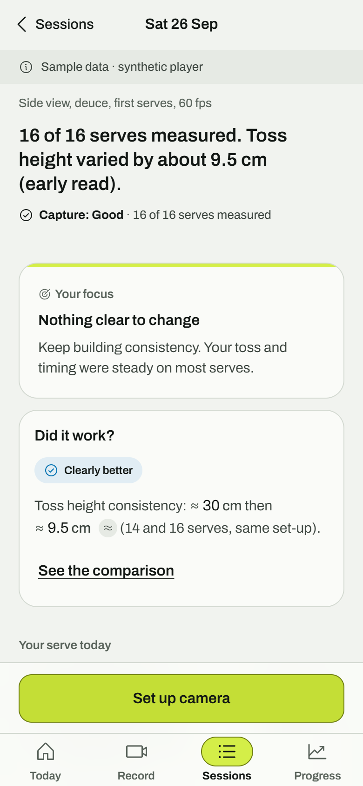
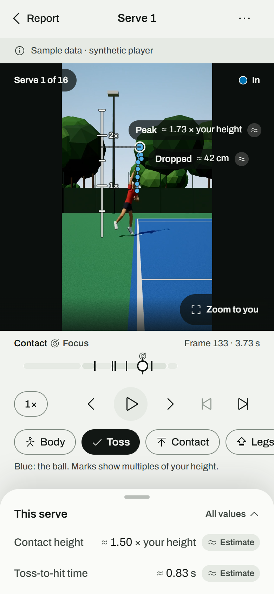
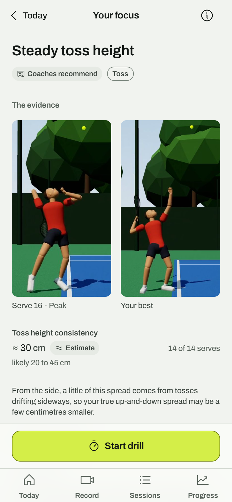
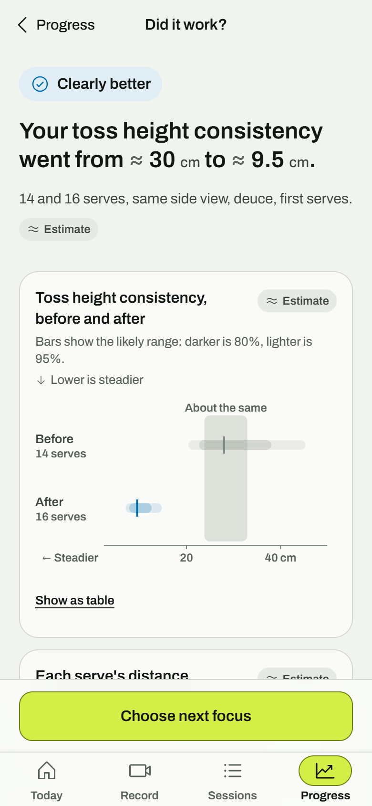

# Serve Coach

A calm, phone-first virtual serve coach for Australian recreational players (UTR 1–7), starting with adults who play weekly night comp or pennant.
You film your serve side-on with one phone; the app analyses it on the phone, labels every number honestly, and gives you one focus, one cue and one drill.
You practise, re-test, and the app answers "Did it work?" with a matched before-and-after comparison.

**Status (28 September 2026, the hardening commit after `33ac31f`):**
- **What exists:** a working web prototype (Vite, React 19, TypeScript, Tailwind v4) with a framework-free analysis engine, and a generated iOS shell that has never been built.
- **How it has been tested:** **all validation so far is on synthetic video; no real footage, real phone or radar has been used.** No serve metric is yet "measured"; the best label is "estimated".
- **Where to start:** [docs/FUNCTIONAL_STATUS.md](docs/FUNCTIONAL_STATUS.md), [docs/VALIDATION.md](docs/VALIDATION.md) and [docs/LIMITATIONS.md](docs/LIMITATIONS.md).

## Screenshots

From the end-to-end flows in headless Edge at 390 × 844 (synthetic player, `validation/results/ui/integrated/`, 110 images in light and dark):

| Session report | Serve detail, toss overlay | Focus with evidence | "Did it work?" |
|---|---|---|---|
|  |  |  |  |

More: onboarding (`light-a01`–`a05`), tagging (`a16`–`a17`), drill and practice log (`a20`–`a21`, `c07`–`c09`), Progress (`a22`, `c17`), import with the mount question and processing (`b01`–`b03`, `c12`–`c13`), Check this serve (`b06`–`b08`), Metric info and How we measure (`a15`, `a25`–`a28`), and every screen in dark (`dark-*`).

## Run it

**Prerequisites:** Node 24 or later; Microsoft Edge or Google Chrome (the scripts drive Edge through Playwright's `msedge` channel).

```sh
cd app
npm install          # also copies the MediaPipe WebAssembly runtime into public/mediapipe
npm run dev          # http://localhost:5173
```

- **Phone-sized view:** open http://localhost:5173 and switch DevTools to device mode at 390 × 844.
- **A phone on the LAN:** `npm run dev -- --host`, then open the printed network address. Plain `http://<LAN address>` is not a secure context, so the browser blocks the camera and WebCodecs there (the app says so on the camera screen, and analysis falls back to slower seek-per-frame decoding). For the camera and full-speed decoding, serve over HTTPS (for example Vite `server.https` with a locally trusted certificate). The desktop route is the reliable one today; no real phone has been tested yet.
- **Sample session:** finish onboarding and choose **See a sample session**, or use Profile → **See a sample session**. It is real engine output on synthetic clips, marked "Sample data · synthetic player".
- **Import a synthetic clip:** Record → **Import a video**.
  - Pick for example `validation/synthetic/clips/default75-s1/default75-s1.mp4` (one serve, D1 default set-up) or `validation/synthetic/clips/sample-checkin/sample-checkin.mp4` (16 serves).
  - In a dev build the Import screen also has a **Developer: synthetic clip** picker that loads clips from `/__synthetic/`.
  - Video files are not in git; generate them first (below). On a laptop, one serve takes about 13–17 s to analyse and a 16-serve clip about 2.5 minutes.
- **Check a serve by hand:** open a serve → More actions → **Check this serve**.
  - Mark the moments and points, then compare "App vs you".
  - The JSON export feeds `tools/validate/annotation-eval.ts` (below).

### Checks

```sh
cd app
npm test             # Vitest: engine project in Node, UI project in jsdom (1,091 tests in 115 files at the hardening commit, 28 September 2026)
npm run typecheck    # tsc -b
npm run lint         # oxlint --deny-warnings
npm run build        # tsc -b && vite build -> dist/
```

### Synthetic corpus (`tools/synth`)

The founder does not allow downloading real serve footage, so the engine is validated on rendered clips with exact ground truth. The generator has its own dependencies.

```sh
cd tools/synth && npm install && cd ../..
npx --prefix tools/synth tsx tools/synth/src/cli.ts --quick        # 3 short clips (about 30 s)
npx --prefix tools/synth tsx tools/synth/src/cli.ts --all          # full corpus, 124 clips (45-60 min)
npx --prefix tools/synth tsx tools/synth/src/verify.ts             # integrity check
```

Details: [tools/synth/README.md](tools/synth/README.md). The dev server also serves the corpus at `/__synthetic/` for the validation harness (`http://localhost:5173/validation.html`).

### Validation runs (`tools/validate`, run from the repository root)

```sh
node tools/validate/smoke.mjs                        # engine smoke run + privacy probe -> validation/results/smoke/
node tools/validate/smoke.mjs --full                 # also dumps per-frame data for the metric evaluation
app/node_modules/.bin/tsx tools/validate/metrics-eval.ts   # metric accuracy vs truth -> validation/results/metrics/SUMMARY.md
app/node_modules/.bin/tsx tools/validate/annotation-eval.ts <exports...>   # pooled "Check this serve" exports
                                                     # -> validation/real/<date>/ (agreement, bias, ICC, coverage)
```

Details: [tools/validate/README.md](tools/validate/README.md). The accuracy report built from these runs is [docs/VALIDATION.md](docs/VALIDATION.md).

### End-to-end flows and the sample session

```sh
cd app
npm run build && node scripts/integrated-flows.mjs   # flows A-C in light and dark -> validation/results/ui/integrated/
node scripts/build-demo.mjs                          # rebuilds public/demo from real engine output (needs the session,
                                                     # sample-checkin and sample-retest clips)
```

### iOS

`app/ios` is a generated Capacitor 8 project that has never been built. See [docs/IOS_ROUTE.md](docs/IOS_ROUTE.md) for what exists and the steps that need a Mac.

## Repository map

| Path | What |
|---|---|
| `app/src/analysis/` | Framework-free engine: video probe and decode, pose (MediaPipe, bundled), ball tracking, serve finding, metrics with honesty labels, statistics, pipeline. READMEs in each folder |
| `app/src/coaching/` | Coaching engine: safety gate, one focus per session, cues, drills, experiments, "Did it work?" |
| `app/src/data/` | Dexie (IndexedDB) schema, repositories, retention, deletion, export, sample data |
| `app/src/ui/` | Screens, components, charts, tokens ([app/src/ui/README.md](app/src/ui/README.md)) |
| `app/src/validation/`, `app/validation.html` | Dev-only harness that scores one clip against truth; `annotation/` holds the "Check this serve" marks, agreement statistics and export |
| `app/scripts/` | Integrated flows, sample-session builder, UI screenshots, MediaPipe copy |
| `app/public/models/`, `app/public/demo/` | Bundled pose models ([docs/MODELS.md](docs/MODELS.md)); the engine-built sample session |
| `app/ios/`, `app/capacitor.config.ts` | Capacitor iOS shell ([docs/IOS_ROUTE.md](docs/IOS_ROUTE.md)) |
| `tools/synth/` | Synthetic serve generator with exact ground truth |
| `tools/validate/` | Smoke run, metric evaluation, grid and noise studies, pooled annotation evaluation |
| `validation/synthetic/` | Corpus manifest and truth (videos ignored by git) |
| `validation/results/` | Smoke, metric and UI results, including screenshots |
| `DESIGN.md` | Visual source of truth |
| `docs/` | Product, decisions, specs, research and launch documents (below) |

## Documentation map

| Document | What it answers |
|---|---|
| [docs/PRODUCT.md](docs/PRODUCT.md) | Who it is for, the core loop, every screen, copy and success metrics |
| [docs/DECISIONS.md](docs/DECISIONS.md) | Product decisions D1–D11 that specs must follow |
| [DESIGN.md](DESIGN.md) | Visual design system |
| [docs/specs/METRICS.md](docs/specs/METRICS.md), `metrics.json` | Every metric, its method, status rules and validation protocol |
| [docs/specs/COACHING.md](docs/specs/COACHING.md), `coaching-library.json` | Focus selection, cues, drills, safety and referral copy |
| [docs/specs/CAPTURE.md](docs/specs/CAPTURE.md) | Filming set-up, live checks, import, native capture |
| [docs/specs/ARCHITECTURE.md](docs/specs/ARCHITECTURE.md) | Modules, pipeline, data, privacy, the iOS route |
| [docs/FUNCTIONAL_STATUS.md](docs/FUNCTIONAL_STATUS.md) | What works today, with status labels |
| [docs/VALIDATION.md](docs/VALIDATION.md) | How accurate each metric is on synthetic video, and how we know |
| [docs/LIMITATIONS.md](docs/LIMITATIONS.md) | What it cannot do or prove yet |
| [docs/NEXT_STEPS.md](docs/NEXT_STEPS.md) | Ranked next steps with success criteria |
| [docs/MONETISATION.md](docs/MONETISATION.md) | Australian pricing, costs, channels, gates, 12-month scenario |
| [docs/LAUNCH_AU.md](docs/LAUNCH_AU.md) | Dated path to an Australian App Store launch, legal and Apple requirements |
| [docs/IOS_ROUTE.md](docs/IOS_ROUTE.md) | The generated iOS project, Mac steps, native plugin plan |
| [docs/SOURCES.md](docs/SOURCES.md) | Consolidated bibliography, graded by evidence type |
| [docs/MODELS.md](docs/MODELS.md) | Bundled model files and hashes |
| `docs/research/01`–`10`, `docs/research/gaps/` | The research behind the decisions |

## Privacy stance

- **Nothing leaves the device.** Analysis, statistics and coaching run on the phone. There are no accounts, no sync, no analytics, no ads and no cloud AI (D8, D9).
- **Enforced by a Content-Security-Policy** in `app/index.html`: `connect-src 'self' blob: data:` blocks every third-party request.
- **MediaPipe's usage telemetry is blocked** by that policy and by a fetch guard in the pose worker. In the smoke run no request left the machine and 130 telemetry attempts were stopped inside the worker ([validation/results/smoke/SUMMARY.md](validation/results/smoke/SUMMARY.md)).
- **Models, runtime and fonts are bundled** and served from the app's own origin; no CDN.
- **Video only.**
  - The in-app recorder never records sound.
  - An imported clip has its sound track removed before a copy is kept (`app/src/data/stripAudio.ts`).
  - The optional hit-sound timing for imports keeps timestamps, not audio.
- **Validation exports stay in the player's hands.** A "Check this serve" export is a JSON file the person shares themselves. It has no video, images, names (initials only) or pain notes.
- **The player controls retention:** keep videos, auto-delete after 7, 30 (default) or 90 days, or delete after analysis; delete a serve, a session or everything; export JSON and CSV.
- **Pain notes stay on the phone** and act only as a referral switch, never a health record.

## Licence notes

- **This repository has no licence file.** Unless the owner adds one, treat the code and documents as all rights reserved.
- **Shipped third-party software** (listed in the app under Profile → About): MediaPipe Tasks Vision and the Pose Landmarker models (Apache-2.0, Google), Archivo typeface (SIL Open Font Licence 1.1), Phosphor Icons (MIT), React and React DOM (MIT), React Router (MIT), Dexie and dexie-react-hooks (Apache-2.0), Motion (MIT), Zustand (MIT), mp4box.js (BSD-3-Clause), Capacitor (MIT). **The full licence texts still have to ship with a release build.**
- **Development-only tools, never shipped:** `ffmpeg-static` (GPL-3.0-or-later; used by the synthetic generator and the sample-session builder), three.js (MIT; synthetic renders), Playwright (Apache-2.0), Vite and Vitest (MIT), TypeScript (Apache-2.0).
- **Coaching content** is written in our own words. Coaches and researchers are cited in [docs/SOURCES.md](docs/SOURCES.md), never reproduced, and citation does not imply endorsement.
