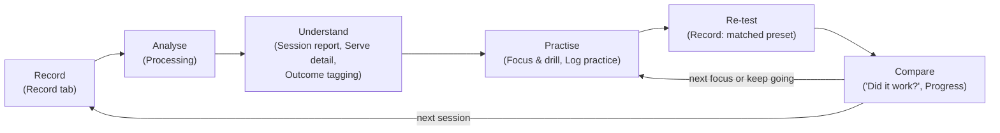

# PRODUCT.md: Serve Coach product spec and rationale (v1)

- **Status:** v1 product specification, written 27 September 2026 and revised the same day after the DECISIONS revision (see the revision log at the end), in Australian English.
- **Owner:** product. **Binding inputs:** `docs/DECISIONS.md` (D1–D11, with D1, D4 and D5 revised on 27 Sep 2026 and D11 added) and `docs/research/10-segment-decision.md`. The 27 Sep gap studies in `docs/research/gaps/` supply the numbers behind the revised decisions: side-view geometry (framing, tilt, what the side view can and cannot see), recreational reference ranges (provisional bands, plausibility bounds, capture envelope), Australian segment evidence, and the Intuitive Tennis and Kovacs primary content.
- **Read with:**
  - `docs/specs/METRICS.md` and `metrics.json`: metric definitions, labels, rounding and verdict rules.
  - `docs/specs/COACHING.md` and `coaching-library.json`: faults, cues, drills, priority, pain screen and the experiment loop.
  - `docs/specs/CAPTURE.md`: setup guide, live framing, quality checks and import.
  - `docs/specs/ARCHITECTURE.md`: engine, storage, deletion, export, demo mode and validation mode.
  - `DESIGN.md`: visual language, glyphs and tokens. This spec never sets colours or type.
- **What this document owns:**
  - who the product is for and why;
  - positioning;
  - jobs to be done;
  - the loop and information architecture;
  - v1 scope, including Free and Plus;
  - every screen's purpose, content, primary action and states;
  - the key flows;
  - tone of voice;
  - success metrics and instrumentation;
  - a summary of the Australian monetisation plan.

  Where another spec owns a rule, this document points to it rather than restating it. **If they disagree, the owning spec wins**, and §12 lists the disagreements found.
- **Evidence labels:**
  - **[Established]:** a peer-reviewed finding or strong consensus.
  - **[Coaching interpretation]:** expert practice that has not been directly proven.
  - **[Vendor claim]:** what a company says about its own product.
  - **[Market data]:** prices, counts and dates.
  - **[Regulation]:** a law or platform rule.
  - **[Our inference]:** our own reasoning, including every target and threshold here that cites no source.

  Research is cited as (research NN [Sx]), meaning source x in `docs/research/NN-*.md`. "Segment decision §n" means `docs/research/10-segment-decision.md`. Gap studies are cited by short name: "gap geometry §n" (`gaps/side-view-geometry-contradictions.md`), "gap ranges §n" (`gaps/recreational-reference-ranges.md`), "gap segment §n" (`gaps/australian-segment-evidence.md`) and "gap Kovacs §n" (`gaps/intuitive-tennis-kovacs-primary-content.md`).
- **Metric ids.** These are the canonical shared ids and are used exactly as spelled:
  - `serve-count`
  - toss: `toss-apex-height`, `toss-forward`, `toss-drop`, `toss-height-spread`, `toss-forward-spread`
  - contact: `contact-height-ratio`, `contact-forward`
  - rhythm: `rhythm-release-to-contact`, `rhythm-spread`, `trophy-pause`
  - leg drive and loading (side view): `leg-drive` (hip rise from the lowest point to contact, as % of height), `drive-time`, `loading-depth` (descriptive hip drop, never a "bend more" instruction), `deep-bend-flag` (experimental)
  - posture bands: `shoulder-tilt-trophy` (side view, player-relative band); `knee-bend-band` and `shoulder-over-shoulder-contact` (**view from behind only**; the second is experimental)
  - landing: `landing-distance`
  - `repeatability`
  - outcomes: `serve-in-rate`, `first-serve-in-rate`, `double-faults`, `placement-zone`, `serve-type-mix`
  - speed and spin: `speed-experimental` (side view, ≥ 120 fps, target tag), `speed-average-rear` (view from behind, experimental), `speed-radar-entered`, `spin` (always unavailable)
  - `capture-quality`

  **Removed:** `trunk-tilt-band`, replaced by `shoulder-tilt-trophy`. `knee-bend-band` is never a side-view metric (D1, D5).

  METRICS.md adds `second-serve-in-rate`, `contact-height-spread`, `retoss-count`, `toss-lateral`, `toss-lateral-spread`, `fatigue-flag` and `load-flag`. The match-log ids in §6.11 are proposals for METRICS.md to confirm.

---

## 0. Summary

**The product.** Serve Coach is a calm serve coach on the phone for adult recreational players.
- A player stands one phone beside the court, side-on (by default upright on a tripod 1.3–1.6 m high, 7–8 m out from the centre mark, between courts or just outside the doubles alley), and serves a block of about 15.
- On the phone, the app finds each serve and measures what the side view can credibly see:
  - toss height and forward placement, and how repeatable they are;
  - contact height;
  - rhythm;
  - leg drive (how far the hips rise into the ball, and how quickly);
  - landing.

  It says plainly what the side view cannot see: knee bend and shoulder tilt at contact need a view from behind (D1).
- The player logs whether each serve went in.
- The app picks **one** change, with one cue and one 5–10 minute drill.
- The player practises it and records a matched re-test. The app then says honestly whether it worked.

**Who it is for first.** "Comp-night regulars" (D11; segment decision §1):
- adults of about 30–55 who play a weekly night comp or pennant, at a UTR of about 3–7 or unrated;
- their serve lets them down on match night: too few first serves in, and double faults in front of their team;
- the launch starts in metro Melbourne.

The secondary segment is improving adults who book courts but do not play comp. Coaches who teach comp adults are the lead channel.

**The promise, in the player's words.**
- "A toss you can trust, fewer double faults, and proof that what I practised made a difference."
- We lead with toss consistency because it is what one side-on phone measures best (D1, D5). It is also where the Kovacs Institute locates most serve problems: a Kovacs Institute team post reports Dr Kovacs's observation that over 80% start at release or loading (research 04 [S14]; gap Kovacs §3) [Coaching interpretation]. That is a claim about where faults start, not evidence that fixing the toss fixes a second serve (§13 item 6).

**What makes it different** [Our inference, from research 01 §13]:
1. It is the only serve product we found that links mechanics to logged outcomes for the same serves. An example is "your serves that went in had the toss further forward". It then tests one change with a matched re-test.
2. Every number carries an honesty label (measured, estimated, player-entered, experimental or unavailable) and its n (D2, D7).
3. It is designed for one phone on a tripod beside the court (or at the side fence), not an elevated rear camera.
4. It needs no account and uploads nothing: analysis runs on the phone (D8).
5. It costs A$99.99 a year, one-third of SwingVision Pro (research 08 §6).

**What it deliberately does not do in v1.**
- No precise speed and no spin (D4). No speed from the sound of the bounce in the side view.
- No grip, racquet-path, racquet-drop or joint-angle numbers (D5). No knee-bend band from the side view, and no comparison with published trunk angles (D5).
- No composite "serve score" (research 09 §12).
- No comparison with professionals.
- No accounts, cloud or social features.
- No juniors in the closed beta.
- No match tracking.

The full list is in §5.4.

**Shape of v1.** v1 is a phone-first PWA with a credible route to iOS through a Capacitor shell (D9; ARCHITECTURE §15).
- **IA:** four tabs (**Today, Record, Sessions, Progress**) plus a profile sheet (D10).
- **Free, "Serve Check":**
  - the first full loop (baseline, practice, re-test, verdict) free;
  - then 2 analysed practice days a month;
  - every measurement, from the side view and from the optional view from behind, with trends over the last 30 days;
  - safety, labels, export and deletion always free.
- **Paid, "Serve Coach Plus":**
  - A$14.99 a month or A$99.99 a year, with a 7-day trial on the annual plan;
  - a A$39.99 season pass to test.

**Honest status of the numbers at launch.**
- No real serve footage has been analysed yet. Validation is synthetic only: the founder did not allow downloading real footage.
- METRICS.md therefore caps every metric at `estimated` until a real-footage study passes (METRICS §1.3). The exceptions are the serve count and the session quality flags (`capture-quality`, `load-flag`), which stay `measured`.
- The product shows this with a separate **validation note**: "Checked on simulated serves, not yet on real courts". It appears on every metric's info sheet and on the report footer. §13 explains why this sits beside the D2 label rather than replacing it.

---

## 1. Who it is for

### 1.1 Primary segment: comp-night regulars

D11 fixes the segment: adults of about 30–55, UTR about 3–7, who play weekly night comp or pennant, starting in metro Melbourne; solo court-bookers are secondary; coaches are the lead channel, not a paying segment; juniors, masters-specific features and speed-seekers are deferred; the closed beta is 18+. The national pool of graded adult team players is about 35,000–60,000, of whom roughly 25,000–45,000 are likely to be UTR 3–7 (gap segment §1) [Our inference; medium confidence on the order of magnitude, low on the bounds].

**Operational definition, computed at onboarding** (segment decision §2.1). A player is *in segment* when all four hold:
1. They are 18 or over.
2. They choose any competition option (pennant, night comp or association, or another league) in "How do you play?".
3. Their UTR is 3.0–7.0 or left blank.
4. Their answer to "What costs you points on serve?" maps to `second-serve-reliability` or `first-serves-in`.

The flag is stored on the device and reported with usage counts where the player has consented (§9). It is how we measure the segment's real size instead of assuming it (segment decision §5).

**Persona (a composite, not a real person).** Each point below is summarised from segment decision §2.2.
- **Plays:** one weekly doubles-heavy association night fixture, a UTR-graded pennant, or both.
  - WDTA night tennis runs Monday to Thursday from 7:30 pm (segment decision [N3]) [Market data].
  - Victorian Pennant had 419 teams from 135 clubs in 2025 (research 02 [S13]) [Market data].
- **Already pays:**
  - club membership;
  - light money: WDTA charges A$8 per person per week for doubles ([N3]) [Market data];
  - court hire of A$20–46 an hour (research 02 [S26][S40]);
  - occasional lessons: a 30-minute private costs A$60–70 in Melbourne (research 02 [S24][S25]) [Market data].
- **Practises:** alone with a basket, in a 30–60 minute booked slot. How often comp players actually practise serves alone is **unknown** (research 02 open question 4). It is the first test in segment decision §9.
- **Pain:** double faults and a low first-serve percentage in front of partner and team, every week.
  - SwingVision's match data show first-serve-in at about 53–56% and 3.2–3.7 double faults a match, almost flat from NTRP 3.0 to 5.0 (research 01 [S7]) [Vendor claim; mostly US match play].
  - That the pain is felt socially is [Our inference].
- **Body:** some carry shoulder or elbow complaints (research 03 §11). Hence the always-on pain gate and referral (D6, D8).
- **Coach:** often has or had one, and may already be getting advice. Hence "My coach's focus" (§6.8).

**The questions they bring** (segment decision §2.3; §3 maps each to a screen):
1. "Is my toss becoming more consistent?"
2. "Am I getting more first serves in?" and "Is my second serve safe?"
3. "Did this change improve my serve?"
4. "Did it show up on comp night?"

### 1.2 Secondary segment: solo court-bookers

**Who they are:** improving adults of about 30–55 who book courts or hit socially but play no organised comp. They are about UTR 1–4 or unrated.

**What changes for them.** It is the same product with no extra build (segment decision §8):
- the UTR 1–3 coaching band, which uses analogy cues (COACHING §9.1);
- the `first-serves-in` goal;
- the Check-in template.

They get no match log hook. Their retention hook (a personal best for toss consistency and a monthly re-test) is to be designed after the beta [Our inference].

### 1.3 Coaches: the lead channel, not a paying segment

- Coaches who already pay A$30–60 a month for OnForm will not pay again for serve analysis (research 08 §2.4). The model is therefore free for the coach, with the student paying [Our inference].
- In v1 the coach relationship works through two things:
  - **export**: a one-page session summary, key frames and CSV through the share sheet (D8; segment decision M12);
  - **"My coach's focus"** (§6.8).

  In the native app, Apple offer codes add one free month for a coach's students (research 08 §6).

### 1.4 Boundaries

- **Adults only in the closed beta.**
  - Onboarding asks "Are you 18 or over?", and a "No" ends onboarding politely (§6.1).
  - Public-release handling of under-18s waits for the privacy owner's call, once the Children's Online Privacy Code commencement date is known. The Code must be registered by 10 December 2026 (research 07 §3) [Regulation].
  - The under-18 coaching safeguards already specced (COACHING §9.4) stay in place for that release.
- **Deferred as targets:**
  - parents of juniors;
  - masters as masters (the pain gate serves them; there are no masters-specific features);
  - regional players as a stand-alone launch (they join through Country Week and regional associations as a sub-cohort);
  - speed-seekers;
  - FIFO workers.

  See segment decision §11.

### 1.5 Why this product for this segment

The argument, step by step:
1. **The problem is reliability, not pace.** Their stakes are double faults and first serves in, every week (segment decision §2.2). An honest "speed unavailable" (D4) costs little with them [Our inference].
2. **Reliability starts at the toss, and the side view sees the toss well.**
   - Experienced servers stabilise the vertical dimension of the toss (research 03 [S29]) [Established].
   - Changing only the tossing-arm timing cut target accuracy from 87% to 17% and 10% in high-performance men (research 03 [S27]) [Established, small n].
   - The Kovacs Institute puts "probably over 80%" of serve problems at the release and loading stages. The source is a Kovacs Institute team post reporting Dr Kovacs's observations, not his own writing (research 04 [S14]; gap Kovacs §3) [Coaching interpretation]. It says where faults tend to start; it is not evidence that a toss fix repairs a flat second serve.
   - Toss apex, forward placement and drop are exactly what D1's side view measures without court calibration. Two honest limits: absolute toss height is `estimated`, because a toss 0.3 m nearer the camera than the body reads about 8–12 cm high; and side-view height spread includes about 2–4 cm of false spread per 10 cm of sideways toss spread (D1; gap geometry §6.7). The consistency copy says so.
3. **Their incumbent option measures outcomes, not causes.**
   - SwingVision reports in/out, placement and average speed from an elevated rear camera (research 01 §3.2).
   - We found no toss or phase metrics in it; its blog tells players to *watch* for toss drift (research 01 §3.7).
   - A double-faulter already knows the ball went out. What they lack is why, and one thing to change [Our inference].
4. **Human feedback on the serve is expensive and scarce.**
   - A 30-minute private costs A$50–85 (research 02 §5.2).
   - None of the Australian coaching providers sampled advertises standalone video analysis (research 08 §2.5) [Market data; small sample].
   - Expert serve review is offshore at US$299–499 (research 04 [S2][S21]).
5. **They can check the value themselves.**
   - A 20-second match log the morning after comp night sits beside measured practice metrics. That makes "Did it work?" tangible without asking them to trust a black box (segment decision §4.2) [Our inference].
   - The match log is never pooled with practice statistics (segment decision M6).
6. **Honesty is a reason to buy in a sceptical category.**
   - AI apps churn 30% faster (research 08 [S63]) [Market data].
   - Most 2024–26 AI tennis apps publish no validation (research 01 §7).
   - Key-frame evidence, labels and plain statements such as "we don't measure speed from this view" should read as credible to a practical club player [Our inference; test in the beta].

**What could make this wrong** (segment decision §9 has the full list with cheap tests):
- comp players rarely practise serves alone (test 1);
- the link between mechanics and outcomes comes back null (test 4). It is a real possibility, because good and faulted serves had near-identical toss values in ranked juniors (research 03 [S28]);
- the side view misses the real second-serve fix (test 5), or D6's stage-first ranking keeps it from ever being chosen (§13 item 6).

---

## 2. Positioning

### 2.1 Positioning statement

> For adult comp players whose serve lets them down on match night, **Serve Coach** is a serve coach on your phone. It shows what your toss and contact are really doing, picks the one change most worth practising, and tells you honestly whether it worked. Unlike tools that only count where your serves land, it reads your serve from one phone beside the court, side-on, labels every number with how it was measured, and keeps everything on your phone.

**Lead lines** (App Store, onboarding, landing page) follow segment decision §7.2:
- "A toss you can trust."
- "Fewer double faults."
- "One change. Did it work?"

We never lead with speed, AI or accuracy claims.

### 2.2 Against SwingVision (the incumbent)

| | SwingVision (research 01 §3) | Serve Coach v1 |
|---|---|---|
| Core question | What happened: in/out, placement, average speed | Why it happened (toss, contact, rhythm), what to change, and whether the change worked |
| Camera | One camera behind the baseline, at least about 1.5 m high (setup wording UNVERIFIED, research 01 §3.2) | One phone beside the court, side-on, on the hitting-arm side. Default: upright (portrait), 7–8 m from the centre mark, 1.3–1.6 m high, level. Alternative: landscape at the side fence, 8.5–9.5 m out, 1.4–1.8 m high, 4K preferred. A framing rule, not a fixed distance, decides: the frame must reach at least 4.5 m above the court at the server (D1; CAPTURE §2). An optional raised view from behind unlocks toss drift, knee bend, shoulder tilt at contact and experimental outcomes |
| Serve mechanics | None found (research 01 §3.7) | Toss apex, forward placement, drop and spread; contact height and forward position; rhythm; leg drive (hip rise and drive time); landing; shoulder tilt at the trophy position as a band with a key frame. From behind: toss left–right, a knee-bend band and (experimental) shoulder tilt at contact |
| Outcomes | Automatic, from the rear view | Player-tagged in the side view (D3), fast tagging or a tally. Experimental suggested tags from the view from behind |
| Speed | Average ball speed over the flight, which is not radar-comparable (research 01 [S5]) | `unavailable` by default. An experimental range only when its prerequisites hold (D4): near-contact speed from the side view at ≥ 120 fps with a target tag, or average speed to a bounce located in the view from behind. Never from sound alone. Radar readings can be entered |
| Coaching | "AI Coaching" on Max; content UNVERIFIED (research 01 §3.3) | One focus, one cue and one drill per session, with evidence and a matched "Did it work?" (D6) |
| Honesty | Vendor claims "within about 10%" for speed at a correct setup (research 01 [S6]) [Vendor claim] | Labels on every number, n, intervals, a validation note, and a public "How we measure" page |
| Data | Cloud processing; one report of half a match lost during upload (research 01 [S1]) | On the device; no upload; export and deletion always free (D8) |
| Price (AU, yearly) | A$149.99 / A$299.99 / A$499.99 (research 01 [S1]) | A$99.99, plus a A$39.99 season pass to test |
| Free tier | 8 HD hours of recording a month since February 2026 (research 01 [S2]) | The first loop free, then 2 analysed practice days a month, with every measurement from either view |

**How we talk about SwingVision** [Our inference]:
- Never by name in-app.
- In market copy, only as a category: "apps that count where serves land".
- Players who use both are welcome. The two views answer different questions, and a player can enter SwingVision or radar outcomes as player-entered values.

**Threat** (research 01 §14): SwingVision adds pose-based serve analysis. Our response is:
- serve-specific depth;
- the mechanics-to-outcome loop;
- visible honesty;
- the one-phone, side-on set-up beside the court;
- price;
- Australian channels.

We monitor its release notes monthly (segment decision §9, test 14).

### 2.3 Alongside coaches

We position as **"homework between lessons"**, never as a replacement for a coach.
- The evidence supports the complement framing: video feedback added no benefit over traditional coaching in intermediate players (research 04 [S57]) [Established, older RCT]. Visual plus verbal feedback beats verbal alone (research 04 [S56]) [Established].
- **"My coach's focus"** (§6.8; segment decision M8):
  - The player can pin the focus their coach gave them, chosen from the library.
  - The engine keeps it as the active focus and still reports the evidence.
  - The safety gate still applies.
  - The engine's own pick appears only under "Also noticed".
- **Export** of a one-page summary, key frames and CSV works with the tools coaches already use: OnForm, CoachNow and Kinovea (research 01 §4).
- **Copy rule:** never "your coach is wrong". If the engine's pick differs, say "Your coach's focus comes first. We also noticed…".

### 2.4 Against the AI technique apps

The apps are ServeAI, Toach, TENNIS AI 2.0 (Axel AI), NiceShot, Shot AI, AXIFY and others (research 01 §7). They show skeletons and scores, publish no validation, and give no outcome statistics. ServeAI's "one cue, one drill" is the closest concept; its price and accuracy are unknown (research 01 [S28]).

We differentiate on four things:
- **Outcomes linked to mechanics:** the D3 signature insight (§6.5).
- **Honesty:** labels, n and intervals; no composite score; no joint-angle numbers.
- **Proof of change:** matched re-tests with verdicts in words.
- **A published "How we measure" page:** method, prerequisites, typical error and validation level for every metric (research 01 Implication 7).

### 2.5 Against speed tools and radar

- Speed is not our game. Radar (Pocket Radar ±1 mph [Vendor claim]; research 01 [S46] validation) and sound-plus-video apps already exist.
- We accept a radar reading as `speed-radar-entered` (player-entered). Paired readings become validation data (D4).
- We never estimate speed from the sound of the bounce in the side view. The bounce is out of frame and its distance unknown, so the error is about ±20% (a 90% interval of −17% to +23%) even with a target tag (D4; gap geometry §7). Audio, when the player opts in, only times contact; it becomes timestamps on the phone and the sound is not kept.
- If a UTR 5–7 player asks for speed, we show the radar-entry path and the experimental range rules. We do not show a guessed number (segment decision §9, test 12).

### 2.6 Claims we make and claims we never make

| We say | We never say |
|---|---|
| "Measured on your phone from one side-on video" | "Accurate", "precise", "lab-quality", "AI-powered biomechanics" |
| "Checked on simulated serves; real-court check in progress" | Any accuracy percentage we have not validated |
| "Your serves that went in tended to have…" (association) | "This caused your double faults" (causation) |
| "Coaches recommend…" / "Research on skilled players links…" | "Proven to improve your serve" |
| "If something hurts, stop and see a physio or GP" | "Prevents injury", "protects your shoulder", any diagnosis word |
| "Speed isn't available from this view" | A km/h figure without its prerequisites and label |
| "Knee bend needs a view from behind" | A knee angle or a "bend more" instruction from the side view; any trunk angle set against published values (48°, 25°) (D5) |
| "Everything stays on this phone" | "Private" without saying what that means |

These follow research 07 §8 on TGA and the ACL, App Store guideline 1.4.1 (research 09 §12), and COACHING §14.

---

## 3. Jobs to be done and the questions we answer

### 3.1 Jobs

- **Main job.** *When my serve lets me down on match night, help me find the one thing most worth fixing, practise it on my own at a local court, and see whether it's working, so I can serve with confidence next week.*
- **Related jobs:**
  - *Before a session:* tell me how to set up my phone so the footage is good enough, quickly and alone.
  - *After a session:* show me what happened on each serve, with the evidence, not just a verdict.
  - *During practice:* give me something short and concrete to do for 5–10 minutes with a basket.
  - *On match day:* remind me of my cue without giving me something new to think about.
  - *With my coach:* let me show them what I'm working on.
- **Emotional jobs:**
  - Feel in control of an unreliable shot.
  - Don't make me feel judged or nagged.
  - Don't waste a court booking.
  - Don't tell me things you can't know.

### 3.2 The questions, and where each is answered

| Question | Where | Metric ids | Label today | Minimum data before we answer (owner) |
|---|---|---|---|---|
| "What happened in this session?" | Session report headline | lead stratum metrics, `capture-quality` | estimated / measured | 5 measured serves for any observation (CAPTURE §5.3) |
| "Is my toss becoming more consistent?" | Progress tile 1; report hero row | `toss-height-spread`, `toss-forward-spread` (view from behind: `toss-lateral-spread`, experimental today) | estimated (target measured) | Spread shown as an "early read" from 8 serves; a trend verdict needs ≥ 3 matched sessions (METRICS §4.1, §4.6) |
| "Am I getting more first serves in?" | Progress tile 2; report outcome row | `first-serve-in-rate` | player-entered | Rate with a band from 10 serves. A verdict usually needs far more serves than one session: about 389 per period to detect 10 points (research 06 §7.1). We say so |
| "Is my second serve safe?" | Progress tile 2 (goal-ordered); report | `second-serve-in-rate`, `double-faults` | player-entered | As above |
| "Why did I miss?" | Signature insight card (report) | the METRICS §4.7 family: toss, contact, rhythm, landing | estimated + player-entered | ≥ 6 tagged ins and ≥ 6 tagged misses in one stratum; shown only when the 99% interval excludes 0 and the difference ≥ SWC (METRICS §4.7) |
| "What should I work on?" | Focus card (Today, report) | per COACHING §5.2 | estimated / player-entered | COACHING §6–7 |
| "Did this change improve my serve?" | "Did it work?" (Compare) | the focus item's primary metric | estimated | ≥ 8 included serves each side (METRICS §4.5). COACHING §12.3 asks for 12; see §12 |
| "Did it show up on comp night?" | Progress tile 5 (season view) | proposed match-log ids (§6.11) | player-entered | Plotted by season week; **never pooled** with practice and **never given a verdict** (segment decision M6, §7.2) |
| "How high do I hit?" / "Is my rhythm steady?" | Progress tile 4; report | `contact-height-ratio`, `rhythm-spread`, `rhythm-release-to-contact` | estimated | as METRICS §4.1 |
| "Am I using my legs?" | Report hero row; Progress tile 4 detail | `leg-drive`, `drive-time` (with `loading-depth` as a description) | estimated | Value from 5 measured serves; the low / typical / high band is against the player's own serves and needs 2 matched sessions (gap geometry §5) |
| "How hard am I serving?" | Speed row | `speed-experimental` (side), `speed-average-rear` (from behind), `speed-radar-entered` | unavailable by default; experimental range only when prerequisites hold | D4; METRICS §3.22 |
| "Am I doing too much?" | Today note; Progress detail | `load-flag`, `fatigue-flag` | measured / estimated | METRICS §4.8; COACHING §11 |

### 3.3 Questions v1 cannot answer, and what we say instead

| Question | What the player sees | Why |
|---|---|---|
| "How much spin?" | "Spin can't be measured from phone video." Always `unavailable` | D4; research 05 |
| "How fast?" (no radar, or prerequisites unmet) | "Speed isn't available from this footage. Record at 120 fps or more and tag your target, or enter a radar reading." | D4 |
| "How much do I bend my knees?" (side view) | "Knee bend needs a view from behind. From the side your knees point at the camera. Here's how far your hips dropped and how much they rose into the ball." | D1, D5; from the side a deep bend usually reads as little or moderate (gap geometry §3) |
| "Do I tilt shoulder over shoulder at contact?" (side view) | "Shoulder tilt at contact needs a view from behind." | D1, D5 (gap geometry §4) |
| "Is my grip right?" / "What's my swing path?" / "Racquet drop?" | Not offered. The double-fault focus says: "Grip and swing direction are best seen from behind." It offers the view from behind as a video to watch, not a measurement | D5; COACHING §5.3; segment decision M7 |
| "Where did my serves land?" (side view) | "Where serves land: add a view from behind" (unlock hint) | D1, D3 |
| "Is my toss drifting left or right?" (side view) | "Left–right needs a view from behind" | METRICS §6 limitation 1 |
| "How do I compare with pros or my level?" / "Is my trunk angle right?" | Not offered. Comparisons are always with the player's own serves. Provisional club-player bands appear only as context on the info sheet (§4.4 rule 9), and no band is set against published trunk angles | COACHING P12, §8.1; D5 |

---

## 4. The core loop and information architecture

### 4.1 The loop



| Stage | What the player does | What the app guarantees | Primary screen | Target time [Our inference, except where cited] |
|---|---|---|---|---|
| **Record** | Chooses a template, sets up the phone, serves a block of about 15 | One instruction at a time until "Ready"; "Record anyway" is always available and downgrades labels honestly (CAPTURE §9.8) | Record → Live framing | Set up to "Ready" in ≤ 2 min on the second session |
| **Analyse** | Waits, or looks at the first finished serve | Staged, determinate progress; cancel and resume; nothing leaves the phone | Processing | ≤ 90 s for a 2-minute 60 fps clip on an A16-class phone; first serve viewable ≤ 30 s (ARCHITECTURE §5.11 budgets, unmeasured on device) |
| **Understand** | Reads one headline, tags outcomes, opens the evidence | One sentence first; every number labelled with n; evidence frames of their own serves | Session report → Serve detail; Outcome tagging | Headline read in < 5 s; tagging ≤ 2 s per serve (segment decision M4) |
| **Practise** | Does the drill with a timer, logs it | One cue, one drill, 5–10 minutes, solo with a basket (D6) | Focus & drill | Practice log in about 10 s (COACHING §12.2) |
| **Re-test** | Records the same stratum after warming up, before the drill | Preset pre-filled and locked to the matched stratum | Record (re-test template) | As Record |
| **Compare** | Reads the verdict | Words first; before/after dot plots on one axis; "about N more serves" when unsure; never a verdict from unmatched data (D7) | "Did it work?"; Progress | Verdict read in < 5 s |

**The loop is an experiment** (D6; COACHING §12). A focus stays active until:
- it is resolved;
- it is parked after 3 re-tests with no change; or
- it is superseded by a major earlier-stage fault.

The safety gate always overrides it.

### 4.2 Mapping to the D10 information architecture

| D10 place | Loop stages | What lives there |
|---|---|---|
| **Today** (tab 1, default) | Practise, Re-test, Compare | Focus card (cue, drill, log, re-test); last session headline; baseline progress; pre-match card on match nights; morning-after match log prompt; processing status; pain-pause card |
| **Record** (tab 2) | Record | Templates (Re-test when due, Check-in, Second-serve check-in, Experiment, Both sides, View from behind); setup guide; live framing; recording; tally; import |
| **Sessions** (tab 3) | Analyse, Understand | Session list → Session report → Serve detail → Compare (serve-level); Outcome tagging; the per-session "Did it work?" card |
| **Progress** (tab 4) | Compare | Question tiles (toss consistency, first serves in or second serve, Did it work?, contact and rhythm, comp nights); trend detail; experiments; Compare sessions |
| **Profile sheet** (avatar, top right) | none | Your serve (height, hand, level, goal, comp nights, season); comfort; coach; storage & privacy; how we measure and how we coach; experimental toggle; plan; export; sample data; about |
| **Sheets** (from anywhere) | none | Metric info sheet; Why this focus?; Match log; Body check and referral cards; Paywall; Practice log |

**Tab-bar rules:**
- Single-word labels; no "More" tab (research 09 §13.1, HIG).
- Tabs are for navigation, not actions. The Record tab is a destination (templates and setup), not a shutter button.
- Whether a Record tab outperforms a single button on Today is research 09 open question 3. We test it in the beta by comparing first-week activation against a build variant [Our inference].

### 4.3 Navigation map

```
Onboarding (first run only) ─▶ Sample session (optional) ─▶ Today

Today
 ├─ Pain-pause card ─▶ Referral card ─▶ "It's settled" (next body check)
 ├─ Processing card ─▶ Processing ─▶ Session report
 ├─ Pre-match card (match nights) ─▶ Warm-up routine
 ├─ Match log prompt (morning after) ─▶ Match log sheet
 ├─ Focus card ─▶ Focus & drill ─▶ Drill player ─▶ Practice log
 │               └─ Why this focus? · Try the other cue · My coach's focus
 ├─ Re-test prompt ─▶ Record (re-test template, pre-filled)
 └─ Last session headline ─▶ Session report
Record
 ├─ Template ─▶ Block card ─▶ Body check ─▶ Setup guide ─▶ Live framing ─▶ Recording ─▶ Tally ─▶ (Tag now?) ─▶ Processing
 ├─ Import a video ─▶ Probe summary ─▶ Questions ─▶ Processing
 └─ Setup guide · Filming at the courts
Sessions
 └─ Session report
     ├─ Focus card (same as Today) · Signature insight · "Did it work?" card
     ├─ Stats rows ─▶ Metric info sheet
     ├─ All-serves strip ─▶ Serve detail ─▶ Compare (best serve | last session | before experiment)
     ├─ Tag serves ─▶ Outcome tagging
     └─ Share with coach · Delete
Progress
 ├─ Question tiles ─▶ Trend detail ─▶ Compare sessions
 ├─ Did it work? ─▶ Experiment list ─▶ Experiment result
 └─ Comp nights (Plus) ─▶ Season view ─▶ Match log entries
Profile sheet
 └─ Your serve · Comfort · Coach · Storage & privacy · How we measure · How we coach
    · Experimental metrics · Plan · Export · Sample data · About
```

### 4.4 Global product rules (apply on every screen)

1. **No unlabelled number** (D2).
   - Every value shows its label: measured, estimated, player-entered, experimental or unavailable. Each label has a glyph and a text chip, as defined in DESIGN.md.
   - Dense lists may use the compact chip, but never omit it.
2. **n on every rate and spread.** Say "12 of 15 serves measured" (D7; METRICS §1.5). Rates under 10 serves show counts only, for example "7 of 9 in" (METRICS §4.1).
3. **Words before numbers.** Verdicts and headlines are sentences. Numbers support them.
4. **One focus.** Nothing competes with the focus card's primary button (research 09 pattern 19).
5. **Matched comparisons only.** Same view, camera side, court side, serve number, intended type and handedness (METRICS §4.4). Unmatched comparisons say why and offer the nearest matched one.
6. **Experimental stays out of the story.** Experimental values never appear in headlines, focus explanations, verdicts or Progress tiles. They show only with the experimental toggle on (D2; METRICS §1.5).
7. **Provisional stays out of headlines.** "Early read" values are never used in a headline, with one exception from METRICS §4.1: a provisional spread from 12 or more serves may headline, labelled "early read" and with its interval ("about 30 cm (early read, likely 20 to 45 cm)").
8. **Colour is never the only signal.** Outcomes use shapes (● in, ▲ net, ✕ long or wide, ○ untagged). Verdicts use words. Nothing is signalled by red alone (research 09 §10).
9. **Own serves only.** Comparisons are with the player's own serves, never with a professional or a population norm (COACHING §8.1). Reference bands, where shown, name their population and are labelled "context, not a target".
   - The provisional recreational bands (gap ranges §7, UTR 1–7) may appear on the Metric info sheet as "Typical for club players (provisional)". They use words such as tight / typical / scattered, never good / bad, and a player's band label changes only when the estimate crosses an edge by more than the stated margin (hysteresis).
   - `shoulder-tilt-trophy` and `leg-drive` bands are **player-relative**: low / typical / high against the player's own serves. Until 2 matched sessions exist, the band is the session's own spread and says so.
   - No band is ever compared with published trunk angles (for example 48° or 25 ± 7°), because their definitions differ from any 2D angle (D5; gap geometry §4). Professional leg-drive values measure centre-of-mass rise, a different quantity from hip rise, so they are not shown either.
10. **The paywall never interrupts safety, capture or a verdict.** It never blocks access to data the player already has, export or deletion (§10).
11. **Sample data is always labelled.** A persistent "Sample data · synthetic player" banner appears. Sample data never enters Progress, experiments or exports by default (ARCHITECTURE §11).
12. **Every number respects METRICS §4.9 display precision.** No figure shows more precision than half its 95% interval supports.
13. **Say what this view cannot see.** A side-view report never shows a knee-bend band, a knee angle or shoulder tilt at contact. It shows "Needs a view from behind" instead (D1). Loading depth (hip drop) is a description, never a "bend more" instruction, and no screen asks for a bigger jump (D5; gap Kovacs §5 T1).
14. **Statistics are never mixed across views** (D1). A side-view session and a view-from-behind session are never pooled or compared with each other.

---

## 5. v1 scope

### 5.1 Capability status at launch

This is the product's statement of what each metric is, not a report of what the build has implemented; the build report states that. "Today" is the highest label the engine may emit at validation level V1, which means synthetic validation only (METRICS §0, §1.3). METRICS.md owns the final labels; where this table and METRICS disagree, METRICS wins and §12.2 records the difference. **No v1 metric uses an external service at runtime.** There is no cloud AI, no analytics SDK and no CDN. MediaPipe models are bundled and its telemetry is blocked by the CSP (D8; ARCHITECTURE §9).

"Side" is the D1 side view; "behind" is the optional raised view from behind the server (D1's second angle). Heights and angles are computed on tilt-corrected keypoints; when the phone's tilt is unknown (most imports), height and angle metrics are capped at `estimated` with the reason "tilt unknown" (D1; gap geometry §6.6).

| Metric id | Player-facing name | Views | Label today | Target after validation | Where shown | Tier |
|---|---|---|---|---|---|---|
| `serve-count` | Serves | side, behind | measured | measured | Every report header | Free |
| `capture-quality` | Capture quality | side, behind | measured | measured | Under every headline | Free |
| `toss-height-spread` | Toss height consistency | side, behind | estimated | measured | **Hero 1**. The side-view copy says it includes a little sideways toss wobble (about 2–4 cm per 10 cm of sideways spread) unless the view from behind is recorded (D1) | Free |
| `toss-forward-spread` | Toss front–back consistency | side | estimated | measured | **Hero 1** | Free |
| `toss-apex-height` | Toss height | side, behind | estimated | estimated | Supporting. Absolute height reads about 8–12 cm high when the toss is 0.3 m nearer the camera than the body (D1). A peak above the frame is fitted and labelled "peak estimated"; more than 0.5 m above the frame, it is unavailable (gap ranges §6.4) | Free |
| `toss-forward` | Toss in front | side | estimated | estimated | Supporting | Free |
| `toss-drop` | Ball drop before contact | side, behind | estimated | measured | Supporting | Free |
| `contact-height-ratio` | Contact height | side, behind | estimated | estimated | **Hero 2** | Free |
| `contact-forward` | Contact in front | side | estimated | estimated | Supporting | Free |
| `contact-height-spread` | Contact height consistency | side, behind | estimated | measured | Supporting | Free |
| `rhythm-release-to-contact` | Toss-to-hit time | side, behind | estimated | measured | **Hero 3** | Free |
| `rhythm-spread` | Rhythm consistency | side, behind | estimated | measured | **Hero 3** | Free |
| `landing-distance` | Landing distance | side | estimated | estimated | **Hero 4** (see §12.2 item 11 on its label) | Free |
| `leg-drive` | Leg drive (hip rise) | side | estimated | estimated | **Hero 5**: hip rise from the lowest point to contact as % of height, with a player-relative band (low / typical / high) and the lowest-point and contact key frames (D5) | Free |
| `drive-time` | Drive time | side | estimated | estimated | **Hero 5**, beside leg drive; player-relative trend only (about ±35–50 ms at 60 fps; gap geometry §5) | Free |
| `loading-depth` | Hip drop | side | estimated | estimated | More measurements. Descriptive only; never the trigger for a "bend more" instruction (D5) | Free |
| `deep-bend-flag` | Deep knee bend: yes / no | side | experimental | experimental | Detail, toggle only. Never "little bend" (about 14% of serves would be wrong on two levels; gap geometry §3.3) | Free (toggle) |
| `shoulder-tilt-trophy` | Shoulder tilt at the trophy position | side | estimated (band only) | estimated | Band (low / typical / high against your own serves) plus the trophy key frame; never shown in degrees; never compared with published trunk angles (D5) | Free |
| `knee-bend-band` | Knee bend | **behind only** | experimental (band only) | estimated | View-from-behind report: band on the knee nearer the camera plus key frame; toggle only while experimental. The side report shows "Needs a view from behind" | Free (toggle) |
| `shoulder-over-shoulder-contact` | Shoulder tilt at contact | **behind only** | experimental (band only) | estimated | View-from-behind report, band plus contact key frame, toggle only | Free (toggle) |
| `retoss-count` | Re-tosses | side, behind | estimated | measured | Detail ("2 tosses caught") | Free |
| `trophy-pause` | Pause at the top | side, behind | experimental | estimated | Detail, toggle only | Free (toggle) |
| `repeatability` | Serve shape repeatability | side, behind | experimental | experimental | Detail, toggle only; never a headline or a "score" | Free (toggle) |
| `serve-in-rate`, `first-serve-in-rate`, `second-serve-in-rate` | Serves in / First serves in / Second serves in | side, behind | player-entered | player-entered | Outcome rows; Progress tile 2 | Free. Suggested tags from behind (experimental): Plus |
| `double-faults` | Double faults | side, behind | player-entered | player-entered | Outcome row; Progress tile 2 | Free |
| `serve-type-mix` | Serve types | side, behind | player-entered | player-entered | Block card; strata | Free |
| `placement-zone` | Where serves land | side: player-entered target; behind: experimental suggestion | player-entered / experimental | as today | Outcome rows; view-from-behind report | Free (entered target). Suggested landing zones from behind: Plus |
| `toss-lateral`, `toss-lateral-spread` | Toss left–right / its consistency | behind only | experimental | estimated / measured | View-from-behind report, toggle only while experimental | Free (toggle) |
| `speed-experimental` | Speed near contact (experimental) | **side only** | unavailable by default. An experimental range only when all hold: 120 fps or more, clean ball detections just after contact, known height scale, and a target tag (T / body / wide) that bounds the ball's angle out of the image plane (D4) | experimental | Speed row, toggle only; names the quantity, rounded outward to 5 km/h, always a range | Free (toggle) |
| `speed-average-rear` | Average speed to the bounce (experimental) | **behind only** | unavailable by default; experimental range when the bounce is located in video after the four-corner tap (D4) | experimental | Speed row in the view-from-behind report, toggle only; says "average", always a range | Free (toggle) |
| `speed-radar-entered` | Radar speed (you logged) | any | player-entered | player-entered | Speed row; validation data | Free |
| `spin` | Spin | none | unavailable | unavailable | Spin row, with a one-line reason | Free |
| `fatigue-flag`, `load-flag` | Fatigue check / Serving volume check | any | estimated / measured | same | Today note; report note | Free |

**Removed:** `trunk-tilt-band` (replaced by `shoulder-tilt-trophy`) and the side-view knee band. There is **no audio speed path in the side view**: audio, when opted in, only times contact, is turned into timestamps on the phone and is never kept (D4).

**Plausibility bounds** (gap ranges §8; METRICS and ARCHITECTURE own the values). A serve with a physically implausible value, for example an apex above 5.5 m, release to contact under 0.40 s or over 1.60 s, or a contact ratio under 1.10 or over 1.75, is left out of the statistics, stays visible with a "not measured" chip and counts in "X of N measured". A value that is possible but outside every published human value (for example an apex above 4.6 m or a contact ratio above 1.62) keeps the serve, lowers its confidence and offers "Check this serve". A contact ratio above 1.62 also asks the player to confirm their entered height.

### 5.2 Free ("Serve Check") and Plus ("Serve Coach Plus")

**Principle** (research 08 §6):
- With on-device analysis, the free tier is limited for **monetisation**, not cost. Marginal cost is about A$0.01 per active user a month on the device (research 08 §4.6).
- The free tier must deliver the defining moment: *"I changed one thing, and here is evidence it worked."*
- Plus sells **weekly coaching through a season**.

| Area | Free: Serve Check | Plus: Serve Coach Plus |
|---|---|---|
| Recording, import, replay | Unlimited recording and import. Annotated playback of every serve: skeleton, ball trail, phase timeline, key-frame strip | Same |
| Analysed sessions | **First loop free:** one baseline analysis plus one matched re-test with its verdict. Then **2 analysed practice days per calendar month** (all blocks recorded on one day count once). Recordings over the limit are kept and queued, never lost | Unlimited |
| Measurements | Every metric in §5.1 from either view: the side view, and the optional **view from behind** (toss left–right, knee bend, shoulder tilt at contact, average speed to the bounce), with labels, n, intervals and capture quality. Experimental rows follow the toggle | Same, plus **suggested outcome tags from behind**: in / net / long / wide and the landing zone pre-filled for the player to confirm (experimental) |
| Experimental metrics | Toggle in Profile, off by default | Same |
| Coaching | One current focus: cue (both registers), base drill, practice log, "Why this focus?", body check, "My coach's focus" | Adaptive progressions and regressions (COACHING §9.1, §12.2); unlimited experiments; a weekly "Did it work?" review |
| "Did it work?" | Verdicts on every matched re-test inside the allowance, including the first loop | Unlimited |
| Evidence and comparison | Focus evidence: key frame beside your own best serve; side-by-side playback against your best serve | Ghost overlay; compare any serve with any serve; compare any two sessions |
| History and trends | All sessions stay viewable. Trend lines and comparisons cover the **last 30 days** | Unlimited trends and comparisons; the season timeline in season weeks |
| Comp nights | Match log entry (about 20 s) and the pre-match card | Season view: "Did it show up on comp night?", with practice and match side by side, never pooled |
| Coach | Share a one-page session summary, key frames and CSV for any session | A multi-session progress summary for your coach |
| **Always free** | Body check, pain gate and referral cards; honesty labels; "How we measure"; export (JSON, CSV, clips); every deletion and retention control; capture tips; the sample session | none |

**Where this deviates from research 08 §6, and why** [Our inference]:
- **All measurements are free, in both views** (research 08 kept some for Plus).
  - Any of them can be a focus's evidence.
  - Gating individual numbers would make the free coaching decision unexplainable.
  - The revised D1 and D5 moved knee bend and shoulder-over-shoulder to the view from behind. Knee feedback was free when it was (wrongly) read from the side, so gating the view from behind would turn a geometry correction into a price rise.
  - The view from behind also has a mechanics role: it is the only view that sees toss direction and tilt, which the Kovacs Institute's release and loading checkpoints use (gap Kovacs §4.1).
  - Plus keeps the automation from behind: suggested outcome tags and landing zones. Tagging is a convenience, and the stored outcome is still the player's confirmed, player-entered value.
  - A view-from-behind session counts as an analysed practice day like any other.
- **The experimental toggle is free** (research 08 put experimental metrics in Plus).
  - Charging for unvalidated numbers conflicts with the honesty positioning.
- **Match log entry is free** (segment decision §7.3 item 4).
  - Logging is the weekly habit hook.
  - The linked season view stays in Plus.
- **The meter counts practice days, not blocks**, so the Experiment template (two blocks) does not use up a month's allowance in one visit. ARCHITECTURE needs a day or visit grouping for this (§12).
- **"My coach's focus" is free.** Coaches are the lead channel, and charging the student to follow their coach would weaken it.

### 5.3 What the PWA prototype does differently from the iOS app

| Area | PWA (v1 prototype, closed beta) | iOS app (Capacitor shell; D9) |
|---|---|---|
| Payments | No in-app purchase. **Everything is unlocked.** The paywall appears at its real moments as an honest fake door: it records intent, then says "Plus is free during the beta" (research 08 §8.3) | StoreKit in-app purchase only; no external links in Australia (research 07 §9–10) |
| Capture | `getUserMedia` at a requested frame rate; exposure, lens and fps cannot be locked; 120/240 fps only through import (CAPTURE §9.12). Tilt comes from `DeviceOrientationEvent`, which needs a motion permission prompt on iOS | Native AVFoundation capture: fixed fps, locked exposure and focus, 1x lens, stabilisation off, portrait by default with landscape as the D1 alternative, 50/100 fps at night where supported; tilt from CoreMotion (CAPTURE §10) |
| Background | Analysis needs the app open. Copy: "Keep Serve Coach open while it analyses. It takes about a minute." (ARCHITECTURE §5.8) | The same, plus local notifications for "Your session is ready" |
| Notifications | None. Web push needs a server, which D8 rules out | Local notifications only, opt-in: analysis ready, re-test reminder, match-day card |
| Storage | IndexedDB, with a persistence request and a nudge to add to the home screen (ARCHITECTURE §8.1) | Native files in the app sandbox |

**Beta decision (28 September 2026): everything is unlocked for beta testers.** The paywall moments still appear, as a calm, non-blocking **"Plus preview"** sheet: T1 after the first "Did it work?" verdict, T2 when the free allowance would be reached, and T3 the first time a Plus feature (ghost overlay, season view) is tapped on a day, with the feature already open under it. The sheet says "Beta: this is unlocked for you", lists what Plus will include, gives the proposed price (A$99.99 a year, or A$14.99 a month) and asks one question, "Would you pay A$99.99 a year for this?" (**Yes** / **Maybe** / **No**), recorded on the phone as the beta event `plus_wtp_answered` (moment, answer and price only), then **Continue**. The Plan screen keeps the prototype entitlement toggle: "Test Plus" plus a "Test the after-beta limits" switch that brings back the free plan's locks and the T3 offer ("See Plus" / "Not now") on that phone, so the post-beta behaviour can be tried. Every other Plus feature has an id (`app/src/entitlement/features.ts`) but nothing checks it yet. T2 only notifies: every session is still analysed. The PWA installs (manifest, service worker) and works offline; it asks the browser to keep its data when the first real session is handed to analysis (FUNCTIONAL_STATUS §7).

### 5.4 Out of scope for v1

| Out of scope | Why | What would bring it in |
|---|---|---|
| Accounts, sign-in, cloud sync, backup | D8; keeps "Data Not Collected" possible (research 07 §9) | Proven retention, a privacy impact assessment, and in-app account deletion (App Store 5.1.1(v)) |
| Cloud AI phrasing of coaching | D9: optional, off by default, not built in v1 (ARCHITECTURE §10) | Consent screen (5.1.2(i)), vendor terms, a 50-payload evaluation |
| Precise speed; any spin figure; speed from the bounce sound in the side view | D4; the side-view bounce is out of frame, about ±20% error (gap geometry §7) | Radar-paired validation of method A at ≥ 120 fps |
| Grip, racquet path, racquet drop, pronation, external rotation, joint-angle numbers | D5; 2D arm-angle errors of about 12–14° (research 01 [S57]) | A racquet keypoint model and validation at 120–240 fps (COACHING §5.3) |
| Knee bend and shoulder tilt at contact from the side view; forward lean at contact; any trunk angle compared with published values | D1, D5. From the side, 47–80% of serves would land in the wrong knee band, and the side view reads a true 48° shoulder tilt at contact as 69–84° (gap geometry §3–4) | Not planned from the side view. The view from behind covers knee bend and shoulder tilt at contact |
| A composite "serve score" | Research 09 anti-pattern 2 | Not planned. `repeatability` stays an experimental detail |
| Comparison with professionals or level norms | COACHING P12 | Not planned |
| Automatic in/out from the side view | D3; the side view does not see the landing | Suggested tags from the view from behind (Plus, experimental) |
| Match play tracking and scoring; points mode (first then second serve) | Different product; CAPTURE §5.4 | Later |
| Coach dashboard, multi-student accounts, coach seats | D8 (no accounts) | After the beta, with the coach channel results |
| Asynchronous expert review add-on (about A$29.99) | Phase 2 in research 08 §6; needs IAP and coach supply | Phase 2 test |
| Social feed, leaderboards, public sharing, streaks | Calm-tone principle (research 09 §12); privacy | Not planned |
| Juniors in the beta; masters-specific features | Segment decision §7.2, §11 | Privacy owner's call; clinician-reviewed copy |
| Apple Watch start/stop and tagging | Native only | v1.1 (CAPTURE §10) |
| Spoken outcome calling ("in", "net") during recording | Audio is off by default (CAPTURE §7.2) | An opt-in on-device speech test in v1.1 |
| Paired side and rear clips of the same block; two-phone 3D toss | CAPTURE §6.4 | v1.1 / later |
| Club seats sold on the web | Needs an IAP equivalent (research 08 §6) | After the soft launch |
| Android store app; languages other than en-AU | Launch focus | After the scale gate |
| Other strokes, returns, ball machines | Serve-only product | Not planned |

---

## 6. Screens

Each screen lists:
- **Purpose**
- **Entry points**
- **Primary content** (top to bottom)
- **Primary action**: exactly one per state
- **Secondary actions**
- **States**
- **Tier**
- **Data**
- **Events**: see §9.3

Copy in quotes is proposed final copy unless marked *[placeholder]*. Visual treatment belongs to DESIGN.md. Layout is described only where order matters.

Standard states, which apply unless a screen says otherwise:
- **Loading:** a skeleton layout of the real structure, with no spinner, for waits under 1 s. Longer waits show named steps.
- **Error:** a plain sentence naming what happened and the one thing to do next, with the player's data untouched. Use no error codes in the UI. Codes go to the local log.
- **Offline:** not an error. The app needs no network.

### 6.1 Onboarding

**Purpose.** Collect the minimum the engine and coaching need, measure whether the player is in segment, set privacy expectations, and get the player to value (the sample session, or a first recording) in about 90 seconds [Our inference]. Onboarding is brief, and every optional step can be skipped. Permissions are deferred until needed, and there is no paywall (research 09 §8, HIG).

**Entry points.** First launch. Re-entry from Profile → "Your serve" edits individual answers.

**Steps.** One question per screen. Progress dots. "Back" is always available.

| # | Screen | Content and options | Required? | Stored as |
|---|---|---|---|---|
| O1 | Welcome | Title "Serve Coach". Line: "Film a few serves. See what your toss is doing. Practise one change. Find out if it worked." Small line: "Everything stays on this phone." Button **Get started** | none | none |
| O2 | Age | "Are you 18 or over?" **Yes** / **No**. On No: "Serve Coach is for adults while we're in beta. We'd love to have you when it opens up." The app then stops (no data stored). *(Public release: replaced by the age-band question in ARCHITECTURE `ageBand`, pending the privacy owner.)* | Yes | `ageBand = '18-plus'` |
| O3 | How you play | "How do you play?" Multi-select: **Pennant** · **Night comp or association** · **Another league** · **No comp: social hits or booked courts** (exclusive). Then, if any comp is chosen: "Which night do you usually play?" Mon–Sun chips, multi-select, with **Skip** | The first question is required; the night is optional | `playStyle[]`, `matchNights[]` |
| O4 | Goal (segment decision M1) | "What costs you points on serve?" In this order, **none preselected**: **Double faults** → `second-serve-reliability`; **Not enough first serves in** → `first-serves-in`; **Not enough pace** → `more-pace`; **Serving feels like hard work** → `less-effort`. If the last is picked, add: "If something hurts, see a physio or GP. This setting just keeps sessions gentler." (COACHING §9.2) | Yes | `goal` |
| O5 | About you | "Your height" (cm stepper, 140–210), with "Why?" → "We use it to turn your video into centimetres. It never leaves this phone." "Which hand do you serve with?" **Right** / **Left** | Yes (both) | `heightM`, `handedness` |
| O6 | Level | "Do you have a UTR?" Numeric field (1.00–16.50) and **I don't have one**. If none: "Which sounds most like you?" **Still getting my serve going** / **I get most serves in but want more** / **I play competition or pennant** (COACHING §9.1 mapping). Footnote: "You can change this any time." | Optional (defaults to the middle option) | `utr?`, `level` |
| O7 | Comfort | "Any areas to go easy on?" Multi-select: **Shoulder** · **Elbow or wrist** · **Back** · **Hip, knee or ankle** · **Somewhere else** · **None**. Line: "We'll leave out drills that load these areas. This isn't a health check. If something hurts, see a physio or GP." No age-based GP line: the pre-exercise screen is the APSS stage 1 screen in COACHING §10.3 (its questions and the any-yes line "Please check with your GP or another health professional before starting a new serving routine. You can still record and review your serves."), which waits on clinician review and on confirming the official wording before it ships. If any area is chosen: "Save these on this phone so we can adjust your drills? They never leave this phone." **Save on this phone** / **Don't save** (equal weight; APP 3.3 express consent) | Optional | `comfortRegions[]` (local only), `consents.comfort` |
| O8 | Privacy | Title "Your serve stays on your phone". Four lines: "We analyse your video on this phone. Nothing is uploaded." · "Videos delete themselves after 30 days. Your stats and key frames stay. You can change this." · "Export or delete anything, any time, in Profile." · "No account needed." Then, **only if the D8 amendment in §13 is accepted**: "Help us improve Serve Coach by sharing anonymous usage counts? No video, no pain notes, nothing that identifies you." **Share counts** / **Don't share** (equal weight). Link: "Privacy policy" | The counts question is optional | `consents.usageCounts` |
| O9 | Ready | "Want to see how it works first?" **See a sample session** (primary) / **Set up my first recording**. Note: "The sample uses a computer-generated player, analysed by the real engine." | none | none |

**Computed at the end.** `inSegment` (§1.1) and `levelBand` (COACHING §9.1).

**States.**
- **Error saving:** "We couldn't save that. Try again." Nothing is lost; the answers stay on screen.
- **Returning player with data:** onboarding never re-runs. A version upgrade that needs a new answer asks only that question, on Today.

**Permissions** are never asked here:
- The camera is asked at the first Live framing, after a pre-alert with one **Continue** button (research 09 §8).
- Motion (to read the phone's tilt, which the app measures and removes; D1) is asked at the first Live framing.
- Local notifications (native only) are asked after the first analysis: "Want a note when your next session is ready?"

**Events.** `onboarding_step_viewed`, `onboarding_completed`, `onboarding_exited_underage`.

### 6.2 Today

**Purpose.** Answer "What should I do now?" in one glance. Today is the home of the practice loop and the match-night routine.

**Entry points.** App launch (default tab); the end of most flows.

**Primary content.** Cards in this priority order. At most three are visible above the fold, and lower-priority cards collapse into "Also today".

| Priority | Card | Shows when | Content | Card action |
|---|---|---|---|---|
| 1 | **Pain pause** | A referral is active (COACHING §10) | "Coaching is paused. Your stats are safe." Plus the referral text and "It's settled" | **It's settled** (runs the body check) |
| 2 | **Processing** | An analysis is queued, running or paused | Named step, progress, "Serve 3 is ready to watch" | **Open** |
| 3 | **Match day** (M10) | A match night set in the profile; from 12:00 on that day | "Match night. Your cue: *Lift it like an elevator.*" Plus the 5-minute warm-up (§6.8.4). "No new changes today." | **Start warm-up** |
| 4 | **How did the serve go?** (M6) | The morning after a match night, until 23:59 two days later | "Last night's comp: log it in 20 seconds." | **Log it** (Match log sheet) |
| 5 | **Your focus** | An active focus or a keep-going decision | Title, phase, evidence tier chip, cue, drill name and minutes, practice count, re-test status ("Practise once more, then re-test" / "Ready to re-test") | **Start drill** or **Record re-test** (see below) |
| 6 | **Did it work?** | A verdict computed since the last visit | Verdict word, effect in plain units, n | **See result** |
| 7 | **Last session** | Any analysed session | Headline sentence, date, view, "12 of 15 measured", capture chip | **Open report** |
| 8 | **Building your baseline** | Fewer than 2 matched sessions of ≥ 8 included serves (METRICS §4.1) | "Building your baseline: 1 of 2 sessions" | **Set up session** |
| 9 | **Season check** (M9) | Season dates set; within 7 days of pre-season, mid-season or end-of-season | "Mid-season Serve Check: same side, same serves as week 1." | **Set up check** |
| 10 | **A gentle note** | `load-flag`, `fatigue-flag`, or a return after 14+ days | The METRICS §4.8 / COACHING §11 copy, one line | none |

**Primary action.** One floating button; its label depends on state.

| State | Primary action |
|---|---|
| New player, no sessions | **Set up my first session** |
| Focus active, no practice logged since it started | **Start drill** |
| Focus active, practice logged, re-test due | **Record re-test** |
| Keep going | **Record a session** |
| Pain pause | none (the card carries "It's settled") |
| Processing | **Open** (processing) |

**Secondary actions.** Profile avatar; "Why this focus?"; "Try the other cue".

**States.**
- **Empty** (no sessions, sample not viewed): a sample-session card ("See what a session looks like: 2 minutes") above the primary action, plus a "Before you head out" checklist link (CAPTURE §3.1).
- **Empty** (sample viewed): the same, without the sample card. "Remove sample data" lives in Profile.
- **Loading:** skeleton cards.
- **Error** (database unreadable): "We couldn't open your data. Your videos and stats are still on this phone. Restart Serve Coach, or export a copy from Profile." The export stays reachable (ARCHITECTURE §13 rescue mode).
- **Rest week:** the player can pause reminders from the focus card: "Taking a break? We'll pause re-test reminders for a week." No streaks exist, so nothing is lost (research 09 §7).

**Tier.** Free. The season check card is shown to all; the season *view* it links to is Plus.

**Events.** `today_viewed`, `card_tapped` (card id), `prematch_card_viewed`, `warmup_started`.

### 6.3 Record

#### 6.3.1 Record home (templates)

**Purpose.** Pick what to record, set up well, and capture a block that meets the metric prerequisites.

**Primary content:**
1. **Last-time tip**, if any (CAPTURE §8.4): "Last time your toss left the picture. Try the phone one step further back."
2. **Templates** (CAPTURE §5.5 plus segment decision M3). A due re-test is pinned first.

| Template | Flow | Serves | Notes |
|---|---|---|---|
| **Re-test** (when due) | Warm up → one block in the **locked** experiment stratum → tally → "Did it work?" | 15 (≥ 12 measured) | Pre-filled; "Matched to your experiment: deuce court, first serves, side view." Record after the warm-up and before the drill (COACHING §12.3) |
| **Check-in (30 min)** | Warm up 10 min → Block A: 15 first serves, deuce → tally → focus → drill 10 min | 15 | Default for new players |
| **Second-serve check-in** (M3) | Warm up → 15 second serves from your usual side → tally → focus → drill | 15 | Suggested first when the goal is `second-serve-reliability` |
| **Experiment (45–60 min)** | Warm up → Block A (15) → focus and drill 10 min → Block B (15, same stratum) → "Did it work?" | 30 | The verdict carries "Compared within one session; check again next time" (CAPTURE §5.5) |
| **Both sides (45 min)** | Block A deuce (15) → Block B ad (15) | 30 | Strata are reported separately |
| **View from behind** (optional) | Raised set-up behind the server with both service boxes in view (CAPTURE §6) → four-corner court tap → block | 15 | "Adds what the side can't see: toss left–right, knee bend and shoulder tilt at contact." Measurements are free (experimental ones follow the toggle); suggested outcome tags are Plus. Its own session type; statistics are never mixed with the side view (D1) |

3. **Import a video** (§6.3.6).
4. Links: **Setup guide** · **Filming at the courts** · **Frame rate: what each choice unlocks**.

**Primary action.** **Set up** on the selected template. A due re-test is selected by default.

**States.**
- **Empty:** not applicable; templates always show.
- **Over the free allowance:** templates still work. A line under the header reads "You've used this month's 2 free analysed days. You can still record; we'll analyse it on 1 November, or now with Plus." There is no block.
- **Pain pause active:** the body check at the next step handles it. Templates show "Coaching is paused. Recording is still available if you're comfortable." No drill steps are suggested.

#### 6.3.2 Block card

Fields, all pre-filled from the template and the last block (CAPTURE §3.7):
- **Side:** Deuce / Ad.
- **Serves:** First / Second.
- **Mostly:** Flat / Slice / Kick / Mixed. Optional; it becomes `serve-type-mix` intent (player-entered).
- **Aiming at:** T / Body / Wide / Mixed. Optional; it becomes the `placement-zone` target (player-entered). A single target (not Mixed), for the block or per serve in tagging, is also a prerequisite for an experimental side-view speed range, because it bounds the ball's angle out of the image plane (D4).
- **Wind:** Calm / Breezy / Windy.
- **Frame rate:** 60 fps (recommended) / 30 / 120 / 240 / 25 or 50 under lights. Help copy comes from CAPTURE §3.3. 30 fps is accepted with less precise timing; anything speed-related needs 120 fps or more (D1).
- **Hit-sound timing:** off by default. Opt-in copy from CAPTURE §7.2. It only times contact; the sound is turned into timestamps on the phone and never kept (D4).

For a re-test, side, serve number, type and view are locked, with a note. Changing them breaks the match, so the button reads "Record a normal session instead".

**Primary action.** **Next**.

#### 6.3.3 Body check (before every recording)

This is COACHING §10.1, verbatim, owned by COACHING:
- "How's your body today?" **All good** / **A bit sore or tight** / **It hurts**.
- **A bit sore** adds today's comfort regions and a load note.
- **It hurts** runs the red-flag questions and a referral card (§6.16).

The check takes one tap in the usual case [Our inference: target ≥ 90% of checks completed in one tap].

#### 6.3.4 Setup guide and live framing assistant

**Setup guide** (CAPTURE §3.1–3.2 copy and diagrams A–C). The diagrams must show the revised D1 set-ups:
- **Default, "Beside the court":** phone upright (portrait) on the hitting-arm side, on the baseline extension, 7–8 m from the centre mark (between courts or just outside the doubles alley), 1.3–1.6 m high, level, 1x lens, lens pointing along the baseline so the baseline runs into the centre of the screen. Portrait gives a frame top of about 5 m and about 450 px of player at 1080p [Our inference, D1].
- **Alternative, "At the side fence":** landscape, 8.5–9.5 m from the centre mark, 1.4–1.8 m high, level or tilted up a few degrees; 4K preferred, because the player is only about 260–310 px tall at 1080p (gap geometry §6.5).
- **Doubles serving spot:** serve from your singles spot while recording, or move the phone about 2 m further out (gap ranges §6.3).

Flow:
- On the first recording, the full six steps.
- On later recordings, one condensed screen: the six steps as a checklist, the last-time tip, and the sun hint for the time of day (CAPTURE §3.4).
- "Filming at the courts" (CAPTURE §7.1) shows once before the first recording and stays reachable from "?".

**Live framing assistant** (CAPTURE §9, which owns the checks and thresholds):

**Purpose.** Get to "Ready" with one instruction at a time, readable from the serving spot about 6–10 m away.

**The framing rule it enforces** (D1; gap ranges §6; gap geometry §6.8). Placement follows a rule, not a fixed distance:
- In the server's plane, the frame must reach from below the feet to at least **4.5 m** above the court. **4.7 m** is the target. **4.3 m** is accepted, in which case a toss peak above the frame is fitted and labelled "peak estimated".
- The check works out the frame top from the standing player (standing height in pixels against the entered height), on tilt-corrected coordinates, with an allowance for the toss sitting about 0.3 m nearer the camera than the body.
- **Below 4.3 m, Record is blocked** and the instruction is to move back or raise the phone.
- **Tilt:** an upward tilt of 5° or less, read from the motion sensors, is allowed and removed in software. A larger tilt, or no tilt reading, gives "Level the phone". Uncorrected tilt is never used.
- **Player size:** below about 250 px of standing height, suggest 4K (usually only landscape at the fence on the far court half).
- After the first three serves, if any toss peak comes within 0.2 m of the top or leaves the frame: "Move the phone about 1 m back or raise it."

**Primary content:**
- the camera preview with the framing overlay (DESIGN.md);
- a checklist rail with each check as a glyph plus a word (tilt, you in frame, toss room, room ahead, steady, player size, frame rate, light);
- a big state.

At the serving spot the screen switches to a full-bleed state: one large glyph and one to three words, such as "Ready", "Phone back 2 steps" or "Level the phone". An optional chime and spoken phrase accompany it (CAPTURE §9.7).

**Practice toss** (recommended): "Stand tall for two seconds, then toss and catch." It checks toss headroom and ball visibility.

**Primary action.** **Record**. Enabled only at "Ready", so headroom below 4.3 m blocks it (D1). **Record anyway** sits in the overflow menu as an explicit override, as in ARCHITECTURE; its failing checks are stored and reported, and labels downgrade (CAPTURE §9.8). With headroom below 4.3 m, toss-peak metrics come out `estimated` ("peak estimated") or `unavailable`, never silently low. Whether D1's "blocks recording" should also remove this override is §12.2 item 12.

**States.**

| State | What the player sees |
|---|---|
| Camera permission not yet asked | Pre-alert: "Serve Coach uses the camera to record your serve. Video is analysed on this phone and isn't uploaded." **Continue** |
| Camera permission denied | "Camera access is off. You can turn it on in Settings, or import a video you've already filmed." **Open Settings** / **Import a video** |
| Motion permission denied | The tilt check can't run: "We can't read the phone's tilt. Keep it level by eye, lined up with the net post or a fence post. Heights will be marked estimated." Height and angle metrics carry the reason "tilt unknown" |
| Camera unavailable or in use | "The camera is busy. Close other camera apps and try again." |
| Low storage | "About 1 GB free. That's enough for about 2 blocks at 60 fps." Warn below the CAPTURE §3.6 needs |
| Hot phone (native) | CAPTURE §3.5 copy |
| Night | Flicker and lux check with an honest downgrade: "Court lights: timing will be a little less precise. Your toss and posture are fine." Plus a nudge: "Record your baseline in daylight if you can." (M11) |

#### 6.3.5 Recording and tally

**Recording** (CAPTURE §9.9):
- A 10 s countdown with beeps.
- An all-black screen with the recording indicator (red dot, "Recording", timer), which App Store 2.5.14 requires.
- A large **Stop** target.
- Automatic stop at 20 minutes.

**After Stop:**
1. "Saved: 5:12 · 1080p · 60 fps", with warnings if the delivered fps differs.
2. **Tally** (D3): "While it's fresh: how many went in?" A counter for **In**, plus optional **Net** / **Long** / **Wide** counters and a **Double faults** counter when the block was second serves. It takes about 10 s. **Skip** is allowed.
3. **Tag each serve now?** Choosing **Tag now** opens Outcome tagging (§6.7) as soon as the serves are found. Choosing **Later** keeps the tally.
4. For multi-block templates: **Next block** → Block card; otherwise **Analyse**.

**States.**
- **Recording interrupted** (call, lock, heat): "Recording stopped at 3:40. We kept what was recorded." **Analyse this** / **Record again**.
- **Very short clip** (< 10 s): "That's too short to contain a serve. Record again?"

#### 6.3.6 Import

This is the CAPTURE §11 flow, which owns it:
1. Probe summary card: "4:12 · 1080p · 60 fps · iPhone".
2. Quick scan with a suggested view.
3. Questions, asking only what the probe cannot answer: camera position (side-on or from behind); deuce, ad or both; first, second or mixed; a slow-motion question when needed. The phone's tilt is usually unknown for imports, so height and angle metrics are capped at `estimated` with the reason "tilt unknown".
4. Optional trim.
5. Rights reminder on the first import only.

**States.**
- **Unreadable format:** ARCHITECTURE §5.12 copy.
- **Duplicate import:** "You've already imported this video (Sat 26 Sep)." **Open that session** / **Import anyway**.
- **Slow-motion time base unknown:** the CAPTURE §11.3 table decides what to ask and what to downgrade. Speed is never computed from an unproven time base.

**Tier.** Recording and import are free, in both views. Suggested outcome tags from the view from behind are Plus.

**Events.** `record_template_selected`, `block_configured`, `body_check_completed` (result class only: `fine`, `sore` or `stop`; never regions or answers, §9.4), `setup_guide_viewed`, `framing_ready` (seconds to ready, failing check ids seen, orientation, frame-top bucket, tilt bucket), `record_anyway_used`, `recording_started`, `recording_stopped`, `tally_entered`, `import_started`, `import_completed`.

### 6.4 Processing

**Purpose.** Make a 1–3 minute on-device analysis feel short, honest and interruptible, and let the player start understanding before it finishes.

**Entry points.** Automatically after Record or Import; the Today processing card; the Sessions list row.

**Primary content:**
1. A determinate progress bar with named steps (ARCHITECTURE §5.8): "Finding serves (9 found)…" → "Tracking the toss (serve 3 of 9)…" → "Timing each phase…" → "Choosing your focus…". The ETA shows only after the first 5 s of measured throughput.
2. **Serves as they finish:** a strip of serve cards. Each shows its contact key frame and "Ready to watch".
3. The line: "Keep Serve Coach open while it analyses. It takes about a minute." In native: "…We'll let you know when it's ready."

**Primary action.** **Watch serve 1**, once the first serve is ready. Before that there is no primary action.

**Secondary actions.** **Cancel**, which keeps completed serves (ARCHITECTURE §5.9). **Tag serves while you wait**.

**States.**

| State | Copy and behaviour |
|---|---|
| Queued behind another analysis | "Waiting for your previous session to finish (2 of 9 serves done)." |
| Paused (app backgrounded) | "Paused while Serve Coach was in the background. Picking up where it left off." (automatic on return) |
| Cancelled | "Analysed 5 of 9 serves." **Resume** / **Discard the rest** |
| Over the free allowance (first loop used) | Analysis does not start. "Saved. This month's 2 free analysed days are used. We'll analyse it on 1 November, or start Plus to analyse it now." **See Plus** (secondary) / **OK** (primary). The recording is exempt from auto-delete until analysed or deleted |
| No serve found | "We couldn't find a serve in this video." Plus the top capture tip. **See setup tips** / **Try another video** (ARCHITECTURE §5.12) |
| Unsupported format | ARCHITECTURE §5.12 copy |
| Pose failure mid-clip | "Part of this video couldn't be analysed. We've kept 6 serves." **Retry the rest** |
| Storage full | "Your phone is out of space. We kept the finished serves." **Free up space** (→ Storage & privacy) |
| Device too slow (projected > 6 min) | "This video is long for this phone. Trim it to under 3 minutes for a quicker result." **Trim** |
| No WebGL | "This phone's browser can't run the analysis. You can still explore the sample session." |

**Completion.** It goes to the Session report automatically if the player is on this screen; otherwise Today shows a "ready" card.

**Tier.** Free, subject to the allowance.

**Events.** `analysis_started`, `analysis_first_serve_ready` (s), `analysis_completed` (duration bucket, serves detected and measured, capture class, fps class, device class), `analysis_cancelled`, `analysis_failed` (code), `analysis_queued_allowance`.

### 6.5 Session report

**Purpose.** Answer "What happened, what's my one change, and how sure are you?" The order is headline, then evidence, then stats, then the practice plan, then "How we measured" (research 09 §13.4).

**Entry points.** Processing completion; Today's last-session card; the Sessions list; notifications (native).

**Primary content, in this order:**

1. **Header:**
   - date, template, view, stratum and serves, for example: "Sat 26 Sep · Side view · Deuce · First serves · 15 serves (13 measured)";
   - capture line: "Capture: Good · 13 of 15 serves measured", with a **Next time:** tip if there is one (CAPTURE §8.4).

   Capture words are Good / Fair / Limited, mapping to `good` / `usable` / `poor`.
2. **Stratum switcher**, when the session has more than one stratum (for example Deuce 1st / Ad 1st). The headline uses the stratum with the most included serves (METRICS §1.6).
3. **Headline:** one sentence chosen by the first matching rule below. It never uses experimental or provisional values, except a provisional spread from 12 or more serves shown as an early read with its interval (§4.4 rule 7; METRICS §4.1).

   | Rule | Template | Example |
   |---|---|---|
   | A re-test with a verdict | "{Verdict}. {Metric}: {before} → {after} ({n} serves, same side view)." | "Likely better. Toss height spread: 17 → 11 cm (13 serves, same side view)." |
   | A focus chosen | The focus item's observation sentence | "Your toss peaked at a different height from serve to serve." |
   | Keep going | "Nothing clear to change today. {best process metric vs personal range}." | "Nothing clear to change today. Your toss height was as steady as your usual." |
   | Capture fix | "We could measure {x} of {n} serves, so there's no focus this time." | "We could measure 4 of 15 serves, so there's no focus this time." |
   | Referral | "Coaching is paused today. Your stats are below." | none |

4. **Decision card**, exactly one:
   - **Focus card:** the same component as on Today (§6.8), including the evidence pair.
   - **Keep going:** the `keep-going` item.
   - **Capture fix:** the top failing check and its fix (COACHING §7.5; CAPTURE copy).
   - **Referral card** (COACHING §10.3).
5. **"Did it work?" card**, when this session was a matched re-test (§6.10).
6. **Signature insight card** (D3, M5). It appears only when METRICS §4.7 surfaces a contrast:
   - "Your first serves that went in tended to have the toss further in front: about 12 cm (8 in, 7 missed)." [placeholder numbers]
   - Wording is association, never cause.
   - It carries "Early hint" while either group has fewer than 10 serves (COACHING §7.3).
   - When eligible (≥ 6 each) but nothing clears the bar: "No clear difference between your ins and misses on toss or contact this time. That's common, and useful to know."
   - When there are too few tags: "Tag your serves to see what your ins had in common." **Tag serves**.
7. **Stats**, in goal order (below). Each row has:
   - the name;
   - the value with unit and interval where it matters;
   - the label chip;
   - "n of N measured";
   - the personal usual range, if one exists;
   - a sparkline of the last matched sessions (Free: last 30 days).

   Tapping a row opens the Metric info sheet (§6.14). Provisional values carry "early read".
8. **More measurements** (collapsed): the remaining metrics and bands for this view with key-frame thumbnails, for example hip drop (`loading-depth`, as a description: "Your hips dropped about 6% of your height before driving up" [placeholder number]) and shoulder tilt at the trophy position (a band with the trophy frame, never degrees). Experimental rows appear only with the toggle on, below a divider labelled "Experimental".
9. **Not available from this view** rows (side view):
   - Speed: "—" with the lock glyph, "Needs 120 fps, clean ball tracking and a target (T, body or wide)", and **Enter a radar reading**.
   - Spin: "—", "Spin can't be measured from phone video", **Why?**.
   - Knee bend: "—", "Needs a view from behind. From the side your knees point at the camera."
   - Shoulder tilt at contact: "—", "Needs a view from behind."
   - Where serves land: "Add a view from behind".
10. **All serves strip:**
    - one dot per serve, shape-coded by outcome (● in, ▲ net, ✕ long or wide, ○ untagged);
    - excluded serves shown struck through, with the reason on tap;
    - filters: all / in / missed / untagged / flagged.

    Tapping a dot opens Serve detail.
11. **Footer:** the validation note, "Measurements are in beta: checked on simulated serves, not yet on real courts." Then **How we measured ›** and the engine version.

**Stats order by goal** [Our inference, following segment decision M2 and COACHING §9.2]:

| Goal | Rows above the fold |
|---|---|
| `second-serve-reliability` | Toss consistency (`toss-height-spread`, `toss-forward-spread`) · Second serves in (`second-serve-in-rate`, k of n with band) · Double faults (tally) · Toss in front (`toss-forward`) · Rhythm consistency (`rhythm-spread`) |
| `first-serves-in` | Toss consistency · First serves in (`first-serve-in-rate`) · Contact height (`contact-height-ratio`) · Rhythm consistency · Landing (`landing-distance`) |
| `more-pace` | Toss consistency · Contact height · Leg drive (`leg-drive`, with `drive-time`) · Shoulder tilt at trophy (`shoulder-tilt-trophy`) · Landing |
| `less-effort` | Rhythm consistency · Toss height consistency · Toss drop (`toss-drop`) · Contact height |

In a view-from-behind session the rows are the same where the metric exists in that view, then toss left–right, knee bend and shoulder tilt at contact (experimental rows only with the toggle on).

**Primary action**, in order of precedence:
- **Tag serves**, if nothing is tagged and there is no tally;
- else **Start drill** (focus);
- else **Record a session** (keep going);
- else **See setup tips** (capture fix);
- else none (referral).

**Secondary actions.**
- **Share with coach** (§6.13).
- **Enter a radar reading**.
- **Rename**.
- **Delete session** (§7.6).
- **Re-analyse**, offered after an engine update. It does not count against the allowance.

**States.**
- **Loading:** a skeleton of the report structure.
- **Partial** (cancelled job): "Analysed 5 of 9 serves", plus **Resume**. Stats compute on the finished serves, with n shown.
- **All serves excluded:** the capture-fix decision, with "Here's what went wrong" and the top check.
- **Video deleted by retention:** the report is unchanged. Serve detail uses key-frame stepping (§6.6).
- **Demo session:** the "Sample data · synthetic player" banner. The actions are **See another part** and **Set up my own session**.
- **Error loading:** "This session couldn't be opened. Your other sessions are fine." **Export this session's data** / **Delete it**.

**Tier.** Free, except that sparklines older than 30 days are Plus.

**Events.** `report_viewed` (decision kind, goal, capture class), `report_section_viewed` (section id), `insight_shown` (kind: contrast / null / needs-tags), `metric_row_tapped` (metric id), `radar_entered`.

### 6.6 Serve detail (annotated playback)

**Purpose.** Show the evidence behind every observation on the player's own serve, frame by frame, with the uncertainty visible (research 09 §6.3).

**Entry points.** The all-serves strip; the focus card evidence; the signature insight; Processing ("Watch serve 1").

**Primary content:**

1. **Video player.**
   - It opens on the **evidence frame** for the session's focus phase, not at 0:00: toss → apex; loading → trophy; drive → lowest hip point, paired with contact; contact → contact; landing → landing (COACHING §8.1).
   - The original aspect ratio is always kept.
2. **Overlay chips**, one on at a time, with the focus overlay on by default:
   - **Skeleton:** low-confidence joints faded, zero-confidence joints hidden (research 09 pattern 16). No angle numbers anywhere (D5).
   - **Ball trail:** the toss arc from release through apex to contact, with the drop labelled; outgoing ball points when detected.
   - **Focus overlay:** the COACHING §8.1 overlay id for the active item, for example `apex-vs-toe`, `contact-height-line` or `timing-strip`.
   - **Phase markers.**
3. **Phase timeline:** the seven product phases (setup, toss, loading, drive, contact, landing, recovery) as tappable segments under the scrubber.
   - Tapping jumps to the phase's key frame.
   - The focus phase is marked with a glyph and a word, not colour alone.
4. **Key-frame strip:** thumbnails for **Release**, **Apex**, **Trophy**, **Lowest point** (hips at their lowest, used by leg drive), **Contact** and **Landing**, from `ServeEvents`.
   - Setup and recovery are shown when detected.
   - An event with confidence < 0.5 shows "Not clear on this serve" instead of a frame (METRICS reason codes).
5. **Transport:**
   - play/pause;
   - frame step −1 / +1 with 44 × 44 pt minimum targets;
   - speed ½ and ¼;
   - swipe to scrub;
   - a loop of the current phase.

   Reduce Motion stops auto-loop (research 09 §6.2).
6. **This serve drawer:**
   - the serve's values with label chips and per-serve intervals;
   - the outcome tag (editable);
   - serve number and side;
   - intended type;
   - exclusions with reasons (for example "Toss left the frame").
7. **Compare** (the segment in the header): **Best serve** · **Last session** · **Before the experiment**.
   - **Side by side:** both clips phase-synced on contact, with one scrubber moving both.
   - **Ghost:** the other serve overlaid, aligned on the contact frame and scaled by body height in pixels. It needs a fixed camera, the same view and the same orientation in both (research 09 §6.1).
   - "Best serve" follows COACHING §8.1. It is never a professional.

**Primary action.** Play (or step) through the evidence. There is no other primary button, because the purpose is looking.

**Secondary actions.**
- **Tag outcome**.
- **Not a serve** (excludes it; recomputes stats instantly, ARCHITECTURE A3).
- **Delete this serve**, with an 8 s undo.
- **Save clip to Photos** (explicit; add-only permission).

**States.**

| State | Copy and behaviour |
|---|---|
| Video deleted (retention) | "The video was deleted after 30 days. Key frames and stats are kept." The player becomes key-frame stepping with overlays on stored frames |
| Low-confidence serve | Banner: "We couldn't see this serve clearly, so it isn't in your stats." Plus the reason and fix |
| Implausible value (hard reject, gap ranges §8) | "Something on this serve didn't add up, so it isn't in your stats." The serve stays visible with a "not measured" chip and counts in "X of N measured" |
| Unusual value (soft flag) | "Check this serve": the value stays, with lower confidence, and the player can mark it "Not a serve" |
| Toss caught | "Toss caught: no hit." Counted as a re-toss, left out of contact and drop metrics |
| Toss peak above the frame | "Your toss went above the picture. We estimated its peak." (`estimated`; unavailable when more than 0.5 m above the frame) |
| Overlay unavailable (for example no ball track) | The chip is disabled with a reason: "Ball not tracked on this serve" |
| Compare target missing | "No best serve yet: tag a few serves that went in." / "No earlier session from the same side." |
| Decode error | "This video can't be played on this phone right now. Key frames are below." |

**Tier.**
- Free: playback, overlays, key frames, side-by-side against **Best serve** and **Last session**.
- Plus: **Ghost**, "Before the experiment" beyond the first loop, and picking any serve or session to compare.

**Events.** `serve_detail_opened` (source), `overlay_toggled` (id), `phase_jumped` (phase), `frame_stepped` (count, bucketed), `compare_opened` (mode, target), `serve_excluded`, `serve_deleted`.

### 6.7 Outcome tagging

**Purpose.** Collect per-serve outcomes fast enough that players actually do it. The median target is ≤ 2 s per serve, and ≥ 80% of sessions should end tagged or tallied (segment decision M4, risk 3).

**Entry points:**
- "Tag now" after recording;
- the report's **Tag serves** action;
- "Tag serves while you wait" in Processing;
- the Serve detail drawer (for one serve).

**Primary content:**

1. The **serve card**: "Serve 7 of 15", with a 1.5 s loop from toss apex to just after contact, muted, to jog memory. When Reduce Motion is on, the contact key frame replaces the loop.
2. **Four big buttons** in the thumb zone: **In** · **Net** · **Long** · **Wide**, plus a small **Not sure**. Tapping auto-advances to the next serve.
3. **Serve number and side** are pre-set from the block and editable per serve through a small row above the buttons.
4. **More** (collapsed): the intended type (Flat / Slice / Kick) and target (T / Body / Wide) for this serve. A target tag is also what an experimental side-view speed range needs (D4).
5. **Progress:** "7 of 15", with a strip of shapes filling in.
6. **Undo**, top left, which steps back one serve.

**Modes:**
- **Every serve** (default).
- **Misses only.** All serves start as In; the player taps only the misses on a grid of contact thumbnails. This is the fallback if per-serve tagging proves too slow (segment decision §9 risk 3).
- **Tally only.** Counts, no per-serve link. The signature insight then says it needs per-serve tags.

**Consistency with the tally.** When a tally exists and the per-serve tags disagree, show "Your tags say 9 in; your tally said 10. Which is right?" **Use tags** / **Use tally**.

**Suggested tags from the view from behind** (Plus, experimental):
- Buttons are pre-selected from the automatic suggestion, labelled "Suggested".
- Confirming stores a player-entered outcome with provenance `auto-suggested` (CAPTURE §6.2).

**Primary action.** Tapping an outcome.

**States.**
- **Empty** (no serves found): not reachable.
- **Completion:** "Tagged 15 serves." **See report**.
- **Error:** none expected. Tags save per tap.

**Tier.** Free, except the suggested tags from behind (Plus).

**Data.**
- The `serve-in-rate` family and `double-faults` (player-entered).
- `placement-zone` (target, player-entered).
- `serve-type-mix` (intent).

**Events.** `tagging_started` (mode), `tagging_completed` (mode, serves tagged, `not_sure` count, median ms per serve), `tally_tag_conflict` (resolution).

**Honest risk.** The side view does not show where the ball landed, so tags rely on memory. How accurately players recall 15 serves in sequence is unknown [Our inference]. The beta measures tagging completion, time per serve and tally/tag conflicts before we lean on the signature insight (segment decision §9 tests 3–4).

### 6.8 Focus & drill

#### 6.8.1 Focus card (Today and Session report)

**Purpose.** One change, the evidence for it, one cue and one drill (D6).

**Content, from `CoachingDecision` and `coaching-library.json`:**

1. **Title and chips:**
   - title, for example "Steady toss height";
   - the phase chip ("Toss");
   - the evidence tier chip: "Research-backed", "Coaches recommend" or "Experimental" (COACHING §13);
   - "Your coach's focus", when pinned.
2. **Evidence:**
   - two key frames side by side: "This session" and "Your best serve", with the item's overlay. COACHING §8.1 chooses the frames: the serve nearest the session median for per-serve and band items, or the serve furthest from it (with every apex drawn) for spread items;
   - one sentence;
   - one or two stats with chips and n, for example "Toss height spread 19 cm (14 serves) · estimated".
3. **Why it matters:** the library's two sentences, for example "When the toss peaks at a different height each time, your swing has to re-time itself on every serve. Experienced servers keep toss height steadier than any other part of the toss."
4. **Cue**, large: the register by level (COACHING §9.1), for example "Lift it like an elevator." A **Try the other cue** link shows "Peak it at the same fence line." Swaps are logged.
5. **Drill:** name and minutes, for example "Fence-line toss ladder · 8 min". Also the setup, 3–4 steps, the success criterion ("14 of 20 tosses peak on your line") and the variant (base, progression or regression).
6. **Re-test plan:** "After 1–2 practices: record 15 serves, deuce, first serves, side view. Warm up first, and record before the drill."
7. **Comfort line:** "Any pain? Stop and see a physio or GP."
8. **Usefulness** (once per decision, after the first practice log or at the verdict): "How useful is this change for you?" 1–5.

**Primary action.** **Start drill**.

**Secondary actions.**
- **Log practice** (without the timer).
- **Why this focus?** (sheet, COACHING §7.6).
- **Not this one** (parks it for 3 sessions with the reason "not this time").
- **My coach gave me a different focus**.
- **Pause reminders for a week**.

**Other decision kinds use the same card shell:**
- **Keep going:** the `keep-going` item, with "Why?" listing what was checked and found in range. We never invent a flaw (COACHING §7.5).
- **Capture fix:** the fix and **See setup tips**. There is no drill.
- **Referral:** COACHING §10.3 text. There is no cue or drill.

#### 6.8.2 Drill player

**Purpose.** Run the drill at the court with the phone in a pocket or on the bench.

**Content:**
- full-screen steps with the current step large;
- a timer for the drill's minutes;
- an optional spoken cue at each step (on-device speech, en-AU where available; off by default);
- a **rep counter** for the success criterion: "Tap for each toss on your line: 9 of 20".

The screen stays awake where supported.

**Primary action.**
- **Next step** (large).
- At the end: **Log practice**, pre-filled.

**States.**
- **Paused:** "Paused at step 2, 3:10 left."
- **Leaving mid-drill:** "Save 6 minutes as practice?"

#### 6.8.3 Practice log (sheet)

This is COACHING §12.2 in one screen, with every field pre-filled. It takes about 10 s:
- date;
- minutes;
- approximate serves;
- success criterion met: yes / partly / no;
- feel: natural / OK / awkward;
- cue helpful: yes / not sure / no;
- body: fine / sore / pain (runs §6.16 if not fine);
- setting: court / wall / other;
- a 140-character note that never leaves the phone.

**Rules driven by the log** (COACHING §12.2):
- two "yes" logs unlock the progression (Plus);
- two "no" logs suggest the regression;
- two "awkward" logs in a row suggest the other cue.

#### 6.8.4 Pre-match warm-up (M10)

**Purpose.** Carry the current cue into match night without introducing anything new (D6).

**Draft routine** [Coaching interpretation; to be confirmed by COACHING, segment decision §7.3 item 2]:
1. "3 shadow swings saying your cue."
2. "6 serves at about 70%, alternating deuce and ad, to big targets."
3. "4 second serves with your cue in mind."
4. "Done. Same cue tonight. Nothing new."

It is about 5 minutes and uses at most 10 serves (COACHING §11 budget). It is available offline and shows no stats. No new focus can be introduced on a match day.

#### 6.8.5 My coach's focus (M8)

**Flow:** "Working on something with your coach?" → pick from the library list (titles and phases) → confirm.

**Behaviour:**
- The pinned item becomes the active focus.
- Evidence and verdicts are still computed where its metrics are available. If the item cannot be detected from this view, the card says so and still shows the cue and drill.
- The engine's own top pick shows under "Also noticed".
- The safety gate and capture-fix still come first.
- **Unpin** is in Profile → Coach.

**Tier.** Free, except progressions and regressions, which are Plus.

**Events.** `focus_viewed` (item, tier, register, kind), `why_focus_opened`, `cue_swapped`, `drill_started`, `drill_completed`, `practice_logged` (success, feel, cue helpful, register; no note, no body details), `focus_parked`, `coach_focus_pinned`, `usefulness_rated` (1–5).

### 6.9 Progress

**Purpose.** Answer the player's standing questions with verdicts in words, over matched sessions, against their own baseline (research 09 §4; METRICS §4.6).

**Entry points.** Tab 4; "See result" on Today; a verdict on the report.

**Primary content.** Question tiles in goal order. Each tile has:
- the question as its title;
- a one-sentence answer;
- a sparkline with a grey personal-range band and the latest point labelled;
- n;
- the stratum label ("Deuce · first serves · side view");
- the label chip.

Tapping a tile opens Trend detail.

| Tile | Question | Metrics | Answer rules |
|---|---|---|---|
| 1 | **"Is my toss becoming more consistent?"** | `toss-height-spread`, `toss-forward-spread` (view from behind: `toss-lateral-spread`, free, joining the tile only once it leaves `experimental`, rule 6) | METRICS §4.6 trend verdict at ≥ 3 matched sessions; a comparison only at 2; "Building your baseline (1 of 2 sessions)" before that. Side-view and view-from-behind sessions are separate strata |
| 2 | **"Am I getting more first serves in?"** (or, first for the double-fault goal, **"Is my second serve safe?"**) | `first-serve-in-rate`; `second-serve-in-rate`, `double-faults` | Rolling pooled window of about 100 serves with a Wilson band (CAPTURE §5.1). Typical answer: "58% of your last 96 first serves (48–68%). About {N} more serves would show a 10-point change." The interval is the Wilson interval for 56 of 96; N comes from METRICS §4.5 and is often large. Process metrics lead (D7) |
| 3 | **"Did it work?"** | Experiments | A list of active and finished experiments with verdict words and dates, for example "Steady toss height · 3 Oct → 10 Oct · Likely better" |
| 4 | **"Contact, rhythm and legs"** | `contact-height-ratio`, `rhythm-spread`, `leg-drive` (`rhythm-release-to-contact` and `drive-time` in detail) | As tile 1. Leg drive is described against the player's own range, never against a population value |
| 5 | **"Did it show up on comp night?"** (Plus) | Match log (§6.11) beside the focus metric | Two aligned rows by season week: "Practice: toss spread" and "Comp nights: double faults per service game (you logged)". **No verdict and no pooling**; the caption says "Your own record. Match numbers jump around a lot." |

**Trend detail:**
- per-session estimates with intervals;
- the latest session's per-serve dot plot;
- a stratum filter (view, side, serve number, type);
- the verdict sentence;
- "About N more serves" when unsure;
- an Audio Graph description on native (research 09 §10).

**Primary action.** Open the most relevant tile's detail. When a re-test is due: **Record re-test**.

**Secondary actions.** **Compare two sessions**; filter by stratum.

**States.**

| State | What the player sees |
|---|---|
| Empty (no sessions) | "Your progress will show here after two sessions from the same side." **Set up a session** |
| Building baseline | Tiles show "Building your baseline: 1 of 2 sessions" with the one session's value |
| Two sessions | A comparison sentence only: "Down from 19 to 15 cm. One more session will show a trend." |
| Unmatched history | "Your sessions are from different sides or serves, so they aren't compared. Showing: deuce first serves (3 sessions)." Plus the filter |
| Free, beyond 30 days | Tiles cover the last 30 days. A quiet line: "Your full history needs Plus." The data is still on the phone and in export |
| Sample data | Hidden. Sample data never enters Progress |

**Tier.** Free for the last 30 days and all tiles except 5. Plus for unlimited history, the season timeline and tile 5.

**Events.** `progress_viewed`, `tile_opened` (tile id), `stratum_filter_changed`, `compare_sessions_opened`.

### 6.10 Compare sessions and "Did it work?"

**Purpose.** Give an honest, matched verdict on whether something changed (D7; METRICS §4.5; COACHING §12.4).

**Entry points.**
- **Experiment result:** a re-test's analysis; Today's "Did it work?" card; Progress tile 3.
- **Compare sessions:** Progress → Compare two sessions; Sessions (select two).

**Primary content (experiment result):**

1. **The verdict word, large.** Use METRICS §4.5 words:
   - "Clearly better"
   - "Likely better"
   - "About the same"
   - "Too early to tell"
   - "Likely worse"
   - "Clearly worse"
   - "Not comparable yet"

   Each has its glyph; colour is secondary.
2. **The effect in plain units** with its interval and n: "Toss height spread: 17 cm → 11 cm (baseline 28 serves, re-test 13 serves, same side view)."
3. **Before/after dot plots** stacked on one shared axis, one dot per serve, with medians marked (research 09 §3.1).
4. **When unsure:** "About 10 more serves to confirm." Beyond METRICS's limit: "This difference is too small to confirm by counting. Watch toss spread and contact height instead."
5. **Guard line:** "First serves in: 9 of 15 → 10 of 15 (you logged)." Plus "…but {guard} dropped; worth a look" when the guard is clearly worse (METRICS §4.5).
6. **Practice summary:** "You practised twice (16 minutes)."
7. **Caveats, as they apply:**
   - "Compared within one session; check again next time" (Experiment template);
   - "Windy today" (block card);
   - "Different frame rate: timing compared with care";
   - "Different set-up (upright beside the court v landscape at the fence): toss height compared with care", because the absolute toss bias depends on distance (ARCHITECTURE; D1). Spreads are still compared.
8. **What next** (COACHING §12.5): the transition sentence and its button, for example "It worked. Your toss height is steadier. We'll keep an eye on it while you work on something new." → **See your next focus**.
9. **Usefulness rating**, if not yet given.

**Primary action.** The COACHING §12.5 next step: **See your next focus**, **Keep going**, **Try the other cue** or **Make the drill easier**.

**Compare sessions (general tool):**
- Pick A and B. The default is the two most recent matched sessions.
- A **match check banner**: "Matched: side view · deuce · first serves · 60 fps", or "Not comparable yet: A is ad court, B is deuce court. Nearest match: Tue 22 Sep." **Use that**.
- Per-metric rows: A, B, the change with its interval, and the verdict word. Outcome rates use counts and Wilson bands.
- Representative serves side by side (free) or as a ghost (Plus).

**States.**

| State | Copy |
|---|---|
| Not comparable | "Not comparable yet: {reason}." Reasons use METRICS/COACHING matching rules: side, serve number, type, view (side-on v from behind are never compared), capture Limited, fewer than the minimum serves |
| Baseline deleted | "The baseline session was deleted, so this experiment can't be compared." **Start a new baseline** (ARCHITECTURE §8.3) |
| Too early | "Too early to tell. About 20 more serves would settle it." **Record another re-test** |
| First loop complete (free) | After the verdict and the next-step button, **once**: the Plus offer card (§6.15). The verdict itself is never behind the paywall |

**Tier.** Free within the allowance. Plus for comparisons of any two sessions beyond 30 days, and for the ghost.

**Events.** `verdict_shown` (verdict id, metric id, n baseline, n re-test, same-session flag), `experiment_transition` (to state), `compare_sessions_viewed` (matched yes/no, reason).

### 6.11 Match log (sheet) (M6)

**Purpose.** Record comp-night serving in about 20 seconds, so the player can tell their own story ("Did it carry over?"). It is never pooled with practice, and never used for a verdict.

**Entry points.** Today's morning-after card; Progress tile 5; Profile → Comp nights → **Add a match**. *As built (28 September 2026): a full screen at `/sessions/matches/new`, opened from Progress ("Comp nights") only; the morning-after card and the Profile entry are not built. First serves are entered as counts (in and hit, optional) instead of the rough slider below; older entries with only the rough band still show it, marked "rough".*

**Fields.** Each field is a proposed id for METRICS.md and ARCHITECTURE to confirm, and all are `player-entered`.

| Field | Control | Proposed id |
|---|---|---|
| Date | Defaults to the last match night | none |
| Competition | Pennant / Night comp / League / Social match (defaults to the last) | none |
| Service games | Stepper (default 4) | `match-service-games` |
| Double faults | Stepper | `match-double-faults` |
| First serves in (rough) | Optional slider: Fewer than half / About half / Most / Nearly all. Labelled "rough" | `match-first-serve-rough` |
| Did you use your cue? | Yes / No / Forgot | `match-cue-used` |

- There is no per-side split: friction matters more than granularity here (segment decision §11.1).
- **Primary action:** **Save**.
- **States:**
  - Editing: an existing entry opens pre-filled, with **Delete entry**.
  - Nothing to log: **Didn't play** dismisses the prompt until the next match night.
- **Tier:** entry is free; the season view is Plus.
- **Events:** `match_log_saved` (fields filled count, cue used), `match_log_dismissed`.

### 6.12 Sessions (tab)

**Purpose.** History and the way into every report.

**Primary content.** Sessions grouped by week, or by season week when a season is set. Each row shows:
- date and template;
- view, side and serve number;
- "13 of 15 measured";
- the headline, truncated to 1 line;
- a capture chip;
- a focus chip;
- a verdict chip, if it was a re-test;
- a video chip ("Video kept" / "Deletes in 12 days" / "Key frames only").

Demo sessions sit in their own "Sample" group.

**Primary action.** Open a session. From the top bar: **Select** to pick two sessions to compare or several to delete.

**States.**
- **Empty:** "No sessions yet. Your first one takes about 30 minutes, warm-up included." **Set up a session**.
- **Processing row:** progress inline.
- **Failed row:** "Couldn't analyse: {reason}", with **Try again** and **Delete**.

**Tier.** Free. Every session stays openable.

**Events.** `sessions_viewed`, `session_opened`, `sessions_multi_selected` (action).

### 6.13 Profile sheet

**Purpose.** Settings and trust, in one sheet from the avatar (D10).

**Sections:**

1. **Your serve:**
   - height;
   - hand;
   - level (UTR or band, switchable; COACHING §9.1);
   - goal (the M1 question);
   - how you play;
   - match nights;
   - **Season** (optional start date and length in weeks, which enables season weeks and season checks, M9).

   Changing height recomputes centimetres from stored ratios. Old centimetre values are never compared across a height change (METRICS §4.4).
2. **Comfort:**
   - areas to go easy on (multi-select);
   - "Save body-check answers on this phone" (on/off);
   - **Delete comfort notes**.

   Copy: "Used only to leave out drills that load these areas. Never shared, never exported unless you choose."
3. **Coach:**
   - **My coach's focus** (pin/unpin);
   - **Share a session with your coach**: a one-page summary image or PDF with the headline, focus, evidence frames and 3–5 stats with labels, plus key frames and CSV, through the share sheet (M12);
   - **Progress summary for your coach** (Plus: several sessions and the experiments).
4. **Storage & privacy** (sub-screen):
   - space used (videos / key frames / data);
   - "Protected from automatic clean-up: Yes/No" (PWA; ARCHITECTURE §8.1);
   - **Video retention**: **Keep** / **Delete after 30 days** (default) / **Delete after analysis, keep stats and key frames**, with 7 and 90 days under "Other". Copy (ARCHITECTURE §17 flag 5): "Videos older than 30 days are deleted the next time you open Serve Coach.";
   - per-session list with sizes and **Delete video**;
   - **Delete all videos**;
   - **What leaves this phone**: "Nothing." (or the usage-counts line, if consented, with **Stop sharing**);
   - **Hit-sound timing** (off by default; CAPTURE §7.2): "Times contact from the sound of the hit. We keep only the timings, never the sound." (D4);
   - **Delete everything** (§7.6).
5. **How we measure:**
   - for every metric: the plain method, prerequisites, typical error (modelled until validated), the validation level in words, limitations and the reason codes it can show;
   - global pages: "What we can't measure" (spin, precise speed, grip, racquet path; from the side: left–right, knee bend, and shoulder tilt or forward lean at contact; speed from the bounce sound) and "Setting up your phone" (the D1 framing rule, both set-ups, why tilt is measured and removed);
   - "Validation results": the latest `tools/validate` summary per metric (coverage, bias, MAE, limits of agreement), the scenario families tested and failure cases (ARCHITECTURE §12–13; METRICS §5).
6. **How we coach:**
   - evidence tiers explained;
   - the phase model (Kovacs & Ellenbecker, COACHING §3);
   - where coaches disagree (COACHING §16 item 7);
   - sources with labels.

   Copy: "Cues and drills are coaching practice, not proven by trials for players like you." (COACHING §13)

   Independence line (gap Kovacs §6): "Serve Coach is independent. It isn't affiliated with, sponsored by or endorsed by any coach or coaching business we cite. Names appear only to cite published coaching material." Coach names never appear in cues, drill names, features or App Store metadata. Attributions follow the verified source: the 80/20 view is cited to the Kovacs Institute (a team post reporting Dr Kovacs's observations), not to Dr Kovacs personally.
7. **Experimental metrics:** a toggle, off by default. "Shows numbers we're still checking, like speed ranges. They're marked with a flask, never used for your focus, and may be wrong."
8. **Plan:**
   - Free / Plus / Season pass;
   - allowance used ("1 of 2 analysed days this month");
   - **Manage subscription** (native `showManageSubscriptions`);
   - **Restore purchases**;
   - the trial end date with our own reminder setting (research 07 §8.1).
9. **Export:** JSON and CSV (ARCHITECTURE §8.4); options "Include comfort notes" (off) and "Include pose data" (off).
10. **Sample data:** **See the sample session** / **Remove sample data**.
11. **About:** version and engine version (tap 7 times for validation mode, ARCHITECTURE §12), privacy policy, terms, contact, open-source licences.

**States.**
- **Export failed:** "Couldn't create the file. Try again, or free some space."
- **Persistence denied** (PWA): "Your browser may clear Serve Coach's data if space runs low. Add it to your Home Screen, or export a copy now."

**Events.** `profile_opened`, `setting_changed` (setting id, new value class; never height values or comfort regions), `retention_changed` (policy), `export_created` (format, options), `experimental_toggle_changed`, `how_we_measure_opened` (metric id or page).

### 6.14 Metric info sheet

**Purpose.** The honesty layer for any number. It opens from every value, chip and "—" in the app (research 09 pattern 2, pattern 6).

**Content**, with strings from `metrics.json`:
1. **Name and question:** "Toss height consistency: does your toss peak at the same height each time?"
2. **This value:** the value with its interval and n, and "12 of 15 serves measured".
3. **Label**, explained in one line:
   - measured: "Worked out directly from your video."
   - estimated: "Worked out from your video and your height, so it has a margin of error."
   - player-entered: "You logged this."
   - experimental: "We're still checking this method, so it may be wrong."
   - unavailable: "Not available from this footage", plus the reason.
4. **Validation level, in words:**
   - "Not yet checked" (V0);
   - "Checked on simulated serves; real-court check in progress" (V1);
   - "Checked on real footage" (V2);
   - "Checked against a physical reference" (V3).
5. **Your usual range** and the latest trend, when they exist.
6. **How we get it:** two sentences.
7. **Why it may be off here:** the reason codes behind any downgrade, with unlock hints (METRICS §1.3). Examples:
   - "Move the phone back a step or raise it a little so the whole toss fits."
   - Tilt unknown: "We couldn't read the phone's tilt, so heights are marked estimated."
   - Peak above the frame: "Your toss went above the picture on 3 serves. We estimated those peaks."
   - Toss height consistency, side view: "From the side, a toss that wanders left or right looks a little like a change in height. A view from behind separates the two." (D1)
8. **Context, not a target** (only for metrics with published references or provisional bands):
   - the population named, for example "In ranked junior men, contact was about 148% of height (research 03 [S28]).";
   - or the provisional club-player band from gap ranges §7, for example "Typical for club players (provisional): toss height spread 8–20 cm." [values provisional, ±50% on each edge until our own data exist];
   - never for `shoulder-tilt-trophy`, `leg-drive`, `knee-bend-band` or `shoulder-over-shoulder-contact`: published trunk and leg values use different definitions (D5; §4.4 rule 9).
9. **More in How we measure ›**

**Primary action.** **Done**. When the value has an unlock hint: **How to fix this** (→ setup guide section).

**States.** The unavailable variant shows the lock glyph, the reason and the unlock path only.

**Events.** `metric_info_opened` (metric id, status).

### 6.15 Paywall (sheet)

**Purpose.** Offer Plus at moments of demonstrated value, clearly and without pressure. It must comply with ACL and Apple subscription disclosure rules (research 07 §8.1, §9).

**Triggers**, in order:

| Trigger | Where | Style |
|---|---|---|
| **T1. First loop complete** (default; segment decision M9) | After the first "Did it work?" verdict and next-step button | An inline card below the verdict, shown once, plus a sheet on tap |
| **T2. Allowance reached** | Starting a third analysed day in a calendar month | The processing "queued" state (§6.4) with **See Plus** |
| **T3. Plus feature tapped** | Ghost compare, any-session compare, history beyond 30 days, season view, suggested tags from the view from behind, progression drill, coach progress summary | A sheet naming the feature |
| **Test cell A** (research 08 OQ11) | After the first analysed report | An inline card at the report's end |

**Never shown:**
- before the first report;
- during setup or recording;
- on body-check, referral or pain screens;
- on export, deletion or privacy screens;
- more than once per day outside T3.

**Content:**
1. A headline tied to the trigger. T1: "That was your first experiment. Plus keeps this going every week through the season."
2. **What Plus adds**, 4 lines:
   - unlimited analysed sessions;
   - your full history and a season view of practice beside comp nights;
   - compare any two sessions, with ghost overlays;
   - progressions, and suggested outcome tags from the view from behind.
3. **Plans**, shown equally clearly:
   - **Annual A$99.99** (about A$8.33 a month), with a 7-day free trial;
   - **Monthly A$14.99**.
   - Test cells: **Season pass A$39.99** (4 months, doesn't renew) and annual A$79.99 / A$129.99 (research 08 §6).
4. **Trial terms in plain words:** "Free for 7 days, then A$99.99 a year. Cancel any time before {date} and you won't be charged. We'll remind you 2 days before." Plus renewal terms, links to Terms of Use and Privacy Policy (DPLA Schedule 2 §3.8), and **Restore purchases**.
5. **Not now**, as visible as the plan buttons.

**Rules:**
- No 12-month-commitment monthly plans (research 07 §8.1).
- No countdown timers or fake scarcity.
- Cancellation is one tap to Apple's manage-subscriptions screen.
- The app sends its own trial-ending reminder (a local notification plus a Today card).

**PWA beta (fake door).** Tapping a plan records the cell and choice, then shows: "Plus isn't on sale yet. Everything is unlocked during the beta. Thanks for telling us; beta players will get a founder price." This is honest disclosure, as research 08 §8.3 requires.

**Events.** `paywall_shown` (trigger, cell), `paywall_plan_tapped` (plan, cell), `paywall_dismissed`, `trial_started`, `purchase_completed`, `restore_tapped` (native).

### 6.16 Body check and referral cards

This is owned entirely by COACHING §10: copy, red-flag questions, referral levels and resume rules.

The product-level rules are:
- The body check appears before every recording and every logged practice.
- It is never paywalled.
- It is never skipped by a template.
- Answers are local only, never in events, export (unless chosen) or any AI.
- The referral card replaces all coaching for the session. Stats remain viewable.
- The Emergency card offers **Call 000**.
- The copy must be reviewed by an Australian physiotherapist or sports and exercise physician before release (COACHING §10). This is a release blocker (segment decision §9 risk 13).

---

## 7. Key flows

### 7.1 First run with demo data

1. **O1–O9** (§6.1), about 90 s. At O9: **See a sample session**.
2. **Sample session report** (demo seed, ARCHITECTURE §11). The banner reads "Sample data · synthetic player". A three-step coach mark, shown once and skippable, points at:
   - (a) the headline: "One sentence first";
   - (b) a label chip: "Every number says how we got it";
   - (c) the focus card: "One change, with a cue and a drill".
3. The player taps the evidence frame. **Serve detail** opens on the apex frame with the `apex-scatter` overlay. A hint reads: "Tap a phase to jump there."
4. Back on the report, **"Did it work?" (sample)** shows session 1 against session 3 of the sample player. It is a verdict on toss front–back consistency with before/after dot plots.
5. **Optional:** "Watch the engine work on a sample clip." It analyses `sample-serves.mp4` live in Processing. This proves on-device analysis on the player's own phone and doesn't count against the allowance.
6. End card: "Ready to record yours? You'll need a court, a basket or a few balls, and about 30 minutes." **Set up my first session** → Record (Check-in, or Second-serve check-in for the double-fault goal).

Sample data never enters Progress or experiments, and **Remove sample data** is in Profile.

**Success signal:** the share of new installs who reach step 6 and start a setup within 7 days (§9).

### 7.2 First real session

1. **Record → Check-in**; the Block card is pre-filled (Deuce, First serves, 60 fps).
2. **Body check:** "All good".
3. **"Before you head out"** (first time only): battery, space, a mount, balls, warm-up.
4. **Filming at the courts** (first time only).
5. **Setup guide**, six steps with diagrams: the default upright set-up beside the court, 7–8 m from the centre mark (§6.3.4).
6. **Live framing.**
   - Camera permission pre-alert → system prompt.
   - Motion permission (to read tilt).
   - One instruction at a time until "Ready".
   - Practice toss: "Room above your toss: 4.6 m (4.5 m wanted)". Below 4.3 m the step reads "Phone back 2 steps" and Record stays blocked (D1).
7. **Record.** A 10 s countdown, then 15 serves, then **Stop**.
8. **Saved summary → Tally:** "How many went in?" 9 of 15, 3 net, 2 long, 1 wide.
9. **Tag each serve now?**
   - **Tag now:** tagging starts once serves are found, about 20–30 s into processing.
   - **Later:** the tally is used.
10. **Processing.** Staged progress; the first serve can be watched within about 30 s (budget).
11. **Session report.** Headline, capture line, focus card (or "Building your baseline" plus a focus when the data allow; COACHING §6.1 minimums apply).
12. **Focus & drill → Start drill** (10 min) → **Practice log**.
13. Today now shows the focus card with "Practise once more, then re-test" and a baseline-progress card.

**Failure branches:**

| Failure | Branch |
|---|---|
| Framing never reaches "Ready" | **Record anyway** is available (§6.3.4). The report states the downgrade and the "Next time" tip; with headroom below 4.3 m, toss peaks are `estimated` or `unavailable` |
| Capture Limited | The capture-fix decision and no focus. Today: "Let's get a clean recording first. Here's the one thing to change." |
| Fewer than 5 measured serves | The same capture-fix card |

### 7.3 Tagging

1. Entry: after the tally ("Tag now") or the report's **Tag serves**.
2. The mode is **Every serve**, with the side and serve number pre-set from the block.
3. For each serve: a 1.5 s loop plays and the player taps **In / Net / Long / Wide / Not sure**, which auto-advances. The median target is ≤ 2 s.
4. If the tags and tally disagree, the player resolves it once.
5. **Done:** "Tagged 15 serves." The report updates instantly (ARCHITECTURE A3: tags never re-run vision).
6. If ≥ 6 ins and ≥ 6 misses exist in the stratum, the **signature insight** card computes. It shows a contrast, "no clear difference", or nothing, per METRICS §4.7.
7. Fallbacks:
   - **Misses only**: a thumbnail grid of all serves, where the player taps the misses;
   - **Tally only**.

### 7.4 The experiment loop (and the paywall moment)

1. **Session 1 (baseline).** The focus is chosen, for example `toss-height-steady`. An experiment record is created with the locked stratum (COACHING §12.1).
2. **Practice.** One or more drill sessions, each logged in about 10 s. The rules driven by the log apply: progression, regression, or the other cue.
3. **Re-test due.** After ≥ 1 logged practice (2 is better), ideally within 7 days:
   - the Today primary action becomes **Record re-test**;
   - on native, an opt-in local reminder may fire once.
4. **Re-test session.** The Re-test template has the stratum locked. Copy: "Warm up first. Record before you do the drill, so we see what stuck."
5. **Analysis → verdict** (METRICS §4.5).
6. **Transition** (COACHING §12.5):
   - worked → next focus;
   - likely better → keep going;
   - about the same after 2 → other cue or regression;
   - no change after 3 → parked;
   - worse → regression plus a body/feel check.
7. **First loop complete (free players).**
   - Below the verdict and the next-step button, the **T1 Plus card** appears once.
   - Dismissing it changes nothing: the next focus is still shown, and the free allowance (2 analysed days a month) starts from the next analysed session.
8. **Usefulness rating** is asked if not yet given for this decision.

**Loop completion** (§9.1) is counted at step 5 when the verdict is anything other than `not-comparable`.

### 7.5 Match-night loop (primary segment)

1. **Match night, from 12:00:** the Today card shows the current cue and **Start warm-up** (5 minutes, at most 10 serves, nothing new).
2. **Next morning:** the Today card asks "How did the serve go last night?". Tapping it opens the **Match log** (about 20 s) → **Save**.
3. **Progress tile 5** (Plus): season weeks on the x-axis, with practice focus metric and match double faults per service game in two aligned rows. The caption reads "Your own record". There is no verdict.
4. **Season checks** (if season dates are set): pre-season, mid-season and end-of-season Serve Check cards propose a matched Check-in.

### 7.6 Deletion

All flows follow ARCHITECTURE §8.3.

| Action | From | Confirmation | Result copy |
|---|---|---|---|
| Delete a serve | Serve detail | An 8 s undo toast | "Serve deleted. Stats updated." |
| Mark "Not a serve" | Serve detail | none (reversible) | "Left out of your stats." |
| Delete video only | Session report ⋯; Storage & privacy | A one-tap confirm: "Delete this video? Your stats and key frames stay." | "Video deleted. Stats and key frames kept." |
| Delete session | Session report ⋯; Sessions select | A sheet naming what goes: "This deletes the video, 15 serves, tags and stats for Sat 26 Sep. Your practice logs stay. If this was an experiment's baseline, that experiment can't be compared." | "Session deleted." |
| Delete all videos | Storage & privacy | "Delete all 14 videos (2.1 GB)? Stats and key frames stay." | "All videos deleted." |
| Delete everything | Storage & privacy | Typed confirm: type "delete". Copy: "This removes every session, video, tag, log and setting from this phone. It can't be undone. Export first?" **Export first** / **Delete everything** | A confirmation screen with the date and time (research 07 §11), then fresh onboarding |
| Change retention | Storage & privacy | When shortening would delete now: "This will delete 6 videos now." | Applied on the next sweep, which runs on app open |

Deletion is always free, always available offline, and never gated by the paywall. The native app deletes files from the sandbox. The PWA deletes IndexedDB records, and the browser reclaims the space later: the UI says "deleted" when the record is gone (ARCHITECTURE §8.3).

### 7.7 Pain during a session

1. Trigger: the body check answer **It hurts**, or a practice log body answer of pain.
2. The red-flag questions (COACHING §10.2) lead to one of three cards:
   - **Emergency** ("Please stop and call 000 now", **Call 000**);
   - **See a doctor today**;
   - **Stop and book**.
3. Coaching pauses:
   - Today shows the pain-pause card;
   - no drills or cues are shown;
   - stats and videos remain viewable;
   - recording is still possible if the player chooses, with no drill suggested.
4. At the next body check, **It's settled** resumes coaching. After a *doctor today* or *emergency* answer, the check asks "Have you been checked by a doctor or physio?". This is self-declared, and the copy says the app can't verify it.
5. None of this is sent anywhere, counted in usage events, or included in export by default.

### 7.8 Import (brief)

1. Record → **Import a video** → system picker (PHPicker natively, which needs no library permission).
2. Probe summary → quick scan → only the necessary questions.
3. Processing.

If the clip is slow motion with an unproven time base:
- timing is labelled `estimated` or `unavailable` per CAPTURE §11.3;
- speed is never computed;
- the report says why in the capture line.

For any import, the phone's tilt is usually unknown, so heights and angles carry "tilt unknown" and are capped at `estimated` (§5.1).

---

## 8. Copy and tone guide

This extends COACHING §14 (coaching content) and CAPTURE §3 (setup copy), which own their domains.

### 8.1 Voice

- **Calm:** short sentences, and no exclamation marks in coaching, stats or safety copy. One exclamation is acceptable in a welcome, but none is preferred.
- **Warm and specific:** second person. Name the serve, the side and the number.
- **Plain:**
  - Say "toss", "contact", "landing" and "rhythm".
  - Joint names go no further than shoulder, hip, knee and back.
  - No jargon such as "kinetic chain" or "MER" outside "How we coach".
- **Honest:**
  - Say what we can't see.
  - Put uncertainty in words first, then numbers.
  - Never overclaim.
- **Non-judgemental:**
  - Never say "wrong", "bad serve", "poor" or "fail".
  - Changes "dip before they improve".
  - Rest is normal. There are no streaks.
- **Australian English:** practise (verb) / practice (noun), analyse, colour, centre, metre, racquet, favourite, organise, program; dates as "Sat 26 Sep"; 24-hour time only where needed (match nights use "7:30 pm"); km/h; cm and m.

### 8.2 Words we use and avoid

| Use | Avoid | Why |
|---|---|---|
| "Toss height consistency", "spread" | "Variance", "SD" (except in How we measure) | Plain |
| "Likely better", "Too early to tell" | "Improved!", arrows alone, "+23%" alone | D7 |
| "You logged" | "User input" | Warmth, plus the label |
| "Estimated", "about" | "Exact", "precise", "accurate" | D2, ACL |
| "Your best serve" | "Ideal", "perfect", "like the pros" | COACHING §14 |
| "Coaches recommend" | "Proven", "science says" (unless research-backed with the population named) | Evidence tiers |
| "See a physio or GP" | "Injury", "diagnosis", "treatment", "protect", "prevent" | TGA 14B; Apple 1.4.1 |
| "On this phone" | "In the cloud", "secure" (unqualified) | D8 |
| "Serve Coach" (the app) | "AI coach", "your AI" | Category scepticism (research 08 [S63]) |
| "Your hips rose about 12% of your height into the ball", "short crouch, quick rise" | "Bend your knees more", "jump higher", a knee angle | D5; the side view can't see knee bend, and both coaching schools say depth isn't the goal (gap Kovacs §5 T1) |
| "Needs a view from behind" | A guessed value from the wrong view | D1 |

### 8.3 Formatting numbers

- Follow METRICS §4.9: heights to 1 cm, ratios to 2 decimals, durations to 10 ms (shown as "0.92 s"), spreads to 0.5 cm or 5 ms, rates as whole per cent, and speed outward to 5 km/h.
- Rates always include counts: "9 of 15 (60%)". Under 10 serves, counts only: "7 of 9 in".
- Ranges use an en dash and a unit once: "2.55–2.70 m".
- Estimated values are prefixed with "about" in sentences; the table shows the chip.
- Experimental values are always a rounded range ("about 130–145 km/h") with the flask chip. They never appear in a sentence outside the experimental section.
- Heights relative to body are shown as a percentage in sentences ("at about 146% of your height") and as "1.46×" in tables. The secondary cm value is shown only when height is entered.
- Leg drive and hip drop are shown as a percentage of height ("hips rose about 12% of your height"); drive time in seconds ("0.38 s").
- Posture bands are shown as words with a key frame, never as degrees: `shoulder-tilt-trophy` and `shoulder-over-shoulder-contact` as low / typical / high against your own serves; `knee-bend-band` (from behind) as little / moderate / deep (METRICS owns the edges).
- Speed always names its quantity: "near-contact speed" (side view) or "average speed to the bounce" (from behind).

### 8.4 Examples by context

| Context | Do | Don't |
|---|---|---|
| Report headline | "Your toss peaked at a different height from serve to serve." | "Your toss is inconsistent and needs fixing!" |
| Keep going | "Nothing clear to change today. Your toss height was as steady as your usual." | "Great job, perfect serve!" |
| Stat row | "Toss height spread · 19 cm · 14 of 15 measured · Estimated" | "Toss SD: 18.7 cm" |
| Signature insight | "Your first serves that went in tended to have the toss further in front (8 in, 7 missed). Early hint." | "Tossing further forward will fix your first serve." |
| Verdict, likely | "Likely better. Your toss height spread went from 17 cm to 11 cm (13 serves, same side view). About 10 more serves to confirm." | "Improved by 35%!" |
| Verdict, unchanged | "About the same. Changes like this often take a few sessions." | "No improvement." |
| Verdict, worse | "It dipped a little, which often happens mid-change. Let's make the drill a bit easier." | "Worse than before." |
| Not comparable | "Not comparable yet: this session was ad court; your experiment is on the deuce court." | "Error: stratum mismatch." |
| Serve-in reality | "58% of your last 96 first serves (48–68%). About {N} more serves would show a 10-point change." | "Your first serve % dropped from 60% to 53%." (from 15 serves) |
| Speed unavailable | "Speed isn't available from this footage. Record at 120 fps or more and tag your target, or enter a radar reading." | "Speed: 142.7 km/h" |
| Knee bend (side view) | "Knee bend needs a view from behind. From the side, your hips rose about 12% of your height into the ball." [placeholder number] | "Knee bend: 38°. Bend more." |
| Leg drive | "Your hips rose a little less than your usual today (typical for you: 11–14%)." [placeholder numbers] | "Weak leg drive." / "Pros rise 16%." |
| Spin | "Spin can't be measured from phone video." | "Spin: 2,300 rpm" |
| Capture tip | "Your toss left the picture on 3 of 15 serves. Move the phone back a step." | "Bad framing detected." |
| Tilt | "Level the phone. We read any tilt from the motion sensor and correct for it, but that correction hasn't been checked on real phones yet." | "Camera angle invalid." |
| Night | "Court lights: timing will be a little less precise. Your toss and posture are fine." | "Low quality video." |
| Empty state | "No sessions yet. Your first one takes about 30 minutes, warm-up included." | "Nothing here!" |
| Allowance | "You've used this month's 2 free analysed days. It's saved; we'll analyse it on 1 November, or now with Plus." | "Upgrade now to continue!" |
| Paywall | "That was your first experiment. Plus keeps this going every week through the season." | "Unlock your full potential!" |
| Deletion | "Delete this video? Your stats and key frames stay." | "Are you sure? This is permanent!!" |
| Pain (from COACHING) | "Let's skip serving today. Pain that's sharp, getting worse, or hanging around is worth getting checked by a GP, physiotherapist or sports doctor." | "You may have tendinitis." |
| Match log | "Last night's comp: log it in 20 seconds." | "Don't break your streak!" |
| Notification (native) | "Your session is ready: 15 serves, one focus." | "We miss you! Come back and practise!" |

### 8.5 Notifications (native only; all opt-in; local only)

1. "Your session is ready."
2. A re-test reminder, at most one per experiment, at a time the player picks.
3. A match-day card reminder at 17:00 on match nights (off by default).
4. A trial-ending reminder 2 days before the trial ends (on by default when a trial starts; required by our consumer-law stance, research 07 §8.1).

No marketing notifications (research 09 §8, HIG).

---

## 9. Success metrics and instrumentation

### 9.1 Definitions

These come from research 08 §8.1 and segment decision M14, and are instrumented from the first build.

| Metric | Definition |
|---|---|
| **In-segment share** | Share of installs completing onboarding with `inSegment = true`, by channel |
| **Setup success** | A recording passes framing (reaches "Ready") on the first or second attempt |
| **Activation** | Within 7 days of install: one valid analysed session (≥ 10 serves detected, capture ≥ Fair) **and** the coaching decision opened |
| **Loop completion ("aha")** | A matched re-test within 14 days of the baseline that produces a verdict other than `not-comparable` |
| **Active week** | ≥ 1 analysed session **or** ≥ 1 logged practice in the ISO week. Practice counts because drill weeks are real use [Our inference; research 08 counts sessions only, so report both] |
| **W4 / W8 retention** | Active in week 4 / week 8 after activation. For comp players, also through a season end (segment decision §9 test 9) |
| **Tagging completion** | Share of analysed sessions with per-serve tags or a tally; median seconds per tagged serve |
| **Adherence** | Share of re-tests preceded by ≥ 1 practice log |
| **Usefulness** | Share of coaching decisions rated 4–5 of 5 |
| **Match-log share** | Share of in-segment active players logging ≥ 1 match in a 4-week window |
| **Paywall intent** (beta) | Plan taps ÷ paywall views, by trigger and price cell |
| **Download-to-paid, trial-to-paid** (native) | From App Store Connect / StoreKit |

**North star** [Our inference]: **completed loops per activated player per 28 days**. It combines recording, practising and re-testing, and it is the moment of proven value that the paywall and retention both hang on (research 08 Implication 5).

### 9.2 Targets (gates)

| Gate | Thresholds | Source |
|---|---|---|
| **1. Closed beta** (6 weeks, 50–100 players 18+, 5–10 coaches, Oct–Nov 2026) | Setup success ≥ 80% · activation ≥ 50% of invitees · loop completion ≥ 40% of activated · usefulness ≥ 70% · PMF ("very disappointed") ≥ 30% · Van Westendorp range includes A$99.99 · ≥ 60 consented annotated or radar-paired clips · tagging median ≤ 2 s per serve and ≥ 80% of sessions tagged or tallied · 100% of pain flags show referral guidance (verified by tests and a copy audit, not telemetry, §9.4) | research 08 §8.4; segment decision §9 tests 3, 6, 13 |
| **2. AU soft launch** (8–12 weeks from Feb 2027, 1,000–3,000 installs) | D35 download-to-paid ≥ 2.5% · trial-to-paid ≥ 35% · W4 of activated ≥ 25% · D30 ≥ 8% · refunds ≤ 5% · annual ≥ 40% of new subscriptions · blended cost per payer ≤ A$40 · in-segment share of channel installs ≥ 50% | research 08 §8.4; segment decision §9 test 11 |
| **3. Scale** | Download-to-paid ≥ 4–5% · paid CPI at or below the ceiling (about A$1.16 at median conversion) · first annual renewal ≥ 30% | research 08 §7, §8.4 |

**Stop or pivot:**
- Beta: activation < 25% after two onboarding iterations, or usefulness < 50% (research 08 §8.4).
- Mechanics-outcome insight: if fewer than 25% of eligible sessions surface a contrast, demote the insight card (segment decision §9 test 4).

### 9.3 Event catalogue

**Conventions:**
- Event names are `snake_case`.
- Every event carries: an anonymous install id (random, resettable in Profile), app and engine version, platform (`pwa` / `ios`), time bucketed to the hour, `inSegment` (boolean), `levelBand`, `goal` and `tier` (`free` / `plus` / `beta-unlocked`).
- Properties use enums or buckets, never free values.

| Event | When | Key properties |
|---|---|---|
| `onboarding_step_viewed` | Each O-screen | step |
| `onboarding_completed` | O9 reached | playStyle classes, has UTR (bool), UTR band (<3 / 3–7 / >7 / none), goal, age band, comfort set (bool only), usage-count consent |
| `onboarding_exited_underage` | O2 "No" | none |
| `sample_viewed` / `sample_step_viewed` / `sample_live_analysis_run` | Demo flow | step |
| `record_template_selected` | Record home | template |
| `block_configured` | Block card | side, serve number, type set (bool), fps requested, hit-sound (bool) |
| `body_check_completed` | Every check | `fine` / `sore` / `stop` **only** (see §9.4) |
| `setup_guide_viewed` | Guide | full / condensed |
| `framing_ready` | "Ready" reached | seconds bucket, failing check ids seen, attempt number, orientation, frame-top bucket, tilt bucket |
| `record_anyway_used` | Overflow | failing check ids (including headroom below 4.3 m) |
| `recording_started` / `recording_stopped` | Record | template, view (side / behind), orientation, fps delivered, duration bucket, night (bool) |
| `tally_entered` | Tally | fields used |
| `import_started` / `import_completed` | Import | slow-motion answer, time-base status |
| `analysis_started` / `analysis_first_serve_ready` / `analysis_completed` / `analysis_cancelled` / `analysis_failed` / `analysis_queued_allowance` | Processing | duration bucket, serves detected and measured, capture class, fps class, device class, failure code |
| `report_viewed` | Report | decision kind, capture class, stratum count |
| `insight_shown` | Signature insight | contrast / null / needs-tags |
| `metric_row_tapped` / `metric_info_opened` | Stats | metric id, status |
| `serve_detail_opened` / `overlay_toggled` / `phase_jumped` / `compare_opened` | Serve detail | source, overlay id, phase, mode |
| `serve_excluded` / `serve_deleted` | Serve detail | none |
| `tagging_started` / `tagging_completed` / `tally_tag_conflict` | Tagging | mode, serves tagged, `not_sure` count, median ms bucket |
| `focus_viewed` / `why_focus_opened` / `cue_swapped` / `focus_parked` / `coach_focus_pinned` | Focus | item id, kind, tier, register |
| `drill_started` / `drill_completed` | Drill player | item id, variant, minutes bucket |
| `practice_logged` | Practice log | success, feel, cue helpful, register, minutes bucket |
| `retest_prompt_shown` / `retest_recorded` | Today, Record | days since baseline |
| `verdict_shown` | "Did it work?" | verdict id, metric id, n buckets, same-session (bool) |
| `experiment_transition` | After verdict | to state |
| `usefulness_rated` | Focus / verdict | 1–5 |
| `prematch_card_viewed` / `warmup_started` | Today | none |
| `match_log_saved` / `match_log_dismissed` | Match log | fields filled count, cue used |
| `progress_viewed` / `tile_opened` / `compare_sessions_viewed` | Progress | tile id, matched (bool) |
| `paywall_shown` / `paywall_plan_tapped` / `paywall_dismissed` | Paywall | trigger, cell, plan |
| `trial_started` / `purchase_completed` / `restore_tapped` | Native | plan |
| `experimental_toggle_changed` / `retention_changed` / `export_created` / `delete_action` | Profile | new value, scope |
| `pmf_survey_answered` | Survey | answer (very / somewhat / not disappointed / N/A) |
| `capture_tip_applied` | The next session after a tip | tip id, check passed (bool) |

**In-app research prompts:**
- **Usefulness:** once per coaching decision (§6.8.1).
- **PMF (Sean Ellis) question:** once, to players active in ≥ 3 of the last 4 weeks (research 08 §8.2).
- **Van Westendorp and Gabor–Granger surveys** run outside the app, with n ≥ 200 comp players, after they see a demo session (research 08 §8.3).

### 9.4 How events are collected under D8

- **Always:** events are written to a local `events` table on the device, kept for 180 days [Our inference]. They are visible to the player in Profile → Storage & privacy → "Usage counts on this phone", and deleted by "Delete everything".
- **Never in any event:**
  - video, images, pose data or audio;
  - free text (notes, session names);
  - height or UTR values (bands only);
  - comfort regions, body-check answers beyond the three-way class, red-flag answers or referral levels;
  - location or device identifiers.

  Pain and referral data are health information (research 07 §1.2) and stay entirely out of analytics. The safety gate is verified by automated tests and a copy audit (COACHING §15), not by telemetry.
- **Leaving the phone.** D8 says "no upload in v1". Without some opt-in upload, none of the §9.2 product gates (activation, loop completion, W4) can be measured beyond the handful of players who might send reports by hand. **Proposal (flagged in §13):**
  - allow an **opt-in, counters-only daily upload**, off by default and unbundled from everything else (O8), to an Australian-hosted endpoint through `platform/net.ts`;
  - the same payload rules apply;
  - stopping sharing takes one tap and deletes the server-side install record.
  - This likely changes the App Store privacy label from "Data Not Collected" to declaring usage data not linked to the user. Confirm against Apple's current App Privacy guidance before submission (research 07 §9).
  - App Store Connect analytics and StoreKit cover installs, retention of opted-in users, trials and purchases without any SDK.
- **If the amendment is not accepted:** the beta relies on consented exports ("Send my beta report" through the share sheet) plus interviews. The soft-launch gates are then measured only through App Store Connect and StoreKit, and the product gates are sampled through surveys. That is weaker evidence, and the gates should say so.

---

## 10. Monetisation summary (Australia)

The detail will live in `docs/MONETISATION.md`. This is the product-facing summary, from research 08 and segment decision §4.2 and M9.

| Element | Proposal | Basis |
|---|---|---|
| **Plans** | **Serve Coach Plus** at A$14.99 a month or **A$99.99 a year**; a 7-day trial on annual only | Matches Strava (A$99.99) and TENNIS AI 2.0; A$4 above HomeCourt; one-third of SwingVision Pro; less than two 30-minute privates (research 08 §2.6) [Market data; Our inference] |
| **Proceeds** (Small Business Program, 15%, after GST) | A$77.26 a year; A$11.58 a month; A$30.90 per season pass | research 08 §3 |
| **Season pass** (test) | **A$39.99**, non-renewing, 4 months, aligned with pennant and night-comp seasons | research 08 §6; segment decision M9 |
| **Price cells** (test) | Annual A$79.99 and A$129.99 | research 08 §6 |
| **Free tier** | The first loop free, then 2 analysed practice days a month; every measurement from either view; match log entry; safety, labels, export and deletion always free | §5.2 |
| **When we ask** | Never before the first report. Default: at the first "Did it work?" (T1). Test cell: after the first report. Plus the allowance and feature triggers | segment decision M9; research 08 §5 implication 2, OQ11 |
| **Coach channel** | A free coach view (export-based in v1); one free month for students through Apple offer codes; about A$20 per converted annual plan, paid off-platform | research 08 §6–7 |
| **Unit cost** | About A$0.01 per active user a month fully on the device. A future optional cloud phrasing layer adds about A$0.006 per call on Haiku 4.5 | research 08 §4.6; ARCHITECTURE §10 |
| **Planning conversion** | APAC download-to-paid 2.4%; trial-to-paid about 32%; first annual renewal about 25% | research 08 §5 |
| **Channels, in order** | Coaches who teach comp adults → Melbourne associations (TROLS, WDTA) → pennant clubs and captains (Serve Check nights) → state events (radar booth, also collecting validation clips) → court-booking QR codes → hitting-partner groups → TA / state bodies / UTR → a capped A$1,500 Apple Ads test | segment decision §6 |
| **Timing** | Closed beta Oct–Nov 2026 (Perth summer pennant, Melbourne spring comps); soft launch Feb 2027 before winter pennant and the February association seasons | segment decision §6; research 08 Implication 10 |
| **Consumer-law stance** | Clear disclosure of trial, price and renewal; our own trial-ending reminder; one-tap cancellation path; no 12-month-commitment monthly plans; no dark patterns | research 07 §8.1 |
| **Pricing evidence before IAP** | Van Westendorp (n ≥ 200), Gabor–Granger, and fake-door cells in the PWA beta. Live A/B tests need about 2,500 installs per arm, more than a beta produces | research 08 §8.3 |

**Revenue reality** [Our inference, segment decision §5.4]:
- At 2% of a 50,000-player national pool, 1,000 payers yield about A$77k a year.
- The primary segment can validate the product and fund a lean team.
- Scale depends on the secondary segment, and later on UTR-rated leagues overseas.

---

## 11. Release prerequisites (privacy, Apple, consumer law)

The full checklist is research 07 §12. These items change product behaviour or copy and must be done before the public App Store release. The closed beta needs items 1–6.

1. **Assume we are an APP entity.** Write an APP 1 privacy policy, including an automated-decision section ready for 10 December 2026, collection notices at the camera and comfort screens, and access, correction and breach processes (research 07 §1, §12 items 1–10) [Regulation].
2. **Express consent before storing comfort or pain information** (APP 3.3). It stays local only and never goes to iCloud (5.1.3) (§6.1 O7; COACHING §10).
3. **Recording indicator** whenever the camera records (2.5.14) (§6.3.5).
4. **Purpose strings:** camera always; microphone only if hit-sound timing ships, used only for contact timestamps with no sound kept (D4); PHPicker for imports (CAPTURE §10). Reading tilt needs Safari's motion prompt in the PWA; whether native CoreMotion attitude needs a purpose string is for CAPTURE §10 to confirm (we believe it does not) [Our inference].
5. **Adults-only closed beta.** The Children's Online Privacy Code decision is needed before public release (§1.4).
6. **Clinician review** of the body-check, red-flag and referral copy. This is a release blocker.
7. **No third-party SDKs.** App Privacy details and a privacy manifest are completed honestly, including the usage-counts decision (§9.4).
8. **IAP only** in Australia, with subscription disclosures in-app (title, length, price, links to terms and privacy) (DPLA Schedule 2 §3.8).
9. **Age rating target 9+.** Keep medical content infrequent and referral-only. No Kids Category (research 07 §9).
10. **Primary category Sports** (research 07 §12B item 40).
11. **Business setup:** Pty Ltd → ABN and GST registration → D-U-N-S → organisation enrolment → Small Business Program (research 07 §10).
12. **ACL:** no accuracy claims we have not validated. "How we measure" and the validation note must stay true to the current validation level (research 07 §12 item 13).

---

## 12. Risks, open questions and cross-spec flags

### 12.1 Product risks and how the product responds

These follow segment decision §9, where each risk has a cheap test.

| Risk | Product response in v1 |
|---|---|
| Comp players rarely practise serves alone | The pre-match card and lesson-homework framing work even with little solo practice. If the risk is confirmed, reposition through coaches (test 1) |
| Tagging is too slow or unreliable | Misses-only and tally modes; measure the median time and tally/tag conflicts (§6.7) |
| The mechanics-outcome insight comes back null | The card says "No clear difference", which is honest and useful. Process metrics lead Progress (D7) |
| The side view misses the second-serve fix | The double-fault focus says what the side view can't see, and offers the view from behind. Beta usefulness is measured on second-serve focuses (test 5). D6's stage-first ranking could also stop `second-serve-margin` ever being chosen for this segment; §13 item 6 proposes the fix |
| Toss leaves the frame (D1 geometry) | The revised D1 framing rule: frame top at least 4.5 m in the server's plane (4.7 m target; 4.3 m accepted with a fitted, labelled peak), checked live from the standing player, with recording blocked below 4.3 m. Default set-up upright at 7–8 m from the centre mark, 1.3–1.6 m high (a frame top of about 5 m); fence alternative landscape at 8.5–9.5 m. Peaks up to 0.5 m above the frame are fitted with known gravity and labelled `estimated`. The "Next time" tip (gap ranges §6; gap geometry §6) |
| Tilted phone distorts heights | Tilt of 5° or less is measured from the motion sensors and removed in software; uncorrected tilt is never used. An uncorrected 5° tilt would cost about 9 cm on the toss peak; a 1° error in the measured tilt costs at most about 1.6 cm (gap geometry §6.6). Phone pitch accuracy against a spirit level is UNVERIFIED and needs a device test |
| Too few pixels on the player at the fence | Suggest 4K below about 250 px of standing height; portrait at 7–8 m gives about 450 px at 1080p (D1) |
| Players miss knee feedback from the side | Say why ("your knees point at the camera"), show hip drop and hip rise instead, and offer the free view from behind for a knee-bend band (§5.2) |
| Metrics unvalidated on real footage | Validation note everywhere; no accuracy claims; in-app annotation mode and radar booth collect ≥ 60 clips (test 6) |
| Night capture quality | Flicker and lux checks, honest downgrade, a daylight nudge for baselines (M11) |
| Coach conflict | "My coach's focus"; "Also noticed" wording; coach export |
| Speed expectations (UTR 5–7) | The radar-entry path is visible in the speed row; the reliability-first headline is A/B tested (test 12) |
| AI-app churn (30% faster) | Evidence frames, labels, a public validation page, annual and season framing (research 08 Implication 9) |

### 12.2 Cross-spec inconsistencies found while writing this spec

Owners should reconcile these.

1. **Verdict ids and words differ.**
   - METRICS §4.5 uses `clearly-better`, `too-early` and "Clearly better".
   - COACHING §12.4 uses `clear-improvement`, `too-early-to-tell` and "Clear improvement".
   - ARCHITECTURE `VerdictWord` has neither "clear" id.
   - This spec uses METRICS words, because METRICS owns comparisons. ARCHITECTURE and COACHING should adopt METRICS ids.
2. **Minimum serves for "Did it work?".** METRICS §4.1 and §4.5 say ≥ 8 included serves per side. COACHING §12.3 and CAPTURE §0 say 12 measured. Product copy asks for 15-serve blocks, which usually yields 12. The rule itself needs one owner: METRICS.
3. **"About N more serves" cap.** METRICS switches to "too small to confirm by counting" above 150. COACHING switches to "Another matched session or two will settle it" above 60. This spec follows METRICS.
4. **Capture-quality words.** METRICS shows Good / Fair / Limited. CAPTURE and COACHING use `good` / `usable` / `poor` internally. The display words are Good / Fair / Limited.
5. **Provisional values in coaching triggers** (COACHING §16 issue 2). Product rule: "early read" limits headlines and display wording, not coaching triggers that apply their own sample-size test. This spec supports COACHING's recommendation, and METRICS should confirm.
6. **Session versus block.** ARCHITECTURE's `SessionRecord` is one recording. The product's allowance and multi-block templates need a **visit or day grouping** (`visitId`). Please add it.
7. **New entities requested:**
   - `MatchLogRecord` (§6.11), with player-entered fields and proposed ids;
   - profile fields `playStyle[]`, `matchNights[]`, `season`, `comfortRegions[]` (the COACHING §9.3 request) and `inSegment`;
   - `settings.consents.usageCounts`;
   - a local `events` table.
8. **The pre-match warm-up routine** (§6.8.4) is draft content. COACHING should own and confirm it (segment decision §7.3 item 2).
9. **Canonical metric ids after the D1/D5 revision.** ARCHITECTURE already uses them. METRICS §0 and §3.14–3.15 (as read on 27 Sep, before its own revision) still define a side-view `knee-bend-band` "Knee bend (hip drop)" and `trunk-tilt-band`. METRICS and `metrics.json` should adopt `leg-drive`, `drive-time`, `loading-depth`, `deep-bend-flag`, `shoulder-tilt-trophy`, rear-only `knee-bend-band` and `shoulder-over-shoulder-contact`, and `speed-average-rear`, and remove `trunk-tilt-band`. This spec's §5.1 labels are provisional until METRICS confirms them.
10. **Orientation.** CAPTURE §2 and the `cq.orientation` check (as read on 27 Sep) recommend landscape and warn on portrait. Revised D1 makes portrait at 7–8 m the default and landscape at the fence the alternative; ARCHITECTURE already follows D1. CAPTURE owns the change.
11. **Landing-distance label.** Gap ranges §7.5 recommends `landing-distance` stay `experimental` until validated, because no study reports landing distance for any population. D5 makes it a hero, and experimental values stay out of headlines and Progress tiles (§4.4 rule 6). METRICS decides; if it goes experimental, the hero row shows landing only with the toggle on and it leaves the `first-serves-in` and `more-pace` above-the-fold rows.
12. **"Record anyway" below 4.3 m.** D1 says the headroom check "blocks recording below 4.3 m". ARCHITECTURE blocks the Record button but keeps "Record anyway" as an override that stores the failing check. This spec follows ARCHITECTURE (§6.3.4) because §4.1 promises that "Record anyway" is always available; the product lead should confirm that reading of D1.
13. **Naming the second angle.** CAPTURE §6 and other specs call it the "Outcomes view". The player-facing name is now **"View from behind"**, because it has a mechanics role as well (toss direction, knee bend, shoulder tilt at contact; gap Kovacs §4.1). Internal ids can stay `rear`.
14. **Tier of the view from behind.** Its measurements are free (§5.2); only suggested outcome tags are Plus. Any spec that says "rear analysis: Plus" should follow this.

### 12.3 Open questions

1. Does a Record *tab* beat a single Record button on Today for first-week activation (research 09 OQ3)?
2. Do players read per-serve dot plots and Wilson bands correctly on a phone in daylight (research 09 OQ5)? Test decision quality, not preference.
3. Is a 1.5 s contact loop enough to recall an outcome? What share of tags does "Not sure" take?
4. Does the free allowance (2 analysed days a month) leave comp regulars feeling short-changed, or nudge them to Plus at the right time? Use beta interviews and fake-door intent by trigger.
5. Should the experimental toggle stay free (§5.2 deviation)?
6. Should match-log entry stay free (segment decision OQ3)?
7. Can players at Australian clubs actually stand a phone 7–8 m out, between courts or just outside the doubles alley, without it being in the way of the next court? How often do they fall back to the fence set-up? Measure orientation and frame-top buckets in `framing_ready` (§9.3).
8. Do players take up the free view from behind for knee bend, and does it change what they work on?

---

## 13. Decisions in DECISIONS.md this spec thinks are wrong or incomplete

This spec follows D1–D11 as revised on 27 Sep 2026. The flags below are for the product lead, and none has been applied unilaterally. Items 1 and 3(a) are resolved by that revision and kept for the record.

1. **D1 camera geometry. RESOLVED by the 27 Sep revision.**
   - The original flag: at 1.2–1.6 m high and 6–8 m from the centre mark, a level 1x phone often cut off the toss (at 1.2 m and 6 m the frame top was only about 3.0–3.5 m), and "from the centre mark" hid a 1–2 m difference between the deuce and ad serving spots. When the apex was lost, the hero toss metrics became unavailable and coaching silently fell to later-stage items (COACHING §16 item 3).
   - Revised D1 replaces the fixed geometry with a framing rule (frame top at least 4.5 m in the server's plane, 4.3 m accepted with a labelled estimated peak, 4.7 m target), a live headroom check that blocks recording below 4.3 m, a portrait default at 7–8 m from the centre mark and 1.3–1.6 m high, a landscape alternative at the side fence (8.5–9.5 m, 1.4–1.8 m, 4K preferred), and measured tilt of 5° or less removed in software. This spec now follows it (§0, §2, §5.1, §6.3.4, §12.1).
   - Remaining detail for CAPTURE: the doubles serving spot on the camera-side half needs about 1.5–2 m more distance (gap geometry §6.4).
2. **D2 conflates two things: how a number was produced, and how well the method has been checked.**
   - The segment decision (§7.2) says toss, contact and rhythm should carry the `experimental` state until real-footage validation passes. Under D2 and research 09, experimental values can never appear in headlines, focus explanations or verdicts.
   - Taken together, these rules would switch off the whole coaching loop until the real-footage study passes.
   - **Recommend:** add a second, always-visible axis: the **validation level** (V0–V3, METRICS §1.3), shown in words on every metric info sheet and as a report-footer note ("Checked on simulated serves, not yet on real courts"). Keep the provenance labels as METRICS caps them (V1 → `estimated`).
   - This keeps the brief's honesty requirement and lets the loop run.
3. **D8 needs two amendments.**
   - **(a) Audio. RESOLVED by the 27 Sep revision of D4.** The original flag asked for audio off by default, with opt-in hit-sound timing converted to timestamps on the phone and never stored, because D4's audio speed path implied recording sound, which surveillance-device laws make risky (research 06 §11; research 07 §7). Revised D4 removes audio flight-time speed from the side view, uses audio only to time contact, and keeps timestamps, not raw audio. Hit-sound timing stays opt-in and off by default (CAPTURE §7.2), which D4 permits. Whether on-device processing without storage counts as "recording" under each state's Act is still for the privacy review (gap geometry §7.5).
   - **(b) Measurement (still open):** "No upload in v1" makes the research 08 and segment decision M14 gates (activation, loop completion, W4) unmeasurable at beta and soft-launch scale.
   - **Recommend:** allow **opt-in, counters-only usage data** (no video, pose, audio, free text, pain or identity), hosted in Australia, off by default, revocable in one tap (§9.4). Accept the App Privacy label consequence knowingly.
4. **D7 should add frame-rate class and engine major version to matching** (ARCHITECTURE §17 flag 3). Timing spreads at 30 and 60 fps differ by construction. This is an addition, not a reversal.
5. **D3 is right, but its signature insight rests on an untested assumption:** that players can recall per-serve outcomes they could not see on the video.
   - **Recommend:** keep the tally as a first-class path. Treat per-serve tagging as optional until the beta shows a median of ≤ 2 s per serve and low tally/tag conflict (segment decision §9 test 3).
6. **D6's priority order can hide the launch segment's own problem** (new, 27 Sep; reviewer issue).
   - D6 ranks earlier-chain faults before the biggest outcome gap, and the player's goal comes last. As COACHING §7.2 implements it, items sort by `chainStage` first. For the D11 segment, whose pain is double faults, a moderate stage 2–3 toss item therefore always outranks a major `second-serve-margin` item (stage 6) that matches the player's goal, even when the toss item shows no link to this player's misses.
   - The justification is weaker than it looks. "Over 80% of serve issues start at release or loading" comes from a Kovacs Institute team post reporting Dr Kovacs's observations, not from his own writing (gap Kovacs §3). It is [Coaching interpretation] about where faults start, not evidence that fixing the toss fixes a flat second serve. Good and faulted serves had near-identical toss values in ranked juniors and competitive women (research 03 [S28]; gap ranges §2.3).
   - **Recommend amending D6:** keep the safety gate and detection confidence first. Then apply stage order only when the upstream item has a positive personal outcome gap (the player's own tagged serves link it to misses, METRICS §4.7) or a severity at least equal to the downstream item's. Otherwise a major, goal-matched outcome item wins.
   - **Test to add (COACHING and engine):** a D11 player with the `second-serve-reliability` goal, P(true second-serve in-rate < 0.70) ≥ 0.95 and a moderate toss spread gets `second-serve-margin` as the focus.
   - Until the product lead decides, this spec follows D6 as written; COACHING §7.2 owns the rule.

D4 and D5 (both revised), D9, D10 and D11 are sound for this segment. D10's four tabs absorb the segment's additions (match log, pre-match card, season view) without a fifth tab.

---

## 14. Sources relied on

All primary sources, access dates and fact-check logs are in the research files. This spec relies on:

- **Segment and market:**
  - segment decision §1–§9 (and its re-checked sources [N1]–[N7]);
  - research 02 §2, §5, §6, §9–10 and implications ([S4], [S8], [S13], [S14], [S16], [S24], [S25], [S26], [S40]).
- **Competitors and positioning:** research 01 §1, §3 ([S1], [S2], [S5], [S6], [S7], [S8]), §7 ([S28]–[S36]), §8 ([S46]), §10 ([S57]), §12–14.
- **Biomechanics:** research 03 [S27], [S28], [S29] (toss and contact findings), §11 (injury context).
- **Coaching:** research 04 [S14] (the Kovacs Institute 80/20 post, by T. Patiño and the Ki team, reporting Dr Kovacs's observations; byline re-checked in gap Kovacs A57), [S2], [S21] (offshore serve review prices), [S56], [S57], [S60] (video and feedback evidence).
- **Gap studies, 27 Sep 2026:**
  - gap geometry §0–§8 (body orientation, knee and trunk projection, leg-drive proxies, framing and tilt, audio speed);
  - gap ranges §0, §2–§3, §6–§8 (provisional recreational bands, capture envelope, apex fallback, plausibility bounds);
  - gap segment §1–§2 (segment choice and sizing);
  - gap Kovacs §1, §3, §4.1, §5–§6 (attributions, the rear view's mechanics role, active vs passive leg drive, referring to coaches).
- **Capture and statistics:** research 06 §7.1 (serves needed for rate changes), research 09 §3–§13 (data states, improvement language, charts, playback, onboarding, IA, anti-patterns).
- **Privacy, Apple and consumer law:** research 07 §1, §3, §8.1, §9–12.
- **Monetisation:** research 08 §2–§8 ([S63] RevenueCat 2026 benchmarks).
- **Specs:** METRICS.md (§0, §1.3–1.6, §4, §6–7), COACHING.md (§1–§16), CAPTURE.md (§0–§11, §15), ARCHITECTURE.md (§1, §5.8–5.12, §8–13, §17; its 27 Sep metric-view table and canonical id list).

---

## Revision log (2026-09-27)

**Decision-driven changes** (DECISIONS D1, D4, D5 revised; D11 added):
- **Header:** binding inputs now D1–D11; gap studies added as numeric sources; canonical metric-id list (adds `leg-drive`, `drive-time`, `loading-depth`, `deep-bend-flag`, `shoulder-tilt-trophy`, `shoulder-over-shoulder-contact`, `speed-average-rear`; removes `trunk-tilt-band`; `knee-bend-band` view from behind only).
- **D1 geometry:** §0, §2.1, §2.2 and §2.2's threat list now describe one phone beside the court, side-on (portrait at 7–8 m by default, landscape at the fence as the alternative). §6.3.4 states the framing rule (4.5 m minimum, 4.3 m accepted with a labelled estimated peak, 4.7 m target), live headroom check blocking Record below 4.3 m, measured tilt of 5° or less removed in software, the 250 px size check and the doubles-spot advice. Updated §6.1 permissions, §6.3.6 and §7.8 imports ("tilt unknown"), §7.2, §12.1 risks, and §9.3 events (orientation, frame-top and tilt buckets).
- **D1 limits and bias:** knee bend and shoulder tilt at contact are "Needs a view from behind" (§3.3, §6.5 item 9, §4.4 rule 13). Toss-height bias (+8–12 cm) and false spread (2–4 cm per 10 cm sideways) stated in §1.5, §5.1 and §6.14. Views never mixed (rule 14).
- **D4 speed:** no audio flight-time speed from the side view; side-view range needs 120 fps or more and a target tag; `speed-average-rear` added; audio only times contact, timestamps only (§2.2, §2.5, §3.3, §5.1, §5.4, §6.3.2, §6.13, §8.3–8.4, §11).
- **D5 metrics:** leg drive is Hero 5 (`leg-drive` with `drive-time`); `loading-depth` descriptive only; `deep-bend-flag` experimental; `shoulder-tilt-trophy` as a player-relative band, never in degrees; no comparison with published trunk angles or professional centre-of-mass rise (§4.4 rule 9, §5.1, §6.6, §6.9 tile 4, §6.14, §8).
- **Gap-study numbers:** provisional recreational bands as info-sheet context only (§4.4 rule 9, §6.14); plausibility bounds and "Check this serve" states (§5.1, §6.6); apex-above-frame fallback (§5.1, §6.6).
- **D11:** segment definition and national pool size cited in §0 and §1.1.
- **§13:** items 1 (D1 geometry) and 3(a) (audio) marked resolved; new item 6 on D6 ranking. **§12.2:** items 9–14 added (METRICS ids, CAPTURE orientation, landing-distance label, "Record anyway" below 4.3 m, naming, rear tier).

**Reviewer issues:**
1. **D6 ranking buries `second-serve-margin` for the D11 segment (major): ACCEPTED as a flag.** The problem is real for the launch segment, and the 80/20 attribution is confirmed wrong by gap Kovacs §3. PRODUCT cannot amend D6 or COACHING, so it re-attributes the claim to the Kovacs Institute (§0, §1.5, §6.13, §14) and adds §13 item 6 with the proposed D6 amendment and the unit test.
2. **Stale ids, missing leg drive, knee feedback silently paid (major): ACCEPTED.** The id list and §5.1 now use the canonical ids, views, labels, tiers and hero placement; the `more-pace` order is Toss consistency · Contact height · Leg drive · Shoulder tilt at trophy · Landing. Tier decision: every measurement from the view from behind is **free** (experimental ones follow the free toggle); only suggested outcome tags are Plus (§5.2, §6.3.1, §6.7, §6.15). The template is renamed "View from behind".
3. **Superseded geometry copy and open flags (minor): ACCEPTED for PRODUCT.** Copy rewritten for the portrait default, §12.1 uses the D1 framing rule, §13 flags 1 and 3(a) marked resolved, D11 added to the binding inputs. The ARCHITECTURE §17 and DESIGN §15 parts are outside this file; ARCHITECTURE already states revised D1, and the DESIGN §15 flag 7 removal is left to its reviser.
