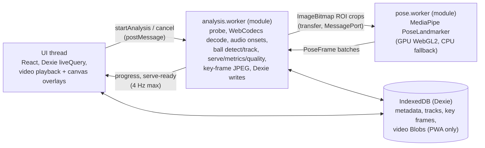

# Serve Coach: technical architecture (v1 PWA and the iOS route)

- **Status:** spec v1, written 2026-09-27. It builds directly on the engine already in `app/src/analysis`.
- **Read with:** `docs/DECISIONS.md` (binding), `docs/specs/METRICS.md` + `metrics.json` (metric definitions, rounding, thresholds), `docs/specs/COACHING.md` + `coaching-library.json` (faults, cues, drills, rule schema), `docs/specs/CAPTURE.md` (recording guide), `docs/PRODUCT.md`, `DESIGN.md`.
- **Supersedes:** `docs/IOS_ROUTE.md` (stub). Keep `docs/MODELS.md` as the model register.
- **Conventions:** research citations look like (research 05 [S4]). Sources I checked for this spec are tagged [A1]–[A6] and listed in section 19. Claims carry [Established], [Vendor claim], [Coaching interpretation] or [Our inference] where it matters. All numbers for iPhone performance are **budgets to be measured**, not measurements, unless a builder report is cited. Metric ids match the shared list and are never renamed.

---

## 1. Summary

v1 is a phone-first PWA: Vite 8, React 19, TypeScript, Tailwind 4 and Dexie 4. The analysis engine is framework-free TypeScript and runs entirely on the device, in Web Workers. There is no account, no upload and no third-party network traffic (D8, D9). The same `dist/` bundle ships inside a Capacitor 8 iOS shell. Native plugins then take over what the web platform does badly: capture with locked frame rate and exposure, large-file handling and, if a benchmark justifies it, Apple Vision pose.

Ten architecture decisions follow from the brief, DECISIONS.md and the research:

| # | Decision | Why |
|---|---|---|
| A1 | **Two-pass analysis.** Pass A is a sparse pass that finds serves using audio onsets, pose at 4 fps and cheap motion and ball cues. Pass B is a dense pass that runs full-rate pose, ball and event fusion inside each serve window only. | Pose inference is the bottleneck: 17–34 ms per frame on a laptop GPU (pose_report). Most of a practice clip is walking and ball-fetching. |
| A2 | **Two module workers plus the UI thread.** `analysis.worker` owns decode, audio, ball, segmentation, metrics and Dexie writes. `pose.worker` owns MediaPipe. They talk over a `MessageChannel`, so frames never cross the UI thread. | Keeps the UI responsive; the two workers overlap GPU pose with CPU ball detection. |
| A3 | **Engine output is immutable and versioned.** Player-entered tags live in their own table. Session statistics that depend on tags are a pure, cheap recomputation (`SessionStats`). | Tagging, deleting a serve or changing settings never re-runs vision, and old results stay reproducible. |
| A4 | **The honesty label is resolved in one place** (`metrics/status.ts`) from declarative prerequisites in the metrics catalogue. Runtime code can only *downgrade* a status, never go above the catalogue's `maxStatus`. | D2: no unlabelled or over-labelled numbers. |
| A5 | **Every rate carries n and an interval; every comparison is matched.** Matching uses view, serve side, serve number, frame-rate class and engine major version. | D7, plus two additions (section 17). |
| A6 | **Videos are stored behind a `BlobStore` interface.** In the PWA that is IndexedDB Blobs. In iOS it is native files in the app sandbox, with only metadata in Dexie. | WebKit gives non-browser apps a much smaller IndexedDB quota [A1]. |
| A7 | **The retention sweep runs on app open and after each analysis.** Deletion is a hard delete of records and blobs. JSON and CSV export are built in. | D8. A PWA cannot run background jobs. |
| A8 | **A strict CSP (`connect-src 'self'`) plus a single network module** (`platform/net.ts`, empty in v1). A Playwright test asserts that no request goes to any other origin. | D8. It blocks MediaPipe telemetry (scaffold_report, pose_report). |
| A9 | **Coaching is a deterministic rules engine over `coaching-library.json`.** An optional language model may only rephrase the chosen decision. It never chooses it. | D6, D9. Keeps advice auditable and testable. |
| A10 | **Validation is part of the product.** The synthetic end-to-end harness (`tools/validate`), in-app annotation mode and a per-metric validation level shown on "How we measure". | The brief's accuracy requirement. Real-footage and radar validation are documented next steps. |

---

## 2. Inputs this spec builds on

**Built** (builder reports: `video_report.json`, `pose_report.json`, `scaffold_report.md`):

- **`analysis/video`.** MP4/MOV probe reads container boxes only. Decode uses WebCodecs, with a media-element seek fallback. It handles rotation, variable frame rate, the slow-motion time base (`timeScale`, flagged when unproven) and audio onset detection. Measured on a Windows laptop in headless Edge/Chrome:
  - decode-only at 1080p: 464–650 fps;
  - RGBA at 640 px: 184–229 fps;
  - media-element fallback: 14–36 fps;
  - audio onset error on synthetic clicks: median 0.021 ms.

  **Nothing has been tested on iOS or on real footage.**
- **`analysis/pose`.**
  - `MediaPipePoseSource` runs in a worker, uses GPU with CPU fallback, and serves assets from `/models` and `/mediapipe/wasm` (no CDN).
  - `ServerTracker` follows the server and ignores bystanders.
  - `cleanPoseFrames` handles left/right swaps, outliers, gaps and zero-phase One Euro smoothing.
  - `body.ts` provides standing height, handedness, facing side, 2D angles and front toe.
  - Measured per-frame inference (laptop GPU, 1280×720 frames of a cartoon figure):

    | Model | numPoses 2 | numPoses 1 |
    |---|---|---|
    | lite | 25–34 ms | 15–22 ms |
    | full | 28–31 ms | 17–19 ms |

  - Worker round trip is about 2× the inference time. First GPU warm-up in a fresh browser takes 3.3–4.9 s.
- **`analysis/ball` (in progress).** Colour and motion detector, tracker (toss and outgoing), robust parabola fits, toss analysis with a gravity time-scale check, bounce detection, homography with court keypoints, and experimental speed (track and flight time).
- **`tools/synth` (in progress).** A three.js/Playwright/ffmpeg generator of serve videos with exact ground truth: per-serve parameters, pose, ball, camera, frame-rate and slow-motion export variants.
- **Assets.**
  - `vision_wasm_module_internal.wasm`: 11.8 MB (this is the build the worker uses).
  - `pose_landmarker_full.task`: 9.4 MB.
  - `pose_landmarker_lite.task`: 5.8 MB.

**Binding decisions:** D1–D10 in `docs/DECISIONS.md`. Section 17 flags the points where I think they need changing.

---

## 3. Module map

```
app/src/
  analysis/                  framework-free; no React; no DOM globals in pure modules; runs in Node tests, workers, WKWebView
    types.ts                 shared contract (v0) + v1 additions in section 6.1
    video/        [built]    probe, FrameSource (WebCodecs | media-element), time base, rotation, audio decode + onsets
    pose/         [built]    PoseSource (MediaPipe | injected | apple-vision later), tracking, cleaning, body geometry
    ball/         [building] detector, tracker, toss + gravity check, bounce, homography, speed (experimental)
    serve/        [new]      serve finding and timing
      sparse.ts              Pass A signals -> ServeCandidate[]
      windows.ts             candidates -> ServeWindow[] (frame ranges, core range, ROI)
      events.ts              pose + ball + audio -> ServeEvents with uncertainties (fusion)
      phases.ts              events -> PhaseSpan[] (7 phases) + key-frame indices
      bodyTrack.ts           per-window pose post-processing (cleanPoseFrames, ROI back-projection)
      types.ts               ServeCandidate, ServeWindow, fusion inputs
    metrics/      [new]      catalogue computation with status and uncertainty
      catalogue.ts           typed loader for catalogue.json (generated from docs/specs/metrics.json)
      status.ts              prerequisites -> status, reason, unlockHint; downgrade rules; maxStatus cap
      serveMetrics.ts        per-serve metric functions registered by MetricId
      sessionMetrics.ts      aggregation: means, spreads, rates, repeatability, outcome links
      stats.ts               Wilson and Newcombe intervals, bootstrap SD intervals, matched comparisons, "N more serves"
      format.ts              rounding and display strings (METRICS.md rules)
    quality/      [new]
      captureChecks.ts       container, time base, fps, subject size, headroom, exposure, flicker, blur, camera motion
      serveChecks.ts         per-serve completeness (release/apex/contact), edge proximity, occlusion, interpolation
      report.ts              QualityReport assembly; exclusion rules; capture-quality metric
    pipeline/     [new]      orchestration
      orchestrator.ts        two-pass plan, progress, cancellation, checkpoints, resume
      analysis.worker.ts     worker entry: FrameSource, audio, ball, serve, metrics, quality, key frames, Dexie writes
      posePort.ts            pose worker over MessagePort (small addition to pose/: "port mode")
      protocol.ts            typed messages UI <-> analysis worker
      budget.ts              memory and duration guards
      keyFrames.ts           re-decode of key-frame indices; JPEG encode via OffscreenCanvas
  coaching/       [new]      pure; imports analysis types only
    library.ts               load + validate coaching-library.json
    rules.ts                 predicate evaluation over MetricValues (respects status)
    decide.ts                D6 priority pipeline -> CoachingDecision (with trace)
    experiment.ts            experiment lifecycle and verdict assembly (uses metrics/stats.ts)
    phrasing/                template.ts (default) | foundation.ts (iOS on-device, later) | cloud.ts (consent-gated, later)
  data/           [new]      Dexie 4
    db.ts                    schema, versions, migrations
    records.ts               record types (section 7.1)
    repos/                   profile, sessions, videos, serves, tracks, keyFrames, tags, tallies, stats,
                             coaching, experiments, practice, annotations, settings, jobs
    storage/                 BlobStore interface; idbBlobStore.ts (PWA); nativeFileStore.ts (Capacitor)
    retention.ts             sweep + policies
    deletion.ts              cascades + deletion log
    export.ts                JSON / CSV (and optional zip of key frames)
    persist.ts               navigator.storage.persist()/estimate()
    demo/                    seed loader for demo mode
  platform/       [new]
    capabilities.ts          feature detection (WebCodecs, HEVC config, OffscreenCanvas WebGL in workers, wake lock, persist)
    native.ts                Capacitor plugin interfaces (ServeCapture, ServeFiles, ServePose, ServePhrasing)
    net.ts                   the only module allowed to call fetch() on another origin (no callers in v1)
    ids.ts                   ULID generator (crypto.getRandomValues)
  ui/                        React; screens, components, charts (hand-built SVG), overlays (canvas), state (zustand)
  validation/                annotation mode (in-app, hidden) + validation.html harness
tools/
  synth/          [building] ground-truth serve video generator
  validate/       [new]      runs the engine on synthetic scenarios; error report; regression gate
  demo/           [new]      builds the demo seed bundle from synthetic sessions using the real engine
```

**Dependency rules.** These are enforced by an `oxlint` `no-restricted-imports` rule, or by a small import-graph test if oxlint cannot express them.

- `analysis/**` imports nothing from `coaching`, `data`, `ui` or `platform/native`.
- `coaching/**` imports only `analysis/types` and `metrics/stats`.
- `data/**` imports types, not engine code.
- Only `pipeline/` and `ui/` compose modules.
- Only `platform/net.ts` may reference `fetch(` with a non-relative URL.

**Specs to code.** `scripts/sync-specs.mjs` runs as a `prebuild` and `pretest` step. It validates `docs/specs/metrics.json` and `docs/specs/coaching-library.json` against TypeScript type guards, then copies them to `app/src/analysis/metrics/catalogue.json` and `app/src/coaching/library.json`. The app never reads outside `app/` at runtime.

---

## 4. Runtime topology



- **Startup.** The UI creates both workers and one `MessageChannel`, transfers `port1` to `analysis.worker` and `port2` to `pose.worker`, and never touches frames.
  - This needs one addition to `pose/`: a "port mode" in which `pose.worker.ts` accepts `PoseInputFrame` messages from a port rather than from its owner.
  - The existing `workerProtocol.ts` messages are reused.
- **Live updates.** Dexie 4 `liveQuery` in the UI picks up writes made in the worker, because Dexie propagates changes across same-origin contexts. This must be verified in Safari; if it fails, the worker posts a `db-changed` message.
- **Fallbacks, chosen by `platform/capabilities.ts` at job start and recorded in `EngineStamp`:**
  1. No WebCodecs in workers → decode on the UI thread and transfer `ImageBitmap`s to the analysis worker. The UI thread uses WebCodecs if it is available there, otherwise the existing media-element path. The media-element path is slow (14–36 fps measured on a laptop).
  2. No WebGL in a worker's `OffscreenCanvas` → run MediaPipe on the UI thread (the existing fallback in `MediaPipePoseSource`). The UI shows a static progress screen to limit jank.
  3. No WebGL at all → analysis unavailable. The app shows a clear message and demo mode still works.

---

## 5. End-to-end analysis pipeline

### 5.1 Entry points

| Path | v1 PWA | iOS (Capacitor) |
|---|---|---|
| Record now | Live framing check via `getUserMedia` preview (pose lite at about 5 fps and a level check; nothing is recorded). Then the camera tracks are stopped and `<input type="file" accept="video/*" capture="environment">` opens the system camera. That camera records at the player's Camera settings, so the guide asks for 1080p at 60 fps. | `ServeCapture` plugin (AVFoundation): locked fps, custom exposure, stabilisation off, 1x lens, HDR off; framing checks run natively (section 15) |
| Import | `<input type="file" accept="video/*">` | `ServeFiles.pick()` using PHPicker with `.current` representation (no transcode) (research 05 §9.2) |
| Demo | Bundled synthetic clip or seeded results | Same |

Every path produces a `Session` (with its mode: `technique` for the side view, `outcomes` for the rear view), a `Video` record and an analysis `Job`. The player's height and handedness are required before analysis: height provides the metric scale for estimated values, and handedness mirrors all geometry. If they are missing, the flow asks once and remembers.

**Pre-flight checks at import**, before any decoding:

- `probeVideo()`, with a budget of 500 ms or less for a 200 MB MOV (it reads boxes only).
- Duration and size guards:

  | Clip | PWA limit |
  |---|---|
  | 60 fps or less | 10 minutes |
  | 120 or 240 fps | 60 seconds |
  | Any file | 2 GB |

- A storage estimate (see below).
- HEVC support via `VideoDecoder.isConfigSupported`.
- A time-base check. If `timeBase.status` is `unknown` and the clip might be a rendered slow-motion export, analysis proceeds. The toss gravity check in Pass B then proves or corrects the time base (`fpsSource: 'physics'`). Audio timing is disabled whenever `timeScale ≠ 1`.

**Storage check:** the app calls `navigator.storage.estimate()` and requires free quota of at least 2.2× the file size. The file is copied into the store, and working memory has headroom.

### 5.2 Sequence

```mermaid
sequenceDiagram
  autonumber
  participant P as Player (UI)
  participant A as analysis.worker
  participant M as pose.worker
  participant D as Dexie
  P->>D: create Session, Video (Blob or native path), Job(queued)
  P->>A: start {jobId}
  A->>A: probe + capability check + budgets
  A->>A: audio: decode track -> detectOnsets() -> contact candidates (if audio usable)
  loop Pass A (sparse), whole clip
    A->>A: decode all frames (HW); emit 10 fps 160px luma (motion, ball-above-head) and 4 fps 256px bitmaps
    A->>M: 4 fps bitmaps (lite, numPoses 2)
    M-->>A: PoseFrames -> ServerTracker
  end
  A->>A: fuse -> ServeCandidate[] -> ServeWindow[] (ROI from tracked box)
  A-->>P: progress "Finding serves (N found)"
  loop Pass B (dense), per window in time order
    A->>A: decode window from preceding keyframe at full rate
    A->>M: ROI crops (full model, numPoses 1) at full rate in core range, every 3rd frame outside it
    M-->>A: PoseFrames (ROI coords -> frame coords)
    A->>A: ball detect/track on toss + outgoing regions (every frame)
    A->>A: events (fusion) -> phases -> per-serve metrics -> serve quality
    A->>A: key-frame pass: re-decode <=8 indices -> JPEG (OffscreenCanvas)
    A->>D: tx: Serve + Track + KeyFrames; Job.completedWindows += i
    A-->>P: progress + "serve-ready" (player can open it)
  end
  A->>A: session aggregation (SessionAnalysis), capture quality, handedness/scale consistency
  A->>D: tx: Session.analysis, Job(done); apply "delete after analysis" if chosen
  A-->>P: done
  P->>P: computeSessionStats(serves, tags, tallies) + decide() -> focus card
```

### 5.3 Pass A: finding serves (sparse)

**Goal:** find every serve with at least 98% recall, the feasibility target in research 05 §10 row 1, and precision to be measured. Each serve gets a window that fully contains setup to recovery.

**Signals**, all computed inside `analysis.worker` from one sequential decode:

| Signal | Rate | Computation | Cost note |
|---|---|---|---|
| S1 audio contact | Sample-accurate | `detectOnsets()` on the decoded track. Candidates are onsets with `sharpness ≥ 0.6`, labelled `contact` (thresholds from `audio.ts`, tuned on synthetic sound only, so experimental) | About 1–2 s for 2 minutes (our estimate) |
| S2 toss-arm posture | 4 fps | Pose lite (numPoses 2) + `ServerTracker`. The tossing wrist is above the nose by at least 0.1 BH and the hitting elbow is at or above shoulder height. BH = standing body height in frame units | Dominant cost: about 480 pose frames for a 2-minute clip |
| S3 ball above head | 10 fps | Ball colour likelihood on a 160 px frame inside the column above the tracked player's head | Cheap |
| S4 motion energy | 10 fps | Luma difference inside the tracked player box | Cheap |

**Fusion rule** (`serve/sparse.ts`):

1. A candidate is anchored on an S1 contact onset when the audio is usable. Otherwise the anchor is the end of an S2 run of at least 0.25 s, plus 0.3 s.
2. It needs at least two supporting cues out of S2 run, S3 hit, S4 peak or S1 onset, within [anchor − 2.0 s, anchor + 0.3 s].
3. Candidates less than 2.5 s apart are merged, keeping the stronger one.
4. Candidates with S2 and S3 but no contact cue and no hitting-arm swing are classified `toss-only` (a caught toss). They are shown as "tosses caught" and excluded from serve statistics.
5. Pre-serve ball bounces produce soft onsets without S2 and are rejected.

**Window** (`serve/windows.ts`):

- `start` = anchor − 2.2 s (covers setup and motion start).
- `end` = anchor + 1.6 s (covers landing and recovery).
- Both are clamped to the clip and to the neighbouring window's midpoint.
- `core` = [anchor − 1.6 s, anchor + 0.6 s] (release to landing), expanded when the sparse S2 run suggests a slow toss.
- `roi` = the union of the tracked player boxes in the window:
  - widened by 0.6 BH on each side;
  - extended upward to the frame top (toss);
  - extended into the court by 1.5 BH (contact point and outgoing ball);
  - square-padded for pose.

  ROI cropping raises effective resolution for a distant player, which mitigates MediaPipe's more-than-4-m out-of-scope note (research 05 §1.3, [S5]).

### 5.4 Pass B: dense analysis per window

Per window, in time order, with each window committed atomically:

1. **Decode** from the keyframe before `start`, using the existing `decodePlan`, which handles open-GOP streams. Frames outside the window are closed immediately.
2. **Pose.**
   - The full model runs on ROI crops (`createImageBitmap(frame, sx, sy, sw, sh, {resizeWidth: 256…512})`) with numPoses 1: the tracker already locked on the server in Pass A, and the ROI excludes most bystanders.
   - Rate: every frame in `core` for clips up to 120 fps, and 120 fps (every 2nd frame) for 240 fps clips. Every 3rd frame outside `core`.
   - Landmarks are mapped back to full-frame normalised coordinates in `posePort.ts`.
   - `cleanPoseFrames(frames, { frameAspect: meta.width / meta.height })` runs per window. The `frameAspect` convention comes from the pose builder.
3. **Ball.** `BallDetector` runs on every frame, over two regions:
   - the toss column (above the head to the frame top, forward of the body);
   - after the provisional contact time, the outgoing region.

   Then `trackBall({ contactTReal, tossSearchWindow })` → `analyseToss()`, which provides release, apex (bracketed or above frame), heights and the gravity check. In outcomes mode it also runs `detectBounce()` → `mapBounceToCourt()`.
4. **Events.** Section 5.5.
5. **Per-serve metrics and quality.** Section 5.6.
6. **Key frames.** `pipeline/keyFrames.ts` re-decodes only the key-frame indices (one forward decode through the window, output ≤ 8 frames).
   - It writes seven phase thumbnails (320 px long side, JPEG q0.72, about 15 KB each).
   - It writes up to two evidence frames (1080 px long side, JPEG q0.82, about 120 KB each): contact, plus the phase the coaching library cares about most, chosen after coaching runs. If the coaching focus needs another phase, it is added lazily while the video still exists.
7. **Commit.** One Dexie transaction writes `serves`, `tracks`, `keyFrames` and `jobs.completedWindows`. The UI can then open that serve.

### 5.5 Event fusion and phases (`serve/events.ts`, `serve/phases.ts`)

Each event is an `EventEstimate` carrying `uncertaintyS`, `confidence` and `method`. Fusion uses inverse-variance weighting across available methods. When two methods disagree by more than 3σ combined, the less reliable method is dropped and the event's confidence is reduced.

| Event | Primary method | Secondary | Notes |
|---|---|---|---|
| `motionStart` | Tossing-wrist speed rises above 0.4 BH/s after at least 0.3 s of stillness | Motion energy | Ends setup |
| `tossRelease` | `estimateRelease()`: ball separates from the hand track (ball module) | Tossing wrist reaches its peak upward speed | σ floor 15 ms (`RELEASE_MODEL_SIGMA_S`) |
| `tossApex` | Parabola vertex from `analyseToss()` | — | Flags `bracketed` and `aboveFrame`. If `aboveFrame`, the apex is extrapolated and apex height becomes unavailable (reason `apex-above-frame`) |
| `trophyStart`, `trophyEnd`, `trophy` | Hitting-hand speed minimum while the hitting elbow is at or above shoulder height and the tossing arm is elevated. `trophy` is the midpoint and the key frame | — | Used by `trophy-pause` |
| `peakLoad` | Lowest pelvis (mid-hip y maximum) between release and contact | Maximum 2D front-knee flexion | Used by the loading proxy |
| `contact` | Audio onset (when `assessAudioTiming` passes and `timeScale = 1`), minus the sound travel time from contact to phone (17–26 ms at 6–9 m, from the scale-derived distance). This correction matters because rhythm mixes video events with the audio contact. Any remaining audio–video offset in the container is estimated per session as the median gap between the audio contact and the ball-velocity discontinuity, where both exist | Ball velocity discontinuity (start of the outgoing track), then the highest point of the hitting wrist | Research 05 §6.1: about ±5 ms with audio, ±1 frame without |
| `takeoff` / `landing` | First frame after contact where the front-foot heel/toe vertical speed is about 0 and height is back to the floor line | Ankle, with a fixed correction (research 05 §6.7) | `landing.footPoint` records which |
| `recoveryEnd` | Pelvis speed below 0.3 BH/s, or landing + 1.0 s | — | |

**Phases** (`ServePhase`), with key frames in brackets:

| Phase | Span | Key frame |
|---|---|---|
| setup | window start → `motionStart` | last still frame |
| toss | `motionStart` → `tossRelease` | release |
| loading | `tossRelease` → `trophyEnd` | `peakLoad` |
| drive | `trophyEnd` → `contact` | midpoint (racket drop is not measured, D5) |
| contact | `contact` ± 1 frame | contact |
| landing | `contact` → `landing` + 0.2 s | landing |
| recovery | then → `recoveryEnd` | `recoveryEnd` |

This mapping to the Kovacs and Ellenbecker stages follows research 03 §2.

### 5.6 Metrics, quality and honesty labels

- **Catalogue-driven.** Each metric id in `catalogue.json` declares: its level (serve or session), unit, `maxStatus`, prerequisites (below), rounding, `unlockHint` text, and its validation level (`none | synthetic | annotated-real | reference-instrument`).
- **Prerequisites** (declarative, evaluated by `metrics/status.ts`):
  - `views` (for example `['side']`);
  - `minCaptureFps`;
  - `timeBaseProven`;
  - `heightKnown`;
  - `audioUsable`;
  - required events and their minimum confidence;
  - `requiresTags` (for player-entered metrics);
  - `minServes` (session level);
  - `experimentalEnabled`.
- **Status resolution** (`resolveStatus`), in order:
  1. If any prerequisite fails, the status is `unavailable`, with the first failing reason and its `unlockHint`.
  2. Otherwise the starting status is the catalogue's `maxStatus`.
  3. Downgrades are applied:
     - landmarks inside the metric's frames are interpolated (`interpolated=true`), or a limb sits in `swapsUnresolved`: at most `estimated` (pose builder's rule);
     - the metric relies on the height scale: at most `estimated`;
     - the serve quality check failed: `unavailable` (`excluded-by-quality`).
  4. Experimental metrics are always computed, but the UI hides them unless the toggle is on. Coaching uses them only in rules explicitly tagged `experimental`.
  5. `spin` always returns `unavailable` / `not-measurable-from-phone` (D4).
- **Per-serve metric ids:**
  - toss: `toss-apex-height`, `toss-forward`, `toss-drop`;
  - contact: `contact-height-ratio`, `contact-forward`;
  - timing: `rhythm-release-to-contact`, `trophy-pause`;
  - body bands: `knee-bend-band`, `trunk-tilt-band`;
  - `landing-distance`;
  - speed: `speed-experimental`, `speed-radar-entered` (from tags);
  - outcomes: `placement-zone` (player-entered target, or experimental in outcomes mode), `spin`.
- **Session-level metric ids:**
  - `serve-count`;
  - spreads: `toss-height-spread`, `toss-forward-spread`, `rhythm-spread`, `repeatability`;
  - outcomes: `serve-in-rate`, `first-serve-in-rate`, `double-faults`, `serve-type-mix`;
  - `capture-quality`;
  - session means of the per-serve metrics.
- **Internal units.** Everything is computed in stature units (BH) first. Metres are shown only when the player's height is entered (`scale-from-height`, therefore `estimated`). Spreads are computed in BH, so the scale error cancels (research 05 §6.3), and are displayed in centimetres using the entered height.
- **Quality** (`quality/`) implements the post-hoc subset of research 06 §14:
  - fps and timing gaps (#10);
  - subject size (#5);
  - headroom (#4);
  - full-body framing (#3);
  - exposure clipping (#7);
  - flicker by FFT of mean luma (#8);
  - blur on the static body (#9);
  - camera motion by background registration (#11);
  - extra people (#12);
  - ball visibility (#13);
  - serve segmentation completeness (#16).

  A serve is excluded from statistics when checks #3, #10 or #16 fail, or when the camera moved during the serve (research 06 §14). Every summary shows "X of N serves measured".

### 5.7 Session aggregation, tags and coaching

- **`SessionAnalysis`** (immutable engine output) contains:
  - capture metadata and quality;
  - scale and handedness consistency: inferred handedness against the profile, with a warning on disagreement;
  - counts and exclusions;
  - stage timings.
- **`computeSessionStats(serves, tags, tally, profile, settings)`** is a pure function that returns `SessionStats`. It is recomputed whenever tags, tallies or settings change (under 50 ms for 50 serves), and it covers:
  - the session-level metrics;
  - strata (side × serve number);
  - outcome links;
  - best serve.

  An outcome link is a D3 signature insight such as "serves that went in had a toss 12 cm further forward". It is reported only when each group has at least 5 serves, and it carries an interval and a verdict word.
- **`decide(input, library)` → `CoachingDecision`** follows D6, with a full trace:
  1. safety gate (pain);
  2. detection confidence;
  3. earlier-chain faults first;
  4. biggest outcome gap;
  5. the player's goal.

  The decision is recomputed when inputs change. It is frozen when the player taps "Start this experiment" (which creates an `Experiment`).
- **"Did it work?"** is `experiment.ts` plus `stats.ts`. It compares the frozen baseline stratum with retest sessions on the experiment's primary metric: a process metric first, per D7. It returns a verdict word, the difference with its interval, and "about N more serves to confirm". METRICS.md owns the thresholds and methods; the engine exposes `compareMatched()` and `servesToConfirm()`.

### 5.8 Progress reporting

- **Stage weights** for overall progress:

  | Stage | Weight |
  |---|---|
  | probe | 2% |
  | audio | 4% |
  | Pass A | 26% |
  | Pass B | 60%, split equally across windows once known |
  | key frames and session | 8% |

  Pass A progress is measured in frames decoded against the frame count. Pass B progress is windows done, plus the fraction of frames in the current window.
- **The message** is `AnalysisProgress` (section 6.2), posted at most every 250 ms. The ETA comes from measured throughput after the first 5 s and is never shown before that. This avoids a fast start followed by a stall, per Apple's guidance on accurate progress (research 09 §8, [S10][S11]).
- **Labels** are specific (research 09 §8): "Finding serves (9 found)…", "Tracking the toss (serve 3 of 9)…", "Timing each phase…", "Choosing your focus…".
- **Progressive results.** Each `serve-ready` event lets the player open that serve's annotated playback while the rest are processed.
- **Staying awake.** `navigator.wakeLock.request('screen')` runs during analysis where supported (this needs verifying in iOS home-screen mode). Copy: "Keep Serve Coach open while it analyses. It takes about a minute."

### 5.9 Cancellation, pause and resume

- **Cancel.** One `AbortController` per job. Its `signal` goes to every `FrameSource` generator (already supported) and to the pose port (a `cancel` message makes the pose worker drop queued frames and ack).
  - Target: stopped within 500 ms, with every `VideoFrame` and `ImageBitmap` closed.
  - Completed serves are kept. `Job.state` becomes `cancelled`.
  - The session shows "Analysed 5 of 9 serves", with **Resume** and **Discard the rest**.
- **Resume.** `jobs.windows` (Pass A output) and `completedWindows` persist. Resume skips Pass A and continues with the remaining windows. This requires the video to be stored. With the "delete after analysis" policy, the blob is kept until the job reaches `done` or the player discards it.
- **iOS backgrounding.** iOS suspends a backgrounded page and may reclaim the hardware decoder.
  - On `visibilitychange` to hidden, the worker checkpoints (current window index) and pauses.
  - On return, a decoder error or reclaim reopens the `FrameSource` and restarts the current window from its keyframe.
  - `Job.state = 'paused'` survives a reload.

### 5.10 Memory limits (budgets)

WebKit's per-process memory limit on iOS is not published, so the budgets below are conservative [Our inference], and on-device measurement is a pre-TestFlight task.

| Item | Budget | Enforcement |
|---|---|---|
| Whole page, both workers included (peak) | ≤ 450 MB | Measured in Safari Web Inspector and Xcode memory gauge; CI proxy: `performance.measureUserAgentSpecificMemory` in Chromium |
| Decoded `VideoFrame`s alive | ≤ 8 (decoder queue) + 2 in flight to pose | `decoder.ts` queue cap; `maxInFlight: 2` |
| ROI bitmaps | ≤ 512×512 each, ≤ 4 alive | Transfer, then close |
| RGBA buffers for ball detection | ≤ 64 MB | Downscale grid via `chooseDownscaleFactor`; regions, not full frames |
| MediaPipe (full) in the pose worker | ≤ 200 MB | Single landmarker; rebuilt per job, not per window |
| Per-window results in memory | ≤ 5 MB | Compact typed arrays (section 6.3); flushed per window |
| Video file | Never fully in memory | `ByteSource` slices (Blob `slice()` in the PWA; bounded HTTP `Range` reads in iOS) |
| Audio | Full-rate mono Float32, processed in 30 s chunks with 0.5 s overlap; only onsets are kept | About 5.8 MB per chunk at 48 kHz |

### 5.11 Processing-time target

**Reference case:**

- a 2-minute, 1080p, 60 fps HEVC clip (7,200 frames) with 12 serves;
- side view;
- iPhone 15-class device (A16), Safari 26 installed PWA, warm model cache.

Derivation [Our inference]: laptop throughput from the builder reports, with iPhone pose inference assumed to be about 25 ms per frame for full on a 256–384 px crop. **This is an assumption to replace with the first device measurement.**

| Stage | Work | Budget |
|---|---|---|
| Probe and set-up | Boxes; model already warm (a first cold GPU start can take 3–5 s, pose_report) | ≤ 1 s (+ ≤ 5 s cold) |
| Audio | Decode + onsets | ≤ 2 s |
| Pass A | 7,200 frames hardware-decoded; 480 pose-lite frames (4 fps) at about 30 ms, overlapped with decode | ≤ 20 s |
| Pass B | Per serve (3.8 s window): 132 core frames at 60 fps + 32 context frames at 20 fps ≈ 164 pose frames × about 25 ms ≈ 4.1 s, with ball detection and decode overlapped | ≤ 5 s per serve → ≤ 60 s |
| Key frames | ≤ 0.7 s per serve (included above) | — |
| Session, stats, coaching | Pure TS | ≤ 1 s |
| **Total** | | **≤ 90 s; first serve viewable ≤ 30 s** |

**Other devices:**

| Device class | Budget |
|---|---|
| iPhone 12-class (A14) | ≤ 180 s (acceptable, with an honest estimate shown) |
| Projected to exceed 6 minutes | The job refuses and suggests trimming or a shorter clip |
| 240 fps clips (PWA limit 60 s) | ≤ 2× clip duration |

**Stretch goal:** ≤ 60 s for the reference case. The likeliest route is to overlap Pass B on window *k* with Pass A still scanning, using a second decoder instance, in v1.1.

### 5.12 Failure modes and what the player sees

| Failure | Detection | Result |
|---|---|---|
| Unsupported codec | `isConfigSupported` false and media element fails | "This video format can't be read on this phone. Try Settings → Camera → Formats → Most Compatible." No partial numbers |
| Rendered slow motion, time base unknown | `timeBase.status = 'unknown'` + toss gravity check | If gravity proves a factor (for example 1/8), apply it (`fpsSource: 'physics'`) and continue. Timing metrics stay `estimated` until proven; audio timing is off |
| No serve found | Pass A returns 0 candidates | "We couldn't find a serve", with a framing tip; offer annotation of one serve (validation mode) |
| Player too small or out of frame | Quality checks #3 and #5 | Metrics unavailable with a reason; capture tips |
| GPU pose failure mid-clip | `stats().detectErrors` | Frames fall back to empty; affected serves are downgraded or excluded; the job suggests a retry (CPU) |
| Memory or jetsam kill (tab reload) | Job was `sparse` or `dense` on startup | Resume offer; after 2 kills, lower `poseModel` to lite and the ROI to 256 px |
| Storage full | `QuotaExceededError` on write | Stop, keep completed serves, prompt to free space (delete videos, keep stats) |

---

## 6. Data structures (TypeScript)

These extend `app/src/analysis/types.ts` additively: nothing is renamed, and new fields are optional on existing interfaces. The v1 contract version is `ENGINE_CONTRACT = 1`.

### 6.1 Additions to `types.ts`

```ts
// ---------- identifiers shared with METRICS.md / metrics.json (never rename) ----------
export type MetricId =
  | 'serve-count' | 'toss-apex-height' | 'toss-forward' | 'toss-drop'
  | 'toss-height-spread' | 'toss-forward-spread' | 'contact-height-ratio' | 'contact-forward'
  | 'rhythm-release-to-contact' | 'rhythm-spread' | 'trophy-pause' | 'knee-bend-band'
  | 'trunk-tilt-band' | 'landing-distance' | 'repeatability' | 'serve-in-rate'
  | 'first-serve-in-rate' | 'double-faults' | 'placement-zone' | 'serve-type-mix'
  | 'speed-experimental' | 'speed-radar-entered' | 'spin' | 'capture-quality'
/** METRICS.md may add ids; the engine accepts them as strings until types are regenerated. */
export type AnyMetricId = MetricId | (string & {})

export type EvidenceTier = 'research-backed' | 'coach-recommended' | 'experimental'
export type ServeSide = 'deuce' | 'ad'
export type ServeNumber = 1 | 2
export type ServeOutcome = 'in' | 'net' | 'long' | 'wide' | 'let' | 'unknown'
export type ServeType = 'flat' | 'slice' | 'kick'
export type TargetZone = 'T' | 'body' | 'wide'
export type LevelBand = 'utr-1-3' | 'utr-4-5' | 'utr-6-7' | 'unknown'
export type Band = 'low' | 'typical' | 'high'
/** Timing precision class used for matched comparisons. */
export type FpsClass = 'fps30' | 'fps60' | 'fps120plus'
export type SessionMode = 'technique' | 'outcomes' // side view | rear view (D1); never mixed

/** Machine reason behind a status (D2). metrics.json holds the canonical list and copy; this is the engine's initial set. */
export type StatusReason =
  | 'ok'
  // unavailable
  | 'wrong-view' | 'fps-too-low' | 'time-base-unproven' | 'height-unknown'
  | 'ball-not-tracked' | 'apex-above-frame' | 'apex-not-bracketed' | 'contact-not-found'
  | 'pose-low-confidence' | 'feet-not-visible' | 'player-out-of-frame' | 'camera-moved'
  | 'too-few-serves' | 'no-player-entry' | 'audio-unusable' | 'not-measurable-from-phone'
  | 'excluded-by-quality' | 'experimental-off' | 'no-calibration'
  // downgrades (value shown, status capped)
  | 'interpolated-landmarks' | 'left-right-unresolved' | 'scale-from-height'
  | 'plane-assumption' | 'not-validated'

export interface Estimate {
  value: number
  /** 1-sigma. */
  sigma: number
}

// ---------- existing interfaces: optional fields added ----------
export interface VideoMeta {
  /* ...all existing fields unchanged... */
  /** From assessTimeBase(): 'proven' only with >=100 fps timestamps, an Android capture-fps key, or a gravity proof. */
  timeBaseStatus?: 'proven' | 'unknown'
  timeBaseKind?: 'normal' | 'native-high-fps' | 'metadata-time-scaled' | 'possible-rendered-slomo'
  /** Piecewise-linear media->real map for rendered slow motion with 1x ramps (video builder proposal). */
  timeMap?: { tMedia: number; tReal: number }[]
  codedWidth?: number
  codedHeight?: number
  decodePath?: 'webcodecs' | 'media-element' | 'native'
  /** Container creation time (ISO 8601) when present; used as the session start time. */
  createdAt?: string
}

export interface AudioOnset {
  /* ...existing fields unchanged; strength = dB above the pre-onset noise floor... */
  tMedia?: number
  riseTimeMs?: number
  hfRatio?: number
}

export interface PoseFrame {
  /* ...existing fields unchanged... */
  track?: { confidence: number; reason: 'acquired' | 'continued' | 'reacquired' | 'lost' | 'no-candidates'; candidates: number }
}

export interface ServeEvents {
  /* ...existing: tossRelease, tossApex, trophy, contact, landing, recoveryEnd... */
  motionStart?: EventEstimate
  trophyStart?: EventEstimate
  trophyEnd?: EventEstimate
  peakLoad?: EventEstimate
  takeoff?: EventEstimate
}

export interface MetricValue {
  /* ...existing: id, value, unit, status, uncertainty, confidence, basis, unavailableReason, unlockHint... */
  reason?: StatusReason
  /** Serves (or tagged serves) that contributed. Required on every rate and spread (D7). */
  n?: number
  /** Serves that were eligible, for "X of N serves measured". */
  nEligible?: number
  /** Rounded display text per METRICS.md, e.g. "2.6-2.9 m" or "about 12 cm". */
  display?: string
  /** e.g. 'toss-apex@1.0.0'; bump when the computation changes. */
  methodVersion?: string
  /** Serves and frames that support the value (key-frame evidence). */
  evidence?: { serveId: string; frameIndex: number; keyFrameId?: string }[]
  /** Catalogue validation level at the time of computation (shown on "How we measure"). */
  validation?: 'none' | 'synthetic' | 'annotated-real' | 'reference-instrument'
}

export interface QualityCheck {
  /* ...existing... */
  /** Which research-06 §14 check this implements (1-18), for traceability. */
  protocolRef?: number
}
```

### 6.2 Pipeline and serve-finding types (`analysis/serve/types.ts`, `analysis/pipeline/protocol.ts`)

```ts
export interface Rect { x: number; y: number; w: number; h: number } // normalised to the displayed frame

export interface ServeCandidate {
  tAnchor: number // real seconds
  anchor: 'audio-contact' | 'pose-arm-run'
  score: number // 0..1
  cues: Array<'audio-contact' | 'toss-arm' | 'ball-above-head' | 'motion'>
  kind: 'serve' | 'toss-only' | 'uncertain'
  playerBox: Rect
}

export interface ServeWindow {
  index: number
  startFrame: number
  endFrame: number
  coreStartFrame: number
  coreEndFrame: number
  roi: Rect
  candidate: ServeCandidate
}

export type AnalysisStage = 'probe' | 'audio' | 'sparse' | 'dense' | 'keyframes' | 'session' | 'done'

export interface AnalyseRequest {
  jobId: string
  sessionId: string
  videoId: string
  mode: SessionMode
  profile: { heightM?: number; handedness: Handedness }
  options: {
    poseModel: 'full' | 'lite'
    experimental: boolean
    /** Serve windows already done (resume). */
    skipWindows?: number[]
    /** Pass A output from a previous run (resume). */
    windows?: ServeWindow[]
  }
}

export interface AnalysisProgress {
  jobId: string
  stage: AnalysisStage
  label: string // plain-English, specific ("Tracking the toss (serve 3 of 9)")
  overall: number // 0..1, monotonic
  servesFound?: number
  servesDone?: number
  etaS?: number // omitted until >=5 s of throughput data
}

export type WorkerToUi =
  | { type: 'progress'; progress: AnalysisProgress }
  | { type: 'serve-ready'; jobId: string; serveId: string; index: number }
  | { type: 'done'; jobId: string; sessionId: string }
  | { type: 'error'; jobId: string; code: AnalysisErrorCode; message: string; recoverable: boolean }
  | { type: 'db-changed'; tables: string[] }

export type UiToWorker =
  | { type: 'start'; request: AnalyseRequest }
  | { type: 'cancel'; jobId: string }
  | { type: 'pause'; jobId: string }
  | { type: 'resume'; jobId: string }

export type AnalysisErrorCode =
  | 'unsupported-codec' | 'probe-failed' | 'too-long' | 'storage-full' | 'no-webgl'
  | 'pose-init-failed' | 'decoder-reclaimed' | 'cancelled' | 'internal'
```

### 6.3 `ServeAnalysis` (one per detected serve; immutable engine output)

```ts
export interface EngineStamp {
  engineVersion: string // semver of app/src/analysis (major bump = results not comparable)
  contract: 1
  catalogueVersion: string // metrics.json version
  poseModel: string // e.g. 'mediapipe-pose-full@tasks-vision-1.0.1#4eaa5eb7' (hash from MODELS.md)
  poseBackend: 'gpu' | 'cpu' | 'apple-vision'
  decodePath: 'webcodecs' | 'media-element' | 'native'
  analysedAt: string // ISO 8601 with offset
  durationMs: number
  paramsHash: string // hash of tunable thresholds used
  device?: string // coarse, e.g. 'iPhone (iOS 26)'; never an identifier
}

/** Compact pose for overlays and re-computation. Typed arrays store natively in IndexedDB. */
export interface PoseTrackCompact {
  frameIndices: Int32Array
  tReal: Float64Array
  /** frames x 33 x (x, y, visibility); NaN where absent. Full-frame normalised coordinates. */
  xyv: Float32Array
  /** frames x 33 flags: 1 interpolated, 2 swap-corrected, 4 outlier-replaced, 8 in unresolved swap span */
  flags: Uint8Array
  source: PoseFrame['source']
  frameAspect: number
  bodyHeightHU: number
}

export interface BallTrackCompact {
  frameIndices: Int32Array
  tReal: Float64Array
  x: Float32Array
  y: Float32Array
  r: Float32Array
  score: Float32Array
  kind: Uint8Array // 0 toss, 1 outgoing, 2 bounce, 3 unknown
  predicted: Uint8Array // 1 = gap-filled prediction, not a detection
  tossFit?: { a: number; b: number; c: number; rmse: number; tStart: number; tEnd: number }
}

export interface ServeDetection {
  confidence: number
  cues: ServeCandidate['cues']
  kind: ServeCandidate['kind']
  anchor: ServeCandidate['anchor']
}

export interface TossSummary {
  release: EventEstimate
  apex: EventEstimate & { bracketed: boolean; aboveFrame: boolean }
  apexXY: { x: number; y: number } // normalised image position
  apexAboveGroundBH?: Estimate // stature units (dimensionless)
  apexForwardOfToeBH?: Estimate // + = into the court (side view only)
  apexLateralBH?: Estimate // + = hitting-arm side (rear view only)
  dropApexToContactBH?: Estimate
  gravity: { status: 'ok' | 'unavailable'; plausible?: boolean; timeScaleFactor?: number; apparentGravityMps2?: number }
  fitRmseNorm: number
  detections: number
}

export interface ContactSummary {
  event: EventEstimate
  ballXY?: { x: number; y: number }
  wristXY?: { x: number; y: number }
  heightOverStature?: Estimate // contact-height-ratio
  forwardOfToeBH?: Estimate // contact-forward (side view)
  /** Spread between fused methods, for QA. */
  methodSpreadMs?: number
}

export interface LoadingSummary {
  peakLoad: EventEstimate
  hipDropBH?: Estimate // pelvis descent from setup, stature units (view-robust loading proxy)
  kneeFlexion2DDeg?: Estimate // never displayed as degrees (D5)
  band?: Band
  bandConfidence: number
}

export interface TrunkSummary {
  atContact2DDeg?: Estimate // never displayed as degrees (D5)
  band?: Band
  bandConfidence: number
}

export interface LandingSummary {
  event: EventEstimate
  foot: 'front' | 'back' | 'both' | 'unknown'
  forwardOfSetupToeBH?: Estimate // landing-distance, stature units
  footPoint: 'heel-toe' | 'ankle-corrected'
}

export interface SpeedSummary {
  quantity: 'average-contact-to-bounce' | 'near-contact-average'
  method: 'track' | 'audio-flight-time'
  lowKmh: number
  highKmh: number
  assumptions: string[] // plain-English, shown with the range
}

export interface CourtCalibration {
  id: string
  frameIndex: number
  imagePoints: { x: number; y: number }[] // tapped corners, normalised
  courtKeypoints: string[] // names from ball/homography COURT_KEYPOINTS
  H: [number, number, number, number, number, number, number, number, number]
  reprojectionRmsPx: number
  source: 'tap' | 'auto'
}

export interface ServeAnalysis {
  schemaVersion: 1
  id: string // ULID
  sessionId: string
  videoId: string
  index: number // 1-based order in the session
  mode: SessionMode
  view: CameraView
  handedness: Handedness
  window: { startFrame: number; endFrame: number; tStartReal: number; tEndReal: number }
  detection: ServeDetection
  events: ServeEvents
  phases: PhaseSpan[]
  toss: TossSummary | null
  contact: ContactSummary | null
  loading: LoadingSummary | null
  trunk: TrunkSummary | null
  landing: LandingSummary | null
  audio: { usable: boolean; reason?: string; contact?: AudioOnset; bounce?: AudioOnset }
  speed: SpeedSummary | null // experimental only (D4)
  /** Per-serve metrics; session-level ids are absent here. */
  metrics: Partial<Record<AnyMetricId, MetricValue>>
  quality: QualityReport
  included: boolean // counts toward session statistics
  exclusions: StatusReason[]
  keyFrameIds: string[]
  engine: EngineStamp
}
```

### 6.4 `SessionAnalysis` (immutable engine output) and `SessionStats` (derived)

```ts
export interface StageTimings {
  probeMs: number; audioMs: number; sparseMs: number; denseMs: number
  keyFramesMs: number; sessionMs: number; totalMs: number
  framesDecoded: number; poseFrames: number; ballFrames: number
}

export interface CaptureSummary {
  meta: VideoMeta
  quality: QualityReport
  fpsClass: FpsClass
  scale: {
    bodyHeightHU: number
    source: 'setup-frames' | 'median-serves'
    heightM?: number // from profile
    metresPerHU?: Estimate
  }
  handedness: { profile: Handedness; inferred?: Handedness; confidence?: number; agrees: boolean }
  facing?: 'front' | 'back' | 'left' | 'right' | 'unknown'
  calibration?: CourtCalibration // outcomes mode only
}

export interface SessionAnalysis {
  schemaVersion: 1
  sessionId: string
  videoIds: string[]
  mode: SessionMode
  view: CameraView
  capture: CaptureSummary
  counts: {
    candidates: number
    tossOnly: number
    analysed: number
    included: number
    excluded: number
    exclusionsByReason: Partial<Record<StatusReason, number>>
  }
  serveIds: string[]
  engine: EngineStamp
  timings: StageTimings
}

export interface StratumKey {
  mode: SessionMode
  side: ServeSide | 'unknown'
  serveNumber: ServeNumber | 'unknown'
  fpsClass: FpsClass
  engineMajor: number
}

export interface StratumStats {
  key: StratumKey
  n: number
  metrics: Partial<Record<AnyMetricId, MetricValue>>
}

export interface OutcomeLink {
  metricId: AnyMetricId
  inGroup: { n: number; mean: number }
  faultGroup: { n: number; mean: number }
  difference: Estimate & { low: number; high: number } // 95% interval
  unit: string
  verdict: 'likely-real' | 'too-early-to-tell'
  sentence: string // "Serves that went in had a toss about 12 cm further forward (18 v 9 serves)."
}

/** Pure function of serves + tags + tallies + profile + settings. Cached; recomputed when inputsHash changes. */
export interface SessionStats {
  sessionId: string
  inputsHash: string
  computedAt: string
  metrics: Partial<Record<AnyMetricId, MetricValue>> // session-level, with n / nEligible / intervals
  strata: StratumStats[]
  outcomeLinks: OutcomeLink[]
  bestServeId?: string // most typical 'in' serve with complete evidence (reference for side-by-side)
  representativeServeId?: string // closest to the session median on the focus metric
}
```

### 6.5 Comparisons, experiments and coaching

```ts
export type VerdictWord = 'likely-better' | 'likely-worse' | 'no-clear-change' | 'too-early-to-tell' | 'not-comparable'

export interface MatchedComparison {
  metricId: AnyMetricId
  matchedOn: StratumKey
  baseline: { sessionIds: string[]; n: number; value: number; low: number; high: number }
  current: { sessionIds: string[]; n: number; value: number; low: number; high: number }
  difference: { value: number; low: number; high: number }
  /** For metrics where lower is better (spreads), "improved" means a decrease. */
  probabilityImproved?: number
  verdict: VerdictWord
  moreServesToConfirm?: number
  notes: StatusReason[]
}

export interface Experiment {
  id: string
  createdAt: string
  status: 'active' | 'completed' | 'abandoned'
  decisionId: string // CoachingDecision that started it
  faultId: string // coaching-library id
  cueId: string
  drillId: string
  primaryMetricId: AnyMetricId // process metric first (D7)
  secondaryMetricIds: AnyMetricId[]
  direction: 'decrease' | 'increase'
  stratum: StratumKey
  baselineSessionIds: string[]
  retestSessionIds: string[]
  result?: MatchedComparison & { computedAt: string }
  /** Set when a baseline session was deleted; verdict becomes 'not-comparable'. */
  baselineDeleted?: boolean
}

export interface RuleTraceEntry {
  step: 'safety' | 'confidence' | 'candidate' | 'chain-order' | 'outcome-gap' | 'goal' | 'select' | 'cue' | 'drill'
  faultId?: string
  passed: boolean
  detail: string // plain English; shown in "Why this advice?"
}

export interface CoachingDecision {
  id: string
  sessionId: string
  createdAt: string
  libraryVersion: string
  engineVersion: string
  gate: 'pain-referral' | 'low-confidence' | 'too-few-serves' | 'ok'
  focus?: { faultId: string; title: string; phase: ServePhase; evidenceTier: EvidenceTier; whyChosen: string }
  evidence?: {
    keyFrameId: string // the player's serve at the focus phase
    compareKeyFrameId?: string // the player's own best serve at the same phase
    metricIds: AnyMetricId[] // 1-2 stats (D6)
    sentences: string[]
  }
  cue?: { id: string; text: string; style: 'analogy' | 'external-target' }
  drill?: { id: string; title: string; minutes: number; steps: string[]; equipment: string[] }
  referral?: { message: string } // pain gate: "see a physiotherapist or doctor"; no diagnosis
  alternatives: { faultId: string; reason: string }[]
  trace: RuleTraceEntry[]
  phrasing: { source: 'template' | 'on-device-llm' | 'cloud-llm'; model?: string; consentVersion?: string }
}
```

### 6.6 Validation annotation (in-app ground truth)

```ts
export type AnnotatedEvent =
  | 'motionStart' | 'tossRelease' | 'tossApex' | 'trophyStart' | 'trophyEnd' | 'peakLoad' | 'contact' | 'landing'
export type AnnotatedPoint =
  | 'ballAtApex' | 'ballAtContact' | 'frontToeSetup' | 'frontToeLanding' | 'headTopSetup' | 'floorSetup'

export interface ServeAnnotation {
  id: string
  sessionId: string
  videoId: string
  serveId?: string // engine serve it was matched to, if any
  annotator: string // initials, local only
  createdAt: string
  tool: 'in-app@1'
  captureFps: number
  events: Partial<Record<AnnotatedEvent, { frameIndex: number; sure: boolean }>>
  points: Partial<Record<AnnotatedPoint, { frameIndex: number; x: number; y: number }>>
  bands?: { knee?: Band; trunk?: Band }
  outcome?: ServeOutcome
  reference?: { radarKmh?: number; radarDevice?: string; tapeLandingM?: number; poleApexM?: number }
  notes?: string
}
```

---

## 7. Persistence: Dexie schema

### 7.1 Record types (`data/records.ts`)

IndexedDB cannot index booleans. Every indexed flag is therefore stored as `0 | 1`.

```ts
export type Flag = 0 | 1

export interface ProfileRecord {
  id: 'me'
  heightM?: number // required before analysis; drives 'estimated' metric scale
  handedness: Handedness
  level: LevelBand
  goal: 'first-serves-in' | 'more-pace' | 'second-serve-reliability' | 'less-effort'
  ageBand: 'under-15' | '15-17' | '18-plus' // under-15: no optional off-device features without parental consent
  /** Referral switch only (D8). Local only; excluded from export unless the player opts in. */
  comfort: { painFlag: Flag; area?: 'shoulder' | 'elbow' | 'back' | 'knee' | 'other'; updatedAt?: string; consentAt?: string }
  createdAt: string
  updatedAt: string
}

export interface SessionRecord {
  id: string
  createdAt: string
  startedAt: string // capture time (container) or import time
  status: 'importing' | 'queued' | 'analysing' | 'paused' | 'ready' | 'failed' | 'cancelled'
  mode: SessionMode
  view: CameraView
  fpsClass?: FpsClass
  defaultSide?: ServeSide // chosen before recording ("deuce-court first serves")
  defaultServeNumber?: ServeNumber
  linkedSessionId?: string // simultaneous second-angle recording; stats never mixed (D1)
  label?: string
  venueLabel?: string // free text, coarse; no GPS (research 07 §1.2)
  isDemo: Flag
  analysis?: SessionAnalysis
  error?: { code: AnalysisErrorCode; message: string }
}

export interface VideoRecord {
  id: string
  sessionId: string
  role: 'primary' | 'second-angle' | 'demo'
  source: 'camera-input' | 'file-import' | 'native-capture' | 'demo'
  fileName: string
  mimeType?: string
  sizeBytes: number
  fingerprint: string // size + hash of first and last 64 KB + duration: duplicate-import check
  meta: VideoMeta
  importedAt: string
  storage: 'idb' | 'native' | 'deleted'
  nativePath?: string // iOS sandbox path (Application Support/Videos/<id>.mov)
  retention: { policy: RetentionPolicy; retainUntil?: number /* epoch ms; absent = keep */; pinned: Flag }
  retainUntil?: number // denormalised for the index (absent when kept)
  deletedAt?: string
  deletedReason?: 'player' | 'retention' | 'after-analysis' | 'storage-full'
  audioStripped?: Flag // v1.1 PWA remux; native captures without audio
  isDemo: Flag
}

export type RetentionPolicy = 'keep' | 'auto-delete-days' | 'delete-after-analysis'

export interface VideoBlobRecord { id: string /* = VideoRecord.id */; blob: Blob }

export interface JobRecord {
  id: string
  sessionId: string
  videoId: string
  state: 'queued' | 'sparse' | 'dense' | 'finalising' | 'paused' | 'done' | 'failed' | 'cancelled'
  windows?: ServeWindow[]
  completedWindows: number[]
  progress: number
  attempts: number
  engineVersion: string
  updatedAt: string
  error?: { code: AnalysisErrorCode; message: string }
}

export interface ServeRecord extends ServeAnalysis { includedFlag: Flag }

export interface TrackRecord { serveId: string; sessionId: string; pose: PoseTrackCompact; ball?: BallTrackCompact }

export interface KeyFrameRecord {
  id: string
  serveId: string
  sessionId: string
  phase: ServePhase
  role: 'thumb' | 'evidence'
  frameIndex: number
  tReal: number
  width: number
  height: number
  blob: Blob // image/jpeg
  createdAt: string
}

export interface ServeTagRecord {
  serveId: string
  sessionId: string
  outcome?: ServeOutcome
  serveNumber?: ServeNumber
  side?: ServeSide
  intendedType?: ServeType // serve-type-mix, player-entered (D4)
  targetZone?: TargetZone // placement-zone, player-entered (D3)
  radarKmh?: number // speed-radar-entered, player-entered; becomes validation data (D4)
  radarDevice?: string
  taggedAt: string
  via: 'review' | 'bulk'
}

export interface SessionTallyRecord {
  sessionId: string
  firstServes?: { in: number; total: number }
  secondServes?: { in: number; total: number }
  doubleFaults?: number
  enteredAt: string
}

export interface SessionStatsRecord extends SessionStats {}
export interface CoachingRecord extends CoachingDecision { experimentId?: string }
export interface ExperimentRecord extends Experiment {}

export interface PracticeLogRecord {
  id: string
  date: string // local date YYYY-MM-DD
  experimentId?: string
  drillId?: string
  minutes: number
  reps?: number
  feel?: 1 | 2 | 3 | 4 | 5
  discomfort?: Flag // if 1, triggers the pain gate (never a health record)
  note?: string
  createdAt: string
}

export interface AnnotationRecord extends ServeAnnotation {}

export interface SettingRecord { key: SettingKey; value: unknown; updatedAt: string }

export type SettingKey =
  | 'retention' // { policy: RetentionPolicy; days: 7 | 30 | 90 } default { 'auto-delete-days', 30 }
  | 'experimentalMetrics' // boolean, default false
  | 'poseModel' // 'full' | 'lite', default 'full'
  | 'consents' // ConsentState
  | 'storagePersisted' // boolean | 'denied'
  | 'lastRetentionSweepAt'
  | 'validationMode' // boolean, hidden
  | 'demoSeedVersion'
  | 'theme'

export interface ConsentRecord {
  granted: boolean
  version: string // hash of the consent text shown
  at: string
  provider?: string
  payloadSchema?: string
  revokedAt?: string
}
export interface ConsentState {
  cloudAiCoaching?: ConsentRecord // v1: never set (feature absent)
  backupSync?: ConsentRecord // v1: never set
  modelImprovement?: ConsentRecord // v1: never set
  marketing?: ConsentRecord // v1: never set
  painNotes?: ConsentRecord // APP 3.3 express consent for the local comfort flag
  parental?: ConsentRecord // under-15 path, if optional features are ever enabled
}

export interface DeletionLogRecord {
  seq?: number
  at: string
  scope: 'serve' | 'session' | 'video' | 'all-videos' | 'retention-sweep'
  counts: Record<string, number> // e.g. { serves: 1, keyFrames: 9 }
  // never content, never ids of deleted media beyond the session id
  sessionId?: string
}
```

### 7.2 Schema v1 and indexes (`data/db.ts`)

```ts
export class ServeCoachDB extends Dexie {
  // typed tables omitted for brevity
  constructor() {
    super('serve-coach')
    this.version(1).stores({
      profile:      'id',
      settings:     'key',
      sessions:     'id, startedAt, status, mode, isDemo, [mode+startedAt], linkedSessionId',
      videos:       'id, sessionId, storage, retainUntil, isDemo',
      videoBlobs:   'id',
      jobs:         'id, sessionId, state, updatedAt',
      serves:       'id, sessionId, [sessionId+index], videoId, includedFlag',
      tracks:       'serveId, sessionId',
      keyFrames:    'id, serveId, sessionId, [serveId+phase], role',
      tags:         'serveId, sessionId, outcome, serveNumber, side',
      tallies:      'sessionId',
      sessionStats: 'sessionId',
      coaching:     'id, sessionId, createdAt, experimentId',
      experiments:  'id, status, createdAt, *baselineSessionIds, *retestSessionIds',
      practiceLogs: 'id, date, experimentId',
      annotations:  'id, sessionId, serveId, annotator, createdAt',
      deletionLog:  '++seq, at, scope',
    })
  }
}
```

**Index rationale:**

| Index | Used for |
|---|---|
| `[mode+startedAt]` | Progress charts per view, never mixed (D1) |
| `retainUntil` | The sweep (`where('retainUntil').below(Date.now())`). Kept videos have no `retainUntil` and stay out of the index |
| `*retestSessionIds` | Finding experiments affected by a session delete |
| `[sessionId+index]` | Ordered serve strips |

Blobs sit in `videoBlobs`, separate from `videos`, so listing video metadata never touches large values.

### 7.3 Migrations

Rules:

1. Schema changes are additive.
2. Upgrade functions are idempotent and never drop player-entered data (profile, tags, tallies, practice logs, experiments, annotations).
3. Engine output (`serves`, `tracks`, `sessionStats`) is never rewritten by a migration. Records keep their `EngineStamp`. When the engine's major version changes, sessions whose video still exists show "Re-analyse with the improved engine". Sessions without a video keep their old results, labelled with the engine version. Comparisons across engine majors return `not-comparable` (A5).
4. Every migration ships with a test that opens a fixture database at version *n* − 1 (built with `fake-indexeddb`), upgrades it, and checks row counts and invariants.
5. If an upgrade throws, the app opens in a read-only **rescue mode** offering "Export my data" (JSON) and "Start fresh". It never loops.
6. On `versionchange` from another tab, the app closes the database and asks to reload.

Example v2, which adds an fps class to sessions for matched progress queries:

```ts
this.version(2).stores({
  sessions: 'id, startedAt, status, mode, isDemo, [mode+startedAt], [mode+fpsClass+startedAt], linkedSessionId',
}).upgrade(async (tx) => {
  await tx.table('sessions').toCollection().modify((s: SessionRecord) => {
    const fps = s.analysis?.capture.meta.captureFps
    if (fps && !s.fpsClass) s.fpsClass = fps >= 100 ? 'fps120plus' : fps >= 50 ? 'fps60' : 'fps30'
  })
})
```

### 7.4 Repositories

Each repository is a thin class over one or more tables. It exposes intent-level methods, and every multi-table write happens inside `db.transaction('rw', …)`.

| Repository | Methods |
|---|---|
| `SessionRepo` | `create`, `get`, `listByMode(mode, range)`, `setAnalysis`, `markStatus` |
| `VideoRepo` | `add(file \| nativePath)`, `openByteSource(id)` (Blob slice or bounded Range fetch), `setRetention`, `delete(id, reason)` |
| `ServeRepo` | `putWithTracksAndFrames` (single transaction), `listBySession`, `delete(serveId)` |
| `TagRepo` | `setTag(serveId, patch)`, `bulkSet(sessionId, patch)` |
| `StatsRepo` | `getOrCompute(sessionId)`, which recomputes when `inputsHash` differs |
| `ExperimentRepo` | `start(decision)`, `attachRetest(sessionId)`, `complete` |
| `PracticeRepo` | `log`, `listByExperiment` |
| `ExportService` | `toJSON`, `toCSV`, `toZip` (optional) |
| `RetentionService` | `sweep(now)` |
| `DeletionService` | `deleteServe`, `deleteSession`, `deleteAllVideos`, `deleteEverything` |

UI code never touches `db` directly.

---

## 8. Storage, retention, deletion and export

### 8.1 Where things live

| Data | PWA | iOS (Capacitor) | Typical size |
|---|---|---|---|
| Raw video | `videoBlobs` (IndexedDB Blob) | File in `Library/Application Support/Videos/` with `.completeUntilFirstUserAuthentication` protection, excluded from iCloud backup by default | About 90 MB/min at 1080p60 HEVC (research 06 §10.2, [S28], unverified for iPhone 17/18) |
| Tracks | `tracks` | Same | About 40–150 KB per serve (typed arrays) |
| Key frames | `keyFrames` | Same | About 105 KB of thumbnails + ≤ 240 KB of evidence per serve |
| Metadata, stats, tags, logs | Dexie tables | Same | Small |

**PWA quota and eviction.** WebKit (Safari 17+) gives a browser-app origin up to about 60% of disk, and a home-screen web app gets the same quota. Non-persistent origins can be evicted, least recently used first, under storage pressure or after inactivity. `navigator.storage.persist()` is granted heuristically, for example to home-screen web apps [A1]. The app therefore:

1. calls `persist()` after the first successful analysis, not on first run;
2. shows "Protected from automatic clean-up: yes/no" in Storage & privacy;
3. recommends Add to Home Screen on iOS;
4. nudges an export when persistence is denied.

**iOS app.** A non-browser app using WKWebView gets an origin quota of about 15% of disk [A1]. That is why videos go to native files and only small records go to IndexedDB (A6).

### 8.2 Retention policies (D8)

- **Keep:** no expiry.
- **Auto-delete after N days (default 30; 7 and 90 also offered):** `retainUntil = importedAt + N days`. Stats, tracks and key frames are kept.
- **Delete after analysis:** the video is deleted when the job reaches `done`. Key frames, tracks and stats are kept. Playback becomes key-frame stepping with overlays.
- **Pin:** a per-video override of any policy ("Keep this video").

**The sweep** (`RetentionService.sweep`) runs on app start, on `visibilitychange` to visible, and after each job. It deletes expired blobs and files and writes a `deletionLog` entry with counts. A PWA cannot run in the background, so the copy is honest: "Videos older than 30 days are deleted the next time you open Serve Coach." In iOS, a `BGAppRefreshTask` may also run the sweep, best-effort.

### 8.3 Deletion flows

| Action | Removes | Keeps | Confirmation |
|---|---|---|---|
| Delete serve | serve, its tracks, key frames, tag, annotations; recomputes `SessionStats` | the session video (shared by other serves) | Undo toast for 8 s (the commit is deferred) |
| Delete video only | the blob or file | stats, tracks, key frames | One tap + confirm |
| Delete session | session, video(s), serves, tracks, key frames, tags, tally, stats, coaching decisions, jobs, annotations. Experiments referencing it get `baselineDeleted` or the id is removed from `retestSessionIds`, and the verdict is recomputed | practice logs (they aren't session data) | Confirm sheet naming what goes |
| Delete all videos | all blobs and files | everything else | Confirm |
| Delete everything | `db.delete()`, native video folder, Cache Storage (except the app shell), `localStorage`, `sessionStorage` | nothing | Typed confirm ("delete"). Then a confirmation screen with the date and time (research 07 §11: destruction confirmation) |

- **Blob deletion** removes the IndexedDB record. The browser reclaims the file space asynchronously. The UI says "deleted" when the record is gone, and the storage figure updates after `estimate()` refreshes.
- **Orphan check:** a startup integrity pass removes key frames or tracks whose serve no longer exists. This covers interrupted transactions in the native file store.

### 8.4 Export

**JSON** (`serve-coach-export@1`), through the share sheet (`navigator.share({ files })`) or a download:

```json
{
  "format": "serve-coach-export",
  "version": 1,
  "exportedAt": "2026-09-27T16:40:00+10:00",
  "app": { "version": "1.0.0", "engineVersion": "1.0.0", "catalogueVersion": "1.0.0" },
  "profile": { "heightM": 1.78, "handedness": "right", "level": "utr-1-3", "goal": "first-serves-in" },
  "sessions": [], "serves": [], "tags": [], "tallies": [], "sessionStats": [],
  "coachingDecisions": [], "experiments": [], "practiceLogs": [],
  "annotations": [],
  "notes": "Videos and images are not embedded. Typed arrays are exported as plain number arrays."
}
```

- The comfort (pain) flag is included only if the player ticks "Include comfort notes".
- Demo data is excluded unless chosen.
- Tracks are optional ("Include pose data", off by default, because of size).

**CSV** is UTF-8 with a BOM (for Excel), RFC 4180 quoting, ISO 8601 dates with offset, one file per table:

- `serves.csv`: `session_id, session_start, mode, fps_class, serve_index, serve_number, side, outcome, intended_type, target_zone, included, exclusions`, then for each serve-level metric id in catalogue order: `<id>`, `<id>__unit`, `<id>__status`, `<id>__low`, `<id>__high`. Unavailable metrics have an empty value and a status.
- `sessions.csv`: one row per session with session-level metrics, plus `__n` and interval columns.
- `practice.csv`, `experiments.csv`.

**Media export** (per video, or key frames as a zip built with a small MIT-licensed library such as `fflate`, a new dependency) is always an explicit action. "Save to Photos" in iOS uses add-only permission (research 07 §9, [S41]).

---

## 9. Privacy architecture

**Principle:** analysis on the device, nothing leaves the device in v1, and any future off-device feature is opt-in per purpose (D8, D9; research 07 §11).

1. **No network egress.**
   - The production build sets this CSP. The PWA gets it as a meta tag injected by a Vite plugin at build time, plus a hosting header; Capacitor gets the meta tag. The dev server is exempt because of React refresh inline scripts.

     ```
     default-src 'self'; script-src 'self' 'wasm-unsafe-eval'; worker-src 'self' blob:;
     connect-src 'self'; img-src 'self' blob: data:; media-src 'self' blob:;
     style-src 'self' 'unsafe-inline'; font-src 'self'; manifest-src 'self';
     object-src 'none'; base-uri 'none'; form-action 'none'
     ```

   - `connect-src 'self'` blocks MediaPipe's usage logging to `odml.pa.googleapis.com`, which tasks-vision 1.0.1 sends without an off switch. Blocking it was tested harmless (pose_report).
   - Fonts must be self-hosted; no Google Fonts at runtime.
   - Whether the MediaPipe loader needs `'unsafe-eval'` must be checked in the CSP Playwright test (section 13). If it does, document it rather than silently widening the policy.
   - A `securitypolicyviolation` listener records violations locally (validation mode shows them).
   - Hosting headers for the PWA: `Permissions-Policy: camera=(self), microphone=(self), geolocation=()`, `Referrer-Policy: no-referrer`, `X-Content-Type-Options: nosniff`, and `frame-ancestors 'none'` (which only works as a header).
2. **One door for the network.**
   - `platform/net.ts` is the only allowed caller of cross-origin `fetch`, enforced by lint.
   - Its v1 implementation throws.
   - A Playwright test records every request across all UI flows and fails on any origin other than the app's own.
3. **No third-party SDKs.** No analytics, advertising, attribution or crash-reporting SDKs. With nothing leaving the device, the App Store privacy label can honestly read "Data Not Collected" (research 07 §9, [S38]). Crash data comes only from TestFlight or Xcode Organizer, which Apple collects under the player's own OS settings.
4. **Audio.**
   - The engine decodes audio only into onset timestamps in memory. Raw audio is never stored separately.
   - A PWA-imported file keeps whatever audio the Camera app recorded, because it is the player's own file. A v1.1 option, "Remove sound from kept videos" (mp4box remux, default on), closes this gap.
   - Native capture records audio only when "Sound timing" is on. It keeps onsets and saves the video without the audio track (research 06 §11, research 07 §7).
5. **Pain handling** (D8; research 07 §11.6):
   - one local flag, after APP 3.3 express consent;
   - it gates coaching (no load-increasing drills, referral message);
   - it is never exported by default, never sent anywhere, and never in iCloud (5.1.3).
6. **Consent flags.** `settings.consents` holds unbundled, default-off records for any future cloud AI, sync, model improvement or marketing. Each record stores the consent text version hash and a timestamp, and can be revoked in the profile sheet. v1 ships no feature that reads them, but the schema and UI placeholders exist so adding one cannot bypass consent.
7. **Age.** The profile asks for an age band. Under-15 sets `parental` as required for any optional off-device feature. Optional features stay off for 15–17 (research 07 §11.5).
8. **Security.**
   - iOS Data Protection on native files.
   - IndexedDB lives in the browser or app container.
   - No JavaScript-level encryption: with no key management, it would add no real protection [Our inference].
   - No secrets in the bundle.

---

## 10. Optional cloud AI coaching phrasing (not in v1; must not be required)

**Scope.** The deterministic engine chooses the focus, evidence, cue and drill. A language model may only rewrite the explanation in warmer, more personal words. If it fails or is off, the template text is used. The product is complete without it.

**Providers, in order of preference:**

1. **Template** (default, v1): `coaching/phrasing/template.ts` fills library strings. It costs nothing, needs no consent, and is fully testable.
2. **On-device model** (iOS, v1.x): Apple's Foundation Models framework runs on-device and offline, and Apple says inference is free of cost (research 08 §4.2, [S51] [Vendor claim]). It needs an Apple Intelligence-capable device. It runs through a `ServePhrasing` Capacitor plugin. **No data leaves the phone, so no 5.1.2(i) consent is needed.** This is the preferred upgrade path.
3. **Cloud model** (optional, off by default, consent-gated): the design follows.

**Consent screen (App Store 5.1.2(i), APP 8, OAIC AI guidance; research 07 §5, §9).** It appears the first time the player taps "Explain it in my words (AI)", and again whenever the text or provider changes (version hash).

- Title: "Use AI to rephrase your coaching?"
- The provider named: "Anthropic (Claude)".
- **What is sent**, as a short list: level band, goal, the chosen focus and its phase, the cue and drill ids, 1–3 rounded statistics with their honesty labels and serve counts, and the comparison verdict.
- **What is never sent:** video, images, sound, your name, location, comfort or pain notes, free-text notes.
- **Where:** "Processed outside Australia (for example in the United States)."
- **Retention:** filled in from the signed vendor terms at procurement, for example a zero-data-retention arrangement if Anthropic grants one. **Never ship placeholder retention text.**
- Purpose, "Not used to train AI models" (only if the contract says so), and how to turn it off.
- Two equal buttons: "Allow" and "Not now". Declining changes nothing else in the app.

**Service design** (`services/phrasing-proxy/`, a separate deployable, not in v1):

- **Runtime:** a stateless HTTPS function, for example AWS Lambda in `ap-southeast-2` or a Cloudflare Worker. It holds the provider API key in a secret store. The app never holds a provider key.
- **Endpoint:** `POST /v1/phrase`.
  - Authentication is an install-scoped random token, plus App Attest assertions in the native app.
  - Rate limit: 20 calls per install per day.
  - Maximum body: 8 KB.
- **Request validation:** strict JSON Schema with `additionalProperties: false` and no free-text fields except library-provided strings. That makes personal data structurally impossible to smuggle in.
- **Logging:** counters only (status, latency, token counts). No request or response bodies.
- **Payload** (`phrase-request@1`):

  ```json
  {
    "schema": "phrase-request@1",
    "locale": "en-AU",
    "level": "utr-1-3",
    "goal": "first-serves-in",
    "focus": { "faultId": "toss-placement-inconsistent", "phase": "toss", "evidenceTier": "research-backed" },
    "cue": { "id": "cue-toss-lift", "style": "analogy", "text": "<library text>" },
    "drill": { "id": "drill-toss-target", "minutes": 8, "title": "<library text>" },
    "stats": [
      { "id": "toss-forward-spread", "display": "about 11 cm", "status": "estimated", "n": 18 },
      { "id": "first-serve-in-rate", "display": "9 of 18 (50%)", "status": "player-entered", "n": 18 }
    ],
    "comparison": { "metricId": "toss-forward-spread", "verdict": "too-early-to-tell", "moreServes": 20 }
  }
  ```

  If the pain gate is active, **no call is made**.
- **Model call:** the Messages API with structured outputs (`output_config.format` with a JSON schema) returning `{ summary ≤ 280 chars, why ≤ 240, cue ≤ 80, drillIntro ≤ 200 }`.
- **On-device output validation**, where any failure falls back to the template:
  - every number in the output must appear in the payload;
  - no medical or diagnostic vocabulary (blocklist);
  - length limits;
  - the output must not name a different fault or drill.

**Model choice and cost** (prices from research 08 §4.4 [S60], cross-checked against the current Claude API reference [A5]). US$ per million tokens:

| Model | Input | Output |
|---|---|---|
| Claude Haiku 4.5 (`claude-haiku-4-5`) | 1 | 5 |
| Claude Sonnet 5 (`claude-sonnet-5`) | 2 | 10 |
| Claude Opus 5 (`claude-opus-5`) | 5 | 25 |

For the phrasing-only payload (about 1,500 system + 700 input + 350 output tokens, uncached), per call [Our inference, arithmetic at A$1 = US$0.7019, research 08]:

| Model | US$ | A$ |
|---|---|---|
| Haiku 4.5 | ≈ 0.0040 | ≈ 0.006 |
| Sonnet 5 (token counts × 1.3 for its tokenizer, research 08 §4.1) | ≈ 0.010 | ≈ 0.015 |
| Opus 5 (also × 1.3) | ≈ 0.026 | ≈ 0.037 |

Research 08's fuller per-session coaching estimate is A$0.011–0.016 on Haiku 4.5.

- **Caching:** Haiku 4.5's minimum cacheable prefix is 4,096 tokens [A5]. A short phrasing prompt will therefore not cache: budget uncached.
- **Data residency:** Haiku 4.5 does not support the `inference_geo` option, and no Australia-only inference is offered, so the consent text must say "outside Australia" (research 08 §4.4).
- **Recommendation:** Haiku 4.5, per research 08, *if* a 50-payload phrasing evaluation shows it meets the rubric (faithful numbers, no new advice, Australian English, reading age). **The founder makes the final model choice.**

---

## 11. Demo mode

**Purpose:** show genuine value before the player films anything (research 09 §8, "Try it on a sample serve"), and give App Review something to check without going to a court.

**How it is built:** `tools/demo/build-demo.ts`.

1. It uses `tools/synth` to render three sessions of a synthetic "Sample player": right-handed, 1.78 m, UTR 1–3 profile, side view, 60 fps. Sessions 1 and 3 have 18 first serves to the deuce court. The toss forward/back spread is lower in session 3.
2. It runs **the real engine** on those clips in headless Chromium.
3. It exports `public/demo/seed@1.json`: sessions, serves, stats, one coaching decision, one experiment with a verdict, and tags.
4. It writes key-frame JPEGs to `public/demo/keyframes/` and one short clip, `public/demo/sample-serves.mp4` (720p60 H.264, 8 MB or less), that the player can **analyse live**.

**Loading.** `data/demo/seed.ts` inserts the seed with `isDemo: 1` on first run if the player taps "See a sample session", and removes it with "Remove sample data" in the profile sheet.

**Labelling:**

- Every demo screen shows a persistent "Sample data · synthetic player" banner.
- Demo sessions never enter the player's Progress or experiments.
- They are excluded from exports by default.
- The "How we measure" copy explains that the numbers are the engine's real output on computer-generated video, not a real person.
- The seed records `engineVersion`. When the engine's major version changes, `build-demo` must be re-run, and CI checks the match.

---

## 12. Validation mode (in-app annotation and export)

**Access:** hidden. Tap the version number seven times, or use `?validation=1` in dev. It sets `settings.validationMode`.

**Annotation UI** (`validation/`), per serve:

- Frame stepping (±1 frame, ±10), using a frame-accurate decode of the clip through `FrameSource.frames({ indices })`. Playback time is never used.
- **Mark events:** motion start, toss release, apex, trophy start/end, peak load, contact, landing, each flagged sure or unsure.
- **Tap points:** ball at apex, ball at contact, front toe at setup and landing, head top and floor at setup (scale).
- **Bands:** knee and trunk, as low, typical or high.
- **Outcome and references:** outcome; radar reading and device; tape-measured landing; pole-read apex height.
- An "unmatched serve" option records serves the engine missed (recall).
- A second annotator can re-annotate blind. Agreement is computed per event (frames) and per band (kappa).

**Comparison:** `validation/compare.ts` matches annotations to engine serves by contact time (±0.25 s) and reports per metric:

- n, coverage, bias, MAE, 95% limits of agreement;
- band agreement;
- detection precision and recall.

These are the statistics research 05 §11.3 asks for.

**Export:** `serve-coach-validation@1.json` contains annotations, the matched engine values, the clip `VideoMeta` and fingerprint, and the `EngineStamp`. Video is not included; the export references the clip by fingerprint. The export is readable by `tools/validate --annotations` for pooled analysis across players.

**Real-footage and radar validation is a documented next step.** The founder did not allow downloading footage. Until real annotated clips exist, every metric's `validation` field is at most `synthetic`, and "How we measure" says so (section 17, flag 2).

---

## 13. Testing strategy

| Layer | Tool | What | Gate |
|---|---|---|---|
| Unit (engine) | Vitest `engine` project (Node) | `serve/` segmentation on injected pose, ball and audio (`servePoseFixture`, `synthTrajectories`, synthetic clicks); event fusion maths; phase spans; every metric function; `status.ts` table tests (every metric × every failing prerequisite → expected status, reason and unlock hint); `stats.ts` (Wilson/Newcombe against published examples, bootstrap reproducibility with a seeded RNG, `servesToConfirm` monotonicity) | 100% of status-table rows; ≥ 90% line coverage in `metrics/`, `serve/`, `coaching/` |
| Property / invariants | Vitest + seeded generators | No `MetricValue` without a status; no numeric `value` when `unavailable`; experimental never in a headline slot; rates always carry `n`; a status never exceeds catalogue `maxStatus`; `computeSessionStats` is pure (same inputs → same `inputsHash` → same output) | Must pass |
| Coaching | Vitest, table-driven | Fixture inputs → expected `faultId`, cue style by level, drill by comfort; the pain gate always wins; deterministic output; every library entry is reachable or explicitly marked dormant | Must pass |
| Data | Vitest + `fake-indexeddb` | Migrations from fixture DBs; cascade deletes leave no orphans; retention sweep boundaries; export JSON matches the JSON Schema; CSV round-trip; rescue mode | Must pass |
| Synthetic end-to-end | `tools/validate` (below) | The full engine on rendered serves against `truth.json` | Accuracy thresholds + no regression |
| UI flows | Playwright, viewport **390×844**, Chromium; WebKit where it works | See below | Must pass; screenshots reviewed |
| Device | Manual checklist before TestFlight | iPhone 12, 15, 17-class; Safari PWA and the Capacitor app | Budgets in section 14 |

**`tools/validate`**, run as `npm run validate -- --level L0|L1|L2 --scenarios validation/synthetic --out validation/reports/<date>`:

- **Levels:**
  - **L0 (logic):** truth pose, ball and audio are injected. This tests segmentation, fusion and metrics with zero perception error.
  - **L1 (noisy injection):** `applyPoseNoise`, ball dropouts and false positives, audio jitter. This tests robustness and honesty downgrades.
  - **L2 (full perception):** decode, MediaPipe and the ball detector on rendered video in headless Chromium (and Playwright WebKit on a best-effort basis, for engine parity with Safari). L2 checks the pipeline on rendered humans. **It does not validate pose accuracy on real players.**
- **Scenario matrix** (from `tools/synth` scenario files):
  - camera: view (side, rear), distance (6, 7.5, 9 m), height (1.2, 1.5, 2.0 m);
  - frame rate: 30, 60, 120, 240, plus 240-as-30 slow-motion export;
  - exposure: short or long, with blur;
  - lighting: bright, overcast, night with 100 Hz flicker;
  - compression: CRF 18 and 28;
  - player: handedness, height 1.55–1.95 m, stance, toss variability;
  - bystander present.
- **Outputs:**
  - `report.json` and `report.md`: per metric and per scenario, n, **coverage**, bias, MAE, 95% LoA and p95 error;
  - serve detection precision and recall;
  - honesty-label correctness (did the engine mark `unavailable` when the truth apex was above the frame?);
  - `failures.csv`;
  - `app/src/analysis/metrics/validation-summary.json`, which "How we measure" reads and labels "synthetic".
- **Initial acceptance thresholds** (research 05 §11.3):

  | Check | Threshold |
  |---|---|
  | Event timing MAE | ≤ 1 frame |
  | Toss apex MAE | ≤ 10 cm |
  | Contact height MAE | ≤ 10 cm |
  | Knee-band agreement | ≥ 80% |
  | Serve detection | ≥ 98% recall |
  | Speed (when attempted) | MAE ≤ 5%, LoA within ±10% |

  METRICS.md may tighten these per metric.
- **Regression gate:** CI fails if any metric's MAE worsens by more than 10% relative, or its coverage drops by more than 3 points, against the committed baseline.

**Playwright flows at 390×844**, in light and dark:

1. First run: questions → sample session → report → "Why this advice?" trace.
2. Import `sample-serves.mp4` → progress stages visible → first serve opens before the job finishes → report shows honesty chips and "X of N serves measured".
3. Fast tagging of 18 serves → `first-serve-in-rate` shows n and interval → outcome link appears only when both groups have at least 5 serves.
4. Experiment loop: start the focus → log practice → import a second clip → "Did it work?" verdict with "about N more serves".
5. Storage: change retention → delete a serve (undo) → delete a session → delete everything → the database is empty; export JSON and CSV and validate them.
6. Cancel mid-analysis → partial results kept → reload → resume completes.
7. Privacy: record all network requests across flows 1–6; the only allowed origin is the app's own; the CSP report listener is empty.
8. Offline: service worker installed → go offline → reload → analyse the sample clip.
9. Accessibility smoke: tap targets ≥ 44×44 px, chips have text labels as well as glyphs, charts have text summaries, no horizontal scroll.

At the end, screenshots are reviewed and the console is read for errors (per the user's global instructions).

---

## 14. Performance budgets

| Area | Budget | How measured |
|---|---|---|
| Initial JS (app shell, gzipped) | ≤ 250 KB; engine chunk lazy ≤ 150 KB gz; charts hand-built SVG (no chart library) | `vite build` report; CI size check |
| Precached analysis assets | About 27 MB: module wasm 11.8 MB + JS 0.3 MB + full model 9.4 MB + lite 5.8 MB | Workbox manifest |
| Cold start to interactive (installed PWA, cached) | ≤ 1.5 s on an iPhone 13-class device | Safari Web Inspector timeline |
| Tab switch / route change | ≤ 100 ms to first paint | Playwright trace (desktop proxy) + device |
| Session list | 60 fps scroll with 200 sessions (virtualised beyond 100) | Device |
| Import probe | ≤ 500 ms for a 200 MB MOV | Timer in `StageTimings` |
| Analysis (reference case, section 5.11) | ≤ 90 s total; first serve ≤ 30 s; iPhone 12 ≤ 180 s | `StageTimings` logged locally; validation-mode screen |
| Cancel latency | ≤ 500 ms | Playwright + device |
| Peak memory | ≤ 450 MB (page + workers) | Web Inspector / Xcode |
| `computeSessionStats` + `decide` | ≤ 50 ms for 50 serves | Vitest benchmark |
| Annotated playback | Overlay drawn within the same frame (`requestVideoFrameCallback` → frame index by timestamp table); key-frame step ≤ 100 ms | Device |
| Storage per 25-serve session (video deleted) | ≤ 10 MB (tracks + key frames + records) | `estimate()` delta |
| Battery | ≤ 3% for the reference analysis on an iPhone 15-class device [Our inference; research 08 §4.2 estimates under 1% natively] | Device, Settings → Battery |

---

## 15. The iOS route

### 15.1 Constraints of Capacitor 8 and WKWebView

- **Toolchain.** Capacitor 8 requires Xcode 26+, Node 22+ and an iOS 15 minimum deployment target. It now creates Swift Package Manager projects by default [A2].
  - **Our deployment target: iOS 26.0.** WebCodecs is fully supported from Safari 26 on iOS, and `AudioDecoder` arrived in Safari 26 (research 05 §9.7, [S62]–[S64]).
  - WKWebView follows the OS WebKit version (video builder, unverified on device).
  - Check iOS 26+ adoption before launch. If it is too low, lower the target and rely on the native decode fallback (15.3).
  - From April 2027, uploads need the iOS 27 SDK (research 07 §9).
- **WebCodecs and HEVC.**
  - Probe every file with `VideoDecoder.isConfigSupported()` and never assume support. A third-party test matrix reports HEVC decode support in about 86% of tested codec configurations on iOS Safari [A4], so some iPhone HEVC variants may fail.
  - Fallbacks, in order: media-element decode (slow), then the native `ServeVideoReader` (AVAssetReader), then "switch Camera to Most Compatible".
- **Memory.** The WebContent process has an unpublished limit, so the section 5.10 budgets apply, and jetsam kills are handled as resumable jobs.
- **Storage.** WKWebView's origin quota is about 15% of disk [A1], so videos are native files (A6).
- **Service worker.** Not used in the native shell. The bundle is local, and WKWebView service workers need App-Bound Domains. Registration is skipped when `Capacitor.isNativePlatform()`.
- **Large files.** Never send video bytes over the Capacitor bridge as base64.
  - JavaScript reads native files through `Capacitor.convertFileSrc(path)`.
  - In `@capacitor/ios` 8.5.2's `WebViewAssetHandler`, any request carrying a `Range` header gets a 206 response read with `FileHandle` at the requested offset [A3].
  - An **open-ended** range (`bytes=N-`) reads to the end of the file into memory, so `nativeFileStore.openByteSource()` must always send **bounded** ranges (≤ 8 MB).
  - Without a `Range` header, the whole file is loaded (memory-mapped for media extensions).
- **Media playback.** Annotated playback uses `<video playsinline>` on the `convertFileSrc` URL, which is range-served. Check `allowsInlineMediaPlayback` in the generated project.

### 15.2 Concrete steps

1. **Business set-up** (research 07 §10): Pty Ltd → ABN + GST registration → D-U-N-S → Apple Developer organisation enrolment → Small Business Program.
2. **On a Mac with Xcode 26:** `cd app && npm ci && npm run build && npx cap add ios` (SPM) `&& npx cap sync ios`.
   - Set the bundle ID `au.com.servecoach.app` (already in `capacitor.config.ts`), the deployment target iOS 26.0, and portrait UI with landscape capture.
3. **`capacitor.config.ts` additions:**
   - `ios.contentInset: 'never'`, `ios.limitsNavigationsToAppBoundDomains: false`;
   - disable web-inspector debugging in release;
   - `server` left unset, so the bundle is served from the binary (2.5.2).
4. **Info.plist purpose strings** (research 07 §9, [S41]):
   - `NSCameraUsageDescription`: "Serve Coach records your serve so it can analyse it on this iPhone. Videos are not uploaded."
   - `NSMicrophoneUsageDescription`: only if the "Sound timing" option ships.
   - `NSPhotoLibraryAddUsageDescription`: "Save to Photos".
   - PHPicker import needs no library permission.
5. **`PrivacyInfo.xcprivacy`** [S39][S40]:
   - `NSPrivacyTracking` false, no tracking domains, no collected data types (v1);
   - required-reason APIs as used: UserDefaults `CA92.1` (if Preferences is used), file timestamps `C617.1`, disk space `E174.1` (free-space check).
6. **Native plugins** as local Swift packages under `app/ios-plugins/`, each with a TypeScript interface in `platform/native.ts`:
   - **`ServeFiles`:**
     - `pick()` uses PHPicker with `preferredAssetRepresentationMode = .current` and copies into the sandbox (research 05 §9.2 [S57]);
     - `freeSpace()`, `delete(path)`, `share(paths)`, `saveToPhotos(path)` (add-only);
     - `setExcludedFromBackup(path)`.
   - **`ServeCapture`** (AVFoundation, research 05 §9, research 06 §4.3):
     - `configure({ fps: 60 | 50 | 100 | 120 | 240, resolution: '1080p' | '4k', lens: '1x', stabilisation: 'off', hdr: false, audio: boolean })`: picks `activeFormat` from `videoSupportedFrameRateRanges` and locks min/max frame duration;
     - custom exposure capped at 1/1000 s in daylight;
     - `startPreview()`: a native preview behind a transparent WebView, with JavaScript overlays;
     - framing checks natively (Vision body pose at about 5 fps, `CMMotionManager` level, luma FFT flicker check) emitted as `framingStatus` events;
     - `ProcessInfo.thermalState` events;
     - `record()` / `stop()`: returns `{ path, captureFps, durationS, codec, exposureS, iso, fieldOfViewDeg, intrinsics? }`;
     - a recording indicator is always visible (2.5.14).
   - **`ServeVideoReader`** (fallback only): AVAssetReader decode of requested frame indices into ROI-cropped, downscaled JPEG or raw buffers written to a temp file and read through ranges. Used when WebCodecs cannot decode a file.
   - **`ServePose`** (behind a flag): `VNDetectHumanBodyPoseRequest` over a file and frame ranges, natively (AVAssetReader + Vision). It returns compact arrays mapped to the 33-landmark topology, with nulls for the missing points (`PoseFrame.source = 'apple-vision'`).
     - **Do not make it the default until the section 13 benchmark shows it is at least as good on our metrics.** Apple Vision has no heel or toe points, which `landing-distance` relies on (research 05 §1.1, §6.7).
   - **`ServePhrasing`** (later): Foundation Models on-device phrasing (section 10).
7. **Monetisation plumbing:** IAP only in Australia (research 07 §10), through StoreKit 2 via a Capacitor purchases plugin (for example RevenueCat's, research 08). The paywall appears only after the first report (research 09 §8).
8. **4.2 minimum-functionality posture** (research 07 §9 risk note). The binary contains:
   - the bundled web app (no remote URL);
   - native capture with controls the web cannot offer;
   - on-device analysis that works offline;
   - native share and Photos integration;
   - haptics during capture set-up and tagging;
   - native IAP.

   No live-update service that changes features (2.5.2).
9. **App Review notes:** explain on-device analysis, point reviewers to "See a sample session" and "Analyse the sample clip" (demo mode) so they can check functionality without a court, and state that no account is needed.
10. **TestFlight:** Archive in Xcode → upload → internal testers first, then external testers after Beta App Review.
    - Test matrix: iPhone 12, 15 and 17-class devices; 30, 60 and 240 fps sources; HEVC and H.264; day and night.
    - Record the section 14 budgets on each device.
    - Crash reports come from TestFlight only.
11. **Release checklist:** research 07 §12 (privacy policy in-app and in App Store Connect, age-rating questionnaire, privacy label "Data Not Collected" if true, Sports primary category).

### 15.3 When to go fully native (Swift/SwiftUI)

Go fully native when **any two** of these hold, measured on real devices:

1. After optimisation, WKWebView analysis misses the reference budget by more than 2× (for example over 180 s on an iPhone 15-class device), or jetsam kills occur in more than 1% of analyses.
2. Native pose (Vision or a Core ML port of MediaPipe or RTMPose) plus native ball tracking beats the web engine on validation. The bar is event-timing MAE down 30% or more, or coverage up 10 points or more, where bridge overhead makes a hybrid impractical.
3. The product needs real-time features: live serve detection with ring-buffer auto-trim (research 06 §10.2), live audio cues during drills, or Apple Watch remote start.
4. The commercial stage gates in research 08 §8.4 are passed, so the rewrite is funded by evidence of retention and willingness to pay.
5. A 4.2 or 2.5.2 rejection persists after adding native capture.

**Port method:** the TypeScript engine is the executable specification. `tools/validate` exports golden per-serve JSON for every scenario, and each Swift module must reproduce it within stated tolerances before it replaces the TypeScript one ("golden parity"). Port order: capture → decode → pose → ball → serve → metrics. Coaching and data can stay in the web layer longest.

---

## 16. Known limitations and risks (engineering)

| Limitation or risk | Consequence | Mitigation |
|---|---|---|
| No iOS or real-footage measurement yet | Performance and accuracy numbers are budgets and synthetic results | First device sprint before TestFlight; real-footage annotation study (section 12) |
| MediaPipe VIDEO mode smooths internally (cannot be disabled) | Peaks may lag; fusion may bias contact if it uses the wrist | Contact comes from audio and ball first; IMAGE mode compared in validation (pose_report) |
| Rendered slow motion from Photos may have 1x ramps (single `timeScale` insufficient) | Wrong real time near the ends | `timeMap` proposal; gravity check per toss; `estimated` until proven |
| Audio contact thresholds tuned on synthetic sounds | False contacts on busy courts | Fused with pose and ball cues; experimental label on audio-only anchors |
| iOS PWA suspension and decoder reclaim | Interrupted analyses | Checkpoint per window; resume; wake lock; honest copy |
| WebKit may evict non-persistent PWA data | Loss of history | `persist()`, home-screen install nudge, export reminders |
| Serve-in rate stays player-entered in the side view (D3) | Tagging burden | Fast bulk tagging; tallies; rear-view outcomes mode as experimental |
| 2D bands (knee, trunk) are out-of-plane in both views (knee flexes about 45° to either image plane) | Band misclassification | Bands only (D5); hip-drop loading proxy as a cross-check; synthetic band agreement ≥ 80% before `estimated` |

---

## 17. Decision flags (for the product lead)

1. **D1 geometry corner case.** A level 1x phone at **1.2 m and 6 m** sees only up to about 3.4 m (26 mm lens). The design envelope runs from −0.2 m to 4.5 m. Research 06 §3.3 gives the distance needed with a level 1x phone:

   | Phone height | 24 mm lens | 26 mm lens |
   |---|---|---|
   | 1.2 m | 8.1 m | 8.8 m |
   | 1.5 m | 7.4 m | 8.0 m |

   Within D1's 1.2–1.6 m and 6–8 m ranges, many high tosses will be `apex-above-frame`, making `toss-apex-height` and `toss-drop` unavailable.
   - **Suggestion:** "≥ 8 m at 1.2–1.6 m (≥ 9 m on 26 mm-lens models), or up to 10° upward tilt with software correction".
   - The live headroom check enforces this either way.
2. **"Measured" and validation.** `types.ts` defines `measured` as a *validated* method. v1 can only be validated on synthetic video. Per the brief ("if a metric cannot yet be validated, mark it as experimental"), I recommend one of two options:
   - show `validation: synthetic` next to every `measured` and `estimated` value on "How we measure" and in the info sheet; or
   - keep `maxStatus` at `estimated` for everything except `serve-count` until the real-footage annotation study passes.

   METRICS.md should choose. The engine supports both through catalogue `maxStatus` and `validation`.
3. **D7 matching should add frame-rate class and engine major version.** Timing spreads at 30 fps and 60 fps differ by construction (±1 frame = ±33 ms against ±17 ms). Results from different engine majors are not comparable. These are additions, not reversals.
4. **D9 nuance.** Apple Vision pose lacks heel and toe points, which `landing-distance` depends on. Keep MediaPipe as the default pose engine in the Capacitor app until the benchmark decides.
5. **D8 wording.** In a PWA, auto-delete can only run when the app is opened. Safari may also clear the data of a non-installed PWA. The product copy should say both.

---

## 18. Build order (next steps for engineers)

1. **`types.ts` v1 additions and `metrics/catalogue.ts`** (with a stub catalogue until `metrics.json` lands), plus `status.ts` and its table tests.
2. **`serve/` on injected data (L0).** Sparse fusion, windows, events, phases, with tests on `servePoseFixture` and ball synthetic trajectories.
3. **`pipeline/`.** Orchestrator, analysis worker, pose "port mode", progress, cancel and resume. Then the L2 run on the first `tools/synth` clips.
4. **`data/`.** Schema v1, repositories, retention, deletion, export, and the tests.
5. **`coaching/`.** `decide()` against `coaching-library.json`, template phrasing, experiments.
6. **UI flows** (DESIGN.md), then Playwright 390×844, CSP and network tests, and service-worker precaching.
7. **Demo and validation.** `tools/validate` report and gate, `tools/demo` seed, in-app annotation mode.
8. **Device sprint.** An iPhone PWA measurement pass (budgets), then the Capacitor shell, native plugins and TestFlight.

---

## 19. Sources

Research files (numbered sources inside each):

- research 03 (phase model §2);
- research 05 (§1, §6, §9, §10, §11);
- research 06 (§3.3, §10, §11, §14);
- research 07 (§1, §5, §7, §9, §10, §11, §12);
- research 08 (§4.1–§4.6);
- research 09 (§6, §8).

Builder reports: `video_report.json`, `pose_report.json`, `scaffold_report.md` (session scratchpad).

Checked for this spec on 2026-09-27:

- **[A1]** WebKit, "Updates to Storage Policy" (Safari 17 quotas: browser-app origin up to 60% of disk, non-browser apps 15%; home-screen web apps same as the browser; LRU eviction; `persist()` granted by heuristics including home-screen apps). https://webkit.org/blog/14403/updates-to-storage-policy/ [Vendor documentation]
- **[A2]** Capacitor, "Updating to 8.0" (iOS 15 minimum, Xcode 26+, Node 22+, SPM default). https://capacitorjs.com/docs/updating/8-0 [Vendor documentation]
- **[A3]** `@capacitor/ios` 8.5.2 source, `Capacitor/Capacitor/WebViewAssetHandler.swift` (Range → 206 via `FileHandle`; open-ended ranges read to end of file; media extensions memory-mapped). Read from `app/node_modules`. [Established, source code]
- **[A4]** WebCodecs Fundamentals, HEVC codec support matrix (Safari iOS: 85.73% of tested HEVC configurations decoded). https://webcodecsfundamentals.org/codecs/hevc.html [Market data, third-party measurement; no browser versions stated]
- **[A5]** Anthropic Claude API reference (model ids `claude-haiku-4-5`, `claude-sonnet-5`, `claude-opus-5`; prices US$1/5, 2/10, 5/25 per million tokens; minimum cacheable prefix 4,096 tokens for Haiku 4.5 and 1,024 for Sonnet 5; structured outputs via `output_config.format` supported on these models). From the bundled claude-api skill reference, cached 2026-06-24, consistent with research 08 [S60]. [Vendor documentation]
- **[A6]** Capacitor pull request #5659, "Support of range requests on WebViewAssetHandler". https://github.com/ionic-team/capacitor/pull/5659 [Vendor source history]
