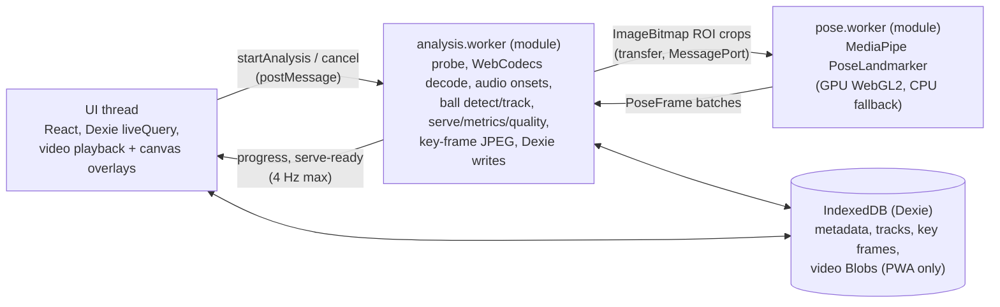

# Serve Coach: technical architecture (v1 PWA and the iOS route)

- **Status:** spec v1, written 2026-09-27 and revised the same day to follow the revised DECISIONS D1, D4, D5 and the new D11 (revision log at the end). It builds directly on the engine already in `app/src/analysis`.
- **Read with:** `docs/DECISIONS.md` (binding), `docs/specs/METRICS.md` + `metrics.json` (metric definitions, reason codes, rounding, thresholds, bands), `docs/specs/COACHING.md` + `coaching-library.json` (faults, cues, drills, rule schema), `docs/specs/CAPTURE.md` (recording guide, live checks, `CaptureContext`), `docs/PRODUCT.md`, `DESIGN.md`. Gap studies used for numbers: `docs/research/gaps/side-view-geometry-contradictions.md` (framing rule, tilt rectification, what the side view cannot measure, audio speed removal), `docs/research/gaps/recreational-reference-ranges.md` (capture envelope, provisional bands, plausibility bounds), `docs/research/gaps/australian-segment-evidence.md` and `docs/research/10-segment-decision.md` (D11 data needs).
- **Supersedes:** `docs/IOS_ROUTE.md` (stub). Keep `docs/MODELS.md` as the model register.
- **Conventions:** research citations look like (research 05 [S4]); the two geometry gap studies are cited as (gap geometry §n) and (gap ranges §n). Sources I checked for this spec are tagged [A1]–[A6] and listed in section 19. Claims carry [Established], [Vendor claim], [Coaching interpretation] or [Our inference] where it matters. All numbers for iPhone performance are **budgets to be measured**, not measurements, unless a builder report is cited. **Metric ids and reason codes are generated from `metrics.json`** (section 6.1), never hand-written; the removed id `trunk-tilt-band` is never reused.

---

## 1. Summary

v1 is a phone-first PWA: Vite 8, React 19, TypeScript, Tailwind 4 and Dexie 4. The analysis engine is framework-free TypeScript and runs entirely on the device, in Web Workers. There is no account, no upload and no third-party network traffic (D8, D9). The same `dist/` bundle ships inside a Capacitor 8 iOS shell. Native plugins then take over what the web platform does badly: capture with locked frame rate and exposure, large-file handling and, if a benchmark justifies it, Apple Vision pose.

Twelve architecture decisions follow from the brief, DECISIONS.md and the research:

| # | Decision | Why |
|---|---|---|
| A1 | **Two-pass analysis.** Pass A is a sparse pass that finds serves using pose at 4 fps, cheap motion and ball cues, and contact-sound onsets when hit-sound timing is on. Pass B is a dense pass that runs full-rate pose, ball and event fusion inside each serve window only. | Pose inference is the bottleneck: 17–34 ms per frame on a laptop GPU (pose_report). Most of a practice clip is walking and ball-fetching. |
| A2 | **Two module workers plus the UI thread.** `analysis.worker` owns decode, audio, ball, segmentation, metrics and Dexie writes. `pose.worker` owns MediaPipe. They talk over a `MessageChannel`, so frames never cross the UI thread. | Keeps the UI responsive; the two workers overlap GPU pose with CPU ball detection. |
| A3 | **Engine output is immutable and versioned.** Player-entered tags live in their own table. Session statistics that depend on tags are a pure, cheap recomputation (`SessionStats`). | Tagging, deleting a serve or changing settings never re-runs vision, and old results stay reproducible. |
| A4 | **The honesty label is resolved in one place** (`metrics/status.ts`) from declarative prerequisites in the metrics catalogue. Runtime code can only *downgrade* a status, never go above the catalogue ceiling: min(`statusTarget`, the ceiling for the metric's `validationLevel`, METRICS §1.3). | D2: no unlabelled or over-labelled numbers. |
| A5 | **Every rate carries n and an interval; every comparison is matched.** The stratum is view, camera side, court side, serve number, intended type and handedness (METRICS §1.6, §4.4). Frame-rate class and the D1 set-up are soft factors that label a comparison; a different engine major makes it `not-comparable`. | D7, METRICS §4.4, section 17. |
| A6 | **Videos are stored behind a `BlobStore` interface.** In the PWA that is IndexedDB Blobs. In iOS it is native files in the app sandbox, with only metadata in Dexie. | WebKit gives non-browser apps a much smaller IndexedDB quota [A1]. |
| A7 | **The retention sweep runs on app open and after each analysis.** Deletion is a hard delete of records and blobs. JSON and CSV export are built in. | D8. A PWA cannot run background jobs. |
| A8 | **A strict CSP (`connect-src 'self'`) plus a single network module** (`platform/net.ts`, empty in v1). A Playwright test asserts that no request goes to any other origin. | D8. It blocks MediaPipe telemetry (scaffold_report, pose_report). |
| A9 | **Coaching is a deterministic rules engine over `coaching-library.json`.** An optional language model may only rephrase the chosen decision. It never chooses it. | D6, D9. Keeps advice auditable and testable. |
| A10 | **Validation is part of the product.** The synthetic end-to-end harness (`tools/validate`), in-app annotation mode and a per-metric validation level shown on "How we measure". | The brief's accuracy requirement. Real-footage and radar validation are documented next steps. |
| A11 | **"Record now" records inside the app** (PWA: `getUserMedia` + `MediaRecorder`, video track only; iOS: the `ServeCapture` plugin). Every recording stores a `CaptureContext`: orientation, D1 set-up, pitch and roll samples, delivered format and field of view. The system Camera app is a fallback that is treated like an import. | Only an in-app recorder can run the D1 headroom gate (block below 4.3 m), log the pitch needed for tilt correction, show the countdown and black recording screen, and keep sound out of the stored file (D1, D4). |
| A12 | **Tilt is removed before any metric.** Pose landmarks and ball centres are mapped through the rotation homography K·R(pitch, roll)·K⁻¹, with K built for the clip's displayed orientation. A clip with unknown pitch (import, system camera) is treated as level with a widened uncertainty and the `TILT_UNKNOWN` label. A measured tilt above the D1 cap (5°) blocks recording in the app; in any clip where it is found afterwards (for example a bump during recording), height and angle metrics are `unavailable` (`CAMERA_TILTED`). | D1: "Uncorrected tilt is not allowed" (gap geometry §6.6). |

---

## 2. Inputs this spec builds on

**Built** (builder reports: `video_report.json`, `pose_report.json`, `scaffold_report.md`):

- **`analysis/video`.** MP4/MOV probe reads container boxes only. Decode uses WebCodecs, with a media-element seek fallback. It handles rotation, variable frame rate, the slow-motion time base (`timeScale`, flagged when unproven) and audio onset detection. Measured on a Windows laptop in headless Edge/Chrome:
  - decode-only at 1080p: 464–650 fps;
  - RGBA at 640 px: 184–229 fps;
  - media-element fallback: 14–36 fps;
  - audio onset error on synthetic clicks: median 0.021 ms.

  **Nothing has been tested on iOS or on real footage.**
- **`analysis/pose`.**
  - `MediaPipePoseSource` runs in a worker, uses GPU with CPU fallback, and serves assets from `/models` and `/mediapipe/wasm` (no CDN).
  - `ServerTracker` follows the server and ignores bystanders.
  - `cleanPoseFrames` handles left/right swaps, outliers, gaps and zero-phase One Euro smoothing.
  - `body.ts` provides standing height, handedness, facing side, 2D angles and front toe.
  - Measured per-frame inference (laptop GPU, 1280×720 frames of a cartoon figure):

    | Model | numPoses 2 | numPoses 1 |
    |---|---|---|
    | lite | 25–34 ms | 15–22 ms |
    | full | 28–31 ms | 17–19 ms |

  - Worker round trip is about 2× the inference time. First GPU warm-up in a fresh browser takes 3.3–4.9 s.
- **`analysis/ball` (in progress).** Colour and motion detector, tracker (toss and outgoing), robust parabola fits, toss analysis with a gravity time-scale check, bounce detection, homography with court keypoints, and experimental speed. Checked in the source on 2026-09-27:
  - `estimateServeSpeedFromTrack` is the side-view path (`speed-experimental`): 120 fps or more, a height scale and a player target tag, otherwise `unavailable`.
  - `speedFromFlightTime` refuses `cameraView: 'side'` ("bounce not in view") and needs `'rear'` plus a bounce located in video (`speed-average-rear`). It has no audio-only mode (D4).
  - `analyseBall()` emits the canonical ids `toss-apex-height`, `speed-experimental`, `speed-average-rear` and `spin`. **`ball/README.md` still lists the old names** (`ball.tossApexHeightM`, `ball.tossApexAboveHeadM`, `ball.serveSpeedKmh`, `ball.serveSpeedAverageAudioKmh`) and must be updated; the catalogue-id test in section 13 stops any of them reaching `MetricValue.id`.
- **`tools/synth` (in progress).** A three.js/Playwright/ffmpeg generator of serve videos with exact ground truth: per-serve parameters, pose, ball, camera, frame-rate and slow-motion export variants.
- **Assets.**
  - `vision_wasm_module_internal.wasm`: 11.8 MB (this is the build the worker uses).
  - `pose_landmarker_full.task`: 9.4 MB.
  - `pose_landmarker_lite.task`: 5.8 MB.

**Binding decisions:** D1–D11 in `docs/DECISIONS.md`, as revised on 2026-09-27. The revisions that change this architecture:

- **D1:** placement follows a framing rule (frame top at least 4.5 m in the server's plane, 4.3 m accepted with an extrapolated and labelled apex, 4.7 m target), enforced by a live headroom check that blocks recording below 4.3 m. The default set-up is **portrait, 7–8 m from the centre mark, 1.3–1.6 m high, level**; the alternative is **landscape at the side fence, 8.5–9.5 m, 1.4–1.8 m, 4K preferred**. A measured upward tilt of 5° or less is allowed and removed in software. The side view cannot measure knee bend or shoulder-over-shoulder at contact.
- **D4:** no audio flight-time speed from the side view; the side-view experimental range needs a target tag; audio only times contact, is reduced to timestamps and is not kept.
- **D5:** leg drive is hip rise (lowest point to contact, % of height) plus drive time; shoulder tilt at the trophy position is a player-relative band; loading depth is descriptive; no knee-bend band in the side view; no 2D band is compared with published trunk angles.
- **D11:** the launch segment is comp-night regulars, which adds the match log, season, play style and the practice-day allowance to the data model (section 7).

Section 17 flags the points where I think the decisions still need attention.

---

## 3. Module map

```
app/src/
  analysis/                  framework-free; no React; no DOM globals in pure modules; runs in Node tests, workers, WKWebView
    types.ts                 shared contract (v0) + v1 additions in section 6.1
    generated/    [new]      written by scripts/sync-specs.mjs; never edited by hand
      catalogue-types.ts     MetricId and ReasonCode unions from metrics.json (section 6.1)
    video/        [built]    probe, FrameSource (WebCodecs | media-element), time base, rotation, audio decode + onsets
    pose/         [built]    PoseSource (MediaPipe | injected | apple-vision later), tracking, cleaning, body geometry
    ball/         [building] detector, tracker, toss + gravity check, bounce, homography, speed (experimental; side
                             near-contact track with target tag, rear flight time to a located bounce)
    geometry/     [new]      pure camera geometry, shared by the engine and the live framing check
      camera.ts              intrinsics K for the displayed orientation (native intrinsics, videoFieldOfView, or lens default)
      rectify.ts             orientation samples -> per-frame R(pitch, roll); K·R·K⁻¹ applied to landmarks and ball centres
      framing.ts             D1 framing rule: frame top at the server's plane, toss-offset allowance, set-up classification
    serve/        [new]      serve finding and timing
      sparse.ts              Pass A signals -> ServeCandidate[]
      windows.ts             candidates -> ServeWindow[] (frame ranges, core range, ROI)
      events.ts              pose + ball + contact onsets -> ServeEvents with uncertainties (fusion), on rectified points
      phases.ts              events -> PhaseSpan[] (7 phases) + key-frame events
      bodyTrack.ts           per-window pose post-processing (cleanPoseFrames, ROI back-projection, rectification)
      types.ts               ServeCandidate, ServeWindow, fusion inputs
    metrics/      [new]      catalogue computation with status and uncertainty
      catalogue.ts           typed loader for catalogue.json (generated from docs/specs/metrics.json)
      status.ts              prerequisites -> status, reasonCode, unlockHint; downgrade rules; catalogue ceiling
      serveMetrics.ts        per-serve metric functions registered by MetricId
      legDrive.ts            lowest hip, hip rise, drive time, loading depth, deep-bend flag (side view)
      bands.ts               shoulder-tilt-trophy (player-relative); rear-only knee and shoulder-over-shoulder bands
      adapters/ball.ts       ball-module results -> canonical MetricValues (ids checked against the catalogue)
      plausibility.ts        hard-reject and soft-flag bounds (gap ranges §8, via metrics.json)
      sessionMetrics.ts      aggregation: means, spreads, rates, repeatability, the outcome-linked contrast
      stats.ts               Wilson and Newcombe intervals, bootstrap SD intervals, matched comparisons, "N more serves"
      format.ts              rounding and display strings (METRICS.md rules)
    quality/      [new]
      captureChecks.ts       container, time base, fps, subject size, headroom (D1 framing rule), tilt, exposure,
                             flicker, blur, camera motion
      serveChecks.ts         per-serve completeness (release/apex/contact), edge proximity, occlusion, interpolation,
                             plausibility bounds
      report.ts              QualityReport assembly; exclusion rules; capture-quality metric
    pipeline/     [new]      orchestration
      orchestrator.ts        two-pass plan, progress, cancellation, checkpoints, resume
      analysis.worker.ts     worker entry: FrameSource, audio, ball, serve, metrics, quality, key frames, Dexie writes
      posePort.ts            pose worker over MessagePort (small addition to pose/: "port mode")
      protocol.ts            typed messages UI <-> analysis worker
      budget.ts              memory and duration guards
      keyFrames.ts           re-decode of key-frame event indices; JPEG encode via OffscreenCanvas
  coaching/       [new]      pure; imports analysis types only
    library.ts               load + validate coaching-library.json
    rules.ts                 predicate evaluation over MetricValues (respects status)
    decide.ts                D6 priority pipeline -> CoachingDecision (with trace)
    experiment.ts            experiment lifecycle and verdict assembly (uses metrics/stats.ts)
    phrasing/                template.ts (default) | foundation.ts (iOS on-device, later) | cloud.ts (consent-gated, later)
  data/           [new]      Dexie 4
    db.ts                    schema, versions, migrations
    records.ts               record types (section 7.1)
    repos/                   profile, sessions, videos, serves, tracks, keyFrames, tags, tallies, stats,
                             coaching, experiments, practice, matchLogs, events, annotations, settings, jobs
    storage/                 BlobStore interface; idbBlobStore.ts (PWA); nativeFileStore.ts (Capacitor)
    retention.ts             sweep + policies (videos; events older than 180 days)
    deletion.ts              cascades + deletion log
    export.ts                JSON / CSV (and optional zip of key frames)
    coachSummary.ts          one-page coach summary: PNG via OffscreenCanvas; PDF where the platform can print one (M12)
    stripAudio.ts            removes the audio track from imported and system-camera clips before storing (mp4box.js
                             remux, no re-encode; lazy chunk)
    persist.ts               navigator.storage.persist()/estimate()
    demo/                    seed loader for demo mode
  platform/       [new]
    capabilities.ts          feature detection (WebCodecs, HEVC config, OffscreenCanvas WebGL in workers, wake lock,
                             persist, MediaRecorder MP4, DeviceMotion permission)
    recorder.ts              in-app PWA recording: MediaRecorder on the video track only, 1 s chunks to IndexedDB,
                             countdown, 20-minute stop, CaptureContext assembly and persistence
    motion.ts                DeviceMotion gravity -> pitch and roll (CAPTURE §9.3), 10 Hz samples into CaptureContext
    liveOnsets.ts            opt-in hit-sound timing: separate audio-only track -> AudioWorklet -> onset timestamps;
                             samples are never written anywhere
    native.ts                Capacitor plugin interfaces (ServeCapture, ServeFiles, ServePose, ServePhrasing)
    net.ts                   the only module allowed to call fetch() on another origin (no callers in v1)
    ids.ts                   ULID generator (crypto.getRandomValues)
  ui/                        React; screens, components, charts (hand-built SVG), overlays (canvas), state (zustand)
  validation/                annotation mode (in-app, hidden) + validation.html harness
tools/
  synth/          [building] ground-truth serve video generator
  validate/       [new]      runs the engine on synthetic scenarios; error report; regression gate
  demo/           [new]      builds the demo seed bundle from synthetic sessions using the real engine
```

**Dependency rules.** These are enforced by an `oxlint` `no-restricted-imports` rule, or by a small import-graph test if oxlint cannot express them.

- `analysis/**` imports nothing from `coaching`, `data`, `ui` or `platform/native`.
- `coaching/**` imports only `analysis/types` and `metrics/stats`.
- `data/**` imports types, not engine code.
- Only `pipeline/` and `ui/` compose modules. `platform/recorder.ts` may import the pure `analysis/geometry` and `data/repos` (recording chunks), nothing else from `analysis`.
- Nothing in `metrics/` or `coaching/` imports match-log or event types (enforced by the import rule), so match logs cannot leak into practice statistics.
- Only `platform/net.ts` may reference `fetch(` with a non-relative URL.

**Specs to code.** `scripts/sync-specs.mjs` runs as a `prebuild` and `pretest` step. It:

1. validates `docs/specs/metrics.json` and `docs/specs/coaching-library.json` against TypeScript type guards;
2. copies them to `app/src/analysis/metrics/catalogue.json` and `app/src/coaching/library.json`;
3. **generates `app/src/analysis/generated/catalogue-types.ts`**: the `MetricId` union from `metrics[].id` and the `ReasonCode` union from the keys of `reasonCodes`, plus `METRIC_IDS` and `REASON_CODES` arrays for runtime checks;
4. fails if `coaching-library.json` references a metric id or reason code that the catalogue does not define, or if the catalogue still contains a removed id (`trunk-tilt-band`), or if a side-view-only rule names a rear-only metric (`knee-bend-band`, `shoulder-over-shoulder-contact`, `speed-average-rear`).

TypeScript then rejects any hand-written id that is not in the catalogue. The app never reads outside `app/` at runtime.

---

## 4. Runtime topology



- **Startup.** The UI creates both workers and one `MessageChannel`, transfers `port1` to `analysis.worker` and `port2` to `pose.worker`, and never touches frames.
  - This needs one addition to `pose/`: a "port mode" in which `pose.worker.ts` accepts `PoseInputFrame` messages from a port rather than from its owner.
  - The existing `workerProtocol.ts` messages are reused.
- **Recording (PWA)** runs on the UI thread and never overlaps analysis: `platform/recorder.ts` owns the `MediaStream`, the `MediaRecorder` and the chunk writes; `platform/motion.ts` samples pitch and roll; the live framing check uses the pose worker in lite mode (CAPTURE §9.4) and `geometry/framing.ts`. The analysis worker starts only after the recording is finalised.
- **Live updates.** Dexie 4 `liveQuery` in the UI picks up writes made in the worker, because Dexie propagates changes across same-origin contexts. This must be verified in Safari; if it fails, the worker posts a `db-changed` message.
- **Fallbacks, chosen by `platform/capabilities.ts` at job start and recorded in `EngineStamp`:**
  1. No WebCodecs in workers → decode on the UI thread and transfer `ImageBitmap`s to the analysis worker. The UI thread uses WebCodecs if it is available there, otherwise the existing media-element path. The media-element path is slow (14–36 fps measured on a laptop).
  2. No WebGL in a worker's `OffscreenCanvas` → run MediaPipe on the UI thread (the existing fallback in `MediaPipePoseSource`). The UI shows a static progress screen to limit jank.
  3. No WebGL at all → analysis unavailable. The app shows a clear message and demo mode still works.

---

## 5. End-to-end analysis pipeline

### 5.1 Entry points

| Path | v1 PWA | iOS (Capacitor) |
|---|---|---|
| **Record now** (default) | **In-app recording** (`platform/recorder.ts`, CAPTURE §9): `getUserMedia` preview with the live framing check (pose lite at about 5 fps, level, D1 headroom, steady, player size). **Ready** requires a frame top of at least 4.5 m at the server's plane (4.7 m target); 4.3–4.5 m is accepted with the note "Very high tosses will be estimated". A **measured** frame top below 4.3 m or a **measured** tilt above 5° blocks Record, and "Record anyway" does not override those two (D1: the check "blocks recording below 4.3 m"; uncorrected or over-cap tilt is not allowed). "Record anyway" (overflow) still overrides the other checks, and also these two when they cannot be measured (player not detected, motion permission denied); the failing or unmeasured check ids are stored. Then a 10 s countdown, an all-black screen with the recording indicator and **Stop**, and an automatic stop at 20 minutes. `MediaRecorder` records the **video track only** (MP4/H.264 preferred, WebM fallback), with `timeslice: 1000` chunks written to IndexedDB as they arrive. Pitch and roll are logged at 10 Hz. After Stop: probe, then "Saved: 5:12 · 1080p · 60 fps". Source `in-app-web`. | `ServeCapture` plugin (AVFoundation): locked fps, custom exposure, stabilisation off, 1x lens, HDR off; portrait by default, landscape as the D1 alternative; framing checks and CoreMotion attitude natively; no audio in the file (section 15). Source `in-app-native` |
| Use the Camera app (fallback) | `<input type="file" accept="video/*" capture="environment">`. For phones where in-app recording fails, and for 120/240 fps (which `getUserMedia` does not deliver). **Treated as an import:** no Ready gate, pitch unknown (`TILT_UNKNOWN`), the sound is removed from the stored copy (section 9 item 4). Source `camera-input` | Not offered (native capture covers it) |
| Import | `<input type="file" accept="video/*">`, CAPTURE §11 questions (view, camera side, court side, serve number); pitch unknown; sound removed from the stored copy. Source `file-import` | `ServeFiles.pick()` using PHPicker with `.current` representation (no transcode) (research 05 §9.2) |
| Demo | Bundled synthetic clip (portrait default set-up) or seeded results | Same |

Every path produces a `Session` (with its mode: `technique` for the side view, `outcomes` for the rear view), a `Video` record **with its `CaptureContext`** (section 7.1; CAPTURE §12 owns the full type) and an analysis `Job`. The capture context carries what the footage alone cannot prove: orientation, D1 set-up, pitch and roll samples, delivered size and frame rate, field of view or intrinsics, declared view, camera side, court side, serve number, intended type and target, and live contact onsets when hit-sound timing is on. For imports and system-camera clips it is built from the probe and the CAPTURE §11 answers, with pitch unknown.

The player's height and handedness are required before analysis: height provides the metric scale for estimated values, and handedness mirrors all geometry. If they are missing, the flow asks once and remembers. An entered height below 1.30 m or above 2.20 m is refused at entry, and one below 1.45 m or above 2.05 m asks for confirmation (gap ranges §8).

**Pre-flight checks at import**, before any decoding:

- `probeVideo()`, with a budget of 500 ms or less for a 200 MB MOV (it reads boxes only).
- Duration and size guards:

  | Clip | PWA limit |
  |---|---|
  | 60 fps or less | 10 minutes |
  | 120 or 240 fps | 60 seconds |
  | Any file | 2 GB |

- A storage estimate (see below).
- HEVC support via `VideoDecoder.isConfigSupported`.
- A time-base check. If `timeBase.status` is `unknown` and the clip might be a rendered slow-motion export, analysis proceeds. The toss gravity check in Pass B then proves or corrects the time base (`fpsSource: 'physics'`). Audio timing is disabled whenever `timeScale ≠ 1`.
- **Sound handling for imports and system-camera clips** (D4): if hit-sound timing is on, contact onsets are computed from the original file's audio track first (`video/audio.ts`, onsets only). Then `data/stripAudio.ts` writes the stored copy without the audio track. If the remux fails, no copy is stored: analysis reads the picked `File` directly, and the session is kept as if "delete after analysis" had been chosen, with the copy "We couldn't remove the sound from this video, so we didn't keep a copy. Your original is unchanged."

**Storage check:** the app calls `navigator.storage.estimate()` and requires free quota of at least 2.2× the file size. The file is copied into the store, and working memory has headroom. During in-app recording the check repeats every 30 s; below the need for one more minute, recording stops cleanly with "Storage nearly full: we kept what was recorded."

### 5.2 Sequence

```mermaid
sequenceDiagram
  autonumber
  participant P as Player (UI)
  participant A as analysis.worker
  participant M as pose.worker
  participant D as Dexie
  P->>D: create Session, Video (Blob or native path) + CaptureContext, Job(queued)
  P->>A: start {jobId, capture}
  A->>A: probe + capability check + budgets
  A->>A: camera model: K for the displayed orientation; per-frame R(pitch, roll) from CaptureContext (or level + TILT_UNKNOWN)
  A->>A: contact onsets: live onsets from CaptureContext, or onsets computed before the audio was removed (hit-sound timing on only)
  loop Pass A (sparse), whole clip
    A->>A: decode all frames (HW); emit 10 fps 160px luma (motion, ball-above-head) and 4 fps 256px bitmaps
    A->>M: 4 fps bitmaps (lite, numPoses 2)
    M-->>A: PoseFrames -> ServerTracker
  end
  A->>A: fuse -> ServeCandidate[] -> ServeWindow[] (ROI from tracked box)
  A-->>P: progress "Finding serves (N found)"
  loop Pass B (dense), per window in time order
    A->>A: decode window from preceding keyframe at full rate
    A->>M: ROI crops (full model, numPoses 1) at full rate in core range, every 3rd frame outside it
    M-->>A: PoseFrames (ROI coords -> frame coords)
    A->>A: ball detect/track on toss + outgoing regions (every frame)
    A->>A: rectify landmarks + ball centres (K·R·K⁻¹); raw points kept for overlays
    A->>A: events (fusion) -> phases -> per-serve metrics -> plausibility + serve quality
    A->>A: key-frame pass: re-decode the event frames (<= 8) -> thumbnails + evidence crops (OffscreenCanvas)
    A->>D: tx: Serve + Track + KeyFrames; Job.completedWindows += i
    A-->>P: progress + "serve-ready" (player can open it)
  end
  A->>A: session aggregation (SessionAnalysis), capture quality, handedness/scale consistency
  A->>D: tx: Session.analysis, Job(done); apply "delete after analysis" if chosen
  A-->>P: done
  P->>P: computeSessionStats(serves, tags, tallies) + decide() -> focus card
```

### 5.3 Pass A: finding serves (sparse)

**Goal:** find every serve with at least 98% recall, the feasibility target in research 05 §10 row 1, and precision to be measured. Each serve gets a window that fully contains setup to recovery.

**Signals**, all computed inside `analysis.worker` from one sequential decode:

| Signal | Rate | Computation | Cost note |
|---|---|---|---|
| S1 audio contact (only when hit-sound timing is on) | Sample-accurate | Onsets with `sharpness ≥ 0.6`, labelled `contact` (thresholds from `audio.ts`, tuned on synthetic sound only, so experimental). In-app recordings supply live onsets from `CaptureContext`; imports supply onsets computed before the sound was removed. Bounce onsets are never used (D4) | Live: none at analysis. Import: about 1–2 s for 2 minutes (our estimate) |
| S2 toss-arm posture | 4 fps | Pose lite (numPoses 2) + `ServerTracker`. The tossing wrist is above the nose by at least 0.1 BH and the hitting elbow is at or above shoulder height. BH = standing body height in frame units | Dominant cost: about 480 pose frames for a 2-minute clip |
| S3 ball above head | 10 fps | Ball colour likelihood on a 160 px frame inside the column above the tracked player's head | Cheap |
| S4 motion energy | 10 fps | Luma difference inside the tracked player box | Cheap |

**Fusion rule** (`serve/sparse.ts`):

1. A candidate is anchored on an S1 contact onset when onsets exist. Otherwise (the default, because hit-sound timing is off by default) the anchor is the end of an S2 run of at least 0.25 s, plus 0.3 s.
2. It needs at least two supporting cues out of S2 run, S3 hit, S4 peak or S1 onset, within [anchor − 2.0 s, anchor + 0.3 s].
3. Candidates less than 2.5 s apart are merged, keeping the stronger one.
4. Candidates with S2 and S3 but no contact cue and no hitting-arm swing are classified `toss-only` (a caught toss). They are shown as "tosses caught" and excluded from serve statistics.
5. Pre-serve ball bounces produce soft onsets without S2 and are rejected.

**Window** (`serve/windows.ts`):

- `start` = anchor − 2.2 s (covers setup and motion start).
- `end` = anchor + 1.6 s (covers landing and recovery).
- Both are clamped to the clip and to the neighbouring window's midpoint.
- `core` = [anchor − 1.6 s, anchor + 0.6 s] (release to landing), expanded when the sparse S2 run suggests a slow toss.
- `roi` = the union of the tracked player boxes in the window:
  - widened by 0.6 BH on each side;
  - extended upward to the frame top (toss);
  - extended into the court by 1.5 BH (contact point and outgoing ball);
  - square-padded for pose.

  ROI cropping raises effective resolution for a distant player, which mitigates MediaPipe's more-than-4-m out-of-scope note (research 05 §1.3, [S5]).

### 5.4 Pass B: dense analysis per window

Per window, in time order, with each window committed atomically:

1. **Decode** from the keyframe before `start`, using the existing `decodePlan`, which handles open-GOP streams. Frames outside the window are closed immediately.
2. **Pose.**
   - The full model runs on ROI crops (`createImageBitmap(frame, sx, sy, sw, sh, {resizeWidth: 256…512})`) with numPoses 1: the tracker already locked on the server in Pass A, and the ROI excludes most bystanders.
   - Rate: every frame in `core` for clips up to 120 fps, and 120 fps (every 2nd frame) for 240 fps clips. Every 3rd frame outside `core`.
   - Landmarks are mapped back to full-frame normalised coordinates in `posePort.ts`.
   - `cleanPoseFrames(frames, { frameAspect: meta.width / meta.height })` runs per window. The `frameAspect` convention comes from the pose builder.
3. **Ball.** `BallDetector` runs on every frame, over two regions:
   - the toss column (above the head to the frame top, forward of the body);
   - after the provisional contact time, the outgoing region.

   Then `trackBall({ contactTReal, tossSearchWindow })` on raw detections; the track's observations are rectified (step 4) and passed to `analyseToss()`, which provides release, apex (bracketed, or above the frame and extrapolated), heights and the gravity check in the level frame. Speed follows D4 exactly:
   - side view: `estimateServeSpeedFromTrack` only at 120 fps or more, with a height scale and the serve's target tag (T / body / wide), otherwise `unavailable` (`FPS_TOO_LOW`, `TARGET_NOT_TAGGED`);
   - rear (outcomes) view: `detectBounce()` → `mapBounceToCourt()` → `speedFromFlightTime({ cameraView: 'rear', bounce })`, which needs a bounce located in video;
   - the pipeline never passes audio bounce onsets to any speed function, and a side-view session never calls `speedFromFlightTime` (the function also refuses `'side'`).
4. **Rectification** (`geometry/rectify.ts`, A12). Every landmark and ball centre is mapped through H = K·R(pitch, roll)·K⁻¹ before events and metrics:
   - **K** is built for the clip's *displayed* orientation: principal point at the frame centre, and f_px = (long side px / 2) / tan(long-side FOV / 2). The long-side FOV comes from native intrinsics, then `videoFieldOfView`, then the lens default (26 mm: 67.3°; 24 mm Pro: 71.6°; gap geometry §6.2). In portrait the long side is vertical, so the default set-up's vertical FOV is the long-side value, not the landscape 41–44°. METRICS §1.1's K must follow the same rule.
   - **R** comes from the per-frame pitch and roll: `CaptureContext.orientationSamples` (PWA, 10 Hz, interpolated to frame times) or the native per-frame attitude. Samples are low-passed; a step of more than 1° during the clip is a camera bump (`CAMERA_MOVED`), not a tilt to correct.
   - **Unknown pitch** (imports, system camera): R = identity for pitch, roll estimated from the standing player's vertical axis and the toss parabolas (CAPTURE §11.2), and METRICS §1.1's σ_tilt = 2° added. Height and angle metrics are capped at `estimated` with `TILT_UNKNOWN`.
   - **Measured pitch above the cap** (5°; 8° only after the synthetic tilt test in section 13 passes, gap geometry §6.6): height and angle metrics are `unavailable` with `CAMERA_TILTED`. Timing metrics are unaffected.
   - **Yaw** cannot be read from gravity. The live check asks for the baseline to run into the centre of the screen; the engine estimates residual yaw from the baseline's vanishing point where visible and adds a quality warning above 10°.
   - Raw (unrectified) points stay in `TrackRecord` for overlays drawn on the video; the per-frame R is stored with them, so rectified points can be recomputed exactly.
5. **Events.** Section 5.5, on rectified points.
6. **Per-serve metrics, plausibility and quality.** Section 5.6.
7. **Key frames** (`pipeline/keyFrames.ts`). One forward decode through the window re-decodes the **event** frames (≤ 8): `setup`, `release`, `apex`, `trophy`, `lowestHip`, `contact`, `landing`, `recovery`. For **every serve** it writes:
   - an event thumbnail for each event found (240 px long side, JPEG q0.72, about 8–12 KB);
   - an **evidence crop** for the four events that coaching evidence and overlays use (`apex`, `trophy`, `lowestHip`, `contact`): the player's ROI widened to the toss column and contact zone, 720 px long side, JPEG q0.8, about 35–50 KB.

   These survive video deletion, so the apex-scatter overlay (drawn from ball tracks on the apex crop), `shoulder-tilt-trophy` (trophy), leg drive (lowest hip and contact) and the focus card's "This session v your best serve" still work after the default 30-day deletion. A full-frame 1080 px evidence frame for the chosen focus event is added lazily while the video still exists.
8. **Commit.** One Dexie transaction writes `serves`, `tracks`, `keyFrames` and `jobs.completedWindows`. The UI can then open that serve.

### 5.5 Event fusion and phases (`serve/events.ts`, `serve/phases.ts`)

Each event is an `EventEstimate` carrying `uncertaintyS`, `confidence` and `method`. Fusion uses inverse-variance weighting across available methods. When two methods disagree by more than 3σ combined, the less reliable method is dropped and the event's confidence is reduced.

| Event | Primary method | Secondary | Notes |
|---|---|---|---|
| `motionStart` | Tossing-wrist speed rises above 0.4 BH/s after at least 0.3 s of stillness | Motion energy | Ends setup |
| `tossRelease` | `estimateRelease()`: ball separates from the hand track (ball module) | Tossing wrist reaches its peak upward speed | σ floor 15 ms (`RELEASE_MODEL_SIGMA_S`) |
| `tossApex` | Parabola vertex from `analyseToss()` on rectified observations | — | Flags `bracketed`, `aboveFrame` and `extrapolated`. Above the frame, the apex is fitted with gravity fixed in pixels (stature scale and time base), weighting points within 3 m/s of the apex (gap ranges §6.4). If the exit-to-re-entry gap is 0.65 s or less (apex up to about 0.5 m above the frame), apex-based values are `estimated` with `APEX_EXTRAPOLATED`; beyond that they are `unavailable` with `APEX_OUT_OF_FRAME` |
| `trophyStart`, `trophyEnd`, `trophy` | Hitting-hand speed minimum while the hitting elbow is at or above shoulder height and the tossing arm is elevated. `trophy` is the midpoint and the key frame | — | Used by `trophy-pause` and `shoulder-tilt-trophy` |
| `lowestHip` | Lowest mid-hip (midpoint of the two hip landmarks, rectified; image-y maximum) between release and contact, from a local quadratic fit over 7–9 frames | Zero crossing of the mid-hip vertical velocity | A flat minimum: about ±2–3 frames at 60 fps (gap geometry §5). Used by `leg-drive`, `drive-time`, `loading-depth` and `deep-bend-flag`. The 2D knee angle is never used in the side view (D1, D5); `deep-bend-flag` uses the view-independent segment-height estimate instead (gap geometry §3.4) |
| `contact` | Audio onset (only when hit-sound timing is on, `assessAudioTiming` passes and `timeScale = 1`), minus the sound travel time from contact to phone (about 18–28 ms at the D1 distances of 6–9.5 m from the phone, from the scale-derived distance). This correction matters because rhythm mixes video events with the audio contact. Any remaining audio–video offset (container, or the live onset clock against the recording clock) is estimated per session as the median gap between the audio contact and the ball-velocity discontinuity, where both exist | Ball velocity discontinuity (start of the outgoing track), then the highest point of the hitting wrist | Research 05 §6.1: about ±5 ms with audio, ±1 frame without |
| `takeoff` / `landing` | First frame after contact where the front-foot heel/toe vertical speed is about 0 and height is back to the floor line | Ankle, with a fixed correction (research 05 §6.7) | `landing.footPoint` records which |
| `recoveryEnd` | Pelvis speed below 0.3 BH/s, or landing + 1.0 s | — | |

**Phases** (`ServePhase`) and the key-frame **events** that stand for them. The phase timeline and the key-frame strip both read this table, so PRODUCT §6.6 and DESIGN §8.9 should use one list: the strip shows the events **Release · Apex · Trophy · Lowest hip · Contact · Landing**, plus Setup and Recovery when detected; the timeline shows the seven phases and jumps to each phase's strip event.

| Phase | Span | Strip event (phase key frame) | Focus-evidence event (coaching) |
|---|---|---|---|
| setup | window start → `motionStart` | `setup` (last still frame) | — |
| toss | `motionStart` → `tossRelease` | `release` | `apex` (toss foci open on the apex frame) |
| loading | `tossRelease` → `trophyEnd` | `trophy` | `trophy` (shoulder tilt) or `lowestHip` (loading depth) |
| drive | `trophyEnd` → `contact` | `lowestHip` | `lowestHip` + `contact` (leg drive; racket drop is not measured, D5) |
| contact | `contact` ± 1 frame | `contact` | `contact` |
| landing | `contact` → `landing` + 0.2 s | `landing` | `landing` |
| recovery | then → `recoveryEnd` | `recovery` | — |

`apex` usually falls inside the loading phase and `lowestHip` near the loading–drive boundary; the strip orders events by time, not by phase. Until `coaching-library.json` names an event (`evidence.keyFrameEvent`), the engine maps its `keyFramePhase` through the last column. This mapping to the Kovacs and Ellenbecker stages follows research 03 §2.

### 5.6 Metrics, quality and honesty labels

- **Catalogue-driven.** Each metric in `catalogue.json` (generated from `metrics.json`) declares `kind` (per-serve, session-spread, rate, band, flag and so on), `unit`, `views`, `statusDefault`, `statusTarget`, `validationLevel` (V0–V3), `prerequisites` (tokens from `prerequisiteVocabulary`), `display` rounding, `swc`, `uncertainty` and the default `unlockHint` per reason code. **Numbers the engine uses but does not own** come from the catalogue too: provisional recreational bands (gap ranges §7) and plausibility bounds (gap ranges §8), each table carrying a version (`bands_v1_provisional`) that is stamped on every session (`EngineStamp.bandsVersion`), so old verdicts stay reproducible.
- **Prerequisites** (declarative, evaluated by `metrics/status.ts`), using the `metrics.json` vocabulary: `view:side` / `view:rear`, `fps>=N`, `timebase`, `event:*`, `floor`, `startToe`, `bodyHeight`, `playerHeight`, `stability`, `n>=N`, `audio`, `entry:*`, `calibration:court-4pt`, `toggle:experimental`. This spec asks METRICS to add three tokens: `tilt:within-cap` (fails only when a measured pitch is above the cap; unknown pitch passes with the `TILT_UNKNOWN` downgrade), `entry:targetTag` (a T / body / wide tag on the serve, required by `speed-experimental`) and `hitSound` (hit-sound timing on).
- **Status resolution** (`resolveStatus`), in order:
  1. If any prerequisite fails, the status is `unavailable`, with the first failing `reasonCode` and its `unlockHint`. A wrong view gives `NEEDS_SIDE_VIEW` or `NEEDS_REAR_VIEW`, never a generic code.
  2. Otherwise the starting status is the catalogue ceiling: min(`statusTarget`, the ceiling for `validationLevel`) (METRICS §1.3).
  3. Downgrades are applied:
     - landmarks inside the metric's frames are interpolated (`interpolated=true`), or a limb sits in `swapsUnresolved`: at most `estimated` (pose builder's rule);
     - the metric relies on the height scale: at most `estimated`;
     - pitch unknown (import, system camera) on a height or angle metric: at most `estimated`, `TILT_UNKNOWN`;
     - apex above the frame and extrapolated: at most `estimated`, `APEX_EXTRAPOLATED`;
     - a plausibility soft flag (below): confidence lowered, "check this serve" in review;
     - the serve failed an exclusion check or a plausibility hard reject: `unavailable`, `EXCLUDED_BY_QUALITY`, with the failing CAPTURE check id in `MetricValue.checkId`.
  4. Experimental metrics are always computed, but the UI hides them unless the toggle is on. Coaching uses them only in rules explicitly tagged `experimental`.
  5. `spin` always returns `unavailable` / `NOT_MEASURABLE` (D4).
- **Which view produces what.** The catalogue's `views` decides; the D1 and D4 constraints that tests enforce are:

  | Metric | Side view | Rear (outcomes) view |
  |---|---|---|
  | `knee-bend-band` | never (`NEEDS_REAR_VIEW`); knees point at the camera at the trophy position | experimental band on the back knee, which is nearly in the image plane |
  | `shoulder-over-shoulder-contact` | never (`NEEDS_REAR_VIEW`) | experimental band |
  | `speed-average-rear` | never (`NEEDS_REAR_VIEW`) | experimental range, bounce located in video |
  | `speed-experimental` | experimental range at ≥ 120 fps with a target tag | never (`NEEDS_SIDE_VIEW`) |
  | `shoulder-tilt-trophy`, `leg-drive`, `drive-time`, `loading-depth`, `deep-bend-flag` | yes (D1, D5) | as the catalogue decides |

- **Per-serve metric ids:**
  - toss: `toss-apex-height` (absolute height is `estimated`: a toss 0.3 m nearer the camera than the body reads about 8–12 cm high, D1), `toss-forward`, `toss-drop`;
  - contact: `contact-height-ratio`, `contact-forward`;
  - timing: `rhythm-release-to-contact`, `trophy-pause`;
  - leg drive (side view, `metrics/legDrive.ts`, gap geometry §5):
    - `leg-drive`: (mid-hip height at contact − lowest mid-hip height) ÷ standing height, as % of height, on rectified points;
    - `drive-time`: contact time − `lowestHip` time;
    - `loading-depth`: (mid-hip height at release − lowest mid-hip height) ÷ height; **descriptive only**, and never the trigger for a "bend more" instruction;
    - `deep-bend-flag`: experimental yes/no (deep ≥ 45°) from segment heights, never "little bend";
  - shoulder (side view, `metrics/bands.ts`): `shoulder-tilt-trophy`, the rectified 2D shoulder-line angle at `trophy` (never displayed as degrees), banded low / typical / high **against the player's own reference**, never against published trunk angles (48°, 25 ± 7°; D5);
  - rear view only: `knee-bend-band` (back knee), `shoulder-over-shoulder-contact` (experimental), `speed-average-rear` (experimental);
  - `landing-distance`;
  - speed: `speed-experimental` (side), `speed-radar-entered` (from tags);
  - outcomes: `placement-zone` (player-entered target, or experimental in outcomes mode), `spin`.
- **Session-level metric ids:**
  - `serve-count`;
  - spreads: `toss-height-spread` (the copy says it includes a small sideways-toss component, 2–4 cm per 10 cm of sideways spread, unless the rear view was recorded; D1), `toss-forward-spread`, `rhythm-spread`, `repeatability`;
  - outcomes: `serve-in-rate`, `first-serve-in-rate`, `double-faults`, `serve-type-mix`;
  - `capture-quality`;
  - session means and bands of the per-serve metrics (`shoulder-tilt-trophy`'s band needs the player's reference: until 2 matched sessions exist, it is the session's own distribution and says so).
- **Internal units.** Everything is computed in stature units (BH) on rectified points first. Metres are shown only when the player's height is entered (`scale-from-height`, therefore `estimated`). Spreads are computed in BH, so the scale error cancels (research 05 §6.3), and are displayed in centimetres using the entered height.
- **Plausibility bounds** (`metrics/plausibility.ts`, values from gap ranges §8 via `metrics.json`). A *hard reject* (for example an apex above 5.5 m or below contact height − 0.10 m, release to contact under 0.40 s or over 1.60 s, a contact ratio under 1.10 or over 1.75, a fitted toss gravity outside 7–13 m/s²) excludes the serve from statistics, keeps it visible with a "not measured" chip and counts it in "X of N". A *soft flag* (for example an apex over 4.6 m, a contact ratio over 1.62, gravity outside 8.8–10.8 m/s²) keeps the serve, lowers its confidence and offers "check this serve". Caught tosses (no contact within 1.6 s of release) are `toss-only`.
- **Quality** (`quality/`) implements the post-hoc subset of research 06 §14:
  - fps and timing gaps (#10);
  - subject size (#5): warn below 250 px of standing height and suggest 4K (the landscape-at-fence set-up on 1080p is about 260–310 px, and less on the far court half; portrait at 7–8 m is about 450 px; D1);
  - headroom (#4), using the D1 framing rule in `geometry/framing.ts`: frame top at the server's plane, from rectified points, minus the 0.12 m toss-offset allowance (gap geometry §6.8). Target 4.5 m; 4.3 m is the floor; after the first three serves, an apex within 0.2 m of the top prompts "move the phone about 1 m back or raise it" next time;
  - tilt: measured pitch and roll against the cap, or unknown;
  - full-body framing (#3);
  - exposure clipping (#7);
  - flicker by FFT of mean luma (#8);
  - blur on the static body (#9);
  - camera motion by background registration and orientation-sample steps (#11);
  - extra people (#12);
  - ball visibility (#13);
  - serve segmentation completeness (#16).

  A serve is excluded from statistics when checks #3, #10 or #16 fail, when the camera moved during the serve (research 06 §14), or on a plausibility hard reject. Every summary shows "X of N serves measured".

### 5.7 Session aggregation, tags and coaching

- **`SessionAnalysis`** (immutable engine output) contains:
  - capture metadata, the capture context summary (set-up, orientation, tilt status, frame top) and quality;
  - scale and handedness consistency: inferred handedness against the profile, with a warning on disagreement;
  - counts and exclusions;
  - stage timings.
- **`computeSessionStats(serves, tags, tally, profile, settings)`** is a pure function that returns `SessionStats`. It is recomputed whenever tags, tallies or settings change (under 50 ms for 50 serves), and it covers:
  - the session-level metrics;
  - strata (METRICS §1.6: view × camera side × court side × serve number × intended type; the headline uses the stratum with most included serves);
  - the outcome-linked contrast;
  - best serve.

  The **outcome-linked contrast** is the D3 signature insight, for example "Your serves that went in tended to have a toss about 12 cm further forward". It follows METRICS §4.7 exactly: within one stratum, tagged `in` against fault serves, **each group with at least 6 included values**; only the fixed metric family (`toss-forward`, `toss-apex-height`, `toss-drop`, `contact-height-ratio`, `contact-forward`, `rhythm-release-to-contact`, `landing-distance`); surfaced only if the **99% interval** of the difference excludes 0 **and** |Δ| ≥ the metric's SWC; **at most one per session** (the largest |Δ| ÷ SWC); worded as an association, never a cause.
- **Match logs are never inputs.** `MatchLogRecord`s (D11, section 7.1) are shown beside practice metrics in the season view, but no function in `metrics/` or `coaching/` reads them, so they cannot be pooled with practice statistics or given a verdict (segment decision M6).
- **`decide(input, library)` → `CoachingDecision`** follows D6, with a full trace:
  1. safety gate (pain);
  2. detection confidence;
  3. earlier-chain faults first;
  4. biggest outcome gap;
  5. the player's goal.

  The decision is recomputed when inputs change. It is frozen when the player taps "Start this experiment" (which creates an `Experiment`).
- **"Did it work?"** is `experiment.ts` plus `stats.ts`. It compares the frozen baseline stratum with retest sessions on the experiment's primary metric: a process metric first, per D7. It returns a verdict id from METRICS §4.5 (`clearly-better`, `likely-better`, `no-clear-change`, `too-early`, `likely-worse`, `clearly-worse`, `not-comparable`), the difference with its interval, and "about N more serves to confirm". METRICS.md owns the thresholds and methods; the engine exposes `compareMatched()` and `servesToConfirm()`. The verdict also carries caveats from the session records: "Windy today" (block wind), "Compared within one session; check again next time" (Experiment template), and a set-up note when the D1 set-up differs (for example portrait at 7.5 m against landscape at the fence), because the absolute toss bias depends on distance.

### 5.8 Progress reporting

- **Stage weights** for overall progress:

  | Stage | Weight |
  |---|---|
  | probe | 2% |
  | audio (imports with hit-sound timing on; otherwise folded into Pass A) | 4% |
  | Pass A | 26% |
  | Pass B | 60%, split equally across windows once known |
  | key frames and session | 8% |

  Pass A progress is measured in frames decoded against the frame count. Pass B progress is windows done, plus the fraction of frames in the current window.
- **The message** is `AnalysisProgress` (section 6.2), posted at most every 250 ms. The ETA comes from measured throughput after the first 5 s and is never shown before that. This avoids a fast start followed by a stall, per Apple's guidance on accurate progress (research 09 §8, [S10][S11]).
- **Labels** are specific (research 09 §8): "Finding serves (9 found)…", "Tracking the toss (serve 3 of 9)…", "Timing each phase…", "Choosing your focus…".
- **Progressive results.** Each `serve-ready` event lets the player open that serve's annotated playback while the rest are processed.
- **Staying awake.** `navigator.wakeLock.request('screen')` runs during analysis where supported (this needs verifying in iOS home-screen mode). Copy: "Keep Serve Coach open while it analyses. It takes about a minute."

### 5.9 Cancellation, pause and resume

- **Cancel.** One `AbortController` per job. Its `signal` goes to every `FrameSource` generator (already supported) and to the pose port (a `cancel` message makes the pose worker drop queued frames and ack).
  - Target: stopped within 500 ms, with every `VideoFrame` and `ImageBitmap` closed.
  - Completed serves are kept. `Job.state` becomes `cancelled`.
  - The session shows "Analysed 5 of 9 serves", with **Resume** and **Discard the rest**.
- **Resume.** `jobs.windows` (Pass A output) and `completedWindows` persist. Resume skips Pass A and continues with the remaining windows. This requires the video to be stored. With the "delete after analysis" policy, the blob is kept until the job reaches `done` or the player discards it.
- **iOS backgrounding.** iOS suspends a backgrounded page and may reclaim the hardware decoder.
  - On `visibilitychange` to hidden, the worker checkpoints (current window index) and pauses.
  - On return, a decoder error or reclaim reopens the `FrameSource` and restarts the current window from its keyframe.
  - `Job.state = 'paused'` survives a reload.

### 5.10 Memory limits (budgets)

WebKit's per-process memory limit on iOS is not published, so the budgets below are conservative [Our inference], and on-device measurement is a pre-TestFlight task.

| Item | Budget | Enforcement |
|---|---|---|
| Whole page, both workers included (peak) | ≤ 450 MB | Measured in Safari Web Inspector and Xcode memory gauge; CI proxy: `performance.measureUserAgentSpecificMemory` in Chromium |
| Decoded `VideoFrame`s alive | ≤ 8 (decoder queue) + 2 in flight to pose | `decoder.ts` queue cap; `maxInFlight: 2` |
| ROI bitmaps | ≤ 512×512 each, ≤ 4 alive | Transfer, then close |
| RGBA buffers for ball detection | ≤ 64 MB | Downscale grid via `chooseDownscaleFactor`; regions, not full frames |
| MediaPipe (full) in the pose worker | ≤ 200 MB | Single landmarker; rebuilt per job, not per window |
| Per-window results in memory | ≤ 5 MB | Compact typed arrays (section 6.3); flushed per window |
| Video file | Never fully in memory | `ByteSource` slices (Blob `slice()` in the PWA; bounded HTTP `Range` reads in iOS) |
| Audio (hit-sound timing on only) | Full-rate mono Float32, processed in 30 s chunks with 0.5 s overlap (imports) or a 2 s ring buffer in an AudioWorklet (live); only onset timestamps are kept, buffers are zeroed and released | About 5.8 MB per chunk at 48 kHz; about 0.4 MB live |
| Live recording (PWA) | `MediaRecorder` chunks of 1 s are written and released immediately; no clip-sized buffer | ≤ 32 MB in flight |
| Audio-track removal (imports) | Streaming remux through `ByteSource` slices: mp4box.js segmentation of the video track only into fragmented-MP4 segments, each written as its own Blob and joined by `new Blob([init, ...segments])`; never the whole file in memory | ≤ 64 MB (UNVERIFIED in Safari) |

### 5.11 Processing-time target

**Reference case:**

- a 2-minute, 1080p, 60 fps HEVC clip (7,200 frames) with 12 serves;
- side view, D1 default set-up (portrait, 7.5 m from the centre mark, 1.5 m high, level; the player is about 450 px tall, so ROI crops are smaller than in landscape at the fence);
- iPhone 15-class device (A16), Safari 26 installed PWA, warm model cache.

Derivation [Our inference]: laptop throughput from the builder reports, with iPhone pose inference assumed to be about 25 ms per frame for full on a 256–384 px crop. **This is an assumption to replace with the first device measurement.**

| Stage | Work | Budget |
|---|---|---|
| Probe and set-up | Boxes; model already warm (a first cold GPU start can take 3–5 s, pose_report) | ≤ 1 s (+ ≤ 5 s cold) |
| Audio | None for in-app recordings (live onsets); decode + onsets for imports with hit-sound timing on | ≤ 2 s |
| Pass A | 7,200 frames hardware-decoded; 480 pose-lite frames (4 fps) at about 30 ms, overlapped with decode | ≤ 20 s |
| Pass B | Per serve (3.8 s window): 132 core frames at 60 fps + 32 context frames at 20 fps ≈ 164 pose frames × about 25 ms ≈ 4.1 s, with ball detection and decode overlapped | ≤ 5 s per serve → ≤ 60 s |
| Key frames | ≤ 0.7 s per serve (included above) | — |
| Session, stats, coaching | Pure TS | ≤ 1 s |
| **Total** | | **≤ 90 s; first serve viewable ≤ 30 s** |

**Other devices:**

| Device class | Budget |
|---|---|
| iPhone 12-class (A14) | ≤ 180 s (acceptable, with an honest estimate shown) |
| Projected to exceed 6 minutes | The job refuses and suggests trimming or a shorter clip |
| 240 fps clips (PWA limit 60 s) | ≤ 2× clip duration |

**Stretch goal:** ≤ 60 s for the reference case. The likeliest route is to overlap Pass B on window *k* with Pass A still scanning, using a second decoder instance, in v1.1.

### 5.12 Failure modes and what the player sees

| Failure | Detection | Result |
|---|---|---|
| Unsupported codec | `isConfigSupported` false and media element fails | "This video format can't be read on this phone. Try Settings → Camera → Formats → Most Compatible." No partial numbers |
| Rendered slow motion, time base unknown | `timeBase.status = 'unknown'` + toss gravity check | If gravity proves a factor (for example 1/8), apply it (`fpsSource: 'physics'`) and continue. Timing metrics stay `estimated` until proven; audio timing is off |
| No serve found | Pass A returns 0 candidates | "We couldn't find a serve", with a framing tip; offer annotation of one serve (validation mode) |
| Player too small or out of frame | Quality checks #3 and #5 | Metrics unavailable with a reason; capture tips |
| GPU pose failure mid-clip | `stats().detectErrors` | Frames fall back to empty; affected serves are downgraded or excluded; the job suggests a retry (CPU) |
| Memory or jetsam kill (tab reload) | Job was `sparse` or `dense` on startup | Resume offer; after 2 kills, lower `poseModel` to lite and the ROI to 256 px |
| Storage full | `QuotaExceededError` on write | Stop, keep completed serves, prompt to free space (delete videos, keep stats) |
| Recording interrupted (call, lock, heat, storage) | `MediaRecorder` `stop`/`error`, `visibilitychange`, track `ended` | The chunks already written are finalised into a playable clip: "Recording stopped at 3:40. We kept what was recorded." **Analyse this** / **Record again** |
| Motion permission denied (PWA) | `DeviceMotionEvent.requestPermission()` refused | Level guide unavailable; pitch unknown, so height and angle metrics carry `TILT_UNKNOWN` (as for imports) |
| Measured tilt above the cap | Live level check; `CaptureContext.orientationSamples` median pitch > 5° (for example after a bump) | Record blocked during framing. Found afterwards: height and angle metrics `unavailable` (`CAMERA_TILTED`), timing kept |
| Frame top below 4.3 m | Live headroom check; post-hoc headroom check #4 (imports, system-camera clips, or an unmeasured live check) | Record blocked during framing. Found afterwards: apexes above the frame are extrapolated (`APEX_EXTRAPOLATED`) up to about 0.5 m, beyond that `APEX_OUT_OF_FRAME`, plus a "move back or raise the phone" tip for next time |
| Audio-track removal fails (import) | `stripAudio` error | No copy stored; analysis from the picked file; results kept as with "delete after analysis" (section 5.1) |

---

## 6. Data structures (TypeScript)

These extend `app/src/analysis/types.ts` additively: nothing is renamed, and new fields are optional on existing interfaces. The v1 contract version is `ENGINE_CONTRACT = 1`.

### 6.1 Additions to `types.ts`

The two identifier unions are **generated** by `scripts/sync-specs.mjs` into `analysis/generated/catalogue-types.ts` from `metrics.json` and re-exported by `types.ts`. They are never edited by hand. The listing below is what the generator must produce from the canonical catalogue as of 2026-09-27; if `metrics.json` carries further ids (for example rear-view toss drift), they appear in the union automatically.

```ts
// ---------- GENERATED from metrics.json by scripts/sync-specs.mjs; do not edit ----------
export type MetricId =
  // session and toss
  | 'serve-count' | 'toss-apex-height' | 'toss-forward' | 'toss-drop'
  | 'toss-height-spread' | 'toss-forward-spread'
  // contact and timing
  | 'contact-height-ratio' | 'contact-forward'
  | 'rhythm-release-to-contact' | 'rhythm-spread' | 'trophy-pause'
  // leg drive and loading (side view, D5)
  | 'leg-drive' | 'drive-time' | 'loading-depth' | 'deep-bend-flag'
  // bands
  | 'shoulder-tilt-trophy'                               // side view, player-relative
  | 'knee-bend-band' | 'shoulder-over-shoulder-contact'  // REAR VIEW ONLY
  // landing and summary
  | 'landing-distance' | 'repeatability'
  // outcomes (player-entered in the side view)
  | 'serve-in-rate' | 'first-serve-in-rate' | 'double-faults' | 'placement-zone' | 'serve-type-mix'
  // speed and spin (D4)
  | 'speed-experimental' | 'speed-average-rear' | 'speed-radar-entered' | 'spin'
  | 'capture-quality'
export const METRIC_IDS: readonly MetricId[] = [/* the same ids, in catalogue order */]
/** Removed ids, rejected by sync-specs and by the catalogue-id test. */
export const REMOVED_METRIC_IDS = ['trunk-tilt-band'] as const
// ---------- end of generated block ----------

/**
 * Only for reading records written by a newer catalogue. Engine code emits MetricId, never
 * AnyMetricId: `MetricValue.id` is typed MetricId in engine output, and the catalogue-id test
 * (section 13) fails if any value outside METRIC_IDS reaches it.
 */
export type AnyMetricId = MetricId | (string & {})

export type EvidenceTier = 'research-backed' | 'coach-recommended' | 'experimental'
export type ServeSide = 'deuce' | 'ad'
export type ServeNumber = 1 | 2
export type ServeOutcome = 'in' | 'net' | 'long' | 'wide' | 'let' | 'unknown'
export type ServeType = 'flat' | 'slice' | 'kick'
export type TargetZone = 'T' | 'body' | 'wide'
export type LevelBand = 'utr-1-3' | 'utr-4-5' | 'utr-6-7' | 'unknown'
export type Band = 'low' | 'typical' | 'high'
/** Soft matching factor: timing precision class. */
export type FpsClass = 'fps30' | 'fps60' | 'fps120plus'
export type SessionMode = 'technique' | 'outcomes' // side view | rear view (D1); never mixed
/** Side view: hitting-arm (chest) side, or the other side. */
export type CameraSide = 'chest' | 'back'
/** Displayed orientation of the clip (after rotation metadata). */
export type CameraOrientation = 'portrait' | 'landscape'
/**
 * D1 set-up, classified from the capture context and the framing check (geometry/framing.ts).
 * Proposed ids; CAPTURE owns the set-up names and may rename them before build.
 */
export type CaptureSetup =
  | 'side-portrait'        // default: portrait, 7-8 m from the centre mark, 1.3-1.6 m, level
  | 'side-landscape-fence' // alternative: landscape, 8.5-9.5 m, 1.4-1.8 m, 4K preferred
  | 'side-other'           // side view outside both envelopes (still gated by the headroom rule)
  | 'rear-outcomes'        // raised rear view, both service boxes visible
  | 'unknown'              // imports without enough information
export type TiltStatus = 'measured-level' | 'measured-corrected' | 'measured-over-cap' | 'unknown'

/**
 * Machine reason behind a status (D2). GENERATED from the keys of metrics.json `reasonCodes`
 * (UPPER_SNAKE); METRICS owns the meanings and unlock hints, DESIGN §3.1 owns the short forms.
 * The listing is the catalogue as it must stand after this revision. Codes marked + are requested
 * from METRICS by this spec; VIEW_NOT_SUPPORTED is replaced by the two view-specific codes,
 * because its single hint ("Film from the side...") is wrong for rear-only metrics.
 */
export type ReasonCode =
  | 'NEEDS_SIDE_VIEW'      // + hint: film from the side, on your hitting-arm side
  | 'NEEDS_REAR_VIEW'      // + hint: add the raised rear view behind you
  | 'VIEW_MISMATCH' | 'FPS_TOO_LOW' | 'TIME_BASE_UNKNOWN' | 'FRAMES_DROPPED'
  | 'PLAYER_HEIGHT_MISSING' | 'BODY_NOT_UPRIGHT' | 'FEET_NOT_VISIBLE' | 'POSE_LOW_QUALITY' | 'OCCLUDED'
  | 'BALL_NOT_TRACKED' | 'APEX_OUT_OF_FRAME'
  | 'APEX_EXTRAPOLATED'    // + downgrade: apex above the frame, fitted with known gravity (estimated)
  | 'RELEASE_NOT_FOUND' | 'CONTACT_NOT_FOUND' | 'LANDING_NOT_FOUND' | 'NO_CONTACT'
  | 'AUDIO_UNAVAILABLE'    // hint must speak of contact timing only (no speed from sound, D4)
  | 'BOUNCE_NOT_LOCATED'   // + replaces BOUNCE_NOT_HEARD: rear view, bounce not found in video
  | 'TARGET_NOT_TAGGED'    // + speed-experimental needs a T / body / wide tag (D4)
  | 'NOT_ENTERED' | 'NEEDS_CALIBRATION' | 'CAMERA_MOVED'
  | 'CAMERA_TILTED'        // measured tilt above the D1 cap (5 degrees)
  | 'TILT_UNKNOWN'         // + downgrade: pitch not measured (import, system camera, motion denied)
  | 'SCALE_INCONSISTENT' | 'TOO_FEW_SERVES' | 'RANGE_TOO_WIDE' | 'METHODS_DISAGREE'
  | 'EXCLUDED_BY_QUALITY'  // + serve excluded by a quality check or a plausibility hard reject
  | 'EXPERIMENTAL_HIDDEN' | 'VALIDATION_PENDING' | 'NOT_MEASURABLE' | 'NOT_IMPLEMENTED'
  | 'LOW_LIGHT' | 'FLICKER' | 'MOTION_BLUR' | 'UNMATCHED'
export const REASON_CODES: readonly ReasonCode[] = [/* the same codes, in catalogue order */]
/**
 * Engine-internal notes logged in `basis`, not player-facing. A downgrade still carries a
 * ReasonCode: interpolation or unresolved swaps -> POSE_LOW_QUALITY; the height scale needs none,
 * because cm metrics already have statusTarget 'estimated'.
 */
export type DowngradeNote = 'interpolated-landmarks' | 'left-right-unresolved' | 'scale-from-height' | 'plane-assumption'

/** Events that own a stored key frame (section 5.5). */
export type KeyFrameEvent = 'setup' | 'release' | 'apex' | 'trophy' | 'lowestHip' | 'contact' | 'landing' | 'recovery'

export interface Estimate {
  value: number
  /** 1-sigma. */
  sigma: number
}

// ---------- existing interfaces: optional fields added ----------
export interface VideoMeta {
  /* ...all existing fields unchanged... */
  /** From assessTimeBase(): 'proven' only with >=100 fps timestamps, an Android capture-fps key, or a gravity proof. */
  timeBaseStatus?: 'proven' | 'unknown'
  timeBaseKind?: 'normal' | 'native-high-fps' | 'metadata-time-scaled' | 'possible-rendered-slomo'
  /** Piecewise-linear media->real map for rendered slow motion with 1x ramps (video builder proposal). */
  timeMap?: { tMedia: number; tReal: number }[]
  codedWidth?: number
  codedHeight?: number
  decodePath?: 'webcodecs' | 'media-element' | 'native'
  /** Container creation time (ISO 8601) when present; used as the session start time. */
  createdAt?: string
}

export interface AudioOnset {
  /* ...existing fields unchanged; strength = dB above the pre-onset noise floor... */
  tMedia?: number
  riseTimeMs?: number
  hfRatio?: number
}

export interface PoseFrame {
  /* ...existing fields unchanged... */
  track?: { confidence: number; reason: 'acquired' | 'continued' | 'reacquired' | 'lost' | 'no-candidates'; candidates: number }
}

export interface ServeEvents {
  /* ...existing: tossRelease, tossApex, trophy, contact, landing, recoveryEnd... */
  motionStart?: EventEstimate
  trophyStart?: EventEstimate
  trophyEnd?: EventEstimate
  /** Lowest mid-hip between release and contact (leg drive, loading depth). Replaces the draft `peakLoad`. */
  lowestHip?: EventEstimate
  takeoff?: EventEstimate
}

export interface MetricValue {
  /* ...existing: id, value, unit, status, uncertainty, confidence, basis, unavailableReason, unlockHint... */
  /* `id` holds a MetricId from the generated catalogue, never a module-private name. */
  /* `unavailableReason` stays plain-English text for logs; it never holds a code or a check id. */
  /** Machine reason (METRICS §1.4 name). Required with every downgrade and every unavailable value. */
  reasonCode?: ReasonCode
  /** CAPTURE check id (for example 'cq.toss-headroom') when a capture or serve check caused the status. */
  checkId?: string
  /** METRICS §1.4 fields, carried as specified there. */
  validationLevel?: 'V0' | 'V1' | 'V2' | 'V3'
  band?: Band | 'unclear'
  bandProbabilities?: { low: number; typical: number; high: number }
  secondary?: Record<string, number | string>
  sigmaRandom?: number
  sigmaShared?: number
  quantity?: 'launch-speed' | 'average-speed'
  /** Serves (or tagged serves) that contributed. Required on every rate and spread (D7). */
  n?: number
  /** Serves that were eligible, for "X of N serves measured". */
  nEligible?: number
  /** Rounded display text per METRICS.md, e.g. "2.6-2.9 m" or "about 12 cm". */
  display?: string
  /** e.g. 'toss-apex@1.0.0'; bump when the computation changes. */
  methodVersion?: string
  /** Serves and frames that support the value (key-frame evidence), keyed by event. */
  evidence?: { serveId: string; event: KeyFrameEvent; frameIndex: number; keyFrameId?: string }[]
}

export interface QualityCheck {
  /* ...existing, plus the CAPTURE §12 optional fields (scope, serveIds, fix, affects, threshold)... */
  /** Which research-06 §14 check this implements (1-18), for traceability. */
  protocolRef?: number
}

/**
 * The engine's view of CAPTURE §12 `CaptureContext` (CAPTURE owns the full type). Fields marked +
 * are additions this spec needs and asks CAPTURE to adopt. Stored on VideoRecord (per clip) and
 * passed in AnalyseRequest.
 */
export interface CaptureContext {
  source: 'in-app-web' | 'in-app-native' | 'import'
  declaredView: CameraView
  cameraSide?: CameraSide
  serveSide: ServeSide | 'both'
  serveNumber: ServeNumber | 'mixed'
  intendedType?: ServeType
  intendedTarget?: TargetZone | 'mixed'
  handedness: Handedness
  playerHeightM: number
  playerHeightSource: 'entered' | 'default'
  conditions?: { wind?: 'calm' | 'breezy' | 'windy'; light?: 'day' | 'lights' | 'indoor' }
  device?: { cameraLabel?: string; model?: string; lensModel?: string; focal35mmEquiv?: number }
  requested?: { width: number; height: number; fps: number }
  delivered?: { width: number; height: number; fps: number; mimeType?: string }
  /** + Displayed orientation of the recording (portrait is the D1 default). */
  orientation?: CameraOrientation
  /** + D1 set-up chosen in the guide, confirmed by the framing check. */
  setup?: CaptureSetup
  /** + Long-side field of view in degrees (native videoFieldOfView, or the lens default). */
  videoFovDeg?: number
  /** + Native intrinsics (3x3 row-major, pixels of the coded frame) when delivered. */
  intrinsics?: number[]
  /** Live capture only: 10 Hz (PWA) or per-frame (native) attitude. Absent => pitch unknown. */
  orientationSamples?: { tMs: number; pitchDeg: number; rollDeg: number }[]
  /** + Recording start on the same clock as orientationSamples and liveOnsets (ms). */
  recordingStartMs?: number
  framingAtStart?: { frameTopM: number; bodyPx1080: number; roomAheadM: number; cameraHeightM: number; tossApexMarginM?: number }
  hitSoundTiming: boolean
  /** + Live contact onsets when hitSoundTiming is on (timestamps only; no samples are kept, D4). */
  liveOnsets?: { tMs: number; strength: number; sharpness: number }[]
  slowMotionAnswer?: 'normal' | 'slomo-120' | 'slomo-240' | 'slomo-unknown' | 'not-sure'
  expectedServeCount?: number
  recordedAnyway?: string[]
  native?: { exposureS?: number; iso?: number; thermal?: { tMs: number; state: 'nominal' | 'fair' | 'serious' | 'critical' }[] }
}
```

### 6.2 Pipeline and serve-finding types (`analysis/serve/types.ts`, `analysis/pipeline/protocol.ts`)

```ts
export interface Rect { x: number; y: number; w: number; h: number } // normalised to the displayed frame

export interface ServeCandidate {
  tAnchor: number // real seconds
  anchor: 'audio-contact' | 'pose-arm-run'
  score: number // 0..1
  cues: Array<'audio-contact' | 'toss-arm' | 'ball-above-head' | 'motion'>
  kind: 'serve' | 'toss-only' | 'uncertain'
  playerBox: Rect
}

export interface ServeWindow {
  index: number
  startFrame: number
  endFrame: number
  coreStartFrame: number
  coreEndFrame: number
  roi: Rect
  candidate: ServeCandidate
}

export type AnalysisStage = 'probe' | 'audio' | 'sparse' | 'dense' | 'keyframes' | 'session' | 'done'

export interface AnalyseRequest {
  jobId: string
  sessionId: string
  videoId: string
  mode: SessionMode
  profile: { heightM?: number; handedness: Handedness }
  /**
   * Everything geometry needs (A12): orientation, set-up, orientationSamples (absent => pitch
   * unknown), videoFovDeg or intrinsics, live onsets, and the block defaults (camera side,
   * court side, serve number, intended type and target).
   */
  capture: CaptureContext
  /** Contact onsets computed from an import's audio before it was removed (hit-sound timing on). */
  importOnsets?: AudioOnset[]
  /** Per-serve target tags known before analysis (bulk block default); speed-experimental needs one. */
  defaultTargetTag?: TargetZone
  options: {
    poseModel: 'full' | 'lite'
    experimental: boolean
    /** Serve windows already done (resume). */
    skipWindows?: number[]
    /** Pass A output from a previous run (resume). */
    windows?: ServeWindow[]
  }
}

export interface AnalysisProgress {
  jobId: string
  stage: AnalysisStage
  label: string // plain-English, specific ("Tracking the toss (serve 3 of 9)")
  overall: number // 0..1, monotonic
  servesFound?: number
  servesDone?: number
  etaS?: number // omitted until >=5 s of throughput data
}

export type WorkerToUi =
  | { type: 'progress'; progress: AnalysisProgress }
  | { type: 'serve-ready'; jobId: string; serveId: string; index: number }
  | { type: 'done'; jobId: string; sessionId: string }
  | { type: 'error'; jobId: string; code: AnalysisErrorCode; message: string; recoverable: boolean }
  | { type: 'db-changed'; tables: string[] }

export type UiToWorker =
  | { type: 'start'; request: AnalyseRequest }
  | { type: 'cancel'; jobId: string }
  | { type: 'pause'; jobId: string }
  | { type: 'resume'; jobId: string }

export type AnalysisErrorCode =
  | 'unsupported-codec' | 'probe-failed' | 'too-long' | 'storage-full' | 'no-webgl'
  | 'pose-init-failed' | 'decoder-reclaimed' | 'cancelled' | 'internal'
```

Target tags usually arrive after analysis (tagging). Because `speed-experimental` depends on a tag, the side-view speed range is computed from the stored outgoing ball track when a tag is added: a pure function over `TrackRecord`, with no re-decode, whose result lives in `SessionStats.derivedPerServe` so that engine output stays immutable (A3).

### 6.3 `ServeAnalysis` (one per detected serve; immutable engine output)

```ts
export interface EngineStamp {
  engineVersion: string // semver of app/src/analysis (major bump = results not comparable)
  contract: 1
  catalogueVersion: string // metrics.json version
  poseModel: string // e.g. 'mediapipe-pose-full@tasks-vision-1.0.1#4eaa5eb7' (hash from MODELS.md)
  poseBackend: 'gpu' | 'cpu' | 'apple-vision'
  decodePath: 'webcodecs' | 'media-element' | 'native'
  analysedAt: string // ISO 8601 with offset
  durationMs: number
  paramsHash: string // hash of tunable thresholds used
  bandsVersion: string // e.g. 'bands_v1_provisional' (gap ranges §9 item 9)
  device?: string // coarse, e.g. 'iPhone (iOS 26)'; never an identifier
}

/** How tilt was handled for this clip (A12). */
export interface RectificationInfo {
  status: TiltStatus
  source: 'motion-sensor' | 'native-attitude' | 'none'
  orientation: CameraOrientation
  /** Long-side FOV used to build K, and where it came from. */
  fovDeg: number
  fovSource: 'intrinsics' | 'videoFieldOfView' | 'lens-default'
  pitchDeg?: Estimate // median over the clip (positive = lens tilted up)
  rollDeg?: Estimate
  /** Residual yaw estimated from the baseline vanishing point, when visible. */
  yawDeg?: Estimate
}

/** Compact pose for overlays and re-computation. Typed arrays store natively in IndexedDB. */
export interface PoseTrackCompact {
  frameIndices: Int32Array
  tReal: Float64Array
  /** frames x 33 x (x, y, visibility); NaN where absent. Full-frame normalised coordinates. */
  xyv: Float32Array
  /** frames x 33 flags: 1 interpolated, 2 swap-corrected, 4 outlier-replaced, 8 in unresolved swap span */
  flags: Uint8Array
  source: PoseFrame['source']
  frameAspect: number
  bodyHeightHU: number
  /** Per-frame pitch and roll used for rectification (degrees); empty when pitch is unknown. */
  pitchDeg: Float32Array
  rollDeg: Float32Array
}

export interface BallTrackCompact {
  frameIndices: Int32Array
  tReal: Float64Array
  x: Float32Array
  y: Float32Array
  r: Float32Array
  score: Float32Array
  kind: Uint8Array // 0 toss, 1 outgoing, 2 bounce, 3 unknown
  predicted: Uint8Array // 1 = gap-filled prediction, not a detection
  tossFit?: { a: number; b: number; c: number; rmse: number; tStart: number; tEnd: number }
}

export interface ServeDetection {
  confidence: number
  cues: ServeCandidate['cues']
  kind: ServeCandidate['kind']
  anchor: ServeCandidate['anchor']
}

export interface TossSummary {
  release: EventEstimate
  /** extrapolated: fitted above the frame with known gravity (APEX_EXTRAPOLATED); aboveTopM: how far above the frame top. */
  apex: EventEstimate & { bracketed: boolean; aboveFrame: boolean; extrapolated: boolean; aboveTopM?: Estimate }
  apexXY: { x: number; y: number } // normalised image position
  apexAboveGroundBH?: Estimate // stature units (dimensionless)
  apexForwardOfToeBH?: Estimate // + = into the court (side view only)
  apexLateralBH?: Estimate // + = hitting-arm side (rear view only)
  dropApexToContactBH?: Estimate
  gravity: { status: 'ok' | 'unavailable'; plausible?: boolean; timeScaleFactor?: number; apparentGravityMps2?: number }
  fitRmseNorm: number
  detections: number
}

export interface ContactSummary {
  event: EventEstimate
  ballXY?: { x: number; y: number }
  wristXY?: { x: number; y: number }
  heightOverStature?: Estimate // contact-height-ratio
  forwardOfToeBH?: Estimate // contact-forward (side view)
  /** Spread between fused methods, for QA. */
  methodSpreadMs?: number
}

/** Side view, rectified mid-hip trajectory (gap geometry §5). No 2D knee angle is computed here. */
export interface LegDriveSummary {
  lowestHip: EventEstimate
  hipDropPctH?: Estimate // loading-depth: release -> lowest point, % of height; descriptive only
  hipRisePctH?: Estimate // leg-drive: lowest point -> contact, % of height
  driveTimeMs?: Estimate // drive-time: lowest hip -> contact
  peakHipSpeedMps?: Estimate // supporting value, experimental; not a catalogue metric
  airborneAtContact?: boolean
  /** deep-bend-flag (experimental): knee flexion >= 45 deg estimated from segment heights; never "little bend". */
  deepBend?: { flag: boolean; probability: number }
}

/** Side view, at the trophy position. Replaces the removed TrunkSummary (trunk-tilt-band). */
export interface ShoulderSummary {
  trophyTilt2DDeg?: Estimate // rectified shoulder line vs horizontal; NEVER displayed (D5)
  sideBend2DDeg?: Estimate // shoulder line vs hip line; experimental, diagnostics only
  /** Per-serve band against the player's reference (bands.ts); never against 48 or 25 +/- 7 deg. */
  band?: Band
  bandConfidence: number
}

/** Rear view only. */
export interface RearBandsSummary {
  knee?: { flexion2DDeg: Estimate /* back knee; never displayed */; band?: Band; bandConfidence: number }
  shoulderOverShoulder?: { atContact2DDeg: Estimate /* never displayed */; band?: Band; bandConfidence: number }
}

export interface LandingSummary {
  event: EventEstimate
  foot: 'front' | 'back' | 'both' | 'unknown'
  forwardOfSetupToeBH?: Estimate // landing-distance, stature units
  footPoint: 'heel-toe' | 'ankle-corrected'
}

/** Experimental only (D4). There is no audio flight-time method. */
export interface SpeedSummary {
  metricId: 'speed-experimental' | 'speed-average-rear'
  quantity: 'launch-near-contact' | 'average-contact-to-bounce'
  method: 'track-side' | 'flight-rear-located-bounce'
  targetTag?: TargetZone // side view: the tag that bounded the out-of-plane angle
  lowKmh: number
  highKmh: number
  assumptions: string[] // plain-English, shown with the range
}

export interface CourtCalibration {
  id: string
  frameIndex: number
  imagePoints: { x: number; y: number }[] // tapped corners, normalised
  courtKeypoints: string[] // names from ball/homography COURT_KEYPOINTS
  H: [number, number, number, number, number, number, number, number, number]
  reprojectionRmsPx: number
  source: 'tap' | 'auto'
}

export interface ServeAnalysis {
  schemaVersion: 1
  id: string // ULID
  sessionId: string
  videoId: string
  index: number // 1-based order in the session
  mode: SessionMode
  view: CameraView
  handedness: Handedness
  window: { startFrame: number; endFrame: number; tStartReal: number; tEndReal: number }
  detection: ServeDetection
  events: ServeEvents
  phases: PhaseSpan[]
  rectification: RectificationInfo
  toss: TossSummary | null
  contact: ContactSummary | null
  legDrive: LegDriveSummary | null // side view
  shoulder: ShoulderSummary | null // side view
  rear: RearBandsSummary | null // rear view only
  landing: LandingSummary | null
  /** Contact timing only (D4): no bounce onset is stored or used. */
  audio: { usable: boolean; reason?: string; contact?: AudioOnset }
  speed: SpeedSummary | null // experimental only (D4); side-view speed with a later tag lives in SessionStats
  /** Per-serve metrics; session-level ids are absent here. */
  metrics: Partial<Record<MetricId, MetricValue>>
  quality: QualityReport
  plausibility: { hardRejects: string[]; softFlags: string[] } // bound ids from metrics.json
  included: boolean // counts toward session statistics
  exclusions: ReasonCode[]
  keyFrames: Partial<Record<KeyFrameEvent, { thumbId: string; evidenceId?: string }>>
  engine: EngineStamp
}
```

### 6.4 `SessionAnalysis` (immutable engine output) and `SessionStats` (derived)

```ts
export interface StageTimings {
  probeMs: number; audioMs: number; sparseMs: number; denseMs: number
  keyFramesMs: number; sessionMs: number; totalMs: number
  framesDecoded: number; poseFrames: number; ballFrames: number
}

export interface CaptureSummary {
  meta: VideoMeta
  quality: QualityReport
  fpsClass: FpsClass
  setup: CaptureSetup
  rectification: RectificationInfo
  /** Frame top at the server's plane from the standing frames (D1 framing rule), with the toss-offset allowance. */
  frameTopM?: Estimate
  bodyPx?: number // standing height in pixels (pixel-density check)
  scale: {
    bodyHeightHU: number
    source: 'setup-frames' | 'median-serves'
    heightM?: number // from profile
    metresPerHU?: Estimate
  }
  handedness: { profile: Handedness; inferred?: Handedness; confidence?: number; agrees: boolean }
  facing?: 'front' | 'back' | 'left' | 'right' | 'unknown'
  calibration?: CourtCalibration // outcomes mode only
}

export interface SessionAnalysis {
  schemaVersion: 1
  sessionId: string
  videoIds: string[]
  mode: SessionMode
  view: CameraView
  capture: CaptureSummary
  counts: {
    candidates: number
    tossOnly: number
    analysed: number
    included: number
    excluded: number
    exclusionsByReason: Partial<Record<ReasonCode, number>>
  }
  serveIds: string[]
  engine: EngineStamp
  timings: StageTimings
}

/**
 * Hard matching key (METRICS §1.6, §4.4). Two samples are matched only when every field is equal;
 * 'unknown' matches only 'unknown'. Serialised as METRICS §1.4's string
 * `${view}|${cameraSide}|${courtSide}|${serveNumber}|${intendedType}` with `|${handedness}` appended
 * (METRICS to confirm the suffix).
 */
export interface StratumKey {
  view: CameraView
  cameraSide: CameraSide | 'unknown'
  courtSide: ServeSide | 'unknown'
  serveNumber: ServeNumber | 'unknown'
  intendedType: ServeType | 'unknown'
  handedness: Handedness
}

/**
 * Soft factors (METRICS §4.4): allowed, but each labels or widens a comparison.
 * engineMajor is the exception: a mismatch makes the comparison not-comparable (section 7.3 rule 3).
 */
export interface SoftFactors {
  fpsClass: FpsClass
  setup: CaptureSetup // absolute toss bias depends on distance (D1)
  tiltStatus: TiltStatus
  captureQuality: 'good' | 'usable' | 'poor' // 'poor' on either side => not comparable
  engineMajor: number
}

export interface StratumStats {
  key: StratumKey
  n: number
  nTotal: number // "n of nTotal serves measured"
  metrics: Partial<Record<MetricId, MetricValue>>
}

/** METRICS §4.7. At most one is surfaced per session. */
export interface OutcomeLink {
  metricId: 'toss-forward' | 'toss-apex-height' | 'toss-drop' | 'contact-height-ratio'
    | 'contact-forward' | 'rhythm-release-to-contact' | 'landing-distance'
  stratum: StratumKey
  inGroup: { n: number; mean: number } // n >= 6 included values
  faultGroup: { n: number; mean: number } // n >= 6 included values
  difference: { value: number; low99: number; high99: number } // 99% interval (z = 2.58)
  swc: number
  ratioToSwc: number // |difference| / SWC; the largest passing one is surfaced
  unit: string
  sentence: string // association wording: "Your serves that went in tended to have a toss about 12 cm further forward (18 v 9 serves)."
}

/** Pure function of serves + tags + tallies + profile + settings. Cached; recomputed when inputsHash changes. */
export interface SessionStats {
  sessionId: string
  inputsHash: string
  computedAt: string
  metrics: Partial<Record<MetricId, MetricValue>> // session-level, with n / nEligible / intervals
  strata: StratumStats[]
  /** The surfaced contrast, or null; `outcomeLinkChecks` records every family member tested (for "Why?"). */
  outcomeLink: OutcomeLink | null
  outcomeLinkChecks: { metricId: MetricId; ratioToSwc?: number; passed: boolean; reason?: ReasonCode }[]
  /** Tag-dependent per-serve values (for example speed-experimental once a target tag exists). */
  derivedPerServe: Record<string /* serveId */, Partial<Record<MetricId, MetricValue>>>
  bestServeId?: string // most typical 'in' serve with complete evidence (reference for side-by-side)
  representativeServeId?: string // closest to the session median on the focus metric
}
```

### 6.5 Comparisons, experiments and coaching

```ts
/** METRICS §4.5 verdict ids (metrics.json `verdicts`); METRICS owns the words. */
export type VerdictWord =
  | 'clearly-better' | 'likely-better' | 'no-clear-change' | 'too-early'
  | 'likely-worse' | 'clearly-worse' | 'not-comparable'

export interface MatchedComparison {
  metricId: MetricId
  matchedOn: StratumKey
  softFactors: { baseline: SoftFactors; current: SoftFactors; notes: string[] } // e.g. "Different set-up: portrait 7.5 m v fence"
  baseline: { sessionIds: string[]; n: number; value: number; low: number; high: number }
  current: { sessionIds: string[]; n: number; value: number; low: number; high: number }
  difference: { value: number; low: number; high: number }
  /** For metrics where lower is better (spreads), "improved" means a decrease. */
  probabilityImproved?: number
  verdict: VerdictWord
  moreServesToConfirm?: number
  notes: ReasonCode[]
  /** Plain-English caveats from session records: "Windy today", "Compared within one session". */
  caveats: string[]
}

export interface Experiment {
  id: string
  createdAt: string
  status: 'active' | 'completed' | 'abandoned'
  decisionId: string // CoachingDecision that started it
  faultId: string // coaching-library id
  cueId: string
  drillId: string
  primaryMetricId: MetricId // process metric first (D7)
  secondaryMetricIds: MetricId[]
  direction: 'decrease' | 'increase'
  stratum: StratumKey
  baselineSessionIds: string[]
  retestSessionIds: string[]
  result?: MatchedComparison & { computedAt: string }
  /** Set when a baseline session was deleted; verdict becomes 'not-comparable'. */
  baselineDeleted?: boolean
}

export interface RuleTraceEntry {
  step: 'safety' | 'confidence' | 'candidate' | 'chain-order' | 'outcome-gap' | 'goal' | 'select' | 'cue' | 'drill'
  faultId?: string
  passed: boolean
  detail: string // plain English; shown in "Why this advice?"
}

export interface CoachingDecision {
  id: string
  sessionId: string
  createdAt: string
  libraryVersion: string
  engineVersion: string
  gate: 'pain-referral' | 'low-confidence' | 'too-few-serves' | 'ok'
  focus?: { faultId: string; title: string; phase: ServePhase; evidenceTier: EvidenceTier; whyChosen: string }
  evidence?: {
    event: KeyFrameEvent // from the library's keyFrameEvent, or its keyFramePhase mapped as in section 5.5
    keyFrameId: string // the player's serve at that event (stored evidence crop; works after video deletion)
    compareKeyFrameId?: string // the player's own best serve at the same event
    metricIds: MetricId[] // 1-2 stats (D6)
    sentences: string[]
  }
  cue?: { id: string; text: string; style: 'analogy' | 'external-target' }
  drill?: { id: string; title: string; minutes: number; steps: string[]; equipment: string[] }
  referral?: { message: string } // pain gate: "see a physiotherapist or doctor"; no diagnosis
  alternatives: { faultId: string; reason: string }[]
  trace: RuleTraceEntry[]
  phrasing: { source: 'template' | 'on-device-llm' | 'cloud-llm'; model?: string; consentVersion?: string }
}
```

### 6.6 Validation annotation (in-app ground truth)

```ts
export type AnnotatedEvent =
  | 'motionStart' | 'tossRelease' | 'tossApex' | 'trophyStart' | 'trophyEnd' | 'lowestHip' | 'contact' | 'landing'
export type AnnotatedPoint =
  | 'ballAtApex' | 'ballAtContact' | 'frontToeSetup' | 'frontToeLanding' | 'headTopSetup' | 'floorSetup'
  | 'midHipLowest' | 'midHipContact' // leg drive
  | 'netPostTop' | 'netPostBase' // vertical reference: pitch cross-check and a known height

export interface ServeAnnotation {
  id: string
  sessionId: string
  videoId: string
  serveId?: string // engine serve it was matched to, if any
  annotator: string // initials, local only
  createdAt: string
  tool: 'in-app@1'
  captureFps: number
  /** The D1 set-up as measured at the court (tape and spirit level), for the envelope study. */
  setup?: { setup: CaptureSetup; distanceFromCentreMarkM?: number; phoneHeightM?: number; pitchDegLevel?: number }
  events: Partial<Record<AnnotatedEvent, { frameIndex: number; sure: boolean }>>
  points: Partial<Record<AnnotatedPoint, { frameIndex: number; x: number; y: number }>>
  /** Side view: shoulder tilt at the trophy position. Rear view only: knee and shoulder-over-shoulder. */
  bands?: { shoulderTiltTrophy?: Band; knee?: Band; shoulderOverShoulder?: Band }
  outcome?: ServeOutcome
  reference?: { radarKmh?: number; radarDevice?: string; tapeLandingM?: number; poleApexM?: number }
  notes?: string
}
```

---

## 7. Persistence: Dexie schema

### 7.1 Record types (`data/records.ts`)

IndexedDB cannot index booleans. Every indexed flag is therefore stored as `0 | 1`.

```ts
export type Flag = 0 | 1

export type BodyRegion = 'shoulder' | 'elbow' | 'back' | 'knee' | 'other' // COACHING §9.3 ids
export type PlayStyle = 'pennant' | 'night-comp' | 'other-league' | 'no-comp' // PRODUCT O3; 'no-comp' is exclusive
export type Weekday = 'mon' | 'tue' | 'wed' | 'thu' | 'fri' | 'sat' | 'sun'

export interface ProfileRecord {
  id: 'me'
  heightM?: number // required before analysis; drives 'estimated' metric scale; 1.30-2.20 m accepted
  handedness: Handedness
  level: LevelBand
  /** Self-reported UTR (optional). Stored locally; events only ever carry its band. */
  utr?: number
  goal: 'first-serves-in' | 'more-pace' | 'second-serve-reliability' | 'less-effort'
  ageBand: 'under-15' | '15-17' | '18-plus' // closed beta is 18+ (D11); under-15: no optional off-device features without parental consent
  /** D11 segment data (PRODUCT §6.1 O3, §6.13). */
  playStyle: PlayStyle[]
  matchNights: Weekday[] // drives the pre-match card and the morning-after match-log prompt
  season?: { startDate: string /* YYYY-MM-DD */; weeks: number } // enables season weeks and season checks
  /** Computed at the end of onboarding (PRODUCT §1.1): comp player in the launch segment. Recomputed on edit. */
  inSegment: Flag
  /** Standing "areas to go easy on" (COACHING §9.3). Never a pain flag and never a referral trigger by itself. */
  comfortRegions: BodyRegion[]
  /** Referral switch only (D8). Local only; excluded from export unless the player opts in. */
  comfort: { painFlag: Flag; area?: BodyRegion; updatedAt?: string; consentAt?: string }
  createdAt: string
  updatedAt: string
}

export type SessionTemplate =
  | 'retest' | 'check-in' | 'second-serve-check-in' | 'experiment' | 'both-sides' | 'outcomes' | 'import'

export interface SessionRecord {
  id: string
  createdAt: string
  startedAt: string // capture time (container) or import time
  /** Local calendar date of the practice visit (YYYY-MM-DD). All blocks recorded on one day share it; the free tier counts distinct visitIds (PRODUCT §5.2). */
  visitId: string
  status: 'importing' | 'queued' | 'analysing' | 'paused' | 'ready' | 'failed' | 'cancelled'
  mode: SessionMode
  view: CameraView
  cameraSide?: CameraSide
  fpsClass?: FpsClass
  /** Denormalised from the clip's CaptureContext for matching and caveats. */
  setup?: CaptureSetup
  tiltStatus?: TiltStatus
  template?: SessionTemplate
  blockIndex?: number // 1-based within a multi-block template visit
  /** A re-test block for an experiment (matched stratum locked). */
  isRetest: Flag
  experimentId?: string
  /** From the block card; drives verdict caveats ("Windy today"). */
  conditions?: { wind?: 'calm' | 'breezy' | 'windy'; light?: 'day' | 'lights' | 'indoor' }
  defaultSide?: ServeSide // chosen before recording ("deuce-court first serves")
  defaultServeNumber?: ServeNumber
  defaultIntendedType?: ServeType
  defaultTarget?: TargetZone
  linkedSessionId?: string // simultaneous second-angle recording; stats never mixed (D1)
  label?: string
  venueLabel?: string // free text, coarse; no GPS (research 07 §1.2)
  isDemo: Flag
  analysis?: SessionAnalysis
  error?: { code: AnalysisErrorCode; message: string }
}

export interface VideoRecord {
  id: string
  sessionId: string
  role: 'primary' | 'second-angle' | 'demo'
  /**
   * in-app-web: PWA MediaRecorder (default "Record now"); in-app-native: ServeCapture;
   * camera-input: system Camera app fallback (treated as an import); file-import; demo.
   */
  source: 'in-app-web' | 'in-app-native' | 'camera-input' | 'file-import' | 'demo'
  /** Everything capture knows that the footage cannot prove (section 6.1; CAPTURE §12). */
  capture: CaptureContext
  fileName: string
  mimeType?: string
  sizeBytes: number
  fingerprint: string // size + hash of first and last 64 KB + duration: duplicate-import check (of the original)
  meta: VideoMeta
  importedAt: string
  storage: 'idb' | 'native' | 'deleted' | 'not-kept' // not-kept: audio removal failed, analysed from the picked file
  nativePath?: string // iOS sandbox path (Application Support/Videos/<id>.mov)
  retention: { policy: RetentionPolicy; retainUntil?: number /* epoch ms; absent = keep */; pinned: Flag }
  retainUntil?: number // denormalised for the index (absent when kept)
  deletedAt?: string
  deletedReason?: 'player' | 'retention' | 'after-analysis' | 'storage-full'
  /** Invariant (D4): a stored video never has an audio track. never-recorded: in-app capture; removed: remuxed on import. */
  audio: 'never-recorded' | 'removed'
  isDemo: Flag
}

export type RetentionPolicy = 'keep' | 'auto-delete-days' | 'delete-after-analysis'

export interface VideoBlobRecord { id: string /* = VideoRecord.id */; blob: Blob }

export interface JobRecord {
  id: string
  sessionId: string
  videoId: string
  state: 'queued' | 'sparse' | 'dense' | 'finalising' | 'paused' | 'done' | 'failed' | 'cancelled'
  windows?: ServeWindow[]
  completedWindows: number[]
  progress: number
  attempts: number
  engineVersion: string
  updatedAt: string
  error?: { code: AnalysisErrorCode; message: string }
}

export interface ServeRecord extends ServeAnalysis { includedFlag: Flag }

export interface TrackRecord { serveId: string; sessionId: string; pose: PoseTrackCompact; ball?: BallTrackCompact }

export interface KeyFrameRecord {
  id: string
  serveId: string
  sessionId: string
  /** The event this frame shows (section 5.5). Evidence and strips are keyed by event. */
  event: KeyFrameEvent
  /** The phase whose timeline segment jumps here, when this is that phase's strip event. */
  phase?: ServePhase
  /** thumb: 240 px, every event found; evidence: 720 px ROI crop (apex, trophy, lowestHip, contact), every serve; evidence-full: 1080 px, lazily for the focus. */
  role: 'thumb' | 'evidence' | 'evidence-full'
  crop?: Rect // normalised crop inside the displayed frame (evidence crops), so overlays can be placed
  frameIndex: number
  tReal: number
  width: number
  height: number
  blob: Blob // image/jpeg
  createdAt: string
}

export interface ServeTagRecord {
  serveId: string
  sessionId: string
  outcome?: ServeOutcome // 'unknown' = "Not sure"
  /** player: tapped by the player; auto-suggested: the player confirmed the rear view's suggestion (PRODUCT §6.7, CAPTURE §6.2). Both are player-entered. */
  outcomeSource?: 'player' | 'auto-suggested'
  serveNumber?: ServeNumber
  side?: ServeSide
  intendedType?: ServeType // serve-type-mix, player-entered (D4)
  targetZone?: TargetZone // placement-zone, player-entered (D3); also bounds the side-view speed angle (D4)
  radarKmh?: number // speed-radar-entered, player-entered; becomes validation data (D4)
  radarDevice?: string
  taggedAt: string
  via: 'review' | 'misses-only' | 'bulk' | 'serve-detail'
}

/** Per serve number: counts from the after-recording tally (PRODUCT §6.3.5). */
export interface TallyCounts { in: number; total: number; net?: number; long?: number; wide?: number }

export interface SessionTallyRecord {
  sessionId: string
  firstServes?: TallyCounts
  secondServes?: TallyCounts
  doubleFaults?: number
  /** Set when per-serve tags disagreed with the tally and the player chose (PRODUCT §6.7). */
  conflictResolution?: 'tags' | 'tally'
  enteredAt: string
}

export interface SessionStatsRecord extends SessionStats {}
export interface CoachingRecord extends CoachingDecision { experimentId?: string }
export interface ExperimentRecord extends Experiment {}

/** COACHING §12.2 fields; the COACHING §7.8 mappings are noted per field. */
export interface PracticeLogRecord {
  id: string
  date: string // local date YYYY-MM-DD
  experimentId?: string
  itemId?: string // coaching-library item
  drillId?: string // = itemId + ':' + drillVariant (COACHING §7.8)
  drillVariant?: 'base' | 'progression' | 'regression'
  minutes: number
  reps?: number // = approxServes (COACHING §7.8)
  /** yes x2 unlocks the progression; no x2 suggests the regression (COACHING §12.2). */
  successCriterionMet?: 'yes' | 'partly' | 'no'
  /** Stored as the word collected. COACHING §7.8's 1-5 mapping (awkward = 1-2, OK = 3, natural = 4-5) is used only where a number is needed. awkward x2 in a row suggests the other cue. */
  feel?: 'natural' | 'ok' | 'awkward'
  cueHelpful?: 'yes' | 'not-sure' | 'no'
  cueRegisterUsed?: 'analogy' | 'outcome' // outcome <-> cue.style 'external-target'
  setting?: 'court' | 'wall' | 'other'
  body?: 'fine' | 'sore' | 'pain' // not 'fine' runs COACHING §10
  discomfort?: Flag // 1 when body = 'pain'; triggers the pain gate (never a health record)
  note?: string // 140 characters; never leaves the phone, never in events
  createdAt: string
}

/**
 * D11 match log (PRODUCT §6.11, segment decision M6). Every field is player-entered.
 * Never pooled with practice statistics, never an input to metrics/ or coaching/, never given a verdict.
 * Field ids proposed for metrics.json (player-entered): match-service-games, match-double-faults,
 * match-first-serve-rough, match-cue-used. Until METRICS registers them they are record fields, not MetricIds.
 */
export interface MatchLogRecord {
  id: string
  date: string // local date of the match night
  competition: 'pennant' | 'night-comp' | 'league' | 'social'
  serviceGames?: number // match-service-games
  doubleFaults?: number // match-double-faults
  firstServeRough?: 'under-half' | 'about-half' | 'most' | 'nearly-all' // match-first-serve-rough ("rough")
  cueUsed?: 'yes' | 'no' | 'forgot' // match-cue-used
  experimentId?: string // the active experiment on that date, for the season view
  createdAt: string
  updatedAt: string
}

/**
 * Local usage counts (PRODUCT §9.3-9.4). Stored on the phone only, kept 180 days, shown in
 * Storage & privacy, wiped by "Delete everything". Written only through EventLog.record(), which
 * validates `props` against a per-event schema of enums and buckets: no free text, no heights or
 * UTR values (bands only), no comfort regions or body-check detail beyond fine/sore/stop, no
 * location or device identifiers. v1 uploads nothing (D8).
 */
export interface EventRecord {
  seq?: number
  name: string // snake_case catalogue name, e.g. 'match_log_saved'
  at: string // ISO 8601, bucketed to the hour
  props: Record<string, string | number | boolean>
}

export interface AnnotationRecord extends ServeAnnotation {}

export interface SettingRecord { key: SettingKey; value: unknown; updatedAt: string }

export type SettingKey =
  | 'retention' // { policy: RetentionPolicy; days: 7 | 30 | 90 } default { 'auto-delete-days', 30 }
  | 'experimentalMetrics' // boolean, default false
  | 'hitSoundTiming' // boolean, default false (D4: contact timing only, timestamps kept)
  | 'captureDefaults' // { orientation: 'portrait' (D1 default) | 'landscape'; countdownS: 10; fps: 60 }
  | 'poseModel' // 'full' | 'lite', default 'full'
  | 'consents' // ConsentState
  | 'storagePersisted' // boolean | 'denied'
  | 'lastRetentionSweepAt'
  | 'validationMode' // boolean, hidden
  | 'demoSeedVersion'
  | 'theme'

export interface ConsentRecord {
  granted: boolean
  version: string // hash of the consent text shown
  at: string
  provider?: string
  payloadSchema?: string
  revokedAt?: string
}
export interface ConsentState {
  cloudAiCoaching?: ConsentRecord // v1: never set (feature absent)
  backupSync?: ConsentRecord // v1: never set
  modelImprovement?: ConsentRecord // v1: never set
  marketing?: ConsentRecord // v1: never set
  painNotes?: ConsentRecord // APP 3.3 express consent for the local comfort flag
  parental?: ConsentRecord // under-15 path, if optional features are ever enabled
  usageCounts?: ConsentRecord // v1: never set; only if the PRODUCT §9.4 opt-in upload is approved against D8
}

export interface DeletionLogRecord {
  seq?: number
  at: string
  scope: 'serve' | 'session' | 'video' | 'all-videos' | 'retention-sweep' | 'match-log' | 'events-sweep'
  counts: Record<string, number> // e.g. { serves: 1, keyFrames: 9 }
  // never content, never ids of deleted media beyond the session id
  sessionId?: string
}
```

### 7.2 Schema v1 and indexes (`data/db.ts`)

```ts
export class ServeCoachDB extends Dexie {
  // typed tables omitted for brevity
  constructor() {
    super('serve-coach')
    this.version(1).stores({
      profile:      'id',
      settings:     'key',
      sessions:     'id, startedAt, visitId, status, mode, isDemo, [mode+startedAt], linkedSessionId, experimentId',
      videos:       'id, sessionId, storage, retainUntil, isDemo',
      videoBlobs:   'id',
      videoChunks:  '[recordingId+seq], recordingId', // in-app recording in progress (1 s chunks); cleared on finalise
      jobs:         'id, sessionId, state, updatedAt',
      serves:       'id, sessionId, [sessionId+index], videoId, includedFlag',
      tracks:       'serveId, sessionId',
      keyFrames:    'id, serveId, sessionId, [serveId+event], role',
      tags:         'serveId, sessionId, outcome, serveNumber, side',
      tallies:      'sessionId',
      sessionStats: 'sessionId',
      coaching:     'id, sessionId, createdAt, experimentId',
      experiments:  'id, status, createdAt, *baselineSessionIds, *retestSessionIds',
      practiceLogs: 'id, date, experimentId, drillId',
      matchLogs:    'id, date, experimentId',
      events:       '++seq, at, name',
      annotations:  'id, sessionId, serveId, annotator, createdAt',
      deletionLog:  '++seq, at, scope',
    })
  }
}
```

**Index rationale:**

| Index | Used for |
|---|---|
| `[mode+startedAt]` | Progress charts per view, never mixed (D1) |
| `visitId` | The free-tier meter: distinct `visitId`s in the calendar month with at least one analysed, non-demo session ("2 analysed practice days"); multi-block templates count once |
| `experimentId` (sessions, practice logs, match logs) | The experiment view: re-test blocks, practice logs and the match nights logged during it |
| `drillId` | Progression and regression rules over the last logs of one drill (COACHING §12.2) |
| `retainUntil` | The video sweep (`where('retainUntil').below(Date.now())`). Kept videos have no `retainUntil` and stay out of the index |
| `events.at` | The 180-day events sweep |
| `*retestSessionIds` | Finding experiments affected by a session delete |
| `[sessionId+index]` | Ordered serve strips |
| `[serveId+event]` | Key-frame strip and evidence lookup by event |

**Recording chunks.** `platform/recorder.ts` appends each 1 s `MediaRecorder` chunk to `videoChunks` as it arrives. On Stop (or on the next start after a crash), the chunks are joined into one Blob (`new Blob(chunks, { type })`), written to `videoBlobs` in one transaction, and the chunk rows deleted. A crash therefore loses at most about a second. Whether Safari's `timeslice` MP4 chunks still form a readable (fragmented) file when the recorder never finalised is UNVERIFIED; the device sprint checks it, and the probe must tolerate a truncated last fragment.

Blobs sit in `videoBlobs`, separate from `videos`, so listing video metadata never touches large values.

### 7.3 Migrations

Rules:

1. Schema changes are additive.
2. Upgrade functions are idempotent and never drop player-entered data (profile, tags, tallies, practice logs, match logs, experiments, annotations).
3. Engine output (`serves`, `tracks`, `sessionStats`) is never rewritten by a migration. Records keep their `EngineStamp`. When the engine's major version changes, sessions whose video still exists show "Re-analyse with the improved engine". Sessions without a video keep their old results, labelled with the engine version. Comparisons across engine majors return `not-comparable` (A5).
4. Every migration ships with a test that opens a fixture database at version *n* − 1 (built with `fake-indexeddb`), upgrades it, and checks row counts and invariants.
5. If an upgrade throws, the app opens in a read-only **rescue mode** offering "Export my data" (JSON) and "Start fresh". It never loops.
6. On `versionchange` from another tab, the app closes the database and asks to reload.

Example v2, which adds an fps class to sessions for matched progress queries:

```ts
this.version(2).stores({
  sessions: 'id, startedAt, status, mode, isDemo, [mode+startedAt], [mode+fpsClass+startedAt], linkedSessionId',
}).upgrade(async (tx) => {
  await tx.table('sessions').toCollection().modify((s: SessionRecord) => {
    const fps = s.analysis?.capture.meta.captureFps
    if (fps && !s.fpsClass) s.fpsClass = fps >= 100 ? 'fps120plus' : fps >= 50 ? 'fps60' : 'fps30'
  })
})
```

### 7.4 Repositories

Each repository is a thin class over one or more tables. It exposes intent-level methods, and every multi-table write happens inside `db.transaction('rw', …)`.

| Repository | Methods |
|---|---|
| `SessionRepo` | `create`, `get`, `listByMode(mode, range)`, `listByVisit(visitId)`, `analysedDaysInMonth(yyyymm)`, `setAnalysis`, `markStatus` |
| `RecordingRepo` | `appendChunk(recordingId, seq, blob)`, `finalise(recordingId, capture)` → `VideoRecord`, `recoverUnfinished()` |
| `VideoRepo` | `add(file \| nativePath, capture)` (imports go through `stripAudio` first), `openByteSource(id)` (Blob slice or bounded Range fetch), `setRetention`, `delete(id, reason)` |
| `ServeRepo` | `putWithTracksAndFrames` (single transaction), `listBySession`, `delete(serveId)` |
| `TagRepo` | `setTag(serveId, patch)`, `bulkSet(sessionId, patch)` |
| `StatsRepo` | `getOrCompute(sessionId)`, which recomputes when `inputsHash` differs |
| `ExperimentRepo` | `start(decision)`, `attachRetest(sessionId)`, `complete` |
| `PracticeRepo` | `log`, `listByExperiment`, `lastLogsForDrill(drillId, n)` |
| `MatchLogRepo` | `save`, `delete`, `listBySeason(season)`, `lastMatchNight(profile)` |
| `EventLog` | `record(name, props)` (schema-validated; drops invalid events and counts them), `list(range)`, `sweep(now)` (180 days) |
| `ExportService` | `toJSON`, `toCSV`, `toZip` (optional), `coachSummary(sessionId, format)` |
| `RetentionService` | `sweep(now)` (videos and events) |
| `DeletionService` | `deleteServe`, `deleteSession`, `deleteMatchLog`, `deleteAllVideos`, `deleteEverything` |

UI code never touches `db` directly.

---

## 8. Storage, retention, deletion and export

### 8.1 Where things live

| Data | PWA | iOS (Capacitor) | Typical size |
|---|---|---|---|
| Raw video | `videoBlobs` (IndexedDB Blob) | File in `Library/Application Support/Videos/` with `.completeUntilFirstUserAuthentication` protection, excluded from iCloud backup by default | About 90 MB/min at 1080p60 HEVC (research 06 §10.2, [S28], unverified for iPhone 17/18) |
| Tracks | `tracks` | Same | About 40–150 KB per serve (typed arrays) |
| Key frames | `keyFrames` | Same | Per serve: up to 8 event thumbnails (about 80 KB) + 4 evidence crops (about 140–200 KB); + ≤ 120 KB for a lazy full-frame focus frame |
| Metadata, stats, tags, logs, match logs, events | Dexie tables | Same | Small (events: a few hundred KB over 180 days) |

**PWA quota and eviction.** WebKit (Safari 17+) gives a browser-app origin up to about 60% of disk, and a home-screen web app gets the same quota. Non-persistent origins can be evicted, least recently used first, under storage pressure or after inactivity. `navigator.storage.persist()` is granted heuristically, for example to home-screen web apps [A1]. The app therefore:

1. calls `persist()` after the first successful analysis, not on first run (*as built, 28 September 2026: when the first real session is handed to analysis, with one line telling the player why; Storage & privacy also has "Ask to protect"*);
2. shows "Protected from automatic clean-up: yes/no" in Storage & privacy;
3. recommends Add to Home Screen on iOS;
4. nudges an export when persistence is denied.

**iOS app.** A non-browser app using WKWebView gets an origin quota of about 15% of disk [A1]. That is why videos go to native files and only small records go to IndexedDB (A6).

### 8.2 Retention policies (D8)

- **Keep:** no expiry.
- **Auto-delete after N days (default 30; 7 and 90 also offered):** `retainUntil = importedAt + N days`. Stats, tracks and key frames are kept.
- **Delete after analysis:** the video is deleted when the job reaches `done`. Key frames, tracks and stats are kept. Playback becomes key-frame stepping with overlays.
- **Pin:** a per-video override of any policy ("Keep this video").

**The sweep** (`RetentionService.sweep`) runs on app start, on `visibilitychange` to visible, and after each job. It deletes expired blobs and files, deletes `events` rows older than 180 days (PRODUCT §9.4), and writes a `deletionLog` entry with counts. A PWA cannot run in the background, so the copy is honest: "Videos older than 30 days are deleted the next time you open Serve Coach." In iOS, a `BGAppRefreshTask` may also run the sweep, best-effort.

### 8.3 Deletion flows

| Action | Removes | Keeps | Confirmation |
|---|---|---|---|
| Delete serve | serve, its tracks, key frames, tag, annotations; recomputes `SessionStats` | the session video (shared by other serves) | Undo toast for 8 s (the commit is deferred) |
| Delete video only | the blob or file | stats, tracks, key frames | One tap + confirm |
| Delete session | session, video(s), serves, tracks, key frames, tags, tally, stats, coaching decisions, jobs, annotations. Experiments referencing it get `baselineDeleted` or the id is removed from `retestSessionIds`, and the verdict is recomputed | practice logs and match logs (they aren't session data) | Confirm sheet naming what goes |
| Delete match log entry | that entry | everything else | "Delete entry" in the match-log sheet |
| Delete all videos | all blobs and files | everything else | Confirm |
| Delete everything | `db.delete()` (including match logs and the local events table), native video folder, Cache Storage (except the app shell), `localStorage`, `sessionStorage` | nothing | Typed confirm ("delete"). Then a confirmation screen with the date and time (research 07 §11: destruction confirmation) |

- **Blob deletion** removes the IndexedDB record. The browser reclaims the file space asynchronously. The UI says "deleted" when the record is gone, and the storage figure updates after `estimate()` refreshes.
- **Orphan check:** a startup integrity pass removes key frames or tracks whose serve no longer exists. This covers interrupted transactions in the native file store.

### 8.4 Export

**JSON** (`serve-coach-export@1`), through the share sheet (`navigator.share({ files })`) or a download:

```json
{
  "format": "serve-coach-export",
  "version": 1,
  "exportedAt": "2026-09-27T16:40:00+10:00",
  "app": { "version": "1.0.0", "engineVersion": "1.0.0", "catalogueVersion": "1.0.0" },
  "profile": { "heightM": 1.78, "handedness": "right", "level": "utr-4-5", "goal": "first-serves-in",
               "playStyle": ["night-comp"], "matchNights": ["wed"], "season": { "startDate": "2026-10-07", "weeks": 14 } },
  "sessions": [], "serves": [], "tags": [], "tallies": [], "sessionStats": [],
  "coachingDecisions": [], "experiments": [], "practiceLogs": [],
  "matchLogs": [],
  "annotations": [],
  "notes": "Videos and images are not embedded. Typed arrays are exported as plain number arrays. Match logs are the player's own record and are never pooled with practice statistics."
}
```

- The comfort (pain) flag and `comfortRegions` are included only if the player ticks "Include comfort notes". Practice-log notes are never exported (they never leave the phone, COACHING §12.2).
- Demo data is excluded unless chosen.
- Tracks are optional ("Include pose data", off by default, because of size).
- The local `events` table is not part of the export; the player can view it in Storage & privacy.
- Each session carries its `CaptureContext` minus `orientationSamples` and `liveOnsets` (summarised as the median pitch and roll, and the onset count).

**CSV** is UTF-8 with a BOM (for Excel), RFC 4180 quoting, ISO 8601 dates with offset, one file per table:

- `serves.csv`: `session_id, visit_id, session_start, mode, camera_side, setup, orientation, tilt_status, fps_class, serve_index, serve_number, side, outcome, outcome_source, intended_type, target_zone, included, exclusions`, then for each serve-level metric id in catalogue order: `<id>`, `<id>__unit`, `<id>__status`, `<id>__reason`, `<id>__low`, `<id>__high`. Unavailable metrics have an empty value, a status and a reason code.
- `sessions.csv`: one row per session with session-level metrics, plus `__n` and interval columns, `template`, `is_retest`, `wind`.
- `practice.csv` (all COACHING §12.2 fields except the note), `experiments.csv`.
- `match_logs.csv`: one row per match night (`date, competition, service_games, double_faults, first_serve_rough, cue_used`). It is a separate file and is never joined to practice rows.

**Coach summary** (M12, `data/coachSummary.ts`). One page for a coach or captain, built on the device from stored records, so it works after the video is deleted:

- **Content:** date, view and stratum; the session headline; the focus, cue and drill; two evidence crops ("This session" and "Your best serve") with the focus overlay drawn from stored tracks; 3–5 stats, each with its honesty label written as glyph **and** word, n and interval; the validation-level footer line (DESIGN §3.2). Optionally the last match-log entries as a separate "Comp nights (you logged)" block, never merged with practice numbers. No pain or comfort data, no notes, no name unless the player types one into the share sheet.
- **PNG** (v1, all platforms): drawn on an `OffscreenCanvas` (1240 × 1754 px, A4 proportion) with self-hosted fonts, `convertToBlob({ type: 'image/png' })`, shared via `navigator.share({ files })`.
- **PDF** where the platform can print one: the same layout as a print-only HTML page and `window.print()` (the system dialog saves a PDF) in the PWA; WKWebView `createPDF` through a `ServeFiles.renderPdf()` method in the iOS app. No PDF library is added.

**Media export** (per video, or key frames as a zip built with a small MIT-licensed library such as `fflate`, a new dependency) is always an explicit action. "Save to Photos" in iOS uses add-only permission (research 07 §9, [S41]). Exported videos never contain sound, because stored videos have none (D4).

---

## 9. Privacy architecture

**Principle:** analysis on the device, nothing leaves the device in v1, and any future off-device feature is opt-in per purpose (D8, D9; research 07 §11).

1. **No network egress.**
   - The CSP is a meta tag at the top of `app/index.html` (and the dev-only `validation.html`), so it applies in dev and in the build; add the same policy as a hosting header for the PWA. Capacitor gets the meta tag. In dev, the React refresh preamble is injected above the meta tag and is therefore not governed by it (implemented 2026-09-27).

     ```
     default-src 'self'; script-src 'self' 'wasm-unsafe-eval'; worker-src 'self' blob:;
     connect-src 'self' blob: data:; img-src 'self' blob: data:; media-src 'self' blob: data:;
     style-src 'self' 'unsafe-inline'; font-src 'self'; manifest-src 'self';
     object-src 'none'; base-uri 'none'; form-action 'none'
     ```

   - `connect-src 'self'` blocks MediaPipe's usage logging to `odml.pa.googleapis.com`, which tasks-vision 1.0.1 sends without an off switch. Blocking it was tested harmless (pose_report).
   - **Workers must start from a `blob:` bootstrap.** A worker loaded from a same-origin URL takes its CSP from its own HTTP response, not from the page's meta tag; the pose worker's telemetry POST got past the meta policy that way (measured 2026-09-27). The pose worker is started through a one-line blob: module, which inherits the page policy, and also installs a same-origin `fetch` guard (`pose/workerNetworkGuard.ts`). `tools/validate/smoke.mjs` probes the page and the running worker and records every request.
   - Fonts must be self-hosted; no Google Fonts at runtime.
   - Whether the MediaPipe loader needs `'unsafe-eval'` must be checked in the CSP Playwright test (section 13). If it does, document it rather than silently widening the policy.
   - A `securitypolicyviolation` listener records violations locally (validation mode shows them).
   - Hosting headers for the PWA: `Permissions-Policy: camera=(self), microphone=(self), geolocation=()`, `Referrer-Policy: no-referrer`, `X-Content-Type-Options: nosniff`, and `frame-ancestors 'none'` (which only works as a header). `microphone=(self)` is needed only while hit-sound timing exists; the permission is requested only when the player turns it on.
2. **One door for the network.**
   - `platform/net.ts` is the only allowed caller of cross-origin `fetch`, enforced by lint.
   - Its v1 implementation throws.
   - A Playwright test records every request across all UI flows and fails on any origin other than the app's own.
3. **No third-party SDKs.** No analytics, advertising, attribution or crash-reporting SDKs. With nothing leaving the device, the App Store privacy label can honestly read "Data Not Collected" (research 07 §9, [S38]). Crash data comes only from TestFlight or Xcode Organizer, which Apple collects under the player's own OS settings.
4. **Audio** (D4: used only to time contact, reduced to timestamps, raw audio not kept).
   - **Hit-sound timing is off by default** (`settings.hitSoundTiming`). With it off, no microphone is opened and no audio is decoded, for recordings and imports alike.
   - **In-app PWA recording:** the `MediaRecorder` stream is built from the **video track only**, so the stored file has no sound. With hit-sound timing on, a separate audio-only `getUserMedia` track feeds an AudioWorklet (`platform/liveOnsets.ts`) holding a 2 s ring buffer in memory; onsets are detected there, only `{ tMs, strength, sharpness }` is written to `CaptureContext.liveOnsets`, and the buffer is zeroed and released when recording stops. No audio sample is ever written to IndexedDB. (CAPTURE §9.2's constraint `audio: hitSoundTiming` on the recording stream must change accordingly.)
   - **Imports and system-camera clips:** the file arrives with the Camera app's sound. With hit-sound timing on, contact onsets are computed from it first; then **in v1** `data/stripAudio.ts` stores a copy without the audio track (mp4box.js remux, no re-encode). If removal fails, no copy is kept (section 5.1). The player's original in Photos or Files is untouched.
   - **Native capture** opens `AVAudioSession` only when hit-sound timing is on, computes onsets from live buffers and never writes audio to the file (research 06 §11, research 07 §7; CAPTURE §10).
   - Bounce sounds are never detected or stored: no speed path uses them (D4).
   - Tests assert that no stored video Blob or native file has an audio track (section 13).
5. **Pain handling** (D8; research 07 §11.6):
   - one local flag, after APP 3.3 express consent;
   - it gates coaching (no load-increasing drills, referral message);
   - it is never exported by default, never sent anywhere, and never in iCloud (5.1.3).
6. **Consent flags.** `settings.consents` holds unbundled, default-off records for any future cloud AI, sync, model improvement or marketing. Each record stores the consent text version hash and a timestamp, and can be revoked in the profile sheet. v1 ships no feature that reads them, but the schema and UI placeholders exist so adding one cannot bypass consent.
7. **Age.** The profile asks for an age band. The closed beta is for users aged 18 and over (D11). Under-15 sets `parental` as required for any optional off-device feature. Optional features stay off for 15–17 (research 07 §11.5).
8. **Usage counts** (PRODUCT §9.3–9.4). Events are written only to the local `events` table through `EventLog.record()`, whose per-event schema allows enums and buckets only (no free text, no height or UTR values, no comfort regions or body-check detail, no identifiers). They are kept 180 days, visible in Storage & privacy, and deleted by "Delete everything". **v1 uploads nothing.** PRODUCT's opt-in counters-only upload would need a D8 change (section 17), `settings.consents.usageCounts`, and a caller in `platform/net.ts`.
9. **Security.**
   - iOS Data Protection on native files.
   - IndexedDB lives in the browser or app container.
   - No JavaScript-level encryption: with no key management, it would add no real protection [Our inference].
   - No secrets in the bundle.

---

## 10. Optional cloud AI coaching phrasing (not in v1; must not be required)

**Scope.** The deterministic engine chooses the focus, evidence, cue and drill. A language model may only rewrite the explanation in warmer, more personal words. If it fails or is off, the template text is used. The product is complete without it.

**Providers, in order of preference:**

1. **Template** (default, v1): `coaching/phrasing/template.ts` fills library strings. It costs nothing, needs no consent, and is fully testable.
2. **On-device model** (iOS, v1.x): Apple's Foundation Models framework runs on-device and offline, and Apple says inference is free of cost (research 08 §4.2, [S51] [Vendor claim]). It needs an Apple Intelligence-capable device. It runs through a `ServePhrasing` Capacitor plugin. **No data leaves the phone, so no 5.1.2(i) consent is needed.** This is the preferred upgrade path.
3. **Cloud model** (optional, off by default, consent-gated): the design follows.

**Consent screen (App Store 5.1.2(i), APP 8, OAIC AI guidance; research 07 §5, §9).** It appears the first time the player taps "Explain it in my words (AI)", and again whenever the text or provider changes (version hash).

- Title: "Use AI to rephrase your coaching?"
- The provider named: "Anthropic (Claude)".
- **What is sent**, as a short list: level band, goal, the chosen focus and its phase, the cue and drill ids, 1–3 rounded statistics with their honesty labels and serve counts, and the comparison verdict.
- **What is never sent:** video, images, sound, your name, location, comfort or pain notes, free-text notes.
- **Where:** "Processed outside Australia (for example in the United States)."
- **Retention:** filled in from the signed vendor terms at procurement, for example a zero-data-retention arrangement if Anthropic grants one. **Never ship placeholder retention text.**
- Purpose, "Not used to train AI models" (only if the contract says so), and how to turn it off.
- Two equal buttons: "Allow" and "Not now". Declining changes nothing else in the app.

**Service design** (`services/phrasing-proxy/`, a separate deployable, not in v1):

- **Runtime:** a stateless HTTPS function, for example AWS Lambda in `ap-southeast-2` or a Cloudflare Worker. It holds the provider API key in a secret store. The app never holds a provider key.
- **Endpoint:** `POST /v1/phrase`.
  - Authentication is an install-scoped random token, plus App Attest assertions in the native app.
  - Rate limit: 20 calls per install per day.
  - Maximum body: 8 KB.
- **Request validation:** strict JSON Schema with `additionalProperties: false` and no free-text fields except library-provided strings. That makes personal data structurally impossible to smuggle in.
- **Logging:** counters only (status, latency, token counts). No request or response bodies.
- **Payload** (`phrase-request@1`):

  ```json
  {
    "schema": "phrase-request@1",
    "locale": "en-AU",
    "level": "utr-1-3",
    "goal": "first-serves-in",
    "focus": { "faultId": "toss-placement-inconsistent", "phase": "toss", "evidenceTier": "research-backed" },
    "cue": { "id": "cue-toss-lift", "style": "analogy", "text": "<library text>" },
    "drill": { "id": "drill-toss-target", "minutes": 8, "title": "<library text>" },
    "stats": [
      { "id": "toss-forward-spread", "display": "about 11 cm", "status": "estimated", "n": 18 },
      { "id": "first-serve-in-rate", "display": "9 of 18 (50%)", "status": "player-entered", "n": 18 }
    ],
    "comparison": { "metricId": "toss-forward-spread", "verdict": "too-early", "moreServes": 20 }
  }
  ```

  If the pain gate is active, **no call is made**.
- **Model call:** the Messages API with structured outputs (`output_config.format` with a JSON schema) returning `{ summary ≤ 280 chars, why ≤ 240, cue ≤ 80, drillIntro ≤ 200 }`.
- **On-device output validation**, where any failure falls back to the template:
  - every number in the output must appear in the payload;
  - no medical or diagnostic vocabulary (blocklist);
  - length limits;
  - the output must not name a different fault or drill.

**Model choice and cost** (prices from research 08 §4.4 [S60], cross-checked against the current Claude API reference [A5]). US$ per million tokens:

| Model | Input | Output |
|---|---|---|
| Claude Haiku 4.5 (`claude-haiku-4-5`) | 1 | 5 |
| Claude Sonnet 5 (`claude-sonnet-5`) | 2 | 10 |
| Claude Opus 5 (`claude-opus-5`) | 5 | 25 |

For the phrasing-only payload (about 1,500 system + 700 input + 350 output tokens, uncached), per call [Our inference, arithmetic at A$1 = US$0.7019, research 08]:

| Model | US$ | A$ |
|---|---|---|
| Haiku 4.5 | ≈ 0.0040 | ≈ 0.006 |
| Sonnet 5 (token counts × 1.3 for its tokenizer, research 08 §4.1) | ≈ 0.010 | ≈ 0.015 |
| Opus 5 (also × 1.3) | ≈ 0.026 | ≈ 0.037 |

Research 08's fuller per-session coaching estimate is A$0.011–0.016 on Haiku 4.5.

- **Caching:** Haiku 4.5's minimum cacheable prefix is 4,096 tokens [A5]. A short phrasing prompt will therefore not cache: budget uncached.
- **Data residency:** Haiku 4.5 does not support the `inference_geo` option, and no Australia-only inference is offered, so the consent text must say "outside Australia" (research 08 §4.4).
- **Recommendation:** Haiku 4.5, per research 08, *if* a 50-payload phrasing evaluation shows it meets the rubric (faithful numbers, no new advice, Australian English, reading age). **The founder makes the final model choice.**

---

## 11. Demo mode

**Purpose:** show genuine value before the player films anything (research 09 §8, "Try it on a sample serve"), and give App Review something to check without going to a court.

**How it is built:** `tools/demo/build-demo.ts`.

1. It uses `tools/synth` to render three sessions of a synthetic "Sample player" in the launch segment (D11): right-handed, 1.78 m, UTR 4–5, plays night comp. Every clip uses the **D1 default set-up**: side view from the chest side, **portrait**, camera 7.5 m from the centre mark, 1.5 m high, level (synthetic pitch 0 ± 0.3°, written as `orientationSamples`), 26 mm-equivalent lens, 60 fps, serving from the singles spot. The synth measures distance from the front toe and sets an aim height, so the builder converts: distance from the toe = 7.5 m − the server's offset towards the camera, and aim height = camera height (level). Sessions 1 and 3 have 18 first serves to the deuce court. The toss forward/back spread is lower in session 3.
2. It runs **the real engine** on those clips in headless Chromium, through the same `AnalyseRequest` (with a `CaptureContext`) as a real recording.
3. It exports `public/demo/seed@1.json`: sessions, serves, stats, one coaching decision, one experiment with a verdict, tags, and two sample match-log entries (so the season view has something to show).
4. It writes key-frame JPEGs (event thumbnails and evidence crops) to `public/demo/keyframes/` and one short clip, `public/demo/sample-serves.mp4` (720 × 1280 portrait, 60 fps, H.264, no audio track, 8 MB or less), that the player can **analyse live**.

**Loading.** `data/demo/seed.ts` inserts the seed with `isDemo: 1` on first run if the player taps "See a sample session", and removes it with "Remove sample data" in the profile sheet.

**Labelling:**

- Every demo screen shows a persistent "Sample data · synthetic player" banner.
- Demo sessions never enter the player's Progress or experiments.
- They are excluded from exports by default.
- The "How we measure" copy explains that the numbers are the engine's real output on computer-generated video, not a real person.
- The seed records `engineVersion`. When the engine's major version changes, `build-demo` must be re-run, and CI checks the match.

---

## 12. Validation mode (in-app annotation and export)

**Access:** hidden. Tap the version number seven times, or use `?validation=1` in dev. It sets `settings.validationMode`.

**Annotation UI** (`validation/`), per serve:

- Frame stepping (±1 frame, ±10), using a frame-accurate decode of the clip through `FrameSource.frames({ indices })`. Playback time is never used.
- **Set-up header** (once per clip): the D1 set-up, the distance from the centre mark and the phone height measured with a tape, and the pitch read from a spirit level. This is the reference for the phone-pitch accuracy test (gap geometry §11 item 7).
- **Mark events:** motion start, toss release, apex, trophy start/end, lowest hip, contact, landing, each flagged sure or unsure.
- **Tap points:** ball at apex, ball at contact, front toe at setup and landing, head top and floor at setup (scale), mid-hip at the lowest point and at contact (leg drive), and the top and base of a net post (vertical reference and a known height).
- **Bands:** shoulder tilt at the trophy position (side view); knee and shoulder-over-shoulder (rear view only), as low, typical or high. The side-view annotation screen does not offer a knee band.
- **Outcome and references:** outcome; radar reading and device; tape-measured landing; pole-read apex height.
- An "unmatched serve" option records serves the engine missed (recall).
- A second annotator can re-annotate blind. Agreement is computed per event (frames) and per band (kappa).

**Comparison:** `validation/compare.ts` matches annotations to engine serves by contact time (±0.25 s) and reports per metric:

- n, coverage, bias, MAE, 95% limits of agreement, split by D1 set-up and court side;
- band agreement (shoulder tilt in the side view; knee and shoulder-over-shoulder in the rear view);
- detection precision and recall;
- measured pitch against the spirit-level reading.

These are the statistics research 05 §11.3 asks for.

**Export:** `serve-coach-validation@1.json` contains annotations, the matched engine values, the clip `VideoMeta` and fingerprint, and the `EngineStamp`. Video is not included; the export references the clip by fingerprint. The export is readable by `tools/validate --annotations` for pooled analysis across players.

**Real-footage and radar validation is a documented next step.** The founder did not allow downloading footage. Until real annotated clips exist, every metric's `validation` field is at most `synthetic`, and "How we measure" says so (section 17, flag 2).

---

## 13. Testing strategy

| Layer | Tool | What | Gate |
|---|---|---|---|
| Unit (engine) | Vitest `engine` project (Node) | `serve/` segmentation on injected pose, ball and audio (`servePoseFixture`, `synthTrajectories`, synthetic clicks); event fusion maths; phase spans; every metric function; `status.ts` table tests (every metric × every failing prerequisite → expected status, reason code and unlock hint); `stats.ts` (Wilson/Newcombe against published examples, bootstrap reproducibility with a seeded RNG, `servesToConfirm` monotonicity); `geometry/` (below); the speed guard (`speedFromFlightTime` returns `unavailable` for `cameraView: 'side'`; the side-view track path returns `TARGET_NOT_TAGGED` without a tag; gap geometry §9 test 6) | 100% of status-table rows; ≥ 90% line coverage in `metrics/`, `serve/`, `geometry/`, `coaching/` |
| Geometry | Vitest | **Framing rule** (gap geometry §9 test 2): the frame-top formula against the gap-study tables for each lens, height and distance, in portrait and landscape; the live check reproduces the frame top within ±5 cm from a standing frame. **Rectification** (test 3): points projected at pitch 0°, 5° and 10° with a known gravity vector perturbed by ±1°: heights above the feet within 2 cm and shoulder-tilt angles within 1° of the level projection; K built from the displayed orientation (a portrait clip must use the long-side FOV vertically) | Must pass |
| Catalogue ids | Vitest | Every `MetricValue.id` produced by any engine path (including `metrics/adapters/ball.ts` over `analyseBall()` output) is in `METRIC_IDS`; none is in `REMOVED_METRIC_IDS`; every `reasonCode` is in `REASON_CODES`; no side-view session yields `knee-bend-band`, `shoulder-over-shoulder-contact` or `speed-average-rear` with a status other than `unavailable` | Must pass |
| Property / invariants | Vitest + seeded generators | No `MetricValue` without a status; no numeric `value` when `unavailable`; experimental never in a headline slot; rates always carry `n`; a status never exceeds the catalogue ceiling; no `outcomeLink` with a group under 6 or a 99% interval that includes 0; match logs never change `SessionStats`; `computeSessionStats` is pure (same inputs → same `inputsHash` → same output) | Must pass |
| Coaching | Vitest, table-driven | Fixture inputs → expected `faultId`, cue style by level, drill by comfort; the pain gate always wins; deterministic output; every library entry is reachable or explicitly marked dormant | Must pass |
| Data | Vitest + `fake-indexeddb` | Migrations from fixture DBs; cascade deletes leave no orphans; retention sweep boundaries (videos and the 180-day events sweep); `analysedDaysInMonth` counts visits, not blocks; `EventLog.record` rejects free text and non-enum values; export JSON matches the JSON Schema; CSV round-trip; match logs exported in their own file; rescue mode; `stripAudio` output has no audio track and the same video samples | Must pass |
| Synthetic end-to-end | `tools/validate` (below) | The full engine on rendered serves against `truth.json` | Accuracy thresholds + no regression |
| UI flows | Playwright, viewport **390×844**, Chromium; WebKit where it works | See below | Must pass; screenshots reviewed |
| Device | Manual checklist before TestFlight | iPhone 12, 15, 17-class; Safari PWA and the Capacitor app | Budgets in section 14 |

**`tools/validate`**, run as `npm run validate -- --level L0|L1|L2 --scenarios validation/synthetic --out validation/reports/<date>`:

- **Levels:**
  - **L0 (logic):** truth pose, ball and audio are injected. This tests segmentation, fusion and metrics with zero perception error.
  - **L1 (noisy injection):** `applyPoseNoise`, ball dropouts and false positives, audio jitter. This tests robustness and honesty downgrades.
  - **L2 (full perception):** decode, MediaPipe and the ball detector on rendered video in headless Chromium (and Playwright WebKit on a best-effort basis, for engine parity with Safari). L2 checks the pipeline on rendered humans. **It does not validate pose accuracy on real players.**
- **Scenario matrix** (from `tools/synth` scenario files). Camera distances are given **from the centre mark**, as D1 states them; the scenario builder converts to the synth's distance from the front toe for each serving spot.
  - **D1 envelope family (first-class; gates every release):**
    - portrait default: 7.0, 7.5 and 8.0 m from the centre mark; phone 1.3, 1.45 and 1.6 m; level; 1080p60;
    - landscape at the fence: 8.5, 9.0 and 9.5 m; phone 1.4, 1.6 and 1.8 m; level or tilted up by 2°; 4K and 1080p;
    - measured tilt: 0, 2.5 and 5° with the pitch supplied (±1° sensor error), corrected; 8° only as a gated case until the tilt test passes; the same clips with pitch withheld (import path, `TILT_UNKNOWN`);
    - serving spots: deuce and ad from the singles spot, for right- and left-handers; a doubles spot on the camera-side half as an expected-fail case (headroom check must fire);
    - known biases: a toss 0.3 m nearer the camera than the body, and 10 cm of sideways toss spread (serve to serve);
    - lenses: 24 mm and 26 mm equivalent.
  - **Honesty checks inside the D1 family:**
    - frame top 4.3–4.5 m with the apex above it: apex values `estimated` with `APEX_EXTRAPOLATED`; more than about 0.5 m above: `unavailable` with `APEX_OUT_OF_FRAME`; frame top below 4.3 m: the live check blocks (unit test) and the post-hoc headroom check fires;
    - the offset toss reads 8–12 cm high and is labelled `estimated`, not `measured`; the sideways spread adds 2–4 cm of apparent height spread, within the stated uncertainty;
    - a side-view clip never produces a knee band or shoulder-over-shoulder, and never a flight-time speed;
    - `speed-experimental` without a target tag is `unavailable` (`TARGET_NOT_TAGGED`).
  - **Other families:** rear (outcomes) view, raised 2.5–3 m behind the server with both service boxes visible; frame rate 30, 60, 120, 240, plus 240-as-30 slow-motion export; exposure short or long, with blur; lighting bright, overcast, night with 100 Hz flicker; compression CRF 18 and 28; player handedness, height 1.55–1.95 m, stance, toss variability; bystander present.
- **Outputs:**
  - `report.json` and `report.md`: per metric and per scenario, n, **coverage**, bias, MAE, 95% LoA and p95 error;
  - serve detection precision and recall;
  - honesty-label correctness (did the engine mark `estimated` + `APEX_EXTRAPOLATED`, or `unavailable` + `APEX_OUT_OF_FRAME`, when the truth apex was above the frame? Did every side-view clip refuse the rear-only metrics?);
  - `failures.csv`;
  - `app/src/analysis/metrics/validation-summary.json`, which "How we measure" reads and labels "synthetic".
- **Initial acceptance thresholds** (research 05 §11.3):

  | Check | Threshold |
  |---|---|
  | Event timing MAE | ≤ 1 frame (`lowestHip`: ≤ 3 frames at 60 fps, a flat minimum) |
  | Toss apex MAE (D1 envelope, body-plane toss) | ≤ 10 cm; with the 0.3 m offset, bias reported separately and within the modelled +6 to +12 cm |
  | Toss height spread error | ≤ 4 cm at 20 serves, including the 10 cm sideways-spread case |
  | Contact height MAE | ≤ 10 cm |
  | Leg drive (hip rise) | 95% limits of agreement within ±2% of height; mean bias within ±1% (gap geometry §9 test 5) |
  | Drive time | MAE ≤ 3 frames at 60 fps |
  | Loading depth | 95% limits of agreement within ±1.5% of height |
  | Shoulder tilt at trophy (side) | Within ±4° of the 3D value (test 4); player-relative band agreement ≥ 80% |
  | Rear knee band (back knee) | Three-level error ≤ 15% (test 1) |
  | Deep-bend flag (side, experimental) | Two-level error ≤ 15% |
  | Serve detection | ≥ 98% recall |
  | Speed (when attempted) | MAE ≤ 5%, LoA within ±10% |

  METRICS.md may tighten these per metric.
- **Regression gate:** CI fails if any metric's MAE worsens by more than 10% relative, or its coverage drops by more than 3 points, against the committed baseline.

**Playwright flows at 390×844**, in light and dark:

1. First run: questions (including play style and match nights) → sample session → report → "Why this advice?" trace.
2. Import `sample-serves.mp4` → progress stages visible → first serve opens before the job finishes → report shows honesty chips (height metrics carry `TILT_UNKNOWN`) and "X of N serves measured"; the stored copy has no audio track.
3. In-app recording, Chromium with a fake camera (`--use-fake-device-for-media-stream --use-file-for-fake-video-capture=<portrait y4m>`) and a mocked `DeviceMotionEvent`: framing reaches Ready → 10 s countdown → black recording screen with Stop → Stop → "Saved: … · 60 fps" → the video Blob has no audio track and the session's `CaptureContext` holds orientation `portrait` and pitch samples. A second run with the mocked pitch at 7° shows Record blocked by the level check, with "Record anyway" not overriding it.
4. Fast tagging of 18 serves → `first-serve-in-rate` shows n and interval → the outcome-linked contrast appears only when both groups have at least **6** serves and the METRICS §4.7 rule passes, and never more than one per session.
5. Experiment loop: start the focus → log practice (success, feel, cue helpful) → record a re-test block → "Did it work?" verdict with "about N more serves" and the "Windy today" caveat when the block said so.
6. Comp night: the morning-after card → match log (about 20 s) → Save → Progress tile 5 shows practice and comp-night rows side by side with no verdict; the practice metrics are unchanged.
7. Storage: change retention → delete a serve (undo) → delete a session → delete everything → the database (including match logs and events) is empty; export JSON, CSV and the coach summary PNG and validate them.
8. Cancel mid-analysis → partial results kept → reload → resume completes.
9. Privacy: record all network requests across flows 1–8; the only allowed origin is the app's own; the CSP report listener is empty; no events row contains free text.
10. Offline: service worker installed → go offline → reload → analyse the sample clip.
11. Accessibility smoke: tap targets ≥ 44×44 px, chips have text labels as well as glyphs, charts have text summaries, no horizontal scroll.

At the end, screenshots are reviewed and the console is read for errors (per the user's global instructions).

---

## 14. Performance budgets

| Area | Budget | How measured |
|---|---|---|
| Initial JS (app shell, gzipped) | ≤ 250 KB; engine chunk lazy ≤ 150 KB gz; charts hand-built SVG (no chart library) | `vite build` report; CI size check |
| Precached analysis assets | About 27 MB: module wasm 11.8 MB + JS 0.3 MB + full model 9.4 MB + lite 5.8 MB | Workbox manifest |
| Cold start to interactive (installed PWA, cached) | ≤ 1.5 s on an iPhone 13-class device | Safari Web Inspector timeline |
| Tab switch / route change | ≤ 100 ms to first paint | Playwright trace (desktop proxy) + device |
| Session list | 60 fps scroll with 200 sessions (virtualised beyond 100) | Device |
| Import probe | ≤ 500 ms for a 200 MB MOV | Timer in `StageTimings` |
| Analysis (reference case, section 5.11) | ≤ 90 s total; first serve ≤ 30 s; iPhone 12 ≤ 180 s | `StageTimings` logged locally; validation-mode screen |
| Cancel latency | ≤ 500 ms | Playwright + device |
| Peak memory | ≤ 450 MB (page + workers) | Web Inspector / Xcode |
| `computeSessionStats` + `decide` | ≤ 50 ms for 50 serves | Vitest benchmark |
| Annotated playback | Overlay drawn within the same frame (`requestVideoFrameCallback` → frame index by timestamp table); key-frame step ≤ 100 ms | Device |
| Storage per 25-serve session (video deleted) | ≤ 10 MB (tracks + event thumbnails + evidence crops + records) | `estimate()` delta |
| In-app recording (PWA) | No dropped frames attributable to chunk writes at 1080p60; chunk write ≤ 100 ms | rVFC frame-count monitor (CAPTURE §9.9) + `StageTimings` |
| Audio-track removal (import) | ≤ 5 s per GB; peak memory ≤ 64 MB | Timer; Web Inspector (UNVERIFIED on iPhone) |
| Coach summary PNG | ≤ 1.5 s to render and open the share sheet | Device |
| Battery | ≤ 3% for the reference analysis on an iPhone 15-class device [Our inference; research 08 §4.2 estimates under 1% natively] | Device, Settings → Battery |

---

## 15. The iOS route

### 15.1 Constraints of Capacitor 8 and WKWebView

- **Toolchain.** Capacitor 8 requires Xcode 26+, Node 22+ and an iOS 15 minimum deployment target. It now creates Swift Package Manager projects by default [A2].
  - **Our deployment target: iOS 26.0.** WebCodecs is fully supported from Safari 26 on iOS, and `AudioDecoder` arrived in Safari 26 (research 05 §9.7, [S62]–[S64]).
  - WKWebView follows the OS WebKit version (video builder, unverified on device).
  - Check iOS 26+ adoption before launch. If it is too low, lower the target and rely on the native decode fallback (15.3).
  - From April 2027, uploads need the iOS 27 SDK (research 07 §9).
- **WebCodecs and HEVC.**
  - Probe every file with `VideoDecoder.isConfigSupported()` and never assume support. A third-party test matrix reports HEVC decode support in about 86% of tested codec configurations on iOS Safari [A4], so some iPhone HEVC variants may fail.
  - Fallbacks, in order: media-element decode (slow), then the native `ServeVideoReader` (AVAssetReader), then "switch Camera to Most Compatible".
- **Memory.** The WebContent process has an unpublished limit, so the section 5.10 budgets apply, and jetsam kills are handled as resumable jobs.
- **Storage.** WKWebView's origin quota is about 15% of disk [A1], so videos are native files (A6).
- **Service worker.** Not used in the native shell. The bundle is local, and WKWebView service workers need App-Bound Domains. Registration is skipped when `Capacitor.isNativePlatform()`.
- **Large files.** Never send video bytes over the Capacitor bridge as base64.
  - JavaScript reads native files through `Capacitor.convertFileSrc(path)`.
  - In `@capacitor/ios` 8.5.2's `WebViewAssetHandler`, any request carrying a `Range` header gets a 206 response read with `FileHandle` at the requested offset [A3].
  - An **open-ended** range (`bytes=N-`) reads to the end of the file into memory, so `nativeFileStore.openByteSource()` must always send **bounded** ranges (≤ 8 MB).
  - Without a `Range` header, the whole file is loaded (memory-mapped for media extensions).
- **Media playback.** Annotated playback uses `<video playsinline>` on the `convertFileSrc` URL, which is range-served. Check `allowsInlineMediaPlayback` in the generated project.

### 15.2 Concrete steps

1. **Business set-up** (research 07 §10): Pty Ltd → ABN + GST registration → D-U-N-S → Apple Developer organisation enrolment → Small Business Program.
2. **On a Mac with Xcode 26:** `cd app && npm ci && npm run build && npx cap add ios` (SPM) `&& npx cap sync ios`.
   - Set the bundle ID `au.com.servecoach.app` (already in `capacitor.config.ts`), the deployment target iOS 26.0, and a **portrait UI; capture in either orientation** (portrait is the D1 default, landscape at the fence the alternative). The capture orientation is set on the `AVCaptureConnection`, not by rotating the UI.
3. **`capacitor.config.ts` additions:**
   - `ios.contentInset: 'never'`, `ios.limitsNavigationsToAppBoundDomains: false`;
   - disable web-inspector debugging in release;
   - `server` left unset, so the bundle is served from the binary (2.5.2).
4. **Info.plist purpose strings** (research 07 §9, [S41]):
   - `NSCameraUsageDescription`: "Serve Coach records your serve so it can analyse it on this iPhone. Videos are not uploaded."
   - `NSMicrophoneUsageDescription`: only if the hit-sound timing option ships (CAPTURE §10 copy: sound is turned into timings on the phone and deleted).
   - `NSPhotoLibraryAddUsageDescription`: "Save to Photos".
   - PHPicker import needs no library permission.
5. **`PrivacyInfo.xcprivacy`** [S39][S40]:
   - `NSPrivacyTracking` false, no tracking domains, no collected data types (v1);
   - required-reason APIs as used: UserDefaults `CA92.1` (if Preferences is used), file timestamps `C617.1`, disk space `E174.1` (free-space check).
6. **Native plugins** as local Swift packages under `app/ios-plugins/`, each with a TypeScript interface in `platform/native.ts`:
   - **`ServeFiles`:**
     - `pick()` uses PHPicker with `preferredAssetRepresentationMode = .current` and copies into the sandbox (research 05 §9.2 [S57]);
     - `freeSpace()`, `delete(path)`, `share(paths)`, `saveToPhotos(path)` (add-only);
     - `setExcludedFromBackup(path)`.
   - **`ServeCapture`** (AVFoundation, research 05 §9, research 06 §4.3):
     - `configure({ orientation: 'portrait' | 'landscape', fps: 60 | 50 | 100 | 120 | 240, resolution: '1080p' | '4k', lens: '1x', stabilisation: 'off', hdr: false, hitSoundTiming: boolean })`: picks `activeFormat` from `videoSupportedFrameRateRanges` and locks min/max frame duration. Portrait is the default (D1); 4K is suggested for landscape at the fence, where the player is only about 260–310 px tall at 1080p;
     - custom exposure capped at 1/1000 s in daylight;
     - `startPreview()`: a native preview behind a transparent WebView, with JavaScript overlays;
     - framing checks natively (Vision body pose at about 5 fps, `CMMotionManager` level, luma FFT flicker check) emitted as `framingStatus` events. The headroom check applies the D1 framing rule through the same formula as `geometry/framing.ts` (frame top at the server's plane: 4.5 m target, **record blocked below 4.3 m**), and the level check reports the measured pitch against the 5° cap;
     - `ProcessInfo.thermalState` events;
     - `record()` / `stop()`: returns `{ path, orientation, captureFps, durationS, codec, exposureS, iso, videoFovDeg, intrinsics?, attitude: { tMs, pitchDeg, rollDeg }[], liveOnsets?: { tMs, strength, sharpness }[] }`. `attitude` is CoreMotion gravity sampled per frame (60 Hz or more) on the capture clock; `liveOnsets` exists only when hit-sound timing is on, and audio is never written to the file. The web layer turns this into the clip's `CaptureContext`;
     - a recording indicator is always visible (2.5.14).
   - **`ServeVideoReader`** (fallback only): AVAssetReader decode of requested frame indices into ROI-cropped, downscaled JPEG or raw buffers written to a temp file and read through ranges. Used when WebCodecs cannot decode a file.
   - **`ServePose`** (behind a flag): `VNDetectHumanBodyPoseRequest` over a file and frame ranges, natively (AVAssetReader + Vision). It returns compact arrays mapped to the 33-landmark topology, with nulls for the missing points (`PoseFrame.source = 'apple-vision'`).
     - **Do not make it the default until the section 13 benchmark shows it is at least as good on our metrics.** Apple Vision has no heel or toe points, which `landing-distance` relies on (research 05 §1.1, §6.7).
   - **`ServePhrasing`** (later): Foundation Models on-device phrasing (section 10).
7. **Monetisation plumbing:** IAP only in Australia (research 07 §10), through StoreKit 2 via a Capacitor purchases plugin (for example RevenueCat's, research 08). The paywall appears only after the first report (research 09 §8).
8. **4.2 minimum-functionality posture** (research 07 §9 risk note). The binary contains:
   - the bundled web app (no remote URL);
   - native capture with controls the web cannot offer;
   - on-device analysis that works offline;
   - native share and Photos integration;
   - haptics during capture set-up and tagging;
   - native IAP.

   No live-update service that changes features (2.5.2).
9. **App Review notes:** explain on-device analysis, point reviewers to "See a sample session" and "Analyse the sample clip" (demo mode) so they can check functionality without a court, and state that no account is needed.
10. **TestFlight:** Archive in Xcode → upload → internal testers first, then external testers after Beta App Review.
    - Test matrix: iPhone 12, 15 and 17-class devices; 30, 60 and 240 fps sources; HEVC and H.264; day and night.
    - Record the section 14 budgets on each device.
    - Crash reports come from TestFlight only.
11. **Release checklist:** research 07 §12 (privacy policy in-app and in App Store Connect, age-rating questionnaire, privacy label "Data Not Collected" if true, Sports primary category).

### 15.3 When to go fully native (Swift/SwiftUI)

Go fully native when **any two** of these hold, measured on real devices:

1. After optimisation, WKWebView analysis misses the reference budget by more than 2× (for example over 180 s on an iPhone 15-class device), or jetsam kills occur in more than 1% of analyses.
2. Native pose (Vision or a Core ML port of MediaPipe or RTMPose) plus native ball tracking beats the web engine on validation. The bar is event-timing MAE down 30% or more, or coverage up 10 points or more, where bridge overhead makes a hybrid impractical.
3. The product needs real-time features: live serve detection with ring-buffer auto-trim (research 06 §10.2), live audio cues during drills, or Apple Watch remote start.
4. The commercial stage gates in research 08 §8.4 are passed, so the rewrite is funded by evidence of retention and willingness to pay.
5. A 4.2 or 2.5.2 rejection persists after adding native capture.

**Port method:** the TypeScript engine is the executable specification. `tools/validate` exports golden per-serve JSON for every scenario, and each Swift module must reproduce it within stated tolerances before it replaces the TypeScript one ("golden parity"). Port order: capture → decode → pose → ball → serve → metrics. Coaching and data can stay in the web layer longest.

---

## 16. Known limitations and risks (engineering)

| Limitation or risk | Consequence | Mitigation |
|---|---|---|
| No iOS or real-footage measurement yet | Performance and accuracy numbers are budgets and synthetic results | First device sprint before TestFlight; real-footage annotation study (section 12) |
| MediaPipe VIDEO mode smooths internally (cannot be disabled) | Peaks may lag; fusion may bias contact if it uses the wrist | Contact comes from audio and ball first; IMAGE mode compared in validation (pose_report) |
| Rendered slow motion from Photos may have 1x ramps (single `timeScale` insufficient) | Wrong real time near the ends | `timeMap` proposal; gravity check per toss; `estimated` until proven |
| Audio contact thresholds tuned on synthetic sounds | False contacts on busy courts | Fused with pose and ball cues; experimental label on audio-only anchors |
| iOS PWA suspension and decoder reclaim | Interrupted analyses | Checkpoint per window; resume; wake lock; honest copy |
| WebKit may evict non-persistent PWA data | Loss of history | `persist()`, home-screen install nudge, export reminders |
| Serve-in rate stays player-entered in the side view (D3) | Tagging burden | Fast bulk tagging; tallies; rear-view outcomes mode as experimental |
| The side view cannot see knee bend (knees point at the camera at the trophy position) or shoulder-over-shoulder at contact (D1; gap geometry §3–4) | A side-view knee band would be wrong for 47–80% of serves | No side-view knee or shoulder-over-shoulder metric (enforced by sync-specs and the catalogue-id test); leg drive from hip rise; loading depth descriptive only; rear-only bands |
| Toss offset out of the body plane (gap geometry §6.7) | Absolute toss height reads about 8–12 cm high for a toss 0.3 m nearer the camera; 10 cm of sideways toss spread adds 2–4 cm of apparent height spread | `toss-apex-height` is `estimated`; the consistency copy says the spread includes a small sideways component; the rear view removes it |
| Phone pitch accuracy (DeviceMotion, CoreMotion) against a spirit level is unverified, including camera-to-sensor misalignment | Residual tilt error (1° costs up to about 1.6 cm on heights from the feet) | Validation-mode spirit-level header; tilt cap 5° until the synthetic tilt test and the device test pass |
| iOS Safari may not deliver 60 fps through `getUserMedia`, and `MediaRecorder` MP4 behaviour is unverified | In-app PWA recordings at 30 fps (timing less precise) | The delivered-rate chip; "Use the Camera app" fallback for 60–240 fps; native capture in the Capacitor app |
| Audio-track removal in Safari (memory, large MOVs) is unverified | Imports may not be stored | Fallback: analyse without keeping a copy (section 5.1) |
| Provisional recreational bands are inference (gap ranges §7) | Band labels may be mis-set | Player-relative first; bands carry `bandsVersion`; replaced by our own reference set (gap ranges §9) |

---

## 17. Decision flags (for the product lead)

1. **D1 geometry: resolved by the revised D1.** The engine follows D1's rule as written: frame top at least 4.5 m in the server's plane (4.3 m accepted with an extrapolated, labelled apex; 4.7 m target), a live headroom check that blocks recording below 4.3 m, portrait at 7–8 m from the centre mark by default, landscape at 8.5–9.5 m as the alternative, and a measured upward tilt of **5° or less** removed in software. My earlier "up to 10° tilt" suggestion is withdrawn. What remains open:
   - phone pitch accuracy against a spirit level is unverified (section 16); the cap rises to 8° only after the synthetic tilt test and the device test pass (gap geometry §6.6);
   - doubles serving spots on the camera-side half need about 1.5–2 m more distance; the headroom check catches them, but the guide should tell comp players to film from their singles spot;
   - D1's own FOV note (long-side half-angle about 31–33°) is narrower than the lens-geometry value (33.7° for 26 mm, gap geometry §6.2), probably allowing for a stabilisation crop. The engine reads `videoFieldOfView` where it can and uses the lens default otherwise; the device sprint should measure it.
2. **"Measured" and validation.** `types.ts` defines `measured` as a *validated* method. v1 can only be validated on synthetic video. Per the brief ("if a metric cannot yet be validated, mark it as experimental"), I recommend one of two options:
   - show `validation: synthetic` next to every `measured` and `estimated` value on "How we measure" and in the info sheet; or
   - keep the status ceiling at `estimated` for everything except `serve-count` until the real-footage annotation study passes.

   METRICS.md chose the validation-level ceiling (METRICS §1.3); the engine implements it through `statusTarget` and `validationLevel`.
3. **D7 matching.** D7 names view, serve side and 1st/2nd. METRICS §4.4 adds camera side, intended type and handedness as hard factors, and treats frame-rate class as a soft factor, which this spec now follows. I add two annotations: the D1 set-up is a soft factor (absolute toss bias depends on distance), and a different engine major makes a comparison `not-comparable`. These are additions, not reversals.
4. **D9 nuance.** Apple Vision pose lacks heel and toe points, which `landing-distance` depends on. Keep MediaPipe as the default pose engine in the Capacitor app until the benchmark decides.
5. **D8 wording.** In a PWA, auto-delete can only run when the app is opened. Safari may also clear the data of a non-installed PWA. The product copy should say both.
6. **D8 and usage counts.** PRODUCT §9.4 proposes an opt-in, counters-only upload so the beta gates can be measured. D8 says "no upload in v1". This spec builds only the local `events` table; any upload needs a D8 amendment first, then a consent record and a `platform/net.ts` caller.
7. **Sex-specific toss-drop bands** (gap ranges §7.2) need a profile field that PRODUCT does not collect. v1 uses the "sex not given" band edges; adding an optional field is a product and privacy decision.
8. **Requests to METRICS / metrics.json** (owned there, needed here): the reason codes marked + in section 6.1 (`NEEDS_SIDE_VIEW`, `NEEDS_REAR_VIEW`, `TARGET_NOT_TAGGED`, `TILT_UNKNOWN`, `APEX_EXTRAPOLATED`, `EXCLUDED_BY_QUALITY`, `BOUNCE_NOT_LOCATED`), a hint for `AUDIO_UNAVAILABLE` that speaks of contact timing only, the prerequisite tokens `tilt:within-cap`, `entry:targetTag` and `hitSound`, the plausibility table, a versioned band table, the player-entered match-log ids, and METRICS §1.1's K built for the clip's orientation. Requests to CAPTURE: the `CaptureContext` fields marked + in section 6.1, the D1 set-up ids, a video-only recording stream, and the D1 gate (Ready at a 4.5 m frame top, 4.3–4.5 m accepted with a note, and a *measured* frame top below 4.3 m or tilt above 5° blocking Record without a "Record anyway" override). PRODUCT §6.3.4 and CAPTURE §9.8 say "Record anyway" is always available; D1's "blocks recording below 4.3 m" limits that, and the owners should confirm the wording. Requests to DESIGN: short forms for the new reason codes (section 6.1) and the event-based key-frame strip (section 5.5).

---

## 18. Build order (next steps for engineers)

1. **`scripts/sync-specs.mjs` generation, `types.ts` v1 additions and `metrics/catalogue.ts`**, plus `status.ts` and its table tests, `metrics/adapters/ball.ts` and the catalogue-id test. Update `ball/README.md` to the canonical ids.
2. **`geometry/`**: `camera.ts`, `rectify.ts`, `framing.ts`, with the framing and rectification tests (gap geometry §9 tests 2–3).
3. **`serve/` on injected data (L0).** Sparse fusion, windows, events (including `lowestHip`), phases, with tests on `servePoseFixture` and ball synthetic trajectories; `metrics/legDrive.ts` and `metrics/bands.ts`.
4. **`pipeline/`.** Orchestrator, analysis worker, pose "port mode", progress, cancel and resume, event key frames. Then the L2 run on the first `tools/synth` clips, starting with the D1 envelope family.
5. **`data/`.** Schema v1 (with `visitId`, match logs, events and recording chunks), repositories, retention, deletion, export, the coach summary, `stripAudio`, and the tests.
6. **`platform/recorder.ts`, `motion.ts`, `liveOnsets.ts`** with the fake-camera Playwright flow.
7. **`coaching/`.** `decide()` against `coaching-library.json`, template phrasing, experiments, practice-log rules.
8. **UI flows** (DESIGN.md), then Playwright 390×844, CSP and network tests, and service-worker precaching.
9. **Demo and validation.** `tools/validate` report and gate, `tools/demo` seed in the portrait default set-up, in-app annotation mode.
10. **Device sprint.** An iPhone PWA measurement pass: budgets; `getUserMedia` frame rate; `MediaRecorder` MP4 chunks after a crash; DeviceMotion pitch against a spirit level; `videoFieldOfView` in portrait. Then the Capacitor shell, native plugins and TestFlight.

---

## 19. Sources

Research files (numbered sources inside each):

- `docs/DECISIONS.md` as revised on 2026-09-27 (D1, D4, D5, D11);
- gap geometry: `docs/research/gaps/side-view-geometry-contradictions.md` (§0, §1, §5, §6.2–6.9, §7.4, §9);
- gap ranges: `docs/research/gaps/recreational-reference-ranges.md` (§0, §6.1–6.4, §7, §8, §9);
- `docs/research/gaps/australian-segment-evidence.md` and `docs/research/10-segment-decision.md` (M6, M9, M12; D11 data needs);
- research 03 (phase model §2);
- research 05 (§1, §6, §9, §10, §11);
- research 06 (§3.3, §10, §11, §14);
- research 07 (§1, §5, §7, §9, §10, §11, §12);
- research 08 (§4.1–§4.6);
- research 09 (§6, §8).

Builder reports: `video_report.json`, `pose_report.json`, `scaffold_report.md` (session scratchpad).

Checked for this spec on 2026-09-27:

- **[A1]** WebKit, "Updates to Storage Policy" (Safari 17 quotas: browser-app origin up to 60% of disk, non-browser apps 15%; home-screen web apps same as the browser; LRU eviction; `persist()` granted by heuristics including home-screen apps). https://webkit.org/blog/14403/updates-to-storage-policy/ [Vendor documentation]
- **[A2]** Capacitor, "Updating to 8.0" (iOS 15 minimum, Xcode 26+, Node 22+, SPM default). https://capacitorjs.com/docs/updating/8-0 [Vendor documentation]
- **[A3]** `@capacitor/ios` 8.5.2 source, `Capacitor/Capacitor/WebViewAssetHandler.swift` (Range → 206 via `FileHandle`; open-ended ranges read to end of file; media extensions memory-mapped). Read from `app/node_modules`. [Established, source code]
- **[A4]** WebCodecs Fundamentals, HEVC codec support matrix (Safari iOS: 85.73% of tested HEVC configurations decoded). https://webcodecsfundamentals.org/codecs/hevc.html [Market data, third-party measurement; no browser versions stated]
- **[A5]** Anthropic Claude API reference (model ids `claude-haiku-4-5`, `claude-sonnet-5`, `claude-opus-5`; prices US$1/5, 2/10, 5/25 per million tokens; minimum cacheable prefix 4,096 tokens for Haiku 4.5 and 1,024 for Sonnet 5; structured outputs via `output_config.format` supported on these models). From the bundled claude-api skill reference, cached 2026-06-24, consistent with research 08 [S60]. [Vendor documentation]
- **[A6]** Capacitor pull request #5659, "Support of range requests on WebViewAssetHandler". https://github.com/ionic-team/capacitor/pull/5659 [Vendor source history]

Not checked for this revision (to confirm at adoption): the mp4box.js licence and its segmentation API for a video-only remux; Chromium's fake-capture flags for the recording test; WKWebView `createPDF` availability in the Capacitor 8 WebView.

Code checked on 2026-09-27: `app/src/analysis/ball/speed.ts` (`speedFromFlightTime` view guard), `app/src/analysis/ball/analyse.ts` (emitted metric ids), `app/src/analysis/types.ts`, `tools/synth/README.md` (camera distance measured from the front toe; portrait supported).

---

## Revision log (2026-09-27)

**Decision-driven changes** (revised D1, D4, D5 and new D11; numbers from the gap studies):

- **D1 framing and set-ups:** in-app recording with a Ready gate at a 4.5 m frame top (4.3–4.5 m accepted with a note; a measured frame top below 4.3 m blocks Record); portrait default at 7–8 m from the centre mark and landscape at the fence as the alternative, in the PWA, native capture, demo seed and validation matrix; `CaptureSetup` and `CameraOrientation` types; subject-size check at 250 px with a 4K suggestion.
- **D1 tilt:** new `geometry/` module; every landmark and ball centre rectified through K·R·K⁻¹ with K built for the displayed orientation; pitch unknown → `TILT_UNKNOWN`; measured tilt above 5° → blocked or `CAMERA_TILTED`; the 10° suggestion in section 17 withdrawn.
- **D1 limits:** no side-view knee band or shoulder-over-shoulder; toss-offset bias (+8–12 cm) and sideways-spread inflation (2–4 cm) stated and tested; apex extrapolation (`APEX_EXTRAPOLATED`) up to about 0.5 m above the frame.
- **D4:** no audio flight-time speed; `SpeedSummary.method` is `'track-side' | 'flight-rear-located-bounce'`; side speed needs a target tag; `audio.bounce` removed; recording is video-only, live onsets only when hit-sound timing is on (off by default); audio removed from imports in v1.
- **D5:** `lowestHip` event; `LegDriveSummary` (hip rise, drive time, descriptive loading depth, experimental deep-bend flag); `ShoulderSummary` for the player-relative `shoulder-tilt-trophy`; rear-only knee and shoulder-over-shoulder summaries; no comparison with published trunk angles.
- **Canonical ids:** `MetricId` and `ReasonCode` generated from `metrics.json`; the seven new ids added (`leg-drive`, `drive-time`, `loading-depth`, `deep-bend-flag`, `shoulder-tilt-trophy`, `shoulder-over-shoulder-contact`, `speed-average-rear`); `trunk-tilt-band` removed and rejected by sync-specs.
- **D11:** profile play style, match nights, season, UTR, `inSegment`, `comfortRegions`; `MatchLogRecord` (never pooled, never an input to metrics or coaching); local `events` table with a 180-day sweep; `visitId` for the practice-day allowance; coach summary PNG/PDF (M12); demo player in the launch segment.
- **Also aligned:** verdict ids with METRICS §4.5; plausibility bounds and versioned provisional bands from the catalogue.

**Reviewer issues:**

| # | Issue | Decision | Reason |
|---|---|---|---|
| 1 | MetricId, SpeedSummary, `speedFromFlightTime` guard, native orientation, §17 tilt | Accepted | All follow revised D1/D4. The view guard already exists in `ball/speed.ts` (checked); the spec now requires it and a test |
| 2 | Two incompatible capture architectures | Accepted | Only an in-app recorder can run the D1 gate, log pitch and keep sound out; system camera kept as an import-like fallback (`camera-input`) |
| 3 | No CaptureContext, no tilt correction, landscape K | Accepted | D1 forbids uncorrected tilt; `CaptureContext` on `VideoRecord` and in `AnalyseRequest`, rectification step, orientation-aware K, native `record()` returns attitude and orientation |
| 4 | Stale ids and summaries; knee threshold; ball ids | Accepted | D5 and the canonical list; `ball/analyse.ts` already emits canonical ids, so the adapter is thin, but the catalogue-id test and a `ball/README.md` fix are specified |
| 5 | D11 data missing | Accepted | Segment features cannot be built without them; the match-log ids are requested from metrics.json rather than added to `MetricId` here, because the canonical list does not include them yet |
| 6 | Sound kept in stored videos | Accepted | Revised D4 says raw audio is not kept; remux moved into v1 with a no-copy fallback |
| 7 | Key frames keyed by phase | Accepted | Event thumbnails and evidence crops for every serve, so evidence survives video deletion; one strip list proposed to PRODUCT and DESIGN |
| 8 | StratumKey and OutcomeLink differ from METRICS | Accepted with one change | Stratum and contrast now follow METRICS §1.6, §4.4, §4.7 (≥ 6 per group, 99% CI, SWC, one per session); fps class and set-up are soft factors, but a different engine major stays `not-comparable`, not soft |
| 9 | Three reason-code vocabularies | Accepted | `ReasonCode` generated from metrics.json keys; `checkId` separate; `VIEW_NOT_SUPPORTED` split; new codes requested from METRICS and DESIGN |
| 10 | Practice log, tally, tag provenance, comfort, session caveats | Accepted | COACHING §12.2 and PRODUCT §6.3–6.8 need them; COACHING §7.8 mappings noted per field |
| 11 | Validation matrix lacks the D1 envelope | Accepted (ARCHITECTURE part) | D1 envelope family with centre-mark distances, both serving spots, bias cases and honesty checks; demo seed in the portrait default. METRICS §5.3 belongs to the METRICS reviser |
